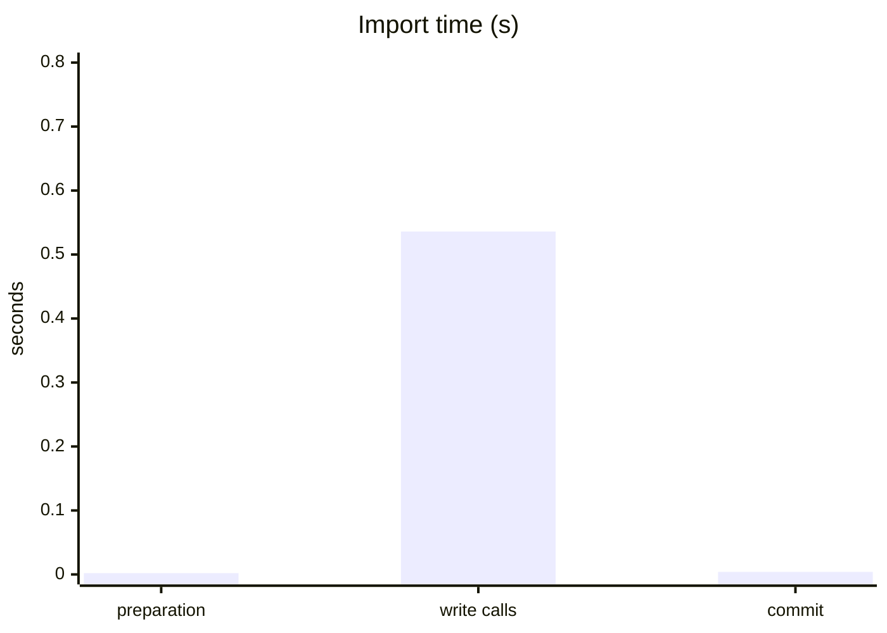
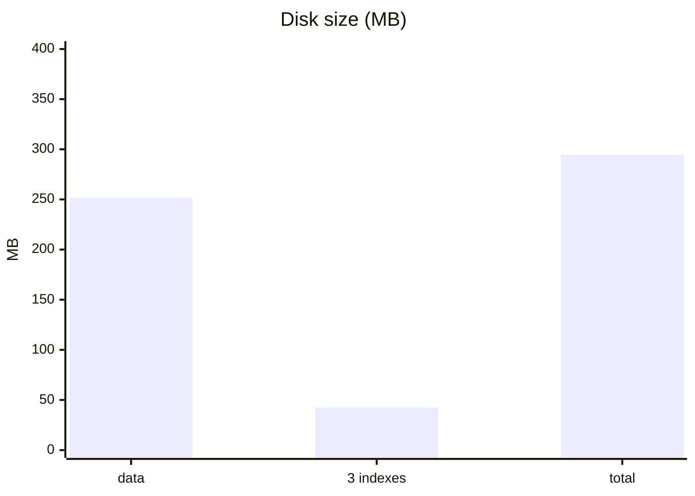
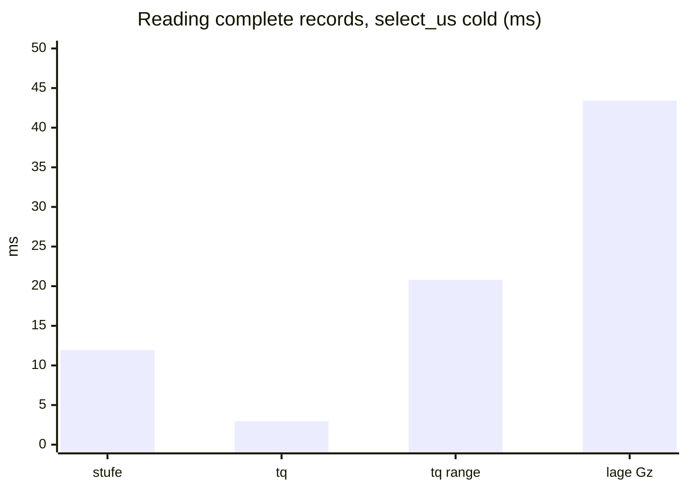

# NHyDB KQ-10M benchmark – NHyDB 0.28.2

**Result: VALID**  
Date: 2026-11-12 13:08:00 +0100 · benchmark version 1.0.0

10,000,000 records with 11 integer fields each (the KQ data set: N, tp, tq, gp, sp, lage, dyn_u, dyn_v, stufe, station, stufenstation; lage is a 4-value enum). Three workloads: writing, building indexes and reading. Only NHyDB is measured.

## Environment

| | |
|---|---|
| Machine | MacBookPro18,2 |
| CPU | Apple M1 Max |
| CPU cores | 10 (8 performance + 2 efficiency) physical, 10 logical |
| Memory | 64.0 GiB |
| Operating system | macOS 27.0.1 (arm64) |
| Python / NumPy | CPython 3.14.5 / 2.5.4 |
| NHyDB | engine 0.28.2, file format 0.28.2 |
| Durability | durability='fsync' |
| Protocol | batches of 10,000 records via put_numpy_batch, one data commit after the last batch; writing and indexing: 3 runs each, every run in a fresh process with a new database; reading: one indexed database, 3 repetitions in separate processes; tables show means (min–max) |
| Test data | generated before the measurements and held in memory, so data generation is not part of any measured time |
| Note | MacBook Pro 16-inch (2021), internal SSD (APFS) |

## 1. Writing: importing 10 million records

| | NHyDB 0.28.2 |
|---|---:|
| Import time (preparation + write calls + commit) | 0.543 s (0.540–0.548) |
| Throughput, complete import | 18.42 M records/s (18.26–18.52) |
| Throughput, write calls only | 18.64 M records/s (18.48–18.77) |
| Write calls | 0.536 s (0.533–0.541) |
| Data commit (once, after 10 M records) | 0.004 s (0.004–0.005) |
| Database file after closing | 251.8 MB (25.18 bytes/record) |
| Peak process memory after import | 819 MiB |
| Additional process memory above the test-data baseline | 14 MiB (14–15) |

## 2. Building indexes

Three secondary indexes on `lage` (4 distinct values), `stufe` and `tq`, built over the same 10 M records with one `build_indexes` call.

| | NHyDB 0.28.2 |
|---|---:|
| Build time incl. commits | 4.335 s (4.331–4.338) |
| of which build_indexes call | 4.327 s (4.324–4.333) |
| Space added by the 3 indexes | 42.7 MB (+16.9 %) |
| Bytes per indexed reference | 1.39–1.48 |
| All files after indexing | 294.5 MB |
| Peak process memory after indexing | 1,044 MiB (1,043–1,044) |
| Additional process memory above the test-data baseline | 239 MiB (239–240) |

## 3. Reading

Five queries against the indexed database. **Cold** = first measured call on a freshly opened database handle, **warm** = the same call repeated on that handle. Cold is not a completely cold system: the operating system file cache is warm in both cases. `lage = Gz` hits are scattered (one record per ring), the two `tq` cases are contiguous ranges.

### Finding matching records (list of IDs, `find_u`)

| Query (hits) | cold | warm |
|---|---:|---:|
| `stufe = 100` (988) | 0.211 ms (0.203–0.218) | 0.022 ms (0.021–0.024) |
| `tq = 1000` (2,000) | 0.172 ms (0.163–0.179) | 0.038 ms (0.031–0.050) |
| `tq BETWEEN 3000 AND 3001` (12,002) | 0.530 ms (0.524–0.533) | 0.180 ms (0.178–0.182) |
| `lage = Gz` (3,162, scattered) | 0.140 ms (0.133–0.151) | 0.054 ms (0.048–0.060) |
| `lage = NL` (4,997,541) | 132.4 ms (131.6–133.4) | 65.08 ms (64.82–65.49) |

### Counting matches (`posting_count`)

| Query (hits) | cold | warm |
|---|---:|---:|
| `stufe = 100` (988) | 0.052 ms (0.050–0.054) | 0.003 ms (0.002–0.003) |
| `tq = 1000` (2,000) | 0.040 ms (0.036–0.046) | 0.001 ms |
| `tq BETWEEN 3000 AND 3001` (12,002) | 0.037 ms (0.035–0.040) | 0.001 ms |
| `lage = Gz` (3,162, scattered) | 0.015 ms (0.014–0.016) | 0.001 ms |
| `lage = NL` (4,997,541) | 0.017 ms (0.016–0.017) | 0.001 ms |

### Reading complete records (all 11 fields)

Times for reading the found records. The IDs were looked up beforehand on the same handle and are not included, so the index part of the handle is already loaded in the cold column.

| Query (hits) | `select_us` cold | `select_us` warm | `get` loop cold | `get` loop warm |
|---|---:|---:|---:|---:|
| `stufe = 100` (988) | 11.93 ms (11.83–12.13) | 1.97 ms (1.96–1.98) | 12.23 ms (11.53–13.41) | 2.53 ms (2.48–2.58) |
| `tq = 1000` (2,000) | 2.97 ms (2.93–3.01) | 3.34 ms (3.18–3.46) | 4.92 ms (4.68–5.14) | 4.96 ms (4.87–5.02) |
| `tq BETWEEN 3000 AND 3001` (12,002) | 20.79 ms (20.54–21.20) | 19.37 ms (19.20–19.47) | 28.87 ms (28.49–29.12) | 33.09 ms (32.35–33.87) |
| `lage = Gz` (3,162, scattered) | 43.42 ms (42.95–44.29) | 9.29 ms (9.14–9.39) | 45.99 ms (45.33–47.03) | 12.37 ms (12.29–12.50) |

### Search and read in a single call

| Query (hits) | `find` cold | `find` warm | `execute_numpy` cold | `execute_numpy` warm |
|---|---:|---:|---:|---:|
| `stufe = 100` (988) | 11.57 ms (11.31–11.98) | 2.42 ms (2.38–2.47) | 10.80 ms (10.52–11.10) | 1.58 ms (1.56–1.59) |
| `tq = 1000` (2,000) | 4.71 ms (4.59–4.84) | 4.69 ms (4.63–4.77) | 2.83 ms (2.73–2.95) | 2.51 ms (2.36–2.62) |
| `tq BETWEEN 3000 AND 3001` (12,002) | 29.66 ms (29.01–30.16) | 29.20 ms (28.86–29.80) | 16.22 ms (15.91–16.51) | 15.15 ms (14.78–15.46) |
| `lage = Gz` (3,162, scattered) | 46.53 ms (44.92–48.43) | 11.83 ms (11.51–12.16) | 41.49 ms (40.98–41.97) | 8.64 ms (8.39–8.88) |

### Contiguous ranges into NumPy (`find_u` + `read_numpy`)

| Query (hits) | cold | warm |
|---|---:|---:|
| `tq = 1000` (2,000) | 0.622 ms (0.569–0.690) | 0.360 ms (0.325–0.392) |
| `tq BETWEEN 3000 AND 3001` (12,002) | 2.47 ms (2.40–2.53) | 1.89 ms (1.87–1.92) |

Opening the database: 2.27 ms on average (84 handles).

## 4. Validation

- OK: all 11 steps finished without error
- OK: write (3 runs): deep verify, record count, all records compared with the test data, 1002 spot checks via get()
- OK: index (3 runs): verify, counts per lage value, exact hit lists, distinct values and references per index
- OK: read (3 repetitions): every result (IDs, counts, all field values) compared with the test data

## How to read these numbers

- One machine, one synthetic data set with integer fields. Other hardware, file systems or access patterns can lead to different results.
- All times are measured from Python with the regular NHyDB Python API.
- Background load, power saving, virus scanners and the storage device have a visible influence; repeat the run if a value looks unusual.

_Generated by the NHyDB KQ-10M benchmark 1.0.0._
