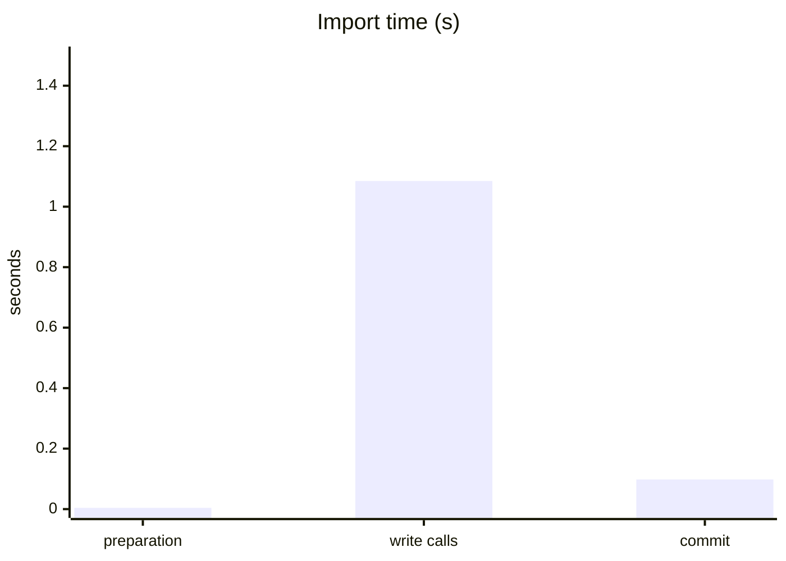
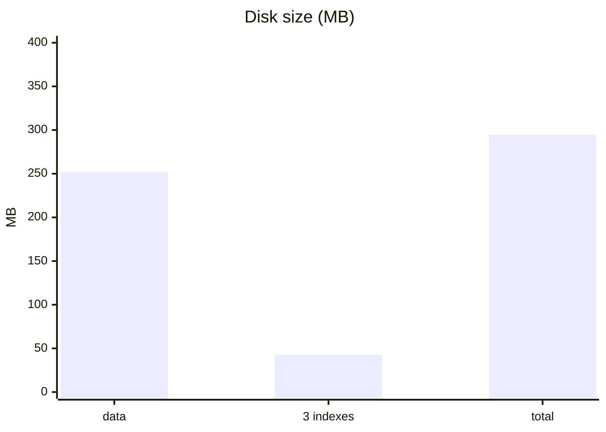
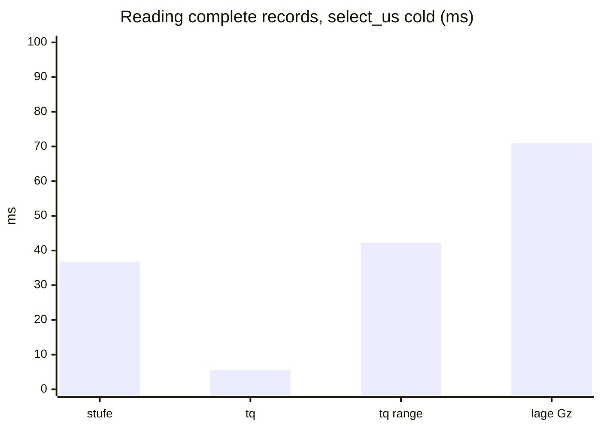

# NHyDB KQ-10M benchmark – NHyDB 0.28.2

**Result: VALID**  
Date: 2026-11-12 12:07:02 +0000 · benchmark version 1.0.0

10,000,000 records with 11 integer fields each (the KQ data set: N, tp, tq, gp, sp, lage, dyn_u, dyn_v, stufe, station, stufenstation; lage is a 4-value enum). Three workloads: writing, building indexes and reading. Only NHyDB is measured.

## Environment

| | |
|---|---|
| Machine | Microsoft Corporation Virtual Machine |
| CPU | Intel(R) Core(TM) i7-8850H CPU @ 2.60GHz |
| CPU cores | 4 physical, 8 logical |
| Memory | 23.5 GiB |
| Operating system | Ubuntu 24.04.5 LTS (kernel 6.8.0-149-generic) (x86_64) |
| Python / NumPy | CPython 3.14.5 / 2.5.4 |
| NHyDB | engine 0.28.2, file format 0.28.2 |
| Durability | durability='fsync' |
| Protocol | batches of 10,000 records via put_numpy_batch, one data commit after the last batch; writing and indexing: 3 runs each, every run in a fresh process with a new database; reading: one indexed database, 3 repetitions in separate processes; tables show means (min–max) |
| Test data | generated before the measurements and held in memory, so data generation is not part of any measured time |
| Note | Hyper-V VM (8 vCPU, 24 GiB) on Lenovo P52, virtual disk on NVMe SSD |

## 1. Writing: importing 10 million records

| | NHyDB 0.28.2 |
|---|---:|
| Import time (preparation + write calls + commit) | 1.188 s (1.153–1.209) |
| Throughput, complete import | 8.42 M records/s (8.27–8.68) |
| Throughput, write calls only | 9.22 M records/s (9.09–9.48) |
| Write calls | 1.085 s (1.055–1.100) |
| Data commit (once, after 10 M records) | 0.098 s (0.093–0.104) |
| Database file after closing | 251.8 MB (25.18 bytes/record) |
| Peak process memory after import | 820 MiB |
| Additional process memory above the test-data baseline | 14 MiB |

## 2. Building indexes

Three secondary indexes on `lage` (4 distinct values), `stufe` and `tq`, built over the same 10 M records with one `build_indexes` call.

| | NHyDB 0.28.2 |
|---|---:|
| Build time incl. commits | 6.539 s (6.531–6.553) |
| of which build_indexes call | 6.500 s (6.492–6.514) |
| Space added by the 3 indexes | 42.7 MB (+16.9 %) |
| Bytes per indexed reference | 1.39–1.48 |
| All files after indexing | 294.5 MB |
| Peak process memory after indexing | 986 MiB (986–987) |
| Additional process memory above the test-data baseline | 180 MiB |

## 3. Reading

Five queries against the indexed database. **Cold** = first measured call on a freshly opened database handle, **warm** = the same call repeated on that handle. Cold is not a completely cold system: the operating system file cache is warm in both cases. `lage = Gz` hits are scattered (one record per ring), the two `tq` cases are contiguous ranges.

### Finding matching records (list of IDs, `find_u`)

| Query (hits) | cold | warm |
|---|---:|---:|
| `stufe = 100` (988) | 0.372 ms (0.367–0.379) | 0.033 ms |
| `tq = 1000` (2,000) | 0.183 ms (0.178–0.190) | 0.038 ms (0.038–0.039) |
| `tq BETWEEN 3000 AND 3001` (12,002) | 0.673 ms (0.659–0.684) | 0.272 ms (0.260–0.282) |
| `lage = Gz` (3,162, scattered) | 0.148 ms (0.143–0.152) | 0.065 ms (0.061–0.071) |
| `lage = NL` (4,997,541) | 314.6 ms (304.0–327.5) | 207.2 ms (203.2–215.2) |

### Counting matches (`posting_count`)

| Query (hits) | cold | warm |
|---|---:|---:|
| `stufe = 100` (988) | 0.059 ms (0.054–0.068) | 0.003 ms (0.003–0.004) |
| `tq = 1000` (2,000) | 0.045 ms (0.041–0.052) | 0.002 ms (0.001–0.002) |
| `tq BETWEEN 3000 AND 3001` (12,002) | 0.042 ms | 0.002 ms |
| `lage = Gz` (3,162, scattered) | 0.017 ms (0.017–0.018) | 0.001 ms |
| `lage = NL` (4,997,541) | 0.018 ms (0.018–0.019) | 0.001 ms |

### Reading complete records (all 11 fields)

Times for reading the found records. The IDs were looked up beforehand on the same handle and are not included, so the index part of the handle is already loaded in the cold column.

| Query (hits) | `select_us` cold | `select_us` warm | `get` loop cold | `get` loop warm |
|---|---:|---:|---:|---:|
| `stufe = 100` (988) | 36.81 ms (36.78–36.86) | 4.03 ms (4.00–4.06) | 28.83 ms (28.77–28.91) | 4.12 ms (4.10–4.14) |
| `tq = 1000` (2,000) | 5.54 ms (5.52–5.58) | 7.13 ms (7.08–7.17) | 7.90 ms (7.87–7.93) | 8.79 ms (8.75–8.85) |
| `tq BETWEEN 3000 AND 3001` (12,002) | 42.26 ms (41.97–42.45) | 42.74 ms (42.56–42.95) | 53.05 ms (52.93–53.28) | 63.05 ms (62.60–63.53) |
| `lage = Gz` (3,162, scattered) | 70.94 ms (68.32–72.54) | 16.68 ms (16.64–16.75) | 77.16 ms (75.29–80.15) | 20.44 ms (20.36–20.59) |

### Search and read in a single call

| Query (hits) | `find` cold | `find` warm | `execute_numpy` cold | `execute_numpy` warm |
|---|---:|---:|---:|---:|
| `stufe = 100` (988) | 24.94 ms (22.89–28.84) | 4.28 ms (4.27–4.30) | 23.99 ms (21.38–27.19) | 2.70 ms (2.65–2.75) |
| `tq = 1000` (2,000) | 8.41 ms (8.40–8.44) | 9.17 ms (9.10–9.29) | 4.87 ms (4.83–4.91) | 4.67 ms (4.64–4.71) |
| `tq BETWEEN 3000 AND 3001` (12,002) | 55.92 ms (55.66–56.14) | 60.25 ms (59.92–60.53) | 34.88 ms (33.90–36.71) | 33.69 ms (33.05–34.28) |
| `lage = Gz` (3,162, scattered) | 76.95 ms (72.12–81.45) | 21.45 ms (21.41–21.50) | 91.88 ms (91.64–92.08) | 15.07 ms (15.05–15.10) |

### Contiguous ranges into NumPy (`find_u` + `read_numpy`)

| Query (hits) | cold | warm |
|---|---:|---:|
| `tq = 1000` (2,000) | 0.894 ms (0.888–0.898) | 0.610 ms (0.587–0.639) |
| `tq BETWEEN 3000 AND 3001` (12,002) | 4.04 ms (4.03–4.05) | 3.49 ms (3.48–3.51) |

Opening the database: 3.11 ms on average (84 handles).

## 4. Validation

- OK: all 11 steps finished without error
- OK: write (3 runs): deep verify, record count, all records compared with the test data, 1002 spot checks via get()
- OK: index (3 runs): verify, counts per lage value, exact hit lists, distinct values and references per index
- OK: read (3 repetitions): every result (IDs, counts, all field values) compared with the test data

## How to read these numbers

- One machine, one synthetic data set with integer fields. Other hardware, file systems or access patterns can lead to different results.
- All times are measured from Python with the regular NHyDB Python API.
- Background load, power saving, virus scanners and the storage device have a visible influence; repeat the run if a value looks unusual.

_Generated by the NHyDB KQ-10M benchmark 1.0.0._
