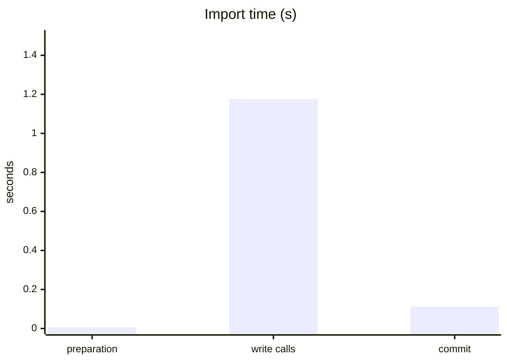
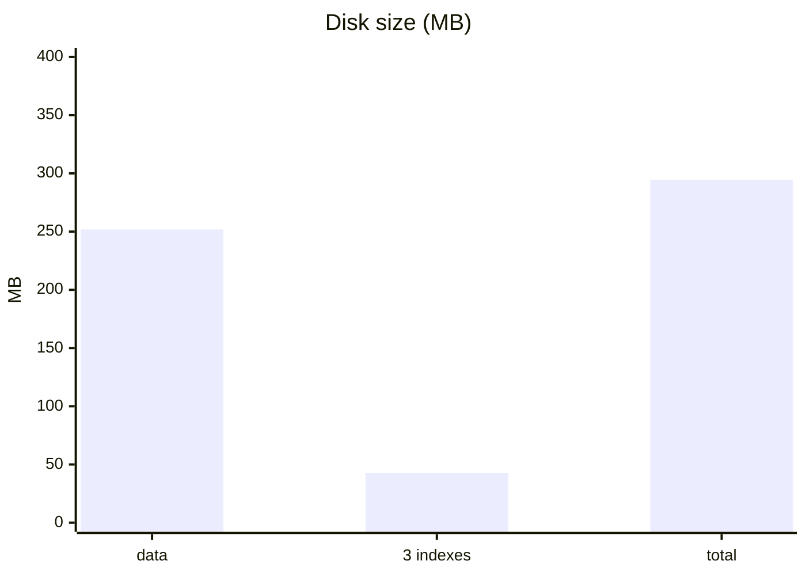
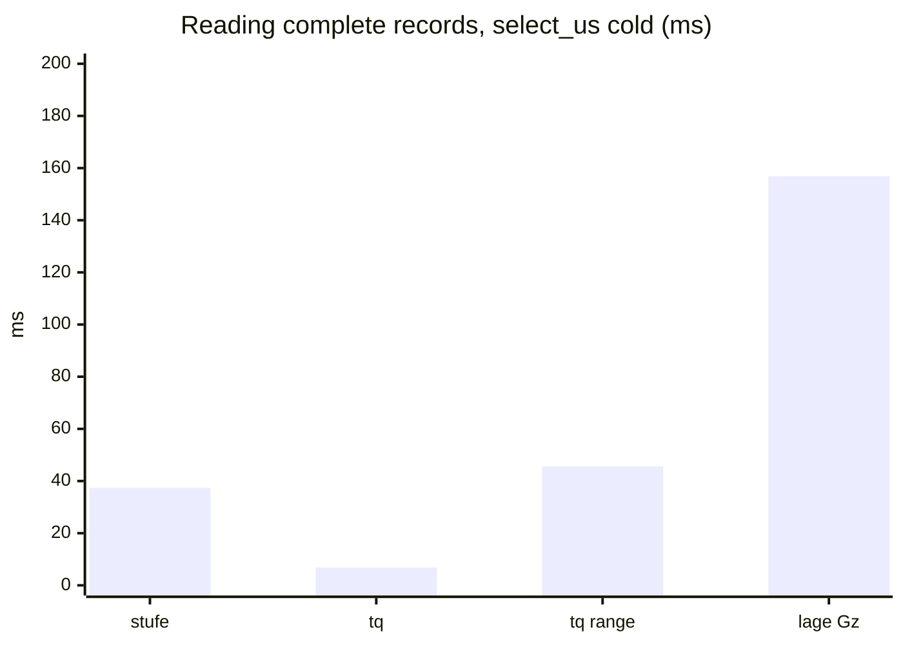

# NHyDB KQ-10M benchmark – NHyDB 0.28.2

**Result: VALID**  
Date: 2026-11-12 13:09:24 +0100 · benchmark version 1.0.0

10,000,000 records with 11 integer fields each (the KQ data set: N, tp, tq, gp, sp, lage, dyn_u, dyn_v, stufe, station, stufenstation; lage is a 4-value enum). Three workloads: writing, building indexes and reading. Only NHyDB is measured.

## Environment

| | |
|---|---|
| Machine | LENOVO 20M9001MGE ThinkPad P52 |
| CPU | Intel(R) Core(TM) i7-8850H CPU @ 2.60GHz |
| CPU cores | 12 logical |
| Memory | 63.7 GiB |
| Operating system | Windows 11 (build 10.0.26300) (AMD64) |
| Python / NumPy | CPython 3.14.5 / 2.5.4 |
| NHyDB | engine 0.28.2, file format 0.28.2 |
| Durability | durability='fsync' |
| Protocol | batches of 10,000 records via put_numpy_batch, one data commit after the last batch; writing and indexing: 3 runs each, every run in a fresh process with a new database; reading: one indexed database, 3 repetitions in separate processes; tables show means (min–max) |
| Test data | generated before the measurements and held in memory, so data generation is not part of any measured time |
| Note | Lenovo P52, Samsung SSD (drive E:) |

## 1. Writing: importing 10 million records

| | NHyDB 0.28.2 |
|---|---:|
| Import time (preparation + write calls + commit) | 1.295 s (1.275–1.311) |
| Throughput, complete import | 7.72 M records/s (7.63–7.84) |
| Throughput, write calls only | 8.50 M records/s (8.39–8.64) |
| Write calls | 1.177 s (1.158–1.192) |
| Data commit (once, after 10 M records) | 0.112 s (0.111–0.114) |
| Database file after closing | 251.8 MB (25.18 bytes/record) |
| Peak process memory after import | 815 MiB |
| Additional process memory above the test-data baseline | 13 MiB |

## 2. Building indexes

Three secondary indexes on `lage` (4 distinct values), `stufe` and `tq`, built over the same 10 M records with one `build_indexes` call.

| | NHyDB 0.28.2 |
|---|---:|
| Build time incl. commits | 7.077 s (7.075–7.081) |
| of which build_indexes call | 7.045 s (7.043–7.048) |
| Space added by the 3 indexes | 42.8 MB (+17.0 %) |
| Bytes per indexed reference | 1.39–1.49 |
| All files after indexing | 294.6 MB |
| Peak process memory after indexing | 973 MiB (972–974) |
| Additional process memory above the test-data baseline | 171 MiB (170–172) |

## 3. Reading

Five queries against the indexed database. **Cold** = first measured call on a freshly opened database handle, **warm** = the same call repeated on that handle. Cold is not a completely cold system: the operating system file cache is warm in both cases. `lage = Gz` hits are scattered (one record per ring), the two `tq` cases are contiguous ranges.

### Finding matching records (list of IDs, `find_u`)

| Query (hits) | cold | warm |
|---|---:|---:|
| `stufe = 100` (988) | 0.467 ms (0.450–0.483) | 0.053 ms (0.050–0.056) |
| `tq = 1000` (2,000) | 0.423 ms (0.407–0.438) | 0.067 ms (0.061–0.073) |
| `tq BETWEEN 3000 AND 3001` (12,002) | 1.24 ms (1.21–1.29) | 0.327 ms (0.305–0.353) |
| `lage = Gz` (3,162, scattered) | 0.342 ms (0.277–0.451) | 0.165 ms (0.144–0.181) |
| `lage = NL` (4,997,541) | 312.9 ms (311.1–315.3) | 226.0 ms (225.4–226.7) |

### Counting matches (`posting_count`)

| Query (hits) | cold | warm |
|---|---:|---:|
| `stufe = 100` (988) | 0.113 ms (0.108–0.120) | 0.004 ms |
| `tq = 1000` (2,000) | 0.059 ms (0.054–0.065) | 0.002 ms |
| `tq BETWEEN 3000 AND 3001` (12,002) | 0.059 ms (0.057–0.061) | 0.002 ms |
| `lage = Gz` (3,162, scattered) | 0.024 ms (0.021–0.029) | 0.002 ms |
| `lage = NL` (4,997,541) | 0.029 ms (0.027–0.030) | 0.002 ms |

### Reading complete records (all 11 fields)

Times for reading the found records. The IDs were looked up beforehand on the same handle and are not included, so the index part of the handle is already loaded in the cold column.

| Query (hits) | `select_us` cold | `select_us` warm | `get` loop cold | `get` loop warm |
|---|---:|---:|---:|---:|
| `stufe = 100` (988) | 37.37 ms (35.56–39.24) | 6.06 ms (4.54–9.09) | 38.10 ms (37.49–38.89) | 5.88 ms (5.83–5.94) |
| `tq = 1000` (2,000) | 6.84 ms (6.75–6.92) | 7.99 ms (7.88–8.18) | 10.68 ms (10.60–10.79) | 11.31 ms (11.18–11.51) |
| `tq BETWEEN 3000 AND 3001` (12,002) | 45.58 ms (45.23–45.82) | 47.35 ms (47.07–47.82) | 68.86 ms (68.23–69.79) | 77.25 ms (76.66–78.41) |
| `lage = Gz` (3,162, scattered) | 156.9 ms (155.7–159.2) | 34.48 ms (34.33–34.62) | 167.8 ms (166.8–168.4) | 42.89 ms (42.84–42.95) |

### Search and read in a single call

| Query (hits) | `find` cold | `find` warm | `execute_numpy` cold | `execute_numpy` warm |
|---|---:|---:|---:|---:|
| `stufe = 100` (988) | 37.45 ms (36.84–38.19) | 5.43 ms (5.32–5.65) | 35.44 ms (35.38–35.47) | 3.05 ms (2.99–3.10) |
| `tq = 1000` (2,000) | 11.03 ms (10.96–11.16) | 12.89 ms (12.83–13.00) | 7.16 ms (7.08–7.20) | 6.59 ms (6.42–6.75) |
| `tq BETWEEN 3000 AND 3001` (12,002) | 68.26 ms (67.81–68.95) | 71.43 ms (70.90–71.85) | 43.43 ms (42.40–44.12) | 42.17 ms (41.50–43.25) |
| `lage = Gz` (3,162, scattered) | 166.2 ms (164.7–167.4) | 41.64 ms (41.45–41.76) | 159.6 ms (157.1–161.2) | 33.96 ms (33.72–34.27) |

### Contiguous ranges into NumPy (`find_u` + `read_numpy`)

| Query (hits) | cold | warm |
|---|---:|---:|
| `tq = 1000` (2,000) | 1.41 ms (1.36–1.48) | 0.831 ms (0.802–0.852) |
| `tq BETWEEN 3000 AND 3001` (12,002) | 6.19 ms (6.00–6.32) | 4.91 ms (4.84–4.98) |

Opening the database: 9.31 ms on average (84 handles).

## 4. Validation

- OK: all 11 steps finished without error
- OK: write (3 runs): deep verify, record count, all records compared with the test data, 1002 spot checks via get()
- OK: index (3 runs): verify, counts per lage value, exact hit lists, distinct values and references per index
- OK: read (3 repetitions): every result (IDs, counts, all field values) compared with the test data

## How to read these numbers

- One machine, one synthetic data set with integer fields. Other hardware, file systems or access patterns can lead to different results.
- All times are measured from Python with the regular NHyDB Python API.
- Background load, power saving, virus scanners and the storage device have a visible influence; repeat the run if a value looks unusual.

_Generated by the NHyDB KQ-10M benchmark 1.0.0._
