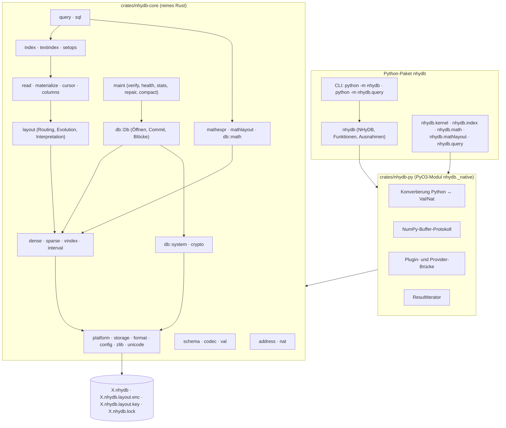
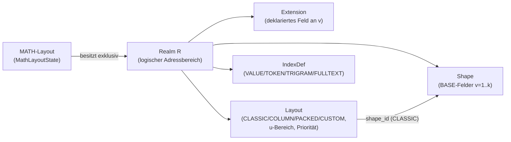
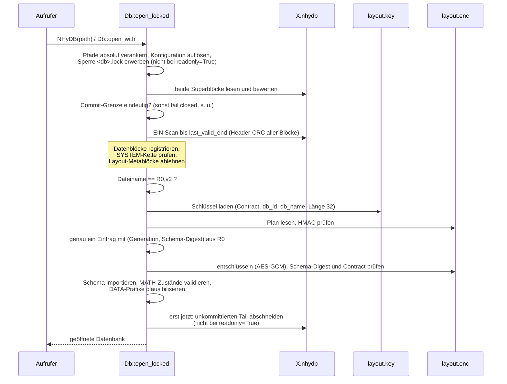
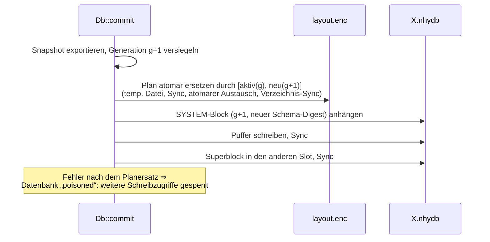
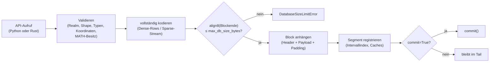
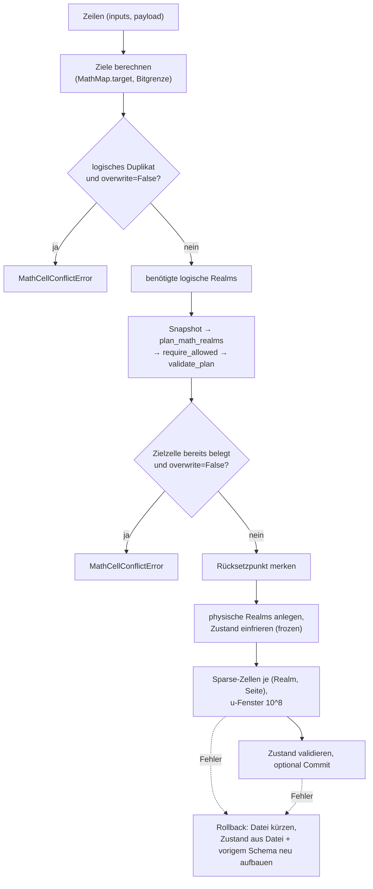
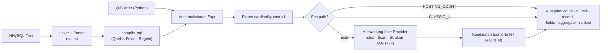

# NHyDB 0.28.0 – Technische Dokumentation

| Metadatum | Wert |
|---|---|
| Dokument | Technische Referenzdokumentation NHyDB 0.28.0 (native Rust-Engine mit Python-Anbindung) |
| Sprache | Deutsch |
| Dokumentstand | 2026-10-21 – Release 0.28.0 (Änderungen gegenüber 0.27.1: `CHANGELOG.md`) |
| Produkt | NHyDB 0.28.0, Python-Paket `nhydb` |
| Engine-Version (`ENGINE_VERSION`) | `0.28.0` |
| Dateikennung | `NHYDB016` (Formatrevision 16, `FILE_FORMAT_VERSION = "0.16"`) – interne Kennung des Dateiformats; sie ändert sich nur, wenn sich das Format auf dem Datenträger ändert, und ist unabhängig von der Produktversion. Datenbanken von NHyDB 0.27.1 oder älter öffnen mit 0.28.0 nicht (Schema-Digest mit Schlüssel, Abschnitt 7) |
| Plattformen | macOS, Linux, Windows |
| Lizenz | NHyDB / dNHyDB Experimental Software License 1.0, siehe Datei `LICENSE.md` (quelloffen einsehbar, keine Open-Source-Lizenz; keine produktive Nutzung) |
| Kontakt | achim.meissner@nhydb.de |

---

## Inhaltsverzeichnis

1. [Zielsetzung und Einordnung](#1-zielsetzung-und-einordnung)
2. [Mathematische Grundlagen der Adressierung](#2-mathematische-grundlagen-der-adressierung)
3. [Umsetzung der Mathematik im Rust-Kern](#3-umsetzung-der-mathematik-im-rust-kern)
4. [Architektur und Komponenten](#4-architektur-und-komponenten)
5. [Datenmodell: Realms, Shapes, Extensions, Layouts](#5-datenmodell-realms-shapes-extensions-layouts)
6. [Datentypen und Wertkodierung](#6-datentypen-und-wertkodierung)
7. [Speicherorganisation und Dateiformat 0.16](#7-speicherorganisation-und-dateiformat-016)
8. [Systemadressraum R0,u1 und externer Layoutplan](#8-systemadressraum-r0u1-und-externer-layoutplan)
9. [Schreib- und Lesepfade, Commit und Persistenz](#9-schreib--und-lesepfade-commit-und-persistenz)
10. [Layouts, Routing und Layout-Evolution](#10-layouts-routing-und-layout-evolution)
11. [Geometrisches GET: Zelle, Record, Auto](#11-geometrisches-get-zelle-record-auto)
12. [Sekundärindizes und Volltextsuche](#12-sekundärindizes-und-volltextsuche)
13. [MATH_MAP: mathematische Belegung](#13-math_map-mathematische-belegung)
14. [Abfragesysteme: QueryEngine und NHySQL-0.24](#14-abfragesysteme-queryengine-und-nhysql-024)
15. [Integrität, Recovery und Sicherheitsmechanismen](#15-integrität-recovery-und-sicherheitsmechanismen)
16. [Python-Schnittstelle (PyO3) und NumPy](#16-python-schnittstelle-pyo3-und-numpy)
17. [Konfiguration, Installation, Build und Betrieb](#17-konfiguration-installation-build-und-betrieb)
18. [Tests, Validierung und Benchmarks](#18-tests-validierung-und-benchmarks)
19. [Bekannte Einschränkungen](#19-bekannte-einschränkungen)
20. [Anhang: Referenzen im Quellcode](#20-anhang-referenzen-im-quellcode)

---

## 1. Zielsetzung und Einordnung

### 1.1 Was NHyDB ist

NHyDB ist eine eingebettete, dateibasierte Datenbank-Engine, deren Adressraum
nicht durch Tabellenzeilen oder Schlüssel, sondern durch eine **arithmetische
Zellgeometrie** definiert ist. Jede speicherbare Zelle besitzt die strukturelle
Identität

```text
(R, u, v, lane)      R = Realm, u = erste Koordinate, v = lokale zweite Koordinate,
                     lane ∈ {NL, NR} (Spur/Seite)
```

Aus dieser Viererkoordinate lässt sich jederzeit eine eindeutige natürliche
Zahl `N` berechnen – und umgekehrt. `N` ist eine **abgeleitete externe
Referenz**, kein gespeicherter Schlüssel.

Die vorliegende Implementierung ist eine **native Rust-Engine** mit
Python-Anbindung über PyO3.

### 1.2 Funktionsumfang (Überblick)

| Bereich | Inhalt |
|---|---|
| Adressmathematik | exakte Abbildung `(R,u,v,lane) ↔ N` mit beliebig großen Ganzzahlen; Ausschluss von GZ- und N0-Zahlen |
| Speicherkern | Dense-BASE-Records, Sparse-Zellen, zwei Lanes, Tombstones und Null-Werte als getrennte Zustände |
| Logische Interpretation | Layouts CLASSIC, COLUMN, PACKED, CUSTOM; Mixed-Realm-Routing; sichere Layout-Evolution |
| Lesen | `get`, `get_cell`, Objekt-APIs, geometrisches GET (`cell`/`record`/`auto`), DESCRIBE, Belegungsabfragen |
| Persistenz | Append-only-Container, alternierende Superblöcke, Commit-Grenze, Tail-Recovery (nie auf Kosten committeter Daten), Durability `fsync`/`full`, Lesemodus `readonly=True` |
| Sicherheit | Systemadressraum R0,u1, verschlüsselter externer Layoutplan (AES-256-GCM, HMAC-SHA256), fail-closed Öffnen, Schreibsperre, DB-Größengrenze |
| Indizes | VALUE, TOKEN, TRIGRAM, FULLTEXT (Positionen, BM25) |
| MATH_MAP | sichere Ausdruckssprache, Abbildung von Eingabetupeln auf Zellen, Realmplaner, exklusive MATH-Realms |
| Abfragen | QueryEngine (Kostenplaner, Provider, Aggregation, Ranking) und NHySQL-0.24 (lesendes `SELECT`) |
| Wartung | Checkpoint, Verify, Health, Stats, Repair, Kompaktierung (in-place und Export), Wiederherstellung von Sicherungen |
| Python | Python-API (Einzeloperationen) und NumPy-Batch-API |

### 1.3 Abgrenzung

NHyDB ist **kein** relationales Datenbanksystem, **kein** Server und
**kein** Mehrprozess-Transaktionssystem. Es gibt genau einen schreibenden
Prozess je Datenbank (abgesichert durch eine Sperrdatei), keine
Netzwerkschnittstelle und keine Transaktions-API mit `BEGIN`; `rollback()`
verwirft lediglich die unkommittierten Änderungen eines Objekts
(Abschnitt 9.7). NHySQL ist eine lesende Abfragesprache; Schreibzugriffe
erfolgen ausschließlich über die API.

---

## 2. Mathematische Grundlagen der Adressierung

Dieser Abschnitt beschränkt sich auf die Mathematik, die im
Quellcode **tatsächlich implementiert** ist. Jede Formel ist einer
Rust-Funktion zugeordnet; die Rechenbeispiele wurden mit der Engine
nachgerechnet (Python-Aufrufe in das native Modul) bzw. sind Testfälle aus
`crates/nhydb-core/src/address.rs` und `tests/python/test_math.py`. Wie die
Formeln im Kern umgesetzt sind (Datentypen, Rechenpfade), beschreibt
Abschnitt 3.

### 2.1 Größen und Wertebereiche

| Symbol | Bedeutung | Wertebereich (im Code geprüft) | Rust-Bezeichner |
|---|---|---|---|
| `R` | Realm-Nummer | ganze Zahl `R ≥ 1`, sonst `ValueError("realm_id must be > 0")` | `realm`, `realm_id` |
| `u` | erste Koordinate | `u ≥ 1`, sonst `ValueError("u must be > 0")` | `u` |
| `v` | **lokale** zweite Koordinate | `1 ≤ v ≤ T`; `v = 0` ⇒ `RealmLimitError("local v must start at 1")`, `v > T` ⇒ `RealmLimitError("Realm R: local v limit reached …")` | `v_local`, `local_v` |
| `lane` | Spur | genau `0` (NL) oder `1` (NR) | `Lane = u8`, `NL = 0`, `NR = 1` |
| `T` | Realm-Spannweite | Konstante `10^100` | `realm_span()` |
| `V` | globale zweite Koordinate | `V ≥ 1` | `vg`, Feld `v` der Adress-Dicts |
| `G` | Gruppe | `G = u + V ≥ 2` | `g` |
| `N` | kanonische Zellzahl | `N ≥ 3`; GZ- und N0-Zahlen ausgeschlossen | `n` |

Alle Größen sind **unbeschränkte** natürliche Zahlen. Es gibt keine
Fließkommarechnung und keine Begrenzung auf 64 Bit für mathematische
Koordinaten (zu Grenzen durch Ressourcen und Konfiguration siehe Abschnitt 3.6).

> **Namensfalle `v`:** Funktionen erhalten das *lokale* `v`. In den
> Ergebnis-Dicts von `dynadron_address`, `cell_address` und
> `n_to_dynadron_address` steht unter `"v"` das *globale* `V`, das lokale unter
> `"v_local"`.

### 2.2 Spurnormalisierung (`normalize_lane_str`, `normalize_lane_int`)

| Eingabe | Ergebnis |
|---|---|
| `0`, `"0"`, `"NL"`, `"L"`, `"DEFAULT"` (Groß-/Kleinschreibung egal, Leerraum entfernt), `None` | `0` (NL) |
| `1`, `"1"`, `"NR"`, `"R"` | `1` (NR) |
| sonst | `ValueError("lane must be 0/NL or 1/NR")` bzw. `"lane must be 0 or 1"` |

Im Blockheader wird die Spur als Bit 0 der Flags gespeichert:
`flags = 1` für NR, `0` für NL (`lane_flags`, `lane_from_flags = flags & 1`).

### 2.3 Realm und globale Koordinate

Vorwärts (`global_v`):

```text
V = (R − 1)·T + v            (für R = 1 direkt V = v)
```

Rückwärts (`split_global_v`):

```text
R = ⌊(V − 1) / T⌋ + 1
v = ((V − 1) mod T) + 1
```

Realmgrenzen (`realm_v_bounds`, API `realm_bounds`):

```text
V_min(R) = (R − 1)·T + 1,   V_max(R) = R·T
```

**Rechenbeispiele (mit der Engine geprüft):**

| Aufruf | Ergebnis |
|---|---|
| `split_global_v(T)` | `(R = 1, v = T)` |
| `split_global_v(T + 1)` | `(R = 2, v = 1)` |
| `global_v(2, 1)` | `T + 1` |
| `realm_v_bounds(2)` | `(T + 1, 2T)` |

`V = T` ist die letzte Zelle von Realm 1, `V = T + 1` die erste von Realm 2.
Für jede Kombination `(R, u, lane)` beginnt das lokale `v` wieder bei 1.

### 2.4 Gruppe und Vorwärtsabbildung auf N (`n_pair`, `dynadron_n`)

```text
G = u + V

lane = NL (0):   N = G² − u
lane = NR (1):   N = G² + V
```

Eigenschaften, die direkt aus den Formeln folgen und in den Tests geprüft
werden:

* Wegen `1 ≤ u ≤ G − 1` liegt `N_NL` in `[G² − G + 1, G² − 1]`, wegen
  `1 ≤ V ≤ G − 1` liegt `N_NR` in `[G² + 1, G² + G − 1]`.
* Dieselbe Strukturkombination `(R, u, v)` ergibt zwei verschiedene Zellen
  (NL und NR); beide sind unabhängig voneinander speicherbar.

**Rechenbeispiele:**

| `(R, u, v, lane)` | `V` | `G` | Rechnung | `N` |
|---|---|---|---|---:|
| `(1, 1, 1, NL)` | 1 | 2 | `4 − 1` | 3 |
| `(1, 1, 1, NR)` | 1 | 2 | `4 + 1` | 5 |
| `(1, 2, 1, NL)` | 1 | 3 | `9 − 2` | 7 |
| `(1, 1, 2, NL)` | 2 | 3 | `9 − 1` | 8 |
| `(1, 2, 1, NR)` | 1 | 3 | `9 + 1` | 10 |
| `(1, 1, 2, NR)` | 2 | 3 | `9 + 2` | 11 |
| `(1, 5, 2, NL)` | 2 | 7 | `49 − 5` | 44 |
| `(1, 3, 5, NL)` / `NR` | 5 | 8 | `64 − 3` / `64 + 5` | 61 / 69 |
| `(1, 11, 13, NL)` / `NR` | 13 | 24 | `576 − 11` / `576 + 13` | 565 / 589 |
| `(23, 14, 744, NL)` | `22·T + 744` | `22·T + 758` | `G² − 14` | 203 Dezimalstellen |
| `(2, 3, 5, NR)` | `T + 5` | `T + 8` | `G² + T + 5` | 201 Dezimalstellen |

### 2.5 Ausgeschlossene Zahlen GZ und N0

Für jede Gruppe `G ≥ 2`:

```text
N0(G) = G·(G − 1)        Gruppengrenze, keine Zelle
GZ(G) = G²               Quadratzentrum, keine Zelle
NL-Zellen:  N0(G)+1 … GZ(G)−1        (G − 1 Zahlen)
NR-Zellen:  GZ(G)+1 … N0(G+1)−1      (G − 1 Zahlen),  N0(G+1) = G·(G+1)
```

Damit zerfällt jedes Intervall `[G(G−1), (G+1)G)` in genau
`N0(G)`, `G−1` NL-Zellen, `GZ(G)`, `G−1` NR-Zellen. Jede positive ganze Zahl
ist entweder genau eine Zelle oder genau eine der beiden Grenzarten (für
`N = 1, 2` gilt: `1 = GZ(1)`, `2 = N0(2)`; der Kerntest prüft alle Zahlen von
1 bis 199 999 auf diese Zerlegung).

Beispiel `G = 24`: `552 = N0(24)`, NL-Zellen `553 … 575`, `576 = GZ(24)`,
NR-Zellen `577 … 599`, `600 = N0(25)`.

### 2.6 Rückwärtsabbildung N → (R, u, v, lane) (`n_to_address`)

Algorithmus (nur ganzzahlige Operationen):

```text
Eingabe N ≥ 1 (N = 0 ⇒ ValueError "N must be > 0")
m = isqrt(N)                 größtes m mit m² ≤ N
d = N − m²                   es gilt 0 ≤ d ≤ 2m

d = 0          ⇒ GZ(m):   AddressError "N… is a GZ point, not an NHyDB storage cell"
1 ≤ d < m      ⇒ NR:      G = m,     V = d,          u = m − d
d = m          ⇒ N0(m+1): AddressError "N… is an N0 point, not an NHyDB storage cell"
m < d ≤ 2m     ⇒ NL:      G = m + 1, u = G² − N,     V = G − u

(R, v) = split_global_v(V)
Kontrolle: cell_address(R, u, v, lane).N == N, sonst AddressError
           "N… could not be resolved unambiguously"
```

Begründung der Fallunterscheidung: Für NR-Zellen gilt `G² < N < G² + G`, also
`isqrt(N) = G` und `d = V ∈ [1, G−1]`. Für NL-Zellen gilt
`(G−1)² + (G−1) < N < G²`, also `isqrt(N) = G − 1 = m` und
`d = N − m² ∈ [m+1, 2m]`. `d = m` entspricht `N = m(m+1) = N0(m+1)`.

**Rechenbeispiele:**

| `N` | `m` | `d` | Fall | Ergebnis |
|---:|---:|---:|---|---|
| 589 | 24 | 13 | `1 ≤ 13 < 24` ⇒ NR | `G = 24, V = 13, u = 11` ⇒ `(1, 11, 13, NR)` |
| 391 | 19 | 30 | `30 > 19` ⇒ NL | `G = 20, u = 400 − 391 = 9, V = 11` ⇒ `(1, 9, 11, NL)` |
| 553 | 23 | 24 | `24 > 23` ⇒ NL | `G = 24, u = 23, V = 1` (erste NL-Zelle von G = 24) |
| 575 | 23 | 46 | `46 = 2m` ⇒ NL | `G = 24, u = 1, V = 23` (letzte NL-Zelle) |
| 576 | 24 | 0 | GZ | `AddressError` |
| 552 | 23 | 23 | `d = m` ⇒ N0 | `AddressError` |
| 600 | 24 | 24 | `d = m` ⇒ N0 | `AddressError` |
| 10 | 3 | 1 | NR | `G = 3, V = 1, u = 2` ⇒ `(1, 2, 1, NR)` |

Für `N = (22·T + 758)² − 14` liefert die Umkehrung `V = 22·T + 744` und über
`split_global_v` exakt `(R = 23, v = 744)`.

### 2.7 Zusätzliche Kennzahlen (`dynadron_address`)

`dynadron_address(R, u, v)` liefert neben `R, u, v_local, V, G, NL, NR`:

```text
station        = V − 1
stufenbreite   = u + 2
stufe          = ⌊station / stufenbreite⌋ + 1
stufenstation  = station mod stufenbreite
```

Beispiel `(1, 3, 5)`: `V = 5, G = 8, station = 4, stufenbreite = 5,
stufe = 1, stufenstation = 4, NL = 61, NR = 69`. Für `(2, 3, 5)` gilt
`station = T + 4`, `stufe = ⌊(T+4)/5⌋ + 1`, `stufenstation = (T+4) mod 5`.
Diese Werte gehören **nicht** zur Zellidentität und werden nie gespeichert;
sie werden bei Bedarf berechnet und erscheinen in Zellausgaben mit dem Präfix
`_dyn_…`: `get_cell` und `get_cell_n` liefern sie standardmäßig
(`dyn_address=True`, abschaltbar mit `dyn_address=False`), `get_math_cell`
nur mit `dyn_address=True`. Für Record-Lesezugriffe (`get`, `range`) gilt der
Modus `dyn_address="off"|"once"|"auto"` (mit `dyn_v` für `"once"`); sein
Standardwert wird mit `set_dyn_address_output(mode, v=…)` gesetzt
(Voreinstellung `"off"`).

### 2.8 N-Referenzen als Text (`parse_n_reference`)

Akzeptiert werden Dezimalzahlen mit optionalem führendem `N`/`n` und Leerraum
(`"N589"`, `" n 12 "`, `"123"`); Ausgabe von N-Referenzen als `"N<zahl>"`
(`N_ref`). Ungültiger Text ⇒ `AddressError("invalid N reference '…'")`,
`0` ⇒ `ValueError`.

### 2.9 Geometrie der Layouts (logische Abbildungen über der Zelladresse)

Layouts ordnen gültigen Zellen logische Records und Felder zu. Die folgenden
Abbildungen sind in `Db::logical_address_in` (Vorwärts) und
`Db::interpret_layout_address` (Rückwärts) implementiert; sie verändern die
Zellidentität nicht.

| Layout | Vorwärts: Objekt `o`, Feld `f` → Zelle | Rückwärts: Zelle `(R, u, v)` → Record | Anker |
|---|---|---|---|
| CLASSIC | `(R, u = o, v = v_f)`; ohne Feld `v = 1` | `record = u`, Feld = `v` | `v = 1` |
| COLUMN | `(R, u = u_f, v = o)`; ohne Feld `u = anchor_u` (Standard: kleinstes Feld-`u`) | `record = v`, Feld = `u` | `u = anchor_u` |
| PACKED (`u_p`, `span`) | `anchor = (o − 1)·span + 1`, `(R, u = u_p, v = anchor + offset_f)`; `anchor > T` oder `v > T` ⇒ `RealmLimitError` | `record = ⌊(v − 1)/span⌋ + 1`, `offset = (v − 1) mod span` | `offset = 0` |
| CUSTOM | Plugin `logical_address` | Plugin `describe` | Plugin |

Randbedingungen aus `create_layout`: PACKED `1 ≤ span ≤ T` (Standard `10^8`),
`0 ≤ offset < span`, `u_p` im u-Bereich des Layouts; COLUMN-Felder mit
eindeutigem `u` im u-Bereich.

**Kanonischer `record_N`** (`record_n_nat`): `N` der Ankerzelle des Records
auf derselben Spur, unabhängig davon, ob der Anker belegt ist.

**Rechenbeispiele (mit der Engine geprüft):**

| Layout | Anfrage | Rechnung | Ergebnis |
|---|---|---|---|
| CLASSIC, Realm 1 | `record_n_for_address(1, 4, 7)` | Anker `(1, 4, 1, NL)`: `G = 5`, `25 − 4` | `N21` |
| CLASSIC, Realm 1 | `get_n(44, mode="cell")` | `44 → (1, 5, 2, NL)`, Anker `(1, 5, 1)`: `G = 6`, `36 − 5` | `record_N = N31` |
| COLUMN, Realm 2, Felder `u = 3` (a), `u = 5` (b) | Objekt 9, Feld `b` | `(2, 5, 9, NL)`: `V = T + 9`, `G = T + 14`, `N = G² − 5` | `N = 10^200 + 28·10^100 + 191` |
| COLUMN, dto. | Anker Objekt 9 | `anchor_u = 3` ⇒ `(2, 3, 9)` | `u = 3, v = 9` |
| PACKED, Realm 3, `u = 2`, `span = 8` | Objekt 4, Feld mit `offset = 5` | `anchor = 3·8 + 1 = 25`, `v = 30` | `(3, 2, 30)` |
| PACKED, dto. | Interpretation von `v = 30` | `⌊29/8⌋ + 1 = 4`, `29 mod 8 = 5` | `record = 4, offset = 5, anchor = False` |

### 2.10 Routing-Mathematik (Gewinnerregel)

Für `(R, u)` werden alle Layouts des Realms mit `u_start ≤ u ≤ u_end`
(`u_end = None` = unbegrenzt) betrachtet. Sortierschlüssel
(`LayoutDef::sort_cmp`, größer gewinnt):

```text
(priority,  −width,  layout_id)
width = u_end − u_start      bzw. 10^200 für unbegrenzte Layouts
```

### 2.11 Mathematik der MATH_MAP-Schicht

MATH-Layouts (Abschnitt 13) berechnen aus Eingaben `(x1, …, xk)` ganzzahlige
Werte `u = f_u(x)`, `V = f_V(x)` und `side = f_side(x)` und zerlegen `V` mit
denselben Formeln wie Abschnitt 2.3, jedoch über `BigInt` mit wählbarer
Spannweite (`split_global_v(V, realm_span)`, `join_global_v(R, v, realm_span)`
in `mathexpr.rs`; in der Datenbank immer `T = 10^100`):

```text
Voraussetzungen:  u > 0, V > 0 (sonst MathDomainError), side ∈ {0, 1}
(R_log, v) = (⌊(V−1)/T⌋ + 1, ((V−1) mod T) + 1)        (div_mod_floor)
join:       V = (R_log − 1)·T + v      mit R_log ≥ 1, 1 ≤ v ≤ T
```

Beispiel: `u = x`, `V = x·10^100 + 7`, `side = NR`, Eingabe `x = 3` ⇒
`V = 3·T + 7` ⇒ `R_log = 4`, `v = 7`, `side = 1`; `join_global_v(4, 7) = 3·T + 7`.

Der logische Realm wird über die RealmMap auf einen physischen Realm
abgebildet (`physical = physical_start + (R_log − logical_start)` je Extent);
gespeichert und adressiert wird die Zelle `(R_phys, u, v, side)`. Das `N`
einer MATH-Zelle ist daher `N(R_phys, u, v, side)`.

Drei Ebenen sind zu unterscheiden:

| Ebene | Bedeutung | Größe |
|---|---|---|
| logischer Realm `R_log` | Ergebnis der Zerlegung von `V`; Teil der Mathematik des Layouts | unbeschränkt (z. B. ≈ 10^5000 möglich) |
| physischer Realm `R_phys` | vom Realmplaner vergebene, dicht ab 1 belegte Realm-ID, unter der die Zelle gespeichert wird; die Zuordnung `R_log → R_phys` steht im verschlüsselten Layoutplan | klein (Anzahl belegter Realms) |
| `N` der gespeicherten Zelle | `N(R_phys, u, v, side)` | – |

Die riesige logische Realmnummer wird nie als Zellkoordinate gespeichert.
Das physische `N` einer MATH-Zelle stimmt nur dann mit dem „mathematischen“
`N(R_log, u, v, side)` überein, wenn `R_log` auf denselben physischen Realm
abgebildet wird (z. B. `R_log = 1 → R_phys = 1`). `get_math_cell` liefert
`_logical_realm` und `_V_global` zusätzlich zur physischen Adresse.

### 2.12 Abgeleitete Zahlenfolgen in der Abfrageschicht

* **Provider `n_sequence`** (`provider_n_sequence`): durchläuft
  `N = start, start+step, …, stop` (`step ≠ 0`), invertiert jede Zahl mit
  `n_to_address` und **überspringt** GZ-/N0-Zahlen (mit `strict=True`
  stattdessen `AddressError`); mit Realm-Kontext werden nur Zellen dieses
  Realms übernommen.
  Beispiel `start = 550, stop = 560` in Realm 1: 552 (N0) entfällt, es
  bleiben 10 Zellen. In der Record-Domäne wird jede Zelle auf ihren
  `record_N` abgebildet, z. B. `554 → (1, 22, 2, NL) → Anker (1, 22, 1)`:
  `G = 23`, `529 − 22 = 507`; `550 → (1, 2, 21, NR) → Anker (1, 2, 1, NR)`:
  `9 + 1 = 10`. Ergebnis: `N5, N10, N273, N307, N343, N381, N421, N463, N507, N553`.
* **Provider `formula`** (`provider_formula`): kompiliert `u` und `V` (oder
  ein lokales `v`, das zu `V = (R−1)·T + v` ergänzt wird) als MATH-Ausdrücke
  über den Parameter `k = start … stop` und liefert
  `N(R_log, u, v, side)` – hier wird **keine** RealmMap angewandt.
* **Provider `math_layout_inputs`**: wendet MathMap und RealmMap eines
  MATH-Layouts an und liefert `N(R_phys, u, v, side)`.

### 2.13 Prinzip versus Implementierungsentscheidung

| Aussage | Art |
|---|---|
| Zellidentität `(R, u, v, lane)`; `N` ist abgeleitet | mathematisches Prinzip |
| Formeln für `V`, `G`, `N`, Ausschluss von GZ/N0, Umkehrung über `isqrt` | mathematisches Prinzip |
| `T = 10^100`, `NL = 0`, `NR = 1` | feste Systemkonstanten (R0,u1,v9), nicht konfigurierbar |
| Stationskennzahlen (`station`, `stufe` …) | berechnete Zusatzinformation, nicht Teil der Identität |
| Layoutgeometrien und Gewinnerregel | logische Interpretationsschicht |
| MATH: Eingaben → `(u, V, side)` → logischer → physischer Realm | Anwendungsschicht; die physische Realmzuordnung ist eine Implementierungsentscheidung (exklusive, frei geplante Realms) |
| strukturelle Blockkodierung, kein N-Index | Implementierungsentscheidung |
| `u64`/`u128`-Schnellpfade, `BigUint`-Ausweichpfad | Implementierungsentscheidung (Performance) |

> **Hinweis zu Nutzdaten:** Ein Schemafeld namens `N` (z. B. im
> Benchmarkprogramm `bench_native` oder im Beispiel in Abschnitt 16.9) ist ein
> gewöhnlicher Anwendungswert, nicht die Zelladresse.

---

## 3. Umsetzung der Mathematik im Rust-Kern

### 3.1 Der Zahltyp `Nat` (`nat.rs`)

```rust
pub enum Nat {
    S(u64),            // Werte 0 … u64::MAX direkt
    B(Box<BigUint>),   // ausschließlich Werte > u64::MAX
}
```

* **Invariante:** `B` enthält nur Werte `> u64::MAX`. Alle Konstruktoren
  (`From<u128>`, `From<BigUint>`, Arithmetik) normalisieren entsprechend.
  Deshalb sind die abgeleiteten `Eq`, `Ord`, `Hash` numerisch korrekt
  (`S(_) < B(_)` gilt immer).
* Operationen: `add`, `add_u64`, `checked_sub`, `sub_u64`, `mul`, `div_rem`,
  `pow10`, `parse_decimal`; jeweils mit `u64`-Schnellpfad und
  `BigUint`-Ausweichpfad.
* `T = 10^100` wird einmal als `Nat::pow10(100)` berechnet und in einem
  `OnceLock` gehalten (`realm_span()`); ebenso `10^200` als Breite
  unbegrenzter Layouts (`unbounded_width()`).

### 3.2 Rechenpfade der Adressfunktionen (`address.rs`)

| Funktion | Ablauf im Code |
|---|---|
| `require_positive(name, x)` | `x = 0` ⇒ `ValueError("<name> must be > 0")` (negative Python-Zahlen bildet die PyO3-Schicht auf 0 ab, damit derselbe Text entsteht) |
| `validate_local_v(v, R)` | `v = 0` ⇒ `RealmLimitError`; nur wenn `v` als `Nat::B` vorliegt, kann `v > T` gelten – dann `RealmLimitError` (Werte ≤ `u64::MAX` sind stets `< T`) |
| `global_v_unchecked(R, v)` | `R = 1` ⇒ `V = v` (keine Multiplikation), sonst `(R−1)·T + v` über `BigUint` |
| `split_global_v(V)` | `V` als `Nat::S` ⇒ sofort `(1, V)`; sonst `div_rem(V − 1, T)` |
| `n_pair(u, V)` | `G = u + V`; wenn `u`, `V` als `u64` vorliegen und `G < 2^63`: `G²` in `u128`, `N_NL = G² − u`, `N_NR = G² + V` in `u128`; sonst `BigUint` |
| `dynadron_address` | Validierung, `V`, `n_pair`, Kennzahlen über `div_rem` |
| `dynadron_n` | Validierung, `V`, `n_pair`, Auswahl nach `lane` |
| `isqrt(N)` | `Nat::S`: Startwert `⌊√N⌋` über `f64`, danach exakte Korrektur in `u128` (`while r² > N: r −= 1; while (r+1)² ≤ N: r += 1`); `Nat::B`: `BigUint::sqrt` |
| `n_to_address(N)` | Algorithmus 2.6, abschließende Kontrolle `cell_address(...).n == N` |

**Warum der `u128`-Pfad sicher ist:** Für `G < 2^63` gilt `G² < 2^126`, und
`G² + V < 2^126 + 2^63 < 2^128`; ein Überlauf ist ausgeschlossen. Für
`R ≥ 2` ist `V ≥ T + 1 > 2^64`, `V` ist also ein `Nat::B`, und der
`BigUint`-Pfad wird verwendet.

**Warum die Fließkomma-Startschätzung exakt wird:** Die Schätzung dient nur
als Startwert; die beiden Korrekturschleifen stellen `r² ≤ N < (r+1)²` in
exakter `u128`-Arithmetik her.

### 3.3 Durchgerechnete Beispiele durch den Rust-Core

**Beispiel A – `dynadron_n(1, 11, 13, NR)`:**

```text
require_positive(R=1), require_positive(u=11), validate_local_v(13)   ok
global_v_unchecked: R = 1  ⇒  V = 13                                 (Nat::S)
n_pair: u, V als u64, G = 24 < 2^63  ⇒  u128-Pfad
        G² = 576, NL = 576 − 11 = 565, NR = 576 + 13 = 589
Ergebnis (lane = NR): 589
```

**Beispiel B – `n_to_address(589)`:**

```text
isqrt(589): f64-Schätzung 24, Korrektur: 24² = 576 ≤ 589 < 625  ⇒  m = 24
d = 589 − 576 = 13;  1 ≤ 13 < 24  ⇒  NR, u = 24 − 13 = 11, V = 13
split_global_v(13): Nat::S  ⇒  (R = 1, v = 13)
Kontrolle: cell_address(1, 11, 13, NR).n = 589 = N   ⇒   (1, 11, 13, NR)
```

**Beispiel C – `dynadron_n(23, 14, 744, NL)`:**

```text
global_v_unchecked: R = 23  ⇒  V = 22·T + 744          (Nat::B, BigUint-Pfad)
n_pair: V ist Nat::B  ⇒  BigUint: G = 22·T + 758, N = G² − 14
N hat 203 Dezimalstellen
n_to_address(N): isqrt über BigUint::sqrt ⇒ m = 22·T + 757;
  d = N − m² = 2m + 1 − 14 = 2m − 13 > m  ⇒  NL, G = m + 1, u = G² − N = 14,
  V = G − 14 = 22·T + 744;  split_global_v(V) ⇒ (23, 744)
```

(Testfall `r23_u14_v744` in `address.rs`, zusätzlich NR-Rückrechnung.)

**Beispiel D – Grenzzahl `n_to_address(552)`:** `isqrt(552) = 23`,
`d = 552 − 529 = 23 = m` ⇒ `AddressError("N552 is an N0 point, not an NHyDB storage cell")`.

### 3.4 Physische Kodierung der Koordinaten

Koordinaten werden **strukturell** und blockweise kodiert, nie als
vollständige Tupel und nie als `N` je Zelle:

| Koordinate | Dense-Block (`DATA_DENSE`) | Sparse-Block (`SPARSE_CELLS`) |
|---|---|---|
| `R` | VarUInt im Präfix | VarUInt im Präfix |
| `lane` | Bit 0 der Blockflags | Bit 0 der Blockflags |
| `u` | `u_start` im Präfix; Record `i` hat `u = u_start + i` | `u_start`, `u_end` im Präfix; je Gruppe `Δu` (erste Gruppe `Δu = 0`) |
| `v` | implizit durch die Feldposition im Shape | je Zelle `Δv` zum Vorgänger (Start 0), streng aufsteigend |

Die Sparse-Zelle speichert `Δv` gemeinsam mit drei Flagbits als **eine**
VarUInt: `key = (Δv << 3) | flags` mit `flags = tomb | selbsttypisiert<<1 |
null<<2`. Für `Δv < 2^60` wird in `u64` gerechnet, sonst über `BigUint`.

Beispiel: Zellen `v = 2` und `v = 9` einer u-Gruppe, beide deklariert, nicht
null: Schlüssel `(2 << 3) | 0 = 16` und `((9 − 2) << 3) | 0 = 56`.

### 3.5 VarUInt und VarInt

```text
VarUInt:  n = Σ b_i·128^i, Byte i = b_i | 0x80 (außer letztem Byte)
VarInt:   z = 2n (n ≥ 0),  z = −2n − 1 (n < 0);  danach VarUInt(z)
          Rückabbildung: z gerade ⇒ n = z/2, z ungerade ⇒ n = −(z+1)/2
```

Mit der Engine geprüfte Kodierungen (`enc_vu`, `enc_vi`, hexadezimal):

| Wert | VarUInt | | Wert | VarInt |
|---:|---|---|---:|---|
| 0 | `00` | | 0 | `00` |
| 1 | `01` | | −1 | `01` |
| 127 | `7f` | | 1 | `02` |
| 128 | `8001` | | −3 | `05` |
| 300 | `ac02` | | 3 | `06` |
| 2^64 | `80808080808080808002` | | | |

Implementierung: `put_vu64` für `u64`, `put_vu_big` über
`BigUint::to_radix_le(128)`; `get_vu64` dekodiert bis 64 Bit in einem
`u128`-Akkumulator und fällt sonst auf `get_vu` (beliebige Größe) zurück.
`get_vu_u64` wird für physische Felder (Längen, Zähler, IDs) verwendet und
lehnt Werte > `u64::MAX` mit `CorruptionError("…: value too large")` ab.

### 3.6 Große Zahlen: BigInt-Fähigkeit und Grenzen

Adressierung, Speicherung und Wiederöffnen sind durchgängig für beliebig
große natürliche Zahlen ausgelegt: `R`, `u`, `V`, `N` sowie Werte der Typen
`varuint`/`varint` werden exakt übernommen (Python ↔ Rust binär über
`BigInt`, ohne Zwischenstrings), gespeichert und nach dem Wiederöffnen
gelesen. `get_vu` hat **keine feste Bitgrenze**; die Länge einer VarUInt ist
nur durch die verbleibenden Bytes des CRC-geprüften Block-Payloads begrenzt
(abgeschnittene Werte ⇒ `CorruptionError("VarUInt ends prematurely")`).
Allokationen werden mit `try_reserve` angefordert; fehlt Speicher, gibt es
einen sauberen `MemoryError` statt eines Absturzes. Getestet sind Koordinaten
und Werte mit 2^16 380, 2^16 400, 10^5 und 10^6 Bit über Einzel-API,
`put_points`, `create_realm`, Dense-Batches und MATH-Durchreichung,
jeweils mit Commit, Wiederöffnen, Lesen und `verify(deep=True)`
(`tests/python/test_stab_bigint.py`).

| Art | Grenze | Wirkungsbereich |
|---|---|---|
| Mathematisch (Dynadron) | `u, v, R ≥ 1`; GZ/N0 ausgeschlossen; `v_local ≤ 10^100` je Realm | Teil des Konzepts |
| Konfiguration | `realm_auto_limit` (**Anzahl** der logischen Realms eines MATH-Layouts, nicht deren Größe) | nur MATH-Layouts (Abschnitt 13.4) |
| | `math_max_intermediate_bits` | nur Rechenoperationen in Formeln (Abschnitt 13.2), nie durchgereichte Eingaben |
| | IDs (`shape_id`, `layout_id`, `index_id`, `default_shape_id`) ≤ 2^63 − 1 | nur Verwaltungs-IDs (`ValueError`) |
| Technisch | NumPy-Batch-APIs: Koordinaten-Arrays `uint64` | nur NumPy-Pfad; Einzel- und Listen-APIs sind unbeschränkt |
| | Python-Anzeige: `str(int)` mit mehr als 4 300 Dezimalstellen verboten | nur Ausgabe in Python (`print`, `json`, f-Strings) |
| Physisch | Arbeitsspeicher, Platte (`db_max_size_bytes`), Rechenzeit | eine Adressberechnung mit 10^6 Bit dauert ≈ 0,1 s |

**Anzeige sehr großer Zahlen in Python:** Seit Python 3.11 (auch in
Sicherheitsupdates älterer Versionen) lehnt
`str(int)` Zahlen mit mehr als 4 300 Dezimalstellen ab (`ValueError:
Exceeds the limit (4300 digits) for integer string conversion`). Das betrifft
nur die Darstellung, nicht NHyDB: Werte kommen als `int` zurück, und
Adress-Dicts enthalten zusätzlich `N_ref` als Text. Für die Ausgabe
`sys.set_int_max_str_digits(0)` setzen (0 = keine Grenze) oder mit
`int.bit_length()` arbeiten.

```python
import sys
sys.set_int_max_str_digits(0)      # nur für die Anzeige riesiger Zahlen
```

### 3.7 Feste Systemkonstanten je Datenbank

Jede neu angelegte Datenbank schreibt in R0,u1 die Zelle
`v9 = {"lane_NL": 0, "lane_NR": 1, "realm_span": 10**100}`. `check_record`
(`db/system.rs`) prüft beim Öffnen, dass v9 – falls vorhanden – exakt diesem
Wert entspricht und `realm_span` numerisch gleich `realm_span()` ist; sonst
`CorruptionError("R0,u1,v9: fixed system constants violated …")`. Fehlt v9, gilt
derselbe Wert.

### 3.8 Prüfung der Mathematik

| Test | Inhalt |
|---|---|
| `address.rs::examples_from_docs` | 589 → `(1,11,13,NR)`, NL-Partner 565, 391 → `(1,9,11,NL)`, Ablehnung von 552, 576, 600, 4; Randzellen 553/575 (NL) und 577/599 (NR) mit `G = 24`; `(1,1,1,NL) = 3` |
| `address.rs::r23_u14_v744` | Vorwärts = `(22·T+758)² − 14`, 203 Stellen, Rückrechnung NL und NR |
| `address.rs::realm_edges` | `split_global_v(T) = (1, T)`, `split_global_v(T+1) = (2, 1)`, Roundtrips für sehr große `R` und `u` auf beiden Spuren, `v`-Grenzen, Null-Koordinaten |
| `address.rs::exhaustive_small_range` | alle `N` in `[1, 200 000)`: entweder GZ/N0 oder exakt invertierbar; > 199 000 gültige Zellen |
| `address.rs::parse_refs` | Textformen von N-Referenzen |
| `nat.rs` (Unit-Tests) | VarUInt/VarInt inkl. `i64::MIN`, abgeschnittene Eingaben |
| `tests/python/test_math.py` | Ablehnung von GZ-/N0-Zahlen, Rechenbeispiel `(23, 14, 744)` |
| `crates/nhydb-core/tests/sparse_access.rs` | Sparse-Zugriff mit `u = 2^70` und `v ≥ 10^40` gegen ein unabhängiges Modell |

---

## 4. Architektur und Komponenten

### 4.1 Schichtenmodell



**Architekturentscheidung:** Der Kern `nhydb-core` hat keine
Python-Abhängigkeit und ist mit `cargo test -p nhydb-core` eigenständig
testbar. Adressmathematik, Kodierung, Routing und Commit liegen
ausschließlich im Kern; die PyO3-Schicht konvertiert nur Typen, gibt den GIL
für rein native Abschnitte frei (Abfragen, SQL, Batch-Schreiben, Commit,
Wartung) und überbrückt Python-Plugins und -Provider, die den GIL für ihren
Rückruf zurückholen. Lesende Aufrufe teilen sich ein `NHyDB`-Objekt
(mehrere Threads dürfen gleichzeitig abfragen); ein schreibender Aufruf
braucht das Objekt exklusiv, ein Konflikt wird sofort abgewiesen
(Abschnitt 16.7, „Threads“).

### 4.2 Module des Rust-Kerns

Zeilenzahlen: physische Zeilen der Quelldateien in NHyDB 0.27.0 (`wc -l`,
einschließlich Kommentaren und Unit-Tests); sie dienen nur der Orientierung.

| Modul | Zeilen | Aufgabe |
|---|---:|---|
| `lib.rs` | 50 | Crate-Wurzel, öffentliche Re-Exporte |
| `error.rs` | 155 | Fehlertyp `Error` (Abbildung auf die Python-Ausnahmen) |
| `nat.rs` | 458 | Zahltyp `Nat`, VarUInt/VarInt-Kodierung |
| `val.rs` | 927 | dynamischer Werttyp `Val` (None/Bool/Int/Big/Float/Str/Bytes/List/Map), Python-kompatibles JSON |
| `address.rs` | 411 | Adressmathematik (Abschnitt 3) |
| `codec.rs` | 479 | 15 Datentypen, `FieldDef`, Wert-Kodierung/-Dekodierung |
| `schema.rs` | 585 | `ShapeDef`, `RealmDef`, `ExtensionDef`, `LayoutDef`, `IndexDef` |
| `format.rs` | 217 | Superblock, Blockheader, Blocktypen, Konstanten |
| `storage.rs` | 147 | Append-Puffer, positionsbasiertes Lesen, Sync |
| `platform.rs` | 425 | OS-Schicht: Durability, Verzeichnis-Sync, atomarer Austausch, Sperren |
| `config.rs` | 242 | `nhydb_config.toml` |
| `crypto.rs` | 161 | AES-256-GCM, HMAC-SHA256, SHA-256, Base64, UUIDv4 |
| `unicode.rs` + `unicode_tables.rs` | 180 + 17 (generierte Tabellen, sehr lange Zeilen) | CPython-exakte Zeichenklassen und `casefold` (Unicode 16.0.0) |
| `zlib.rs` | 53 | zlib-Kompression der Postings |
| `plugin.rs` | 46 | Trait `LayoutPlugin` für CUSTOM-Layouts |
| `setops.rs` | 96 | sortierte Mengenoperationen (galoppierender Schnitt) |
| `textindex.rs` | 625 | Tokenizer, N-Gramme, FULLTEXT-Codecs, Phrase, BM25 |
| `mathexpr.rs` | 1 942 | MATH-Ausdruckssprache, `MathMap`, `MathMapLayoutSpec`, `dry_run` |
| `mathlayout.rs` | 546 | Realmplaner für MATH-Layouts |
| `query.rs` | 2 397 | QueryEngine: Ausdrucksbaum, Planer, Auswertung, Aggregation, Suche |
| `sql.rs` | 1 252 | NHySQL: Lexer, Parser, Compiler |
| `db/mod.rs` | 1 197 | `Db`: Zustand, Öffnen, Commit, Blöcke, Open-Scan |
| `db/system.rs` | 397 | R0,u1, Schlüssel-/Plan-Dateien, Schema-Snapshot |
| `db/schema_ops.rs` | 427 | Realms, Shapes, Extensions, Indexdefinitionen |
| `db/layout.rs` | 1 451 | Layouts, SpaceMaps, Routing, Evolution, logische Adressen |
| `db/dense.rs` | 620 | Dense-BASE-Records |
| `db/sparse.rs` | 555 | Sparse-Zellen |
| `db/vindex.rs` | 554 | v-Index je u-Gruppe (gezielter Sparse-Zugriff) |
| `db/interval.rs` | 152 | Intervallindex mit Präfixmaximum |
| `db/read.rs` | 828 | Lese-APIs, geometrisches GET |
| `db/materialize.rs` | 374 | Iteration materialisierter Zellen, `record_N` |
| `db/cursor.rs` | 330 | Lazy-Cursor für `range`, `select`, `find`, Sparse-Punkte |
| `db/columns.rs` | 489 | spaltenweises Schreiben/Lesen (NumPy-Pfade) |
| `db/index.rs` | 1 155 | Indexaufbau, Verzeichnisse, Kandidaten |
| `db/math.rs` | 553 | MATH-API im Kern, Rollback |
| `db/maint.rs` | 1 060 | Checkpoint, Verify, Health, Stats, Repair, Kompaktierung |
| `db/blockcache.rs` | neu in 0.28.0 (609) | Block-Cache (LRU), „verified“-Register, Teil-Lesen geprüfter Blöcke, Cache-Budgets (Abschnitt 9.8) |
| `db/batch.rs` | neu in 0.28.0 (116) | Prüfung einzelner Zellen für `batch()`, `rollback()` |

### 4.3 PyO3-Schicht `nhydb-py`

| Datei | Aufgabe |
|---|---|
| `lib.rs` | Klasse `NHyDB`, `LayoutDef`, `IndexDef`, Modulfunktionen, Registrierung |
| `conv.rs` | Konvertierung Python ↔ `Val`/`Nat` (beliebig große `int`) |
| `exceptions.rs` | Ausnahmehierarchie |
| `numpy_io.rs` | Buffer-Protokoll für NumPy-Arrays, Ausgabe ohne Kopie über `ColumnBuffer` und `numpy.frombuffer` |
| `batch.rs` | `WriteBatch` für `NHyDB.batch()` |
| `iter.rs` | `ResultIterator` (lazy, blockweise) |
| `pyplugin.rs` | Brücke für Python-CUSTOM-Plugins (Weak-Referenz auf das DB-Objekt) |
| `kernel.rs` | zustandslose Kernelfunktionen für `nhydb.kernel` |
| `textapi.rs` | Funktionen für `nhydb.index` |
| `mathapi.rs` | Klassen für `nhydb.math`/`nhydb.mathlayout`, MATH-Methoden |
| `queryapi.rs` | native `QueryEngine`, SQL, Provider-Brücke |

### 4.4 Externe Abhängigkeiten

Versionen laut `Cargo.lock` von NHyDB 0.28.0:

| Crate | Version | Verwendung |
|---|---|---|
| `num-bigint` / `num-integer` / `num-traits` | 0.4.8 / 0.1.47 / 0.2.19 | exakte Ganzzahlarithmetik |
| `crc32fast` | 1.5.2 | CRC32 für Superblöcke, Blockheader, Payloads |
| `miniz_oxide` | 0.8.9 | zlib-Dekompression; Kompression unter Windows |
| `aes-gcm` | 0.11.1 | AEAD-Verschlüsselung des Layoutplans |
| `sha2` | 0.11.1 | SHA-256 (Fingerprints, Schlüsselableitung für MAC und Schema-Digest) |
| `hmac` | 0.13.0 | HMAC-SHA256 über den Planumschlag und den Schema-Snapshot |
| `base64` | 0.23.1 | Kodierung von Schlüssel, Nonce und Ciphertext |
| `getrandom` | 0.4.3 | Zufallszahlen des Betriebssystems (Schlüssel, Nonces, UUID) |
| `toml` | 1.1.8 | Konfigurationsdatei |
| `libc` (nur Unix) | 0.2.190 | `fsync`, `fcntl(F_BARRIERFSYNC/F_FULLFSYNC)`, `O_NOFOLLOW`, `sysconf` (physischer Arbeitsspeicher), `localtime_r` |
| `windows-sys` (nur Windows) | 0.61.2 | `GlobalMemoryStatusEx` (physischer Arbeitsspeicher), `GetLocalTime`; Datei-Sync (`FlushFileBuffers`) und Umbenennen über die Standardbibliothek |
| `pyo3` (nur `nhydb-py`) | 0.29.3 | Python-Anbindung, Feature `num-bigint` |
| System-`libz` (Unix, per FFI) | – | zlib-Kompression bytegleich zu CPython |

Es wird keine eigene Kryptografie implementiert; JSON wird mit einem eigenen,
Python-kompatiblen Codec in `val.rs` erzeugt (kein `serde`).

### 4.5 Release-Profil

```toml
[profile.release]
opt-level = 3
lto = "fat"
codegen-units = 1
panic = "unwind"
```

---

## 5. Datenmodell: Realms, Shapes, Extensions, Layouts

### 5.1 Begriffsübersicht



| Objekt | Rust-Typ | Persistenz | Wichtige Felder |
|---|---|---|---|
| Realm | `RealmDef` | externer Layoutplan | `realm_id`, `name`, `description`, `default_shape_id`, `base_reserve_to` |
| Shape | `ShapeDef` | externer Layoutplan | `shape_id`, `realm_id`, `name`, `fields: Vec<FieldDef>` |
| Feld | `FieldDef` | Teil von Shape/Extension | `v`, `name`, `typ`, `enum_map`, `description` |
| Extension | `ExtensionDef` | externer Layoutplan | `realm_id`, `v`, `typ`, `name`, `enum_map` |
| Layout | `LayoutDef` | externer Layoutplan | `layout_id`, `realm_id`, `kind`, `u_start`, `u_end`, `priority`, `shape_id`, `params`, `spacemap`, `plugin` |
| Index | `IndexDef` | externer Layoutplan | `index_id`, `realm_id`, `name`, `kind`, `source_v`, `options` |
| MATH-Zustand | `MathLayoutState` | externer Layoutplan | Spezifikation, RealmMap, `payload_type`, `frozen` |

Alle Schemaobjekte liegen in Format 0.16 **nicht** in der Datenbankdatei,
sondern verschlüsselt im externen Layoutplan (Abschnitt 8). In der
Datenbankdatei stehen nur Daten-, Index-, Lösch-, Checkpoint-, Konfigurations-
und SYSTEM-Blöcke.

### 5.2 Dense und Sparse

* **Dense-BASE-Record:** ein zusammenhängender Datensatz an `(R, u, lane)` mit
  den Feldern eines Shapes in Feldreihenfolge (`v = 1 … k`). Er wird
  blockweise für zusammenhängende `u`-Bereiche geschrieben (`put_dense_batch`).
* **Sparse-Zelle:** eine einzelne Zelle `(R, u, v, lane)` mit Wert, Null oder
  Tombstone. Sparse-Zellen ergänzen oder überlagern Dense-Records
  (Extensions, Einzelwerte, COLUMN-/PACKED-/CUSTOM-Objekte, MATH-Zellen).

Drei Zustände sind streng getrennt:

| Zustand | Bedeutung | Kodierung |
|---|---|---|
| fehlend | Zelle wurde nie geschrieben | kein Eintrag |
| Null | Zelle existiert mit Wert `None` | Sparse-Flag `4` |
| Tombstone | Zelle wurde gelöscht | Sparse-Flag `1` |

Der jeweils **neueste** Zustand (höchste Block-ID) gewinnt.

**Löschen von Dense- und Sparse-Daten.** Die Löschbefehle wirken
unterschiedlich:

| Befehl | Wirkung |
|---|---|
| `delete(realm, u)` | `DELETE`-Block; verdeckt **nur den Dense-Record** an `(realm, u, lane)`, wie ihn `put`/`put_dense_batch` geschrieben haben. Sparse-Zellen derselben u-Gruppe bleiben bestehen – Einzelzellen auf BASE-Feldern (`put_cell`, `put_points`, `put_cells_numpy`, `batch().put_cell`), gleich ob vor oder nach dem `delete` geschrieben, sowie Extensions: Sie bleiben über `get_value`/`get_cell`, das geometrische GET, QueryEngine/NHySQL und Indizes sichtbar. `get`, `get_record`, `range` und `read_numpy` liefern den Record dagegen nicht mehr (kein Dense-Record). Rückgabe `True`, wenn ein Dense-Record vorhanden war, sonst `False` (dann wird nichts geschrieben) |
| `delete_record(layout_id, object_id)` | vollständiges Löschen eines logischen Records: CLASSIC – `DELETE`-Block für den Dense-Record und Tombstones für alle lebenden Sparse-Zellen der u-Gruppe (BASE-Einzelzellen und Extensions); COLUMN/PACKED/CUSTOM – Tombstones für alle belegten Zellen des Objekts. Rückgabe: Anzahl gelöschter Elemente |
| `delete_cell(realm, u, v)` | Tombstone für genau eine Zelle, auch für ein BASE-Feld eines Dense-Records (das Feld liest sich danach als `None`); `False` ohne Schreibvorgang, wenn die Zelle leer oder null ist |
| `delete_point(realm, u, v)` | Tombstone für genau eine Zelle; wird immer geschrieben, Rückgabe: Schreibstatistik (Dict) |

Gelöschte Daten bleiben als ältere Blöcke in der Datei (append-only).
Physisch entfernt werden verdeckte Dense-Records und gelöschte Zellen erst
durch `compact_file()` (Abschnitt 15.5).

### 5.3 Extensions und BASE-Grenze

Extensions sind deklarierte Zusatzfelder eines Realms an einem `v` oberhalb
der BASE-Felder. Sie werden als Sparse-Zellen gespeichert (ein optionaler
EXT-Bereich `0xEA` in Dense-Records wird beim Lesen unterstützt, von der
Engine aber nicht geschrieben). `define_extension`, `put_extensions`, `put_extension_list` und
`put_extension_range` arbeiten auf dieser Ebene. `base_reserve_to` reserviert
einen `v`-Bereich für künftige BASE-Felder.

---

## 6. Datentypen und Wertkodierung

### 6.1 Die 15 Feldtypen

| Typcode | Name | Kodierung | Wertebereich / Hinweise |
|---:|---|---|---|
| 1 | `u8` | 1 Byte LE | 0 … 255 |
| 2 | `u16` | 2 Byte LE | 0 … 65 535 |
| 3 | `u32` | 4 Byte LE | 0 … 2³²−1 |
| 4 | `u64` | 8 Byte LE | 0 … 2⁶⁴−1 |
| 5 | `i8` | 1 Byte LE | −128 … 127 |
| 6 | `i16` | 2 Byte LE | |
| 7 | `i32` | 4 Byte LE | |
| 8 | `i64` | 8 Byte LE | |
| 9 | `f32` | 4 Byte IEEE 754 LE | endliche Werte, die als `f32` unendlich würden, werden abgewiesen |
| 10 | `f64` | 8 Byte IEEE 754 LE | |
| 11 | `bool` | 1 Byte | Python-Wahrheitswert |
| 12 | `varuint` | VarUInt | beliebig groß, ≥ 0 |
| 13 | `varint` | VarInt (ZigZag + VarUInt) | beliebig groß |
| 14 | `utf8` | `vu(Länge)` + UTF-8-Bytes | Nicht-Strings werden wie Python-`str()` umgewandelt |
| 15 | `bytes` | `vu(Länge)` + Bytes | |

Die Typcodes sind als `nhydb.TYPE_CODES` abrufbar.

### 6.2 VarUInt und VarInt

* **VarUInt (`vu`):** Basis 128, sieben Datenbits je Byte, Little-Endian,
  höchstes Bit = Fortsetzung. Beliebig groß (für `Nat::B` über `BigUint`).
* **VarInt (`vi`):** ZigZag-Abbildung `n ≥ 0 → 2n`, `n < 0 → −2n−1`,
  anschließend VarUInt.
* Dekodierfehler ergeben `CorruptionError` mit festen Texten
  (`VarUInt ends prematurely`, `length value ends beyond the payload`,
  `fixed-width value incomplete`). Eine feste Bitgrenze gibt es nicht
  (Abschnitt 3.6).

### 6.3 Enums

Ein Feld kann eine Enum-Abbildung `Label → Code` (Codes als `i64`) tragen.
Beim Schreiben werden Labels in Codes übersetzt, beim Lesen zurück. Bei
doppelten Codes gewinnt – wie beim Python-Dict-Comprehension – der letzte
Eintrag. Unbekannte Labels ergeben
`ValueError("<feld>: unknown enum value '<x>'")`.

### 6.4 Selbsttypisierte Sparse-Zellen

Sparse-Zellen, für die kein Typ aus Shape, Extension oder Layout ableitbar
ist, oder die mit explizitem `type=` geschrieben werden, speichern ihren
Typcode als zusätzliches Byte („selbsttypisiert“). CUSTOM-Layoutzellen und
MATH-Zellen sind stets selbsttypisiert. Ist kein Typ ableitbar und keiner
angegeben, wird mit `SchemaError("…: cannot derive a data type; specify type=...")`
abgelehnt.

### 6.5 Der Werttyp `Val`

Zellwerte, Layoutparameter und API-Ergebnisse werden im Kern als `Val`
repräsentiert: `None`, `Bool`, `Int(i64)`, `Big(BigInt)`, `Float(f64)`,
`Str`, `Bytes`, `List`, `Map` (geordnete Schlüssel). `Val` implementiert die
**Python-Gleichheits- und Ordnungssemantik** (z. B. `1 == 1.0 == True`), die
für Aggregation, Gruppierung und Sortierung der Abfrageschicht nötig ist,
sowie einen JSON-Codec, der bytegleich zu
`json.dumps(…, sort_keys=True, separators=(",", ":"), ensure_ascii=False)`
serialisiert (für Fingerprints zusätzlich ein `ensure_ascii=True`-Modus).

---

## 7. Speicherorganisation und Dateiformat 0.16

Die Engine schreibt und liest das Dateiformat mit der Kennung `NHYDB016`
(Formatrevision 16, `FILE_FORMAT_VERSION = "0.16"`). Ältere Formatrevisionen
werden nicht gelesen; einen Konverter gibt es nicht. Alle Ganzzahlen sind Little-Endian.

**Kompatibilität mit NHyDB 0.27.1.** Dateikennung `NHYDB016`, Superblöcke,
Blockheader und Daten-Payloads sind gegenüber 0.27.1 unverändert. Seit 0.28.0
ist der Schema-Digest im Layoutplan (Feld `sha256`) und in R0,u1,v6 jedoch ein
HMAC-SHA256 mit einem aus dem Schlüssel abgeleiteten Schlüssel (Abschnitt 8.3)
statt eines einfachen SHA-256 des Schema-Snapshots; außerdem enthält der
MATH-Layoutzustand das Feld `max_intermediate_bits`. Datenbanken, die mit
NHyDB 0.27.1 oder älter angelegt wurden, öffnen deshalb nicht – auch nicht mit
`readonly=True`: Das Öffnen schlägt fail closed mit `CorruptionError` fehl,
dessen Text NHyDB 0.27.1 und den Weg über Export und Neuimport nennt. Der
Probelauf von `repair_file` meldet `action: "abort"` mit `plan_error`,
`repair_file(apply=True)` lehnt mit `CorruptionError` ab; die Dateien bleiben
unverändert. Eine Migration gibt es nicht: Die Daten mit NHyDB 0.27.1
auslesen (exportieren), mit 0.28.0 eine neue Datenbank anlegen, die Daten
dort importieren und die Indizes mit `build_indexes()` aufbauen.

### 7.1 Dateien einer Datenbank

| Datei | Inhalt | Hinweis |
|---|---|---|
| `X.nhydb` | Container (Superblöcke, Blöcke) | |
| `X.nhydb.layout.enc` | verschlüsselter Layoutplan (1–2 Schema-Generationen) | Pfad wählbar |
| `X.nhydb.layout.key` | 32-Byte-Schlüssel (JSON), Unix-Rechte `0600` | **separat sichern**; ohne ihn ist die DB nicht zu öffnen |
| `X.nhydb.lock` | Sperrdatei für den exklusiven Schreibzugriff (leer, bleibt bestehen) | |

Pfade von Plan und Schlüssel sind über `layout_path`/`key_path` bzw. die
Konfiguration wählbar; R0,u1 speichert nur die **Dateinamen**, keine Pfade.

### 7.2 Gesamtlayout der Datei

```text
Offset 0      Superblock A (4096 Byte)
Offset 4096   Superblock B (4096 Byte)
Offset 8192   Block 1: SYSTEM (R0,u1, Generation 0)
              Block 2: DB_CONFIG
              Block …: DATA_DENSE | SPARSE_CELLS | DELETE | SECONDARY | CHECKPOINT | SYSTEM | DB_CONFIG
              ── Commit-Grenze last_valid_end ──
              (optional: unkommittierter Tail, wird beim Öffnen abgeschnitten,
               sofern die Commit-Grenze eindeutig ist – Abschnitt 8.4)
```

### 7.3 Superblock

| Offset | Typ | Inhalt |
|---:|---|---|
| 0 | 8 Byte | `NHYDB016` |
| 8 | u16 | Major `0` |
| 10 | u16 | Minor `16` |
| 12 | u32 | Superblockgröße `4096` |
| 16 | u64 | `generation` |
| 24 | u64 | `checkpoint_offset` |
| 32 | u64 | `last_valid_end` (Commit-Grenze) |
| 40 | u64 | `next_block_id` |
| 48 | u64 | `created_ns` |
| 56 | u64 | `updated_ns` |
| 64 | u32 | `flags` |
| 4092 | u32 | CRC32 über Bytes 0 … 4091 |

Beim Öffnen gewinnt der gültige Superblock mit der höchsten Generation,
sofern seine Commit-Grenze in der Datei liegt (Bewertung beider Slots:
Abschnitt 8.4). Ein Commit schreibt stets den **anderen** Slot.

### 7.4 Blockheader

32 Byte, Struktur `<4sBBHQQII`:

| Feld | Typ | Inhalt |
|---|---|---|
| Magic | 4 Byte | `NHBL` |
| Version | u8 | `16` |
| Typ | u8 | Blocktyp (Tabelle 7.5) |
| Flags | u16 | Bit 0 = Lane NR |
| Block-ID | u64 | fortlaufend |
| Payloadlänge | u64 | |
| Payload-CRC | u32 | CRC32 der Payload |
| Header-CRC | u32 | CRC32 des Headers mit Header-CRC = 0 |

Nach der Payload folgt Null-Padding auf ein Vielfaches von 8 Byte.

### 7.5 Blocktypen

| Typ | Name | Ort | Payload |
|---:|---|---|---|
| 1 | REALM | nur Layoutplan | – |
| 2 | SHAPE | nur Layoutplan | – |
| 3 | INDEX_DEF | nur Layoutplan | – |
| 4 | DATA_DENSE | DB | `D10D vu(realm) vu(shape) vu(u_start) vu(count) u32[count+1] records` |
| 5 | DELETE | DB | `vu(realm) vu(u)` |
| 6 | CHECKPOINT | DB | `CP10` + JSON |
| 7 | SECONDARY | DB | `SI10 vu(index) vu(source_block) vu(entries) vu(dirlen) dir postings` |
| 8 | EXTENSION_DEF | nur Layoutplan | – |
| 9 | LAYOUT_DEF | nur Layoutplan | – |
| 10 | SPARSE_CELLS | DB | `SP10 vu(realm) vu(u_start) vu(u_end) vu(groups) vu(cells) stream` |
| 11 | MATH_LAYOUT_STATE | nur Layoutplan | – |
| 12 | DB_CONFIG | DB | JSON `{"contract":"NHYDB_DB_CONFIG_V015","max_db_size_bytes":N}` |
| 13 | SYSTEM (R0,u1) | DB | JSON `{"contract":"NHYDB027_R0U1_V1","cells":{…}}` |

Ein Layout-Metablock (Typen 1, 2, 3, 8, 9, 11) in der Datenbankdatei ist ein
Fehler; das Öffnen schlägt mit `CorruptionError` fehl (fail closed).

**Implementierungsdetail:** Schemaoperationen rufen intern weiterhin den
Append-Pfad mit diesen Blocktypen auf. `Db::append_block_limit` fängt sie ab,
schreibt nichts in die Datei und setzt stattdessen `layout_dirty`, sodass der
nächste Commit eine neue Plangeneration erzeugt.

### 7.6 Dense-Block

```text
"D10D"
vu(realm) vu(shape_id) vu(u_start) vu(count)
u32[count + 1]          Offsets relativ zum Recordbereich (letzter = Gesamtlänge)
records                 Record i = Bytes [off[i], off[i+1])
```

Ein Record enthält die BASE-Felder in Shape-Reihenfolge (feste Typen LE,
`varuint`/`varint`, `utf8`/`bytes` als `vu(len)` + Bytes, `bool` 1 Byte).
Ein optionaler EXT-Bereich
`0xEA vu(count) (vu(Δv<<1 | has_value) [wert])*` wird beim Lesen
unterstützt, aber nicht geschrieben. Wegen der 32-Bit-Offsets darf der Recordbereich eines
Batches höchstens 4 GiB umfassen
(`ValueError("a DATA batch may contain at most 4 GiB of record data")`).

### 7.7 Sparse-Block

```text
"SP10"
vu(realm) vu(u_start) vu(u_end) vu(groups) vu(cells)
stream:  je u-Gruppe:  vu(Δu) vu(len) record        (erstes Δu = 0)
record:  vu(count), dann je Zelle aufsteigend nach v:
         vu(Δv << 3 | flags)  [u8 typcode, falls selbsttypisiert]  [wert, außer Tombstone/Null]
flags:   1 = Tombstone, 2 = selbsttypisiert, 4 = Null
```

`v` muss je `u` streng aufsteigend sein (`SchemaError`). Schreibvorgänge
gruppieren Zellen in `u`-Fenstern (Standard `u_window = 10 000`, MATH:
`10^8`) zu je einem Block.

### 7.8 SECONDARY-Block (Index)

Verzeichnis-Einträge: `vu(len) JSON-Schlüssel` (Bytes als
`{"__bytes__": hex}`), `vu(rel_offset) vu(comp_len) vu(count) u8(codec)`.
Schlüssel stehen in Python-Sortierordnung (bei gemischten Typen nach `repr`).

| Codec | Inhalt |
|---:|---|
| 4 / 8 | `u`-Werte als u32- bzw. u64-Array (Breite nach dem größten indizierten `u`, mindestens nach dem Lane-Maximum) |
| 0 | VarUInt-Deltas (für `u ≥ 2^64`) |
| 1 | FULLTEXT-Positionen: `FTP1 vu(n) (vu(Δu) vu(tf) vu(pos0) vu(Δpos)…)*` |
| 2 | FULLTEXT-Dokumentlängen: `FTD1 vu(n) vu(total_tokens) (vu(Δu) vu(len))*`, Schlüssel `"\u0000NHYDB_FULLTEXT_DOCUMENT_LENGTHS"` |

Postings sind zlib-komprimiert (Level 1; Unix: System-`libz`, bytegleich zu
CPython; Windows: `miniz_oxide`, gültiger, aber nicht notwendig bytegleicher
Strom). `count` ist die Dokumentfrequenz bzw. Dokumentanzahl. Verzeichnisse
werden beim Öffnen nicht dekodiert, sondern beim ersten Zugriff; dabei wird
der ganze Payload einmal gelesen und seine CRC geprüft, bevor Verzeichnis oder
Postings verwendet werden (ein beschädigter Indexblock ergibt
`CorruptionError`, nie stillschweigend falsche Treffer).

### 7.9 CHECKPOINT-Block

`CP10` gefolgt von JSON mit `version` (11), `data_max_block_id`, je Realm und
Lane der Segmentanzahl und `max_u` sowie `secondary_source_block`. Ein
Checkpoint wird über `checkpoint()` angehängt und sofort committet. Er macht
frühere Blöcke **nicht** überflüssig; er ist eine Momentaufnahme für
Diagnosezwecke (`health` meldet eine Warnung, wenn keiner existiert).

### 7.10 Speicherbedarf

Gemessene Dateigrößen des Kernbenchmarks (Abschnitt 18.5): 1 Mio.
KQ-Datensätze BASE_ONLY ≈ 23,4 MB (≈ 23,4 Byte je Record bei 11 Feldern), SPARSE_MIX zusätzlich
≈ 9,78 Byte je materialisierter Extension-Zelle. Diese Werte gelten nur für
das jeweilige Benchmark-Schema.

---

## 8. Systemadressraum R0,u1 und externer Layoutplan

### 8.1 Zweck

Format 0.16 trennt **Daten** (in `X.nhydb`) von **Schema und Layout**
(verschlüsselt in `X.nhydb.layout.enc`). Der Systemadressraum R0,u1 in der
Datenbankdatei bindet die Datenbank kryptografisch an genau eine
Plangeneration. Fehlt der Schlüssel, ist der Plan manipuliert oder passt die
Generation nicht, wird das Öffnen verweigert.

> **Abgrenzung:** Realm 0 ist **kein** Dynadron-Adressraum. Für Benutzer ist
> Realm 0 ungültig (`require_positive`). R0,u1 ist eine reservierte
> Systemstruktur mit eigener API (`get_system_metadata`, `get_system_cell`).

### 8.2 Zellen von R0,u1

| Zelle | Inhalt | veränderlich |
|---:|---|---|
| v1 | Datenbank-UUID (v4) | nein |
| v2 | ursprünglicher DB-Dateiname | nein |
| v3 | Dateiname des Layoutplans | nein |
| v4 | Dateiname der Schlüsseldatei | nein |
| v5 | Plangeneration (+1 je SYSTEM-Block) | ja |
| v6 | Schema-Digest (HMAC-SHA256 mit Schlüssel, hex) des aktiven Schema-Snapshots | ja |
| v7 | `created_ns` | nein |
| v8 | `"AES-256-GCM + HMAC-SHA256"` | nein |
| v9 | `{"lane_NL":0,"lane_NR":1,"realm_span":10**100}` (nur im ersten SYSTEM-Block) | nein |

v9 steht nur im ersten SYSTEM-Block der Kette; Folgegenerationen enthalten
v9 nicht. `get_system_cell(9)` liefert v9 dennoch aus der gemerkten Kette.

### 8.3 Schlüssel- und Plandatei

* **Schlüsseldatei:** JSON
  `{"contract":"NHYDB027_KEY_V1","db_id","db_name","key_b64"}` mit 32
  Zufallsbytes; exklusiv angelegt (`create_new`), Unix-Rechte `0600`,
  Datei- und Verzeichnis-Sync. Ist die Datei beim Öffnen für Gruppe oder
  andere lesbar (`mode & 0o077`), meldet NHyDB eine `RuntimeWarning` (auch in
  `db.open_warnings`). Der Schlüssel wird im Speicher beim Freigeben genullt
  (Grenzen: Abschnitt 15.6).
  Windows: Die Schlüsseldatei erbt die ACL ihres Verzeichnisses; NHyDB setzt
  keine eigene ACL. Schlüsseldateien daher in ein nur für den Benutzer
  zugängliches Verzeichnis legen (z. B. unter `%USERPROFILE%`) oder über
  `[paths] key_path` an einen geschützten Ort.
* **Plandatei:** JSON `{"contract":"NHYDB027_EXTERNAL_LAYOUT_V1","db_id","entries":[1..2],"mac"}`
  mit `mac = HMAC-SHA256(SHA256("NHYDB027-LAYOUT-MAC:" ‖ key), json(Umschlag ohne mac))`.
* **Eintrag:** `{"generation","sha256","nonce","ciphertext"}`; AES-256-GCM
  mit 12-Byte-Zufallsnonce, AAD `"NHYDB027:{db_id}:{generation}:{sha256}"`,
  Base64-kodiert. `sha256` (Feldname historisch) ist der Schema-Digest
  `HMAC-SHA256(SHA256("NHYDB027-SCHEMA-DIGEST:" ‖ key), Klartext)` – ohne
  Schlüssel lässt sich ein geratenes Schema nicht bestätigen.
* **Klartext:** Schema-Snapshot
  `{"contract":"NHYDB027_SCHEMA_V1","realms","shapes","extensions","layouts","indexes","math_layouts"}`
  (Listen nach ID sortiert).
* JSON überall mit sortierten Schlüsseln, Trennzeichen `,`/`:` und UTF-8 ohne
  ASCII-Escape; MAC und Schema-Digest hängen an dieser bytegenauen Serialisierung.

### 8.4 Öffnen (fail closed)



Jeder Fehler vor dem Abschneiden des Tails lässt die Datei unverändert.
Die Engine prüft R0 und registriert Datenblöcke in **einem** Scan über die
Blockheader.

**Bewertung der Superblöcke.** Gewählt wird der gültige Superblock mit der
höchsten Generation, dessen Commit-Grenze in der Datei liegt. Bytes hinter
der Grenze gelten nur dann sicher als unkommittiert, wenn **beide**
Superblöcke gültig und konsistent sind. Sonst gilt:

| Lage | Verhalten beim Öffnen |
|---|---|
| beide Superblöcke gültig und konsistent | Tail wird nach allen Prüfungen abgeschnitten (`recovered_tail_bytes`) |
| ein Superblock defekt oder inkonsistent, **keine** Bytes hinter der Grenze des neuesten gültigen Superblocks | öffnet mit `RuntimeWarning` (auch in `db.open_warnings`) |
| ein Superblock defekt oder inkonsistent, Bytes hinter der nutzbaren Grenze (könnten committete Daten sein) | `CorruptionError`, Datei unverändert; `readonly=True` liest den Stand des nutzbaren Superblocks, `repair_file` klärt den Zustand (Abschnitt 15.4) |
| neuester gültiger Superblock zeigt hinter das Dateiende (Datei abgeschnitten) | `CorruptionError` mit Hinweis auf `repair_file`; `readonly=True` liest einen älteren passenden Superblock, falls vorhanden |
| beide Superblöcke defekt bzw. fremde Datei | `CorruptionError` („no usable superblock“ bzw. „not an NHyDB 0.16 database file“) |
| Datei kürzer als 8192 Byte | `CorruptionError` („file is shorter than the superblock area …“) |
| Öffnen mit `lock=False` und unkommittiertem Tail | `DatabaseLockedError` (der Tail könnte einem anderen Schreiber gehören; nichts wird abgeschnitten) |

**Wann tritt das auf?** Ein reiner Prozessabbruch (z. B. `SIGKILL`, Absturz
der Anwendung) erzeugt nie einen beschädigten Superblock: Superblöcke werden
mit einem einzigen Schreibaufruf geschrieben, unkommittierte Blöcke werden
beim nächsten Öffnen einfach verworfen. Ein zerrissener Superblock mit
Daten dahinter entsteht nur bei Strom- oder Systemausfall während des
Superblock-Schreibens (oder durch Datenträgerfehler). Dann gilt fail closed:
`readonly=True` liest den Stand des anderen Superblocks;
`repair_file(apply=True, keep_uncommitted=True)` übernimmt die intakten
Blöcke hinter der Grenze (in der Regel der gerade committete Stand),
`allow_data_loss=True` verwirft sie.

**Dateinamensbindung.** R0,v2 speichert den Dateinamen, unter dem die
Datenbank angelegt wurde. Verglichen wird mit dem tatsächlich im Verzeichnis
gespeicherten Namen (Unix: Abgleich über die Inode, Windows: kanonischer
Pfad); auf Dateisystemen ohne Unterscheidung von Groß-/Kleinschreibung zählt
daher die gespeicherte Schreibweise. Eine umbenannte oder unter anderem Namen
kopierte Datei öffnet nicht („must keep the name“); für eine Kopie unter neuem
Namen `compact_file(path, output=neu)` verwenden.

**Lesemodus `readonly=True`.** Die Datei wird mit `O_RDONLY` geöffnet, ohne
Sperre; es wird nichts abgeschnitten und beim Schließen nichts committet.
Schreib-APIs und `commit()` lösen `NHyDBError` aus. Ein unkommittierter Tail
bleibt unsichtbar (`recovered_tail_bytes` meldet seine Länge). Die Sicht ist
der committete Stand zum Zeitpunkt des Öffnens; spätere Commits eines
gleichzeitig geöffneten Schreibers werden nicht nachgeladen (kein
`refresh`). Trifft das Öffnen auf einen gleichzeitig laufenden Schema-Commit
eines Schreibers (Plan und R0 kurz uneinheitlich), wird es wiederholt.
Schreibgeschützte Dateien (z. B. Rechte `0444`) lassen sich so lesen.

### 8.5 Commit mit Schemaänderung (Zwei-Generationen-Protokoll)



Crash-Analyse:

| Absturzzeitpunkt | Zustand beim nächsten Öffnen |
|---|---|
| vor dem Planersatz | alte Generation g im alten Plan; R0 zeigt auf g |
| nach Planersatz, vor dem Superblock | R0 (committet) zeigt auf g; g ist im neuen Plan enthalten ⇒ öffnet; Daten im Tail werden verworfen |
| nach dem Superblock | R0 zeigt auf g+1; g+1 im Plan ⇒ öffnet |

Der Plan hält nur **zwei** Generationen. Fiele der Superblock auf einen
Stand vor g zurück (beide Superblöcke einer neueren Generation defekt), wäre
die passende Generation nicht mehr im Plan; das Öffnen schlägt dann fail
closed fehl. Ebenso wird ein wieder eingespielter **älterer** Plan erkannt
(keine Generation passt zu R0 ⇒ `CorruptionError`).

Wird beim nächsten Öffnen nur **ein** Superblock beschädigt vorgefunden und
liegen Bytes hinter der nutzbaren Commit-Grenze, verwirft NHyDB diese Bytes
nicht mehr stillschweigend, sondern verweigert das Öffnen (Abschnitt 8.4).

---

## 9. Schreib- und Lesepfade, Commit und Persistenz

### 9.1 Append-only und Commit-Grenze

Alle Daten werden **angehängt**; bestehende Blöcke werden nie überschrieben.
Eine Aktualisierung ist ein neuer Block, der den älteren Zustand überlagert
(höchste Block-ID gewinnt). Gültig ist nur der Bereich bis zur Commit-Grenze
`last_valid_end` des aktiven Superblocks.

`Storage` (`storage.rs`) hält einen Append-Puffer von bis zu 8 MiB. Lesezugriffe
sehen auch noch nicht geschriebene Bytes. Ein fehlgeschlagener Append wird
vollständig zurückgenommen (`rollback_to`), damit kein halber Block hinter
eine spätere Commit-Grenze gelangt.

### 9.2 Commit ohne Schemaänderung

```text
1. Append-Puffer schreiben, Datei synchronisieren (Durability-Modus)
2. Superblock mit generation+1 in den anderen Slot schreiben, synchronisieren
```

Nach Rückkehr von `commit()` (bzw. einer Operation mit `commit=True`) ist
der Zustand gemäß dem gewählten Durability-Modus dauerhaft. Ohne Commit
geschriebene Daten liegen im Tail und gehen bei einem Absturz verloren.

* Unter macOS ist der Sync in Schritt 1 im Modus `fsync` ein
  `fcntl(F_BARRIERFSYNC)`: Alle zuvor geschriebenen Daten werden vor dem
  Superblock persistiert (Schreibreihenfolge). Unterstützt das Dateisystem
  die Barriere nicht, wird `fsync(2)` verwendet.
* Im Modus `full` ist der Sync in Schritt 1 unter macOS ebenfalls ein
  `F_BARRIERFSYNC` (Reihenfolge), der Sync in Schritt 2 ein `F_FULLFSYNC`:
  Er leert den Laufwerkscache für Daten **und** Superblock, bevor `commit()`
  zurückkehrt. Garantie wie bisher (zwei `F_FULLFSYNC`), aber ≈ 3,6 statt
  6,0 ms je Commit. Ohne Barrierenunterstützung wird in Schritt 1
  `F_FULLFSYNC` verwendet. Absturzanalyse: Ein Ausfall vor dem Superblock
  hinterlässt den alten Superblock (alter konsistenter Stand); ist der neue
  Superblock persistiert, sind es wegen der Barriere auch seine Daten.
* Schlägt ein Sync oder das Schreiben des Superblocks fehl, ist das Handle
  „poisoned“: Weitere Commits werden abgewiesen, die Datenbank muss neu
  geöffnet werden (ein wiederholter Sync könnte Erfolg melden, obwohl Daten
  verloren sind). Ein fehlgeschlagenes Schreiben des Puffers selbst bleibt
  wiederholbar.
* Ein Commit ohne Änderungen schreibt nichts, sobald beide Superblöcke den
  aktuellen Stand tragen; `close()` sorgt dafür, dass beide Slots aktuell
  sind.

### 9.3 Schreibpfade im Überblick

| Operation | Ergebnis im Container | Hinweise |
|---|---|---|
| `put_dense_batch(realm, u_start, rows, …)` | ein `DATA_DENSE`-Block (+ optional ein `SPARSE_CELLS`-Block für Extensions) | Extensions werden **vor** dem ersten Append validiert und kodiert |
| `put(realm, u, values, …)` | wie `put_dense_batch` mit einer Zeile | |
| `put_points(realm, cells, …)` | ein `SPARSE_CELLS`-Block je `u`-Fenster | alle Zellen werden vor dem ersten Append kodiert |
| `put_extensions(…)`, `put_extension_list(…)`, `put_extension_range(…)` | Sparse-Zellen | `merge=False` löscht nicht genannte, lebende Extensions per Tombstone |
| `delete_point(realm, u, v, …)`, `delete_cell(…)` | Sparse-Tombstone | `delete_cell` schreibt nichts, wenn die Zelle leer oder null ist |
| `delete(realm, u, …)` | `DELETE`-Block | verdeckt nur den Dense-Record an `u`; Sparse-Zellen und Extensions bleiben sichtbar (Abschnitt 5.2) |
| `delete_record(layout_id, object_id, …)` | `DELETE`-Block (CLASSIC) und Sparse-Tombstones | löscht den logischen Record vollständig (Abschnitt 5.2) |
| `put_object(s_batch)` | Zellen gemäß Layout | |
| `put_math_batch(…)` | Sparse-Zellen in exklusiven MATH-Realms | vollständiger Rollback im Fehlerfall (Abschnitt 13) |
| `with db.batch(…) as b:` | ein `put_points` je Realm/Lane beim Verlassen des Blocks | Aufrufe sofort geprüft, letzte gewinnt, kein read-your-writes, bei Ausnahme nichts geschrieben (Abschnitt 16.4) |
| `set_max_db_size(…)` | `DB_CONFIG`-Block | |
| Schemaoperationen | keine Datei-Bytes; `layout_dirty` | neue Plangeneration beim Commit |



**Grenze der Atomarität:** Eine Operation, die mehrere Blöcke schreibt (z. B.
`put_points` über mehrere `u`-Fenster), ist nicht als Ganzes atomar. Schlägt
ein späterer Append fehl (z. B. Größengrenze), bleiben frühere Blöcke
derselben Operation unkommittiert im Tail, bis ein Commit sie dauerhaft
macht, `rollback()` sie verwirft (Abschnitt 9.7) oder die Datenbank ohne
Commit geschlossen wird. Einen automatischen vollständigen Rollback haben nur
`put_math_batch` und das Schreiben eines `batch()`.

### 9.4 Lesepfade

* **Dense:** `resolve_segment(realm, u, lane)` sucht im Intervallindex
  (`interval.rs`) alle Segmente, die `u` enthalten, und wählt das mit der
  höchsten Block-ID, sofern kein jüngerer `DELETE`-Block existiert. Das
  Recordbyte-Fenster ergibt sich aus der Offsettabelle.
* **Sparse:** Für COLUMN/PACKED-Zugriffe baut die Engine je `(realm, lane, u)`
  einmalig einen **v-Index** (`vindex.rs`): v-Bereich jedes Sparse-Records im
  Intervallindex und Sprungmarken alle 128 Zellen. Ein Punktzugriff prüft nur
  passende Records vom neuesten zum ältesten Block und dekodiert nur die
  Trefferzelle. Budget: 4 194 304 Sprungmarken, 4 096 v-Indizes, bis zu 64
  gemeinsam indexierte Geschwister-u-Gruppen eines Blocks.
* **Overlays:** `get_internal` kombiniert Dense-Record und neueste
  Sparse-Zustände derselben u-Gruppe. Hat die Realm/Lane keine
  Sparse-Overlays, dekodieren `get_value`/`get_cell` nur das angefragte
  BASE-Feld (die vorherigen Felder werden übersprungen).
* **Sparse-Schreiben und v-Index:** Ein neuer Sparse-Block aktualisiert die
  gecachten v-Indizes nicht sofort; ein v-Index zieht die neuen Blöcke beim
  nächsten Lesen seines `u` in Blockreihenfolge nach. Dekodierte
  Sparse-Records (Schlüssel Block-ID und `u`, unveränderlich) bleiben
  gültig.
* **Bereiche:** `range`/`select` finden das nächste gespeicherte `u` über
  den Intervallindex in O(log Segmente) und überspringen Lücken.
* **Block-Cache:** Budget `[cache] block_cache_bytes` (Standard 64 MiB),
  Blöcke bis max(8 MiB, Budget/8), Verdrängung nach LRU. Jeder Block wird
  vor der ersten Nutzung vollständig gelesen und per Payload-CRC geprüft
  und danach als *geprüft* vermerkt; nicht (mehr) gecachte geprüfte Blöcke
  werden nur noch bereichsweise gelesen (Offsettabelleneintrag + Record bzw.
  Sparse-Fenster zwischen zwei Sprungmarken). Große Batches bleiben damit
  auch für Einzelzugriffe schnell. Der Vermerk gilt je Handle und wird bei
  jedem Zurückschneiden der Datei (Rollback, verworfener Puffer) und beim
  Schließen verworfen; `verify` prüft immer vollständig. Details und alle
  Cache-Budgets: Abschnitt 9.8.

### 9.5 Iteratoren

`range`, `select`, `select_us`, `find`, `iter_materialized_sparse_points`,
`iter_materialized_cells` und `iter_materialized_record_ns` liefern in
Python **lazy Iteratoren** (`ResultIterator`): Ergebnisse werden blockweise
nachgeladen, Fehler treten erst beim ersten `next()` auf, der
Speicherbedarf ist unabhängig von der Ergebnisgröße.

* Nach `close()` löst jedes weitere `next()` `NHyDBError("database is closed")` aus, auch wenn noch Zeilen
  gepuffert sind.
* `find` ermittelt die Liste der passenden `u` beim ersten `next()` aus dem
  Index (dabei wird die Frische geprüft, `StaleIndexError`). Danach arbeitet
  der Iterator mit dieser Momentaufnahme: Spätere Schreibvorgänge lösen keinen
  `StaleIndexError` aus und werden nicht berücksichtigt. Für einen aktuellen
  Stand einen neuen Iterator erzeugen.

### 9.6 Durability-Modi

| Modus | macOS | Linux | Windows |
|---|---|---|---|
| `fsync` (Standard) | `fsync(2)` | `fsync(2)` | `FlushFileBuffers` |
| `full` | `fcntl(F_BARRIERFSYNC)` vor, `fcntl(F_FULLFSYNC)` nach dem Superblock | `fsync(2)` | `FlushFileBuffers` |

* `fsync` ist der gewöhnliche Datei-Sync des Betriebssystems und wird auf Unix über
  `libc::fsync` aufgerufen – bewusst **nicht** über
  `std::fs::File::sync_all`, das auf Apple-Plattformen intern `F_FULLFSYNC`
  verwendet und damit bereits dem Modus `full` entspräche (im Kernbenchmark,
  Abschnitt 18.5, liegt der Schreibdurchsatz mit `full` je nach Szenario um
  rund 30–60 % niedriger).
* Auf macOS garantiert `fsync(2)` nur die Übergabe an das Laufwerk, nicht das
  Leeren seines Schreibcaches; `full` garantiert zusätzlich das Leeren.
* Unter Linux und Windows führt `full` denselben Aufruf aus wie `fsync`
  (Linux: `fsync(2)` leert laut Kernel-Vertrag auch den Laufwerkscache;
  Windows: `FlushFileBuffers`).
* Wird ein Modus nicht unterstützt oder schlägt `F_FULLFSYNC` auf macOS fehl
  (z. B. auf einem Dateisystem ohne Unterstützung), schlägt die Operation mit
  einem Fehler fehl; es gibt **keinen stillen Rückfall** auf `fsync(2)`.
* Alle Datei-Syncs (Datenbank, Layoutplan) folgen dem gewählten Modus, unter
  Unix auch die Verzeichnis-Syncs. Unter Windows ist der Verzeichnis-Sync
  (`sync_dir`) in beiden Modi wirkungslos: Verzeichniseinträge sind
  journalisierte NTFS-Metadaten der benannten Datei, und der Sync einer neu
  angelegten Datei schreibt das Journal bis zu ihrer letzten Änderung fest.
  Der atomare Austausch (`atomic_replace`) verwendet dort `std::fs::rename`
  (POSIX-Semantik: ersetzt ein vorhandenes Ziel auch, wenn ein
  Readonly-Handle es noch offen hält; lange Pfade werden unterstützt) und
  synchronisiert danach die ersetzte Datei im gewählten Modus, womit die
  Umbenennung dauerhaft ist. Hält ein anderer Prozess (Virenscanner,
  Indexdienst) die Datei kurz, wird bis zu achtmal mit kurzer Wartezeit
  wiederholt (Fehler 5/32). Unter Unix `rename` mit anschließendem
  Verzeichnis-Sync.
* Vor dem Superblock-Schreiben verwendet der Modus `fsync` unter macOS
  `F_BARRIERFSYNC` (Abschnitt 9.2). Damit ist die Commit-Grenze auch im
  Modus `fsync` gegen Stromausfall geschützt: Der Superblock kann nie vor den
  Daten, auf die er verweist, auf dem Datenträger landen. Gemessen kostet das
  rund 0,3 ms je Commit (0,063 → 0,365 ms); `full` leert zusätzlich den
  Laufwerkscache – mit einem einzigen `F_FULLFSYNC` nach dem Superblock
  (Abschnitt 9.2; Commit `full` mit 100 Records ≈ 6,0 → 3,6 ms).
* Schreibweisen: `durability` akzeptiert neben `"fsync"` die Aliasse
  `"default"` und `"normal"`, neben `"full"` den Alias `"fullfsync"`;
  `db.durability` liefert immer den kanonischen Namen.

### 9.7 Lebenszyklus

| Methode | Wirkung |
|---|---|
| `NHyDB.create(path, overwrite=False, …)` | legt Triade an (Schlüssel, Plan mit Generation 0, DB mit SYSTEM-Block), setzt die Größengrenze (`DB_CONFIG`) und committet |
| `NHyDB(path, …)` / `nhydb.open` | öffnet fail closed (Abschnitt 8.4); `readonly=True` öffnet ohne Sperre und ohne die Datei zu ändern |
| `commit()` | Commit-Protokoll; Rückgabe: Commit-Grenze |
| `rollback()` | verwirft alle Schreibvorgänge und Schemaänderungen des Objekts seit seinem letzten Commit: Datei auf die Commit-Grenze zurückschneiden, Caches leeren, Zustand per Open-Scan und Schema aus dem aktiven Layoutplan-Eintrag neu aufbauen (Daten, R0,u1, MATH-Zustände, Größengrenze). Sitzungseinstellungen (Plugins, `durability`, dyn-Ausgabe) bleiben. Ohne Änderungen wirkungslos. `readonly=True` oder „poisoned“ ⇒ `NHyDBError`; mit `lock=False` vorher Prüfung auf fremde Commits (`DatabaseLockedError`, nichts wird abgeschnitten). Rückgabe: Commit-Grenze |
| `sync(hard=False)` | Puffer schreiben, optional Datei-Sync – **kein** Superblock-Commit |
| `close(commit=True)` | optional Commit, danach Dateihandle und Sperre freigeben (sofort, nicht erst bei der Objekt-Freigabe); anschließend lösen alle Lese-, Schreib-, Index- und Abfrage-APIs sowie offene Iteratoren `NHyDBError` ("database is closed") aus, unabhängig von Cache-Inhalten; wiederholte Aufrufe sind wirkungslos; schlägt der Commit fehl, bleibt die Datenbank geöffnet (erneuter Versuch oder `close(commit=False)`), außer das Handle ist „poisoned“ (Abschnitt 9.2) – dann werden Handle und Sperre freigegeben und der Fehler gemeldet; `close(commit=False)` gibt Handle und Sperre auch dann frei, wenn das Schreiben des Puffers fehlschlägt; bei `readonly=True` wird nie committet |
| `with nhydb.create(...) as db:` | `__exit__` ruft `close(commit=True)` auf – **auch wenn im Block eine Ausnahme auftrat** (Semantik der Referenz v0.14). Schlägt dieser Commit fehl, wird die Datenbank mit `close(commit=False)` geschlossen (Handle und Sperre frei) und der Commit-Fehler ausgelöst, verkettet mit der ursprünglichen Ausnahme (`__cause__`); `with` auf einem geschlossenen Objekt löst `NHyDBError` aus |
| Objekt-Freigabe ohne `close` | Puffer wird geschrieben, aber nicht committet |

### 9.8 Caches und Speicherbudgets

Alle Caches gehören zu einem geöffneten Objekt (Handle); sie werden beim
Schließen, bei `rollback()` und bei jedem Zurückschneiden der Datei
geleert bzw. ab der Schnittstelle verworfen. Kein Cache ersetzt eine
Prüfung: Daten werden erst nach erfolgreicher CRC-Prüfung ihres Blocks
benutzt.

**Annahme „Blöcke sind unveränderlich“:** Die Prüfung gilt je Handle
und je Block. Ein bereits geprüfter Block wird danach aus dem Cache oder per
Teil-Lesen ohne erneute CRC benutzt, weil NHyDB Blöcke nach dem Anhängen nie
ändert. Ändert ein anderer Prozess die Datei *an Ort und Stelle* (Manipulation,
Werkzeuge außerhalb von NHyDB, oder `repair_file(allow_data_loss=True)`, das
die Datei kürzt, gefolgt von neuen Schreibvorgängen), erkennt ein bereits
offenes Handle – typischerweise ein `readonly=True`-Leser ohne Sperre – das
nicht: Es liefert gecachte alte Werte oder liest neue Bytes ab einem früher
geprüften Offset ohne CRC. Ein neu geöffnetes Handle prüft wieder. Nach einer
solchen Änderung sind offene Handles daher zu schließen und neu zu öffnen.
Kompaktierung und `restore_backup` ersetzen die Datei dagegen atomar; offene
Handles lesen dann unverändert die alte Datei weiter.

| Cache | Budget | Verhalten |
|---|---|---|
| Block-Cache (Payloads) | `[cache] block_cache_bytes`, Standard 64 MiB; `0` = aus | LRU; Verdrängung in Schüben auf ¾ des Budgets; größter Eintrag max(8 MiB, Budget/8), höchstens das Budget (64 MiB ⇒ 8 MiB, 256 MiB ⇒ 32 MiB) |
| „verified“-Register | ≈ 30 Byte je geprüftem Block | Offset → Payloadlänge; erlaubt Teil-Lesen (`pread` von Offsettabelleneintrag + Record bzw. Sparse-Fenster); nach 8 Teil-Lesungen wird ein cachebarer Block wieder ganz geladen (erneute CRC) und gecacht |
| Index-Postings | 2^23 (≈ 8,4 Mio) `u`-Einträge | eine Posting-Liste über dem Budget wird nicht gecacht |
| FULLTEXT-Postings | 2^23 Einträge | wie Index-Postings |
| Sparse-Gruppenverzeichnisse | 2^22 (≈ 4,2 Mio) Gruppen | je Sparse-Block |
| dekodierte Sparse-Records / zusammengeführte Sparse-Zustände | je 2^20 (≈ 1 Mio) Zellen und höchstens 4 096 Einträge | Schlüssel (Block-ID, `u`) bzw. (Realm, Lane, `u`) |
| v-Index (COLUMN/PACKED, Sparse-Punktzugriff) | 4 194 304 Sprungmarken, 4 096 Indizes (fest) | `[cache] vindex_*` werden geprüft, aber noch nicht verwendet |
| Indexverzeichnisse (`sec_dirs`/`sec_sorted`) | durch die Zahl der Indizes begrenzt | aus CRC-geprüften SECONDARY-Blöcken |

Ist ein Budget erreicht, wird der jeweilige Cache (außer dem Block-Cache)
geleert, nachdem der tatsächliche Verbrauch neu berechnet wurde.
`stats()["block_cache"]` liefert `budget_bytes`, `max_item_bytes`,
`cached_bytes`, `cached_blocks`, `verified_blocks` und die Zähler `hits`,
`loads`, `partial_reads`, `evictions` (seit dem Öffnen).

**Leistungswirkung (Messung Abschnitt 18.5):** Einzelzugriff in einen
Block mit 1 Mio Records nach der ersten Prüfung `get` 4,2 ms → 3 µs;
4 000 zufällige Zugriffe über 400 Blöcke (≈ 100 MB) warm 21 µs → 3,6 µs
(Budget 32 MiB), 2,2 µs (64 MiB), 0,26 µs (256 MiB). Der erste Zugriff auf
einen Block kostet unverändert das einmalige Lesen und Prüfen des ganzen
Blocks (1 Mio KQ-Records ≈ 25 MB, wenige ms).

---

## 10. Layouts, Routing und Layout-Evolution

### 10.1 Die vier Geometrien

| Layout | Record-ID | Feld | Anker (Record-Adresse) | Parameter |
|---|---|---|---|---|
| CLASSIC | `u` | `v` (Shape-Feld oder Extension) | `v = 1` | `shape_id` (Pflicht) |
| COLUMN | `v` | `u` (je Feld ein `u`) | `u = anchor_u` (Standard: kleinstes Feld-u) | `fields: [{u, name, type}]` |
| PACKED | `⌊(v−1)/span⌋ + 1` | Offset `(v−1) mod span` | `v = (record−1)·span + 1` | `u`, `span` (Standard 10^8), `fields: [{offset, name, type}]` |
| CUSTOM | durch Plugin | durch Plugin | durch Plugin | `plugin` (persistierte ID), `params`, `spacemap` |

Für CLASSIC, COLUMN und PACKED ist die SpaceMap aus der Mappinglogik
abgeleitet und **read-only**; eine abweichende SpaceMap wird abgelehnt.

### 10.2 Mixed-Realm-Routing

Mehrere Layouts dürfen sich einen Realm teilen. Für `(realm, u)` gewinnt
unter allen Layouts, deren u-Bereich `u` enthält:

1. höhere `priority`,
2. bei Gleichstand der **engere** u-Bereich (`u_end − u_start`; unbegrenzt
   zählt als `10^200`),
3. bei Gleichstand die höhere `layout_id`.

(`LayoutDef::sort_cmp`, `Db::layout_at`, `Db::layout_candidates`.)
`route_address` und `layout_diagnostics` machen das Routing sichtbar
(Gewinner, Kandidaten, Überlappungen, Lücken).

### 10.3 Schutz materialisierter Daten

Beim Anlegen, Ersetzen (`replace=True`) oder Evolvieren eines Layouts
berechnet die Engine die Intervalle, deren Routing sich ändern würde
(`routing_change_intervals`), und prüft, ob dort bereits Dense-Records oder
Sparse-Zellen liegen (`occupied_routing_impact`). Würde materialisierter Raum
den Layout-Eigentümer wechseln, wird die Änderung mit `SchemaError`
abgelehnt. Leerer Adressraum darf umgeroutet werden.

| Methode | Zweck |
|---|---|
| `plan_layout_evolution(layout_id, …)` | Trockenlauf: zeigt Routing- und Eigentumsauswirkungen |
| `evolve_layout(layout_id, …, commit=False)` | wendet eine sichere Evolution an (`name`, `description`, `u_start`, `u_end`, `priority`, `add_fields`, `spacemap_update` – Letzteres nur CUSTOM) |

### 10.4 CUSTOM-Layouts und Plugins

Ein CUSTOM-Layout persistiert nur seine Plugin-ID. Die Adresslogik liefert
ein zur Laufzeit registriertes Objekt:

```python
db.register_layout_plugin(name, obj)
```

Das Objekt kann die optionalen Methoden `logical_address`, `describe`,
`type_of`, `spacemap` und `occupied_addresses(db, layout, object_id, lane)`
besitzen; fehlende Methoden werden per `hasattr`
erkannt; die Engine verwendet dann ihr eingebautes Standardverhalten. Im Kern ist die
Schnittstelle das Trait `LayoutPlugin` (`plugin.rs`); die PyO3-Schicht
stellt eine Brücke für Python-Objekte bereit.

* Ohne registriertes Plugin schlagen Zugriffe, die die Adressfunktion
  benötigen, mit `SchemaError("CUSTOM layout requires registered plugin '…'")`
  fehl; die Logik wird nicht simuliert.
* **Einschränkung:** Rückrufe eines Plugins in dieselbe Datenbank während
  eines laufenden Schreibvorgangs (`put_object`, `put_objects_batch`,
  `delete_record` …) werden nicht unterstützt und mit einem PyO3-Borrow-Fehler
  (`RuntimeError`) abgewiesen. Lesende Rückrufe außerhalb von
  Schreibvorgängen funktionieren.
* `occupied_addresses(db, layout, object_id, lane)` wird auch während
  `delete_record` aufgerufen; dort ist `db` gesperrt (`RuntimeError: Already
  mutably borrowed`). Plugins sollten die Adressen daher nur aus `layout`,
  `object_id` und `lane` berechnen und `db` in dieser Methode nicht benutzen.

### 10.5 Beispiel COLUMN und PACKED

```python
db.create_realm(2, "col")
db.create_column_layout(10, 2, "colz",
    fields=[{"u": 1, "name": "a", "type": "varuint"},
            {"u": 2, "name": "b", "type": "utf8"}])
db.put_object(10, 42, {"a": 7, "b": "x"}, commit=True)
db.get_object(10, 42)
# {'_layout': 10, '_layout_name': 'colz', '_kind': 'COLUMN', '_object': 42,
#  '_lane': 0, '_lane_name': 'NL', 'a': 7, 'b': 'x'}

db.create_realm(3, "pk")
db.create_packed_layout(11, 3, "packed", u=1, span=8,
    fields=[{"offset": 0, "name": "a", "type": "varuint"},
            {"offset": 1, "name": "b", "type": "utf8"}])
db.put_object(11, 3, {"a": 1, "b": "p"}, commit=True)
db.record_anchor(11, 3)["N"]   # Anker v = (3-1)*8+1 = 17 in Realm 3
```

---

## 11. Geometrisches GET: Zelle, Record, Auto

Eine Zahl `N` bezeichnet zunächst nur **eine** mathematische Zelle. Wie sie
gelesen wird, bestimmt der Modus:

| Modus | Verhalten |
|---|---|
| `cell` | gibt genau die adressierte Zelle zurück (auch wenn sie ein Record-Anker ist) |
| `record` | interpretiert die Adresse über das geroutete Layout, bestimmt den logischen Record und gibt dessen **tatsächlich belegte** Zellen zurück; ohne auflösbaren Record `SchemaError` |
| `auto` | Anker eines Records → `record`, sonst `cell` (`auto_policy = "anchor_record_else_cell"`) |

Weitere Regeln:

* Der kanonische `record_N` wird aus der **geometrischen Ankeradresse**
  berechnet, auch wenn der Anker physisch leer ist.
* Ein PACKED-Record umfasst auch belegte, nicht als Feld deklarierte Offsets.
* Für nicht definierte Realms liefert GET
  `{"result": "unresolved", "reason": "realm_not_defined", …}`.
* `get_n(value, mode=…)` und `get_address(realm, u, v, lane=…, mode=…)`
  verwenden denselben aufgelösten Zugriff.
* `describe_n(N)` liefert Adresse, Layout, Interpretation und Belegung.
* `occupied_n(layout_id, object_id)` und `occupied_from_n(N, output="N"|"ADDRESS"|"BOTH")`
  listen die belegten Zellen eines logischen Objekts.

Beispiel (CLASSIC-Realm 1, Record `u = 5`, Feld `v = 2`):

```python
n = nhydb.dynadron_n(1, 5, 2, 0)          # 44
db.get_n(n, mode="cell")
# {'result': 'cell', 'N': 'N44', 'realm': 1, 'u': 5, 'v': 2, 'lane': 0, 'lane_name': 'NL',
#  'layout_id': 1, 'layout_name': 'records', 'layout_kind': 'CLASSIC', 'object': 5,
#  'record_N': 'N31', 'field': 'status', 'anchor': False, 'present': True, 'value': 'idle',
#  'requested_mode': 'cell', 'effective_mode': 'cell'}
db.get_n(nhydb.dynadron_n(1, 5, 1, 0), mode="auto")["effective_mode"]   # 'record'
```

---

## 12. Sekundärindizes und Volltextsuche

### 12.1 Indexfamilien

| Familie | Optionen (normalisiert, persistiert) | Schlüssel je Wert | Anlegen |
|---|---|---|---|
| VALUE | `{}` | `(value,)` (auch `None`) | `create_index(…)` |
| TOKEN | `tokenizer="simple"`, `casefold=True` | eindeutige `\w+`-Tokens | `create_token_index(…)` oder `create_index(…, kind="TOKEN")` |
| TRIGRAM | `ngram ∈ [2, 16]` (Standard 3), `casefold=False` | eindeutige Code-Point-N-Gramme | `create_trigram_index(…)` |
| FULLTEXT | `tokenizer="simple"`, `casefold=True`, `positions=True` | Terme mit Positionen, Dokumentlängen | `create_fulltext_index(…)` |

* Nicht-VALUE-Indizes sind nur auf `utf8`-Quellfeldern (BASE oder Extension)
  zulässig.
* Textnormalisierung: `None → ""`, sonst Python-`str(value)`, optional
  `casefold()`. Zeichenklassen (`\w`) und `casefold` sind aus CPython 3.14.5
  (Unicode 16.0.0) generiert und über alle 0x110000 Code Points gegen
  CPython getestet.
* N-Gramme und `contains` arbeiten auf Code Points, nicht auf Bytes.

### 12.2 Aufbau und Frische

`build_indexes(index_ids=None, commit=False)` liest BASE-Felder über einen
selektiven Decoder und Extensions direkt aus Sparse-Blöcken (neuester Block
gewinnt, Tombstones und Deletes werden beachtet) und schreibt je Index und
Lane einen SECONDARY-Block. Ein Index ist **frisch**, wenn sein
SECONDARY-Block jünger ist als der jüngste Datenblock der Lane
(`index_is_fresh`). Die direkten Index-APIs (`find_u`/`find`,
`index_candidates`) lösen bei einem veralteten Index `StaleIndexError` aus.
Der Planer der QueryEngine verwendet nur frische Indizes und weicht sonst auf
einen Scan aus; die BM25-Suche (`search`) verlangt einen frischen
FULLTEXT-Index. `verify` meldet veraltete Indizes.

**Speicher beim Aufbau:** Alle Indizes eines Durchgangs entstehen aus einem
Scan; ihre Postinglisten liegen bis zum Schreiben im Arbeitsspeicher (je
Referenz 4 Byte, ab u ≥ 2^32 8 Byte, ab u ≥ 2^64 exakte BigInt-Werte;
gemessen mit KQ-10M ≈ 8,6 Byte je Referenz einschließlich Wachstumsreserve
und Schreibpuffer, drei Indizes über 10 Mio Records ≈ 275 MiB). Die
DATA-Blöcke werden dabei geprüft, aber am Block-Cache vorbei gelesen. Vor
dem Scan schätzt `build_indexes` den Bedarf (Records × 10 Byte je Index):
Überschreiten alle gewählten Indizes zusammen die Hälfte des physischen
Arbeitsspeichers, werden sie automatisch in mehreren Scans gebaut (Feld
`passes` im Ergebnis; Ergebnis identisch, Laufzeit länger). Braucht ein
einzelner Index mehr als den physischen Arbeitsspeicher, meldet die
Operation `MemoryError`, bevor etwas gelesen oder geschrieben wird. Für
TOKEN-, TRIGRAM- und FULLTEXT-Indizes ist die Schätzung eine Untergrenze;
ein dennoch scheiternder Speicherzuwachs ergibt `MemoryError` statt eines
Prozessabbruchs, soweit das Betriebssystem die Anforderung ablehnt (unter
Linux kann der OOM-Killer vorher eingreifen). Die Datenbank bleibt in jedem
Fall unverändert im letzten committeten Zustand.

Der Index eines Realms, der nur Sparse-Daten enthält, wird geschrieben und
gilt als frisch; Sparse-Zustände von BASE-Feldern (inkl. Tombstones und
reiner Sparse-Records) werden beim Indexaufbau berücksichtigt.

**Semantik: Der Index liefert exakt dasselbe wie der Scan.** Der allgemeine
Auswerter (Scan) ist die Referenz; Indexpfade dürfen nur dort verwendet
werden, wo sie identische Ergebnisse liefern:

* **Nur CLASSIC-Records** werden indiziert. Zellen von `u`, die zu einem
  COLUMN-, PACKED- oder CUSTOM-Layout geroutet sind, kommen in keinen Index.
  Der Planer verwendet einen Index nur, wenn alle Layouts des Realms CLASSIC
  sind und das Feld dort unter dem abgefragten Namen erscheint; sonst scannt
  er.
* **`delete(realm, u)`** blendet nur die Dense-Werte des Records aus.
  Sparse-Zellen auf BASE-Feldern und Extensions, die danach noch bestehen,
  bleiben (wie in `get_value`/`get_cell` und im Scan) sichtbar und indiziert
  (Abschnitt 5.2); `delete_record` entfernt sie mit.
* **Gleichheit** folgt Python (`1 == 1.0 == True`); `== NaN` trifft nie
  (auch nicht in Listen oder Dicts).
* **Bereiche** (`between`, `<`, `>` …) schließen `None` und NaN aus;
  Werte, die mit den Grenzen nicht vergleichbar sind (z. B. Text gegen
  Zahl), treffen nicht – ein leeres Ergebnis statt `TypeError`, wie im Scan.
* `u` oberhalb von 2^32 bzw. 2^64 werden in Postings exakt gespeichert.
* Ein SECONDARY-Block wird beim ersten Zugriff vollständig gelesen und per CRC
  geprüft; ein beschädigter Block ergibt `CorruptionError`.

> **Hinweis zur Aktualisierung:** Indizes, die mit NHyDB 0.27.1 oder älter
> gebaut wurden, konnten wegen der behobenen Fehler unvollständige oder zu
> viele Postings enthalten (große `u`, Nicht-CLASSIC-Layouts,
> Extensions nach `delete`). Da Datenbanken von 0.27.1 mit 0.28.0 nicht
> öffnen (Abschnitt 7), werden die Indizes nach dem Neuimport mit
> `build_indexes()` neu gebaut.

### 12.3 Kandidaten-API am Kern

| Methode | Zweck |
|---|---|
| `find_u(realm, filters, …)` / `find(…)` | VALUE-Filter (Gleichheit, Bereich) → sortierte `u` bzw. Records (Iterator) |
| `posting_count(index_id, cond)` | Trefferanzahl aus dem Verzeichnis ohne Dekodierung |
| `index_candidate_estimate(index_id, op, value, value2, …)` | Schätzung für den Planer |
| `index_candidates(index_id, op, value, value2, …)` | sortierte Kandidaten-`u` (VALUE `eq/between`, TOKEN `token/tokens_all/tokens_any`, TRIGRAM `contains/icontains`, FULLTEXT `fulltext/phrase`) |
| `fulltext_term_posting`, `fulltext_corpus`, `fulltext_payloads` | Zugriff auf FULLTEXT-Payloads |

### 12.4 BM25

```text
idf   = ln(1 + (N − df + 0.5) / (df + 0.5))
avgdl = total_tokens / N          (0 ⇒ 1.0)
score += idf · tf · (k1 + 1) / (tf + k1 · (1 − b + b · dl / avgdl))
k1 = 1.2, b = 0.75 (Standard)
```

Die Summation erfolgt in Anfrageterm-Reihenfolge in `f64`; sortiert wird nach
`(-score, u)`, also bei Gleichstand nach `u`.

---

## 13. MATH_MAP: mathematische Belegung

### 13.1 Prinzip

Ein MATH-Layout bildet **Eingabetupel** über arithmetische Ausdrücke auf
Zellen ab:

```text
inputs (x1, …, xk)  ──MathMap──►  (u, V_global, side)
V_global  ──split──►  (logischer Realm, v_local)     mit T = 10^100
logischer Realm  ──RealmMap──►  physischer Realm
gespeicherte Zelle:  (physischer Realm, u, v_local, lane = side)
```

| Aspekt | Art |
|---|---|
| Abbildung `inputs → (u, V, side)` über benutzerdefinierte Ausdrücke | Anwendungsmodell |
| Zerlegung `V → (R_logisch, v)` mit `T = 10^100` | mathematisches Prinzip (Abschnitte 2.3 und 2.11) |
| Zuordnung logischer zu physischen Realms über eine append-only RealmMap | **Implementierungsentscheidung**: MATH-Layouts belegen nur freie Realm-IDs und besitzen diese exklusiv |
| `N` einer MATH-Zelle | wird aus der **physischen** Zelladresse berechnet |

### 13.2 Ausdruckssprache

Die Sprache bildet die Python-Ausdrucksgrammatik nach (`mathexpr.rs`); `^`
wird als `**` gelesen.

| Erlaubt | Beispiele |
|---|---|
| Ganzzahl- und Bool-Konstanten, Literale `0x…`, `0o…`, `0b…`, `1_000` | `10**100` |
| Parameternamen (Identifier, nicht mit `_` beginnend, keine Funktionsnamen) | `x`, `y` |
| Operatoren `+ - * // % **`, unär `+ - not` | `(x - 1) // 2` |
| `and`/`or` (Kurzschluss), Vergleichsketten `== != < <= > >=` | `0 < x < 10` |
| Funktionen `abs`, `gcd`, `lcm`, `isqrt`, `min`, `max` (nur Positionsargumente) | `gcd(x, 6)` |

Nicht erlaubt (Auswahl): Attribute, Indizes, Division `/`, Bitoperatoren,
bedingte Ausdrücke (`a if c else b` → `MathSyntaxError("syntax element IfExp is not allowed")`).
Semantik nach Python: beliebig große Ganzzahlen, Floor-Division und Modulo
mit dem Vorzeichen des Divisors, `**` mit negativem Exponenten ⇒
`MathDomainError`, `bool` in Arithmetik verboten.

**Ressourcengrenze:** Kein Zwischenergebnis
darf mehr als `math_max_intermediate_bits` Bit haben (Standard
2^20 = 1 048 576). `*`, `**` und `lcm` werden **vor** der Berechnung über die
Bitlängen abgeschätzt; Überschreitung ⇒ `MathDomainError`. Die Grenze gilt
nur für Ergebnisse von Rechenoperationen in Formeln; durchgereichte Eingaben
(`u = "x"`), Konstanten, die Realm-Zerlegung und die Realm-Zuordnung sind
nicht begrenzt. Auch die Konstantenfaltung beim Kompilieren hält die Grenze
ein. Es gibt **zwei Einstellungen**, die sich nicht gegenseitig beeinflussen:

| Einstellung | gilt für |
|---|---|
| `[math] math_max_intermediate_bits` in `nhydb_config.toml` | MATH-Layouts einer Datenbank: Der Wert wird beim **Anlegen** eines MATH-Layouts im Layoutzustand eingefroren (`MathLayoutState.max_intermediate_bits`) und gilt danach für Schreiben und Lesen dieses Layouts, unabhängig von späteren Sitzungen und Konfigurationen; `replace_math_spec` (vor dem ersten Schreiben) übernimmt den aktuellen Konfigurationswert |
| `nhydb.math.set_math_max_intermediate_bits(bits)` | prozessweit für **freistehende** Objekte (`MathExpression`, `MathMap`, `dry_run`); wirkt nicht auf Datenbankoperationen; `bits ≥ 1`, sonst `ValueError` |

**Verschachtelungsgrenzen:** Klammern und Rekursionsebenen (Klammer, unäre
Operatoren, `not`, `**`) sind wie in CPython auf 200 begrenzt
(`MathSyntaxError("too many nested parentheses …")` bzw.
„expression too deeply nested …“), der Syntaxbaum auf Tiefe 1000. Lange gleichrangige Ketten
(`x + 1 + 1 + …`) werden n-är und iterativ ausgewertet und sind nicht
begrenzt. Bezeichner und Parameternamen müssen NFC/NFKC-normalisiert sein;
Zahlenliterale folgen den Regeln von CPython (z. B. `0x_ff`, kein Schlüsselwort
direkt nach einer Zahl). Eingabewerte werden wie Python-`int()`
umgewandelt (große Floats exakt, Unterstriche, NaN/inf ⇒ `ValueError`).

```python
from nhydb.math import MathExpression
MathExpression.compile("2**3 + gcd(x, 6)", ("x",)).evaluate(x=4)   # 10
```

### 13.3 MathMap und Spezifikation

```python
from nhydb.math import MathMap, MathMapLayoutSpec
m = MathMap.compile("grid", ("x", "y"), u="x+1", V="y", side="x % 2")
spec = MathMapLayoutSpec("grid", m, 4096)      # realm_auto_limit = 4096
```

* `side` ist fest (`"NL"`, `"NR"`, `0`, `1`, `bool`) oder ein Ausdruck mit
  Ergebnis 0/1/bool.
* `target(*inputs)` verlangt `u > 0`, `V > 0`.
* Der **Fingerprint** ist SHA-256 über das kanonische JSON mit
  `ensure_ascii=True`. `from_dict` prüft ihn.
* `dry_run(mapping, rows, …)` liefert eine Diagnose (gültige/ungültige Zeilen,
  Kollisionen, benötigte Realms, Budget) ohne Datenbankzugriff.

### 13.4 Realmplaner (`mathlayout.rs`)

* Benötigte logische Realms werden zu zusammenhängenden Extents gruppiert;
  jedes Extent wird in den **ersten freien physischen Lauf** gelegt, der es
  ganz aufnimmt (beginnend bei Realm 1; jeder Nicht-MATH-Realm gilt als
  belegt).
* Budget: `bestehende + neue ≤ realm_auto_limit` (Standard 4096), sonst
  `RealmBudgetExceeded`. `realm_auto_limit` begrenzt die **Anzahl** der
  logischen Realms eines MATH-Layouts, nicht deren Größe oder Nummer – eine
  einzelne riesige logische Realmnummer (z. B. ≈ 10^5000) zählt als 1.
* Herkunft von `realm_auto_limit`: `MathMapLayoutSpec(name, mapping,
  realm_auto_limit)` trägt den Wert selbst; `create_math_map_layout(...)`
  nimmt ohne Angabe den Wert aus `[math] realm_auto_limit` der Konfiguration;
  freistehende Objekte (`MathMapLayoutSpec`, `MathRealmMap`, `dry_run`)
  verwenden ohne Angabe die Bibliotheksvorgabe 4096
  (`nhydb.math.DEFAULT_REALM_AUTO_LIMIT`). Der Wert wird mit dem Layout
  gespeichert und beim Öffnen nie durch die Konfiguration überschrieben.
* Pläne werden gegen einen Snapshot (Revision = `next_block_id`) validiert
  (`StalePlanError`, `AllocationConflictError`).
* Die RealmMap ist append-only und bijektiv.

### 13.5 Core-API

| Methode | Beschreibung |
|---|---|
| `create_math_layout(spec, *, layout_id=None, payload_type="bytes", commit=False)` | legt ein MATH-Layout an (freie ID = kleinste unbenutzte) |
| `create_math_map_layout(name, parameters, *, u, V, side=None, …)` | Kurzform mit Ausdrücken |
| `replace_math_spec(layout_id, spec, …)` | nur vor dem ersten Schreiben, sonst `MappingFrozenError` |
| `put_math_batch(layout_id, rows, *, overwrite=False, commit=False)` | Zeilen `(inputs, payload)` |
| `put_math_numpy(layout_id, inputs, payloads, …)` | NumPy-Variante (Abschnitt 16.6) |
| `put_math(layout_id, inputs, payload, …)` | eine Zeile; Rückgabe der physischen Adresse |
| `get_math(layout_id, inputs)` | Wert oder `None` (allokiert nie) |
| `get_math_cell(layout_id, inputs, *, dyn_address=False)` | Zellen-Dict mit `_math_layout_id`, `_logical_realm`, `_V_global`, `_math_inputs` |
| `describe_math(layout_id)` | Zustand, Mapping, RealmMap, Anzahl Zellen |

### 13.6 Ablauf von `put_math_batch`



### 13.7 Exklusivität

Physische Realms eines MATH-Layouts sind für Shapes, Layouts, Extensions,
Indizes und direkte `put_points` gesperrt
(`SchemaError("Realm … belongs exclusively to MATH layout …")`).
`create_realm` auf einer solchen (wie auf jeder belegten) Realm-ID löst
`SchemaError("realm … already exists")` aus.

### 13.8 Beispiel

```python
from nhydb.math import MathMap, MathMapLayoutSpec
m = MathMap.compile("grid", ("x", "y"), u="x+1", V="y", side="x % 2")
db.create_math_layout(MathMapLayoutSpec("grid", m, 4096), layout_id=7, payload_type="utf8")
db.put_math_batch(7, [((x, y), f"{x},{y}") for x in range(1, 5) for y in (1, 10**100 + 1)],
                  commit=True)
# {'cells': 8, 'blocks': 4, 'bytes': 508, 'new_realms': 2, 'mapped_realms': 2,
#  'realm_extents': [{'logical_start': 1, 'logical_end': 2,
#                     'physical_start': 4, 'physical_end': 5}]}
db.get_math(7, (3, 10**100 + 1))           # '3,1000…0001'
db.get_math_cell(7, (3, 10**100 + 1))      # u=4, physischer Realm 5, NR, _logical_realm=2
```

In diesem Lauf waren die Realms 1–3 bereits durch gewöhnliche Layouts belegt;
der Planer legte die logischen Realms 1 und 2 deshalb auf die physischen
Realms 4 und 5.

---

## 14. Abfragesysteme: QueryEngine und NHySQL-0.24

### 14.1 Pipeline



### 14.2 Ausdrucksbaum und Builder

Knoten: `BoolExpr(and|or|not)`, `FieldPredicate`, `StructPredicate`,
`MathPredicate`, `DirectNPredicate`, `AllPredicate`. Python-Operatoren `&`,
`|`, `~` und Vergleiche auf Referenzen erzeugen Knoten.

| Builder | Bedeutung |
|---|---|
| `Q.field(name)` | Feldreferenz mit `eq ne lt le gt ge between contains icontains token tokens_all tokens_any fulltext phrase exists` (auch über `== != < <= > >=`) |
| `Q.realm`, `Q.u`, `Q.v`, `Q.lane`, `Q.N`, `Q.record_N`, `Q.struct(name)` | strukturelle Prädikate |
| `Q.n(*values, domain=…)` | direkte N-Menge |
| `Q.math(provider, **params)` | Provider-Prädikat |
| `Q.fulltext(field, …)`, `Q.phrase(field, …)` | Volltext |
| `Q.all()` | alle Kandidaten |

### 14.3 QueryEngine

```python
from nhydb.query import Q, QueryEngine
q = QueryEngine(db)
q.execute(expr, *, realm=None, lane=None, return_mode=None, select=None, aggregate=None,
          group_by=None, order_by=None, limit=None, offset=None, explain=None, k1=1.2, b=0.75)
q.explain(expr, *, realm=None, lane=None, return_mode=None)
q.search(expr, *, realm=None, lane=None, select=None, limit=20, offset=None, explain=None, k1=1.2, b=0.75)
q.execute_spec(spec)                         # JSON-Spezifikation
q.register_math_provider(name, function, *, domain=None, description=None, estimator=None)
q.execute_numpy(expr, *, realm=None, lane=None, select, order_by=None, limit=None, offset=None)
q.compile_sql(text, parameters=None, *, lane=None)
q.execute_sql(text, parameters=None, *, lane=None)
q.execute_sql_numpy(text, parameters=None, *, lane=None)
```

**Rückgabemodi:** `record`, `cell`, `n`, `count`, `fields`, `aggregate`,
`ranked` (= `search`).

**Planer `cardinality-cost-v1`:** Indexzugriff kostet `8 + rows` (zuzüglich
`rows` bei TRIGRAM, `0,5·rows` bei FULLTEXT), ein Scan die
Universumsschätzung. `AND` sortiert Kinder nach (Zeilen, Kosten, Position)
und bricht bei leerer Menge früh ab; `OR` summiert; `NOT` = Universum minus
Kind. Strukturprädikate nutzen `DIRECT_N`, `STRUCT_DIRECT`, `STRUCT_RANGE`.
Kosten werden wie Python-`round(cost, 3)` gerundet.

**Fastpaths:**

* `POSTING_COUNT`: `count` über genau ein Feldprädikat mit exakter Schätzung.
* `CLASSIC_U`: Record-Domäne in einem Realm mit genau einem CLASSIC-Layout,
  nur indizierte Feldblätter in `AND`; Auswertung im u-Raum.
* Universum aus Segmentmetadaten (ohne Marker in der Ausgabe): Realm mit
  genau einem CLASSIC-Layout, `(realm, lane)` ohne Overlays (keine
  Sparse-Zellen, `DELETE`-Blöcke oder Überlappungen), Shapes mit Feldern.
  Dann kommt `COUNT(*)` aus den Segmenten (1 Mio Records 0,76 s → 1,9 ms
  beim ersten Aufruf je Handle mit Prüfsummenprüfung der DATA-Blöcke,
  wiederholt 0,03 ms; Abschnitte 15.1 und 18.5),
  `NOT`/`ALL` brauchen keine Dekodierung, `ORDER BY … LIMIT` baut nur das
  Fenster und `GROUP BY` streamt die Zeilen in 4 096er-Blöcken. Ergebnisse
  und Fehlermeldungen sind identisch zum allgemeinen Pfad (getestet).
* Planer: FIELD-, AND-von-FIELD- und ALL-Ausdrücke werden nur bei Bedarf
  (`explain`) geplant; verschachtelte AND/OR nutzen den Plan von `execute`.
  Vereinigungen mehrerer Postings werden als `u64` sortiert (exakter
  `Nat`-Pfad, sobald ein `u > 2^64` vorkommt).

**Provider:** eingebaut `formula` (Ausdrücke über `k`), `n_sequence`
(arithmetische N-Folge, GZ/N0 übersprungen), `math_layout_inputs`
(Eingabetupel eines MATH-Layouts); zusätzlich Laufzeit-Provider als
Python-Callables, die die Engine erhalten und **lesend** auf `engine.db`
zugreifen dürfen.

**Semantik:** Vergleiche, Gleichheit und Gruppenschlüssel nach Python
(`1 == 1.0 == True`; inkompatible Ordnungsvergleiche ergeben `False` – im
Scan **und** über Indizes, Abschnitt 12.2); `== NaN` trifft nie, Bereiche
schließen `None` und NaN aus; Zeilen mit NaN als Gruppenwert bilden je eine
eigene Gruppe; Gruppen in Einfügereihenfolge; `sum` exakt für Ganzzahlen;
`avg` als korrekt gerundete Division; `ORDER BY` stabil mit fester
`None`-Behandlung, inkompatible Typen ⇒ `QueryPlanError`. Der Fastpath
`CLASSIC_U` liefert dieselben Zeilenformen wie der allgemeine Pfad
(`record`-Hüllen, Strukturspalten); unbekannte Spalten in `select` ergeben
`None`. `IS NULL` trifft nur, wenn das Feld im Record **fehlt** (z. B. eine
nicht gesetzte Extension); ein explizit gespeicherter Nullwert gilt als
vorhanden (`IS NOT NULL`).

**Grenzen:** Ausdrucksbäume (Python-`Q`, JSON-Spezifikation) sind auf
256 Ebenen begrenzt (`QueryPlanError`); gleichartige `&`/`|`-Ketten werden
n-är gesammelt und sind nicht begrenzt. BM25: `k1` muss endlich und > 0
sein (`IndexConfigError`); `@record_n` verlangt ganzzahlige Werte
(`3.0` ja, `3.7` ⇒ `ValueError`); `search(limit=)` nimmt beliebig große
Ganzzahlen.

**Leistungsoptimierungen ohne Semantikänderung:** Zeilen ohne `ORDER BY`
werden erst im LIMIT/OFFSET-Fenster erzeugt; Materialisierungsscans halten
keine Menge aller Records; `STRUCT_RANGE` über Bereiche > 4096 besucht nur
die gespeicherten `u` **des Bereichs** (Kandidaten aus dem Dense-/Sparse-
Intervallindex, Präsenz je `u` wie im Direktpfad; 1 Mio Records,
`u 1..4097`: 284 → 11 ms).

**Thread-Modell:** `query`, `explain_query`, `sql`, `sql_numpy` und die
`QueryEngine`-Methoden laufen ohne GIL; Laufzeit-Provider in Python holen
sich den GIL für ihren Aufruf zurück (Abschnitt 16.7).

### 14.4 NHySQL-0.24 (lesendes SELECT)

Grammatik (vereinfacht):

```text
[EXPLAIN [QUERY PLAN]]
SELECT select_list
FROM [realm.]layout [[AS] alias]
[WHERE or_expr]
[GROUP BY ident, …]
[ORDER BY path [ASC|DESC], …]
[LIMIT literal] [OFFSET literal] [;]
```

| Element | Unterstützung |
|---|---|
| SELECT-Liste | `*`, `q.*`, Feld `[AS] alias`, `relevance`, `COUNT/SUM/MIN/MAX/AVG(*\|feld)` (Standardalias `<op>_<feld\|all>`) |
| Quelle | nur **CLASSIC**-Layouts; Realm als `realm_N`, `realmN`, `rN`, `N` oder eindeutiger Name; Layout als Zahl, `layout_N`, `layoutN` oder eindeutiger Name. `FROM <layout>` umfasst nur die Records, die zu diesem Layout geroutet sind (Routing-Gewinner, Abschnitt 10.2), nicht den ganzen Realm |
| WHERE | `NOT` > `AND` > `OR`, Klammern; `IS [NOT] NULL`, `BETWEEN … AND …`, Vergleiche mit Literal (`= NULL` verboten), Infix `CONTAINS`, `ICONTAINS`, `TOKEN`, `FULLTEXT`, `PHRASE`; Funktionen `TOKEN`, `TOKENS_ALL`, `TOKENS_ANY`, `CONTAINS`, `ICONTAINS`, `FULLTEXT`, `FULLTEXT_ANY`, `PHRASE`, `EXISTS` |
| Strukturreferenzen | `@u`, `STRUCT.u` (`realm`, `u`, `v`, `lane`, `n`, `record_n`, `layout_id`, `layout_kind`, `layout_name`, `object`) |
| Parameter | `?` (positionsnummeriert) und `:name`; werden beim Parsen eingesetzt |
| Lexik | Kommentare `--` und `/* */`, Strings `'…'` mit `''`, Identifier `"…"`/`` `…` ``, Unicode-Ziffern nach CPython-Regeln |
| Nicht implementiert | `DISTINCT`, `HAVING` (Fehler „… is not implemented in NHySQL“), alle schreibenden Anweisungen |

Regeln: Feld- und Aliasauflösung case-insensitiv (casefold); nicht
aggregierte Felder müssen gruppiert sein; `GROUP BY` ohne Aggregat ist ein
Fehler; `relevance` nur ohne Aggregat und nur mit `ORDER BY relevance DESC`
(→ BM25-Suche, Standard-`LIMIT 20`); `COUNT(*)` allein nutzt den Count-Pfad.
Fehlertexte enthalten Zeile, Spalte und `near`. Klammern und `NOT` sind auf
256 Ebenen begrenzt (`SQLSyntaxError`); `AND`/`OR`-Ketten sind n-är und nicht
begrenzt. `IS NULL` hat die Semantik aus Abschnitt 14.3 (Feld fehlt).

Ergebnis: `{query_version, language: "NHySQL-0.24", statement, source,
columns, rows, returned, matched, optimizer, …}`; `EXPLAIN` liefert nur den
Plan.

```python
db.sql("SELECT status, COUNT(*) AS n FROM records GROUP BY status ORDER BY n DESC")["rows"]
# [{'status': 'idle', 'n': 667}, {'status': 'active', 'n': 333}]
db.sql("SELECT id, relevance FROM records WHERE FULLTEXT(body, :q) "
       "ORDER BY relevance DESC LIMIT 5", {"q": "quick fox"})
db.sql_numpy("SELECT id, temp FROM records WHERE id BETWEEN ? AND ?", [3, 7])
# {'id': array([3, 4, 5, 6, 7]), 'temp': array([23., 24., 25., 26., 20.])}
```

---

## 15. Integrität, Recovery und Sicherheitsmechanismen

### 15.1 Prüfsummen und Strukturprüfungen

| Prüfung | Zeitpunkt |
|---|---|
| Superblock-CRC32, Magic, Version | jedes Öffnen |
| Header-CRC aller Blöcke im committeten Bereich | jedes Öffnen (ein Scan) |
| Payload-CRC von SYSTEM, DB_CONFIG, DELETE, CHECKPOINT, SPARSE | beim Öffnen |
| Payload-CRC von Datenblöcken | vor der ersten Nutzung je Handle (ganzer Block, danach Teil-Lesen) und in `verify` |
| Payload-CRC von SECONDARY-Blöcken (Index) | beim ersten Zugriff auf den Index (ganzer Block), danach Verzeichnis und Postings aus dem geprüften Payload |
| DATA-Präfix: Ende der Offsettabelle = Payloadende, Shape vorhanden und zum Realm gehörig | beim Öffnen (aus dem Lesefenster des Open-Scans; bei großen Blöcken ein zusätzlicher kleiner Lesezugriff) |
| Präfixe, Offsettabellen, Sparse-Streams, Gruppenzahl | `verify`, mit `deep=True` vollständige Dekodierung aller Records |
| Plan: HMAC, AES-GCM-Tag, Schema-Digest (HMAC) des Klartexts, Contracts, Generation | jedes Öffnen |
| R0-Kette: unveränderliche Zellen, Generation +1, v9 | jedes Öffnen |
| MATH-Zustände (keine Fremddefinitionen in MATH-Realms, keine Doppelbelegung) | Öffnen und `health` |

Alle Längen- und Offsetberechnungen aus Dateiinhalten sind überlaufgeprüft
(`checked_add`, `try_from`); Zähler aus der Datei (Gruppen, Postings) werden
gegen die Payloadlänge plausibilisiert, Allokationen mit `try_reserve`
angefordert, zlib-Ströme mit einer Größengrenze entpackt, JSON-Metadaten bis
Tiefe 256 gelesen. Beschädigte oder manipulierte Dateien ergeben
`CorruptionError` (bzw. `MemoryError` bei echtem Speichermangel), nie
`IndexError`, `PanicException` oder einen Prozessabbruch.

**Routing-Präfixe:** SPARSE-Blöcke werden beim Öffnen per Payload-CRC
geprüft (Realm, `u_start`, `u_end` und Zähler liegen in der geschützten
Payload); kleine Blöcke kommen dabei aus dem ohnehin gelesenen Scanfenster,
große werden in 1-MiB-Stücken gelesen (gemessen ca. 0,1 ms je MiB
Sparse-Daten). Ein verschobenes Overlay kann daher keinen älteren BASE-Wert
mehr still zurückgeben. Bei DATA-Präfixen muss die Shape existieren und zum
Realm des Segments gehören; ein gekippter Realm-Wert ergibt damit beim Öffnen
`CorruptionError`.

**Verbleibende Lücke:** Die übrigen Routing-Präfixe von DATA-Blöcken werden beim
Öffnen ohne Payload-CRC gelesen. Ein gekippter `u_start`-Wert gleicher
Kodierlänge verschiebt das Segment; ein Lesezugriff (`get`, `get_value`,
`get_cell`, `get_record`, `select_us`) auf ein `u`, das kein Segment mehr
abdeckt, und ein Bereichslesen (`range`, `select`, `read_numpy`), das eine
solche Lücke überspringt, prüft deshalb einmal je Handle den nächsthöheren
DATA-Block per Payload-CRC und meldet `CorruptionError` statt „nicht
vorhanden“. Antworten allein aus Segmentmetadaten (`Q.all()` als Anzahl
oder N-Liste, `COUNT(*)`) prüfen vorher alle DATA-Blöcke des Realms einmal
je Handle. Beginnt zwischen dem gelesenen `u` und dem verschobenen
`u_start` ein anderes Segment (nur bei überlappenden Segmenten, also nach
Überschreiben), wird statt des verschobenen Blocks dieses Segment geprüft;
die betroffenen `u` erscheinen dann bis zum Laden des Blocks oder
`verify(deep=True)` leer. Eine vollständige Schließung bräuchte eine
eigene Präfix-Prüfsumme (Formatänderung).

### 15.2 Tail-Recovery

Bytes hinter der Commit-Grenze werden beim Öffnen – erst nach erfolgreicher
Prüfung von R0, Schlüssel, Plan und Schema – abgeschnitten; ihre Anzahl steht
in `db.recovered_tail_bytes`. Abgeschnitten wird nur, wenn die Commit-Grenze
eindeutig ist (beide Superblöcke gültig und konsistent) und die Sperre
gehalten wird; sonst schlägt das Öffnen fehl, ohne die Datei zu ändern
(Abschnitt 8.4). Committete, CRC-gültige Daten werden nie stillschweigend
abgeschnitten.

### 15.3 Wartungsfunktionen

| Funktion | Beschreibung |
|---|---|
| `verify(deep=False)` | Blockstruktur bis Dateiende; prüft nach einem Schaden weiter und meldet **jeden** beschädigten Block; Ergebnis `{ok, scanned_blocks, physical_records, error_count, errors, warnings, …}`; veraltete Indizes stehen in `warnings` (kein Fehler) |
| `health(deep=False)` | Checks `container`, `layouts`, `spacemap`, `layout_routing`, `math_layouts`, `definitions`, `indexes`, `checkpoint`; Gesamtstatus `healthy`/`warning`/`unhealthy`; ein veralteter Index ergibt `warning` |
| `stats()` | Datei, Format, Realms, Shapes, Layouts, Extensions, Indizes (inkl. `kind`, `options`, `distinct_values`), `max_db_size_bytes`, MATH-Layouts |
| `checkpoint()` | CHECKPOINT-Block + Commit |
| `NHyDB.inspect_tail(path)` | prüft die Datei ohne Öffnen (Header-, Payload-CRC); meldet zusätzlich beide Superblöcke (`superblocks`), die Commit-Grenze (`committed_end`), `superblock_problem`, `uncommitted_bytes`, `damaged_blocks` und intakte Blöcke hinter einer Schadstelle (`later_valid_blocks`) |
| `NHyDB.repair_file(path, *, apply=False, make_backup=True, rebuild_indexes=True, allow_data_loss=False, keep_uncommitted=False, …)` | stellt einen eindeutigen, konsistenten Zustand her (Abschnitt 15.4) |
| `NHyDB.restore_backup(backup, path, …)` | spielt eine Sicherung von `repair_file`/`compact_file` (DB + Plan) geprüft wieder ein (Abschnitt 15.5) |
| `NHyDB.compact_file(path, *, output=None, make_backup=True, rebuild_indexes=True, batch_records=10000, …)` | schreibt den logischen Zustand neu |

### 15.4 Repair

`repair_file` nimmt (bei `apply=True`) zuerst die Schreibsperre, untersucht die Datei
(`inspect_tail`, beide Superblöcke) und bestimmt ein **sicheres** Ende:
übernommen werden nur CRC-gültige Blöcke, deren R0-Generation im Layoutplan
liegt und deren Datenblöcke auf veröffentlichte Realms, Shapes und Indizes
verweisen. Grundsätze:

* **Committete Daten werden nie stillschweigend geopfert.** Lägen intakte,
  committete Blöcke hinter einer Schadstelle und würden abgeschnitten,
  bricht `repair_file` mit `CorruptionError` ab und ändert nichts. Nur mit
  `allow_data_loss=True` werden sie verworfen; sie stehen dann in
  `lost_blocks`.
* **Unkommittierte Blöcke** hinter der Commit-Grenze werden standardmäßig
  verworfen (`discarded_uncommitted_blocks`); mit `keep_uncommitted=True`
  werden intakte unkommittierte Blöcke übernommen
  (`kept_uncommitted_blocks`).
* Ist die Commit-Grenze mehrdeutig (ein Superblock beschädigt oder
  inkonsistent) und folgen vollständige Blöcke, verlangt `repair_file` eine
  ausdrückliche Entscheidung: `keep_uncommitted=True` (behalten) oder
  `allow_data_loss=True` (verwerfen); sonst `CorruptionError`.
* Ist die Datei kürzer als die Commit-Grenze, meldet das Ergebnis
  `missing_committed_bytes`; die neue Grenze ist das letzte gültige
  Blockende.
* Beide Superblöcke werden mit neuen Generationen geschrieben (erst der
  inaktive Slot, je mit Sync), danach wird gekürzt.
* `apply=False` (Standard) ändert nichts und berichtet die geplante Aktion
  (`action`, `cut_reason`, `plan_error`, `damaged_blocks`, `lost_blocks` …).
* Mit `make_backup=True` werden vorher (unter eindeutigen Namen, auch bei
  mehreren Sicherungen je Sekunde) die DB-Datei als
  `<db>.bak_<zeitstempel>` und der Layoutplan als
  `<db>.bak_<zeitstempel>.layout.enc` dauerhaft gesichert
  (`backup`, `backup_layout_plan`).

Sidecar-Pfade und Konfiguration werden durchgereicht.

### 15.5 Kompaktierung

* **In-place** (`output=None`): neue Datei mit identischer R0-Identität (ID,
  Generation) und denselben Sidecars; nur die `.nhydb` wird atomar ersetzt;
  bei `make_backup=True` dauerhafte Sicherung der DB-Datei als
  `<db>.before_compact_<zeitstempel>` und des Layoutplans als
  `<db>.before_compact_<zeitstempel>.layout.enc`.
* **Export** (`output=…`): neue UUID, eigene Sidecars neben der Zieldatei.
* Ablauf: Dense-Records mit gespeicherten BASE-Rohwerten (durch `delete`
  verdeckte Records werden nicht übernommen), neueste Sparse-Zustände
  (Tombstones nur dort, wo sie Dense-Werte verdecken), MATH-Zustände 1:1,
  Indexneuaufbau, Checkpoint, Deep-Verify der Zieldatei, erneutes Öffnen mit
  Deep-Verify, atomarer Austausch.
* **Speicherbegrenzt:** BASE-Records werden als Rohbytes übernommen (gleiche
  Shape; die Tiefenprüfung des Ziels dekodiert jeden Record erneut),
  Tombstones nur bei Bedarf gegen Shape/Extensions des Records geprüft,
  Extension- und Sparse-Zellen in Blöcken zu 50 000 geschrieben. Der
  Arbeitsspeicher hängt von `batch_records` ab, nicht von der DB-Größe
  (1 Mio KQ-Records mit Overlays: Spitzen-RSS 1 880 → 67 MiB, 3,5 → 1,2 s;
  2 Mio: 91 MiB).
* In-place-Kompaktierung funktioniert auch mit MATH-Daten; Realm-Defaults
  (`default_shape_id`/`base_reserve_to`) und Tombstones auf BASE-Feldern
  bleiben erhalten.
* Die Sperre wird über Quelle, Staging-Datei und Austausch gehalten.
* Schlägt die Kompaktierung fehl, werden nur die von ihr selbst angelegten
  Dateien entfernt; die Quelle bleibt unverändert.

**Sicherungen wieder einspielen.** Sicherungen von `repair_file` und
`compact_file` bestehen aus `<backup>` und `<backup>.layout.enc`; der
Schlüssel bleibt unverändert. `NHyDB.restore_backup(backup, path)` (CLI
`nhydb restore`) nimmt die Sperre von `path`, prüft, dass die Sicherung mit
dem Plan der Sicherung und dem Schlüssel von `path` öffnet und zu dieser
Datenbank gehört, kopiert beide Dateien dauerhaft neben die Ziele und
tauscht sie aus (erst den Plan, dann die DB). Von Hand: `<backup>` auf den
DB-Pfad und `<backup>.layout.enc` auf den Planpfad kopieren, während die
Datenbank geschlossen ist.

### 15.6 Sicherheitsmechanismen und ihre Grenzen

| Mechanismus | Schützt gegen | Schützt **nicht** gegen |
|---|---|---|
| AES-256-GCM + HMAC des Layoutplans | unbemerkte Manipulation oder Vertauschung von Schema/Plan; Lesen des Schemas ohne Schlüssel | Lesen der **Nutzdaten** in `X.nhydb` – diese sind **nicht verschlüsselt** |
| Bindung R0 ↔ Plan (Generation, Schema-Digest mit Schlüssel) | Kombination nicht zusammengehöriger Dateien; Bestätigen eines geratenen Schemas ohne Schlüssel | Verlust der Schlüsseldatei (DB dann nicht mehr zu öffnen) |
| Dateinamensbindung (R0,v2) | versehentliches Öffnen umbenannter Dateien | – |
| Schreibsperre `<db>.lock` | gleichzeitige Schreibprozesse derselben Engine; die Sperrdatei folgt keinem symbolischen Link | Prozesse, die die Sperre umgehen (`lock=False`) oder nicht beachten |
| Größengrenze `DB_CONFIG` | unkontrolliertes Dateiwachstum | – |
| MATH-Bitgrenze | Ressourcenerschöpfung durch Ausdrücke | – |
| CRC32 | zufällige Bitfehler, Teil-Schreibvorgänge | gezielte Manipulation der Datenblöcke (CRC ist kein kryptografischer Schutz) |

Schlüsseldatei: Unix-Rechte `0600` (Warnung beim Öffnen, wenn Gruppe oder
andere lesen dürfen); unter Windows erbt sie die ACL ihres Verzeichnisses
(Abschnitt 8.3). Geheimschlüssel gehören nie in die Konfigurationsdatei.

**Schlüsselmaterial im Arbeitsspeicher:** Das Schlüsselobjekt wird beim
Freigeben mit Nullen überschrieben, die daraus abgeleiteten Schlüssel für
Plan-MAC und Schema-Digest unmittelbar nach Gebrauch. Nicht garantiert
gelöscht werden die internen Zustände der verwendeten HMAC- und
AES-GCM-Implementierungen sowie temporäre Puffer beim Laden und Anlegen der
Schlüsseldatei (Dateiinhalt, JSON-Objekt, Base64-Text). NHyDB ist kein
Sicherheitsprodukt: Verschlüsselt ist nur der Layoutplan, die Datendatei
`.nhydb` nicht.

---

## 16. Python-Schnittstelle (PyO3) und NumPy

### 16.1 Module

| Modul | Inhalt |
|---|---|
| `nhydb` | `NHyDB`, `LayoutDef`, `IndexDef`, `QueryEngine`, `MathLayoutState`, Ausnahmen, Adressfunktionen, Konstanten, `open()`, `create()` |
| `nhydb.kernel` | zustandsloser Kernel: Adressmathematik, Codecs, Postings, Mengenkerne, Superblock/Blockheader, Plan-Krypto |
| `nhydb.index` | Indexsemantik (`simple_tokens`, `ngrams`, `index_keys`, `predicate_matches`, FULLTEXT-Codecs, `bm25_scores`, …) |
| `nhydb.math` | `MathExpression`, `MathMap`, `MathMapTarget`, `MathMapLayoutSpec`, `dry_run`, `split_global_v`, `join_global_v`, `normalize_side`, `set/get_math_max_intermediate_bits` |
| `nhydb.mathlayout` | Realmplaner (`plan_math_realms`, `validate_plan`, `resolve_math_target`, …) |
| `nhydb.query` | `Q`, Ausdrucksklassen, native `QueryEngine`, `expr_from_spec`, `parse_sql`, SQL-Dataclasses, CLI |

Modulkonstanten von `nhydb`: `REALM_SPAN` (`10**100`), `ENGINE_VERSION`
(`"0.28.0"`, die Produktversion), `FILE_FORMAT_VERSION` (`"0.16"`, interne
Kennung des Dateiformats), `TYPE_CODES`. `nhydb.query` stellt zusätzlich
`QUERY_VERSION` (`"0.27"`) und `SQL_LANGUAGE_VERSION` (`"NHySQL-0.24"`)
bereit (Abschnitt 18.3).

### 16.2 Öffnen und Anlegen

```python
db = nhydb.NHyDB.create("x.nhydb", *, overwrite=False, layout_path=None, key_path=None,
                        config=None, durability=None, lock=None, lock_timeout_ms=None)
db = nhydb.NHyDB("x.nhydb", *, readonly=False, layout_path=None, key_path=None,
                 config=None, durability=None, lock=None, lock_timeout_ms=None)
```

Alle Optionen sind Schlüsselwortargumente. `nhydb.create(...)` und
`nhydb.open(...)` sind Kurzformen für `NHyDB.create(...)` bzw. `NHyDB(...)`.
Der frühere Parameter `strict` ist entfallen (er hatte keine Wirkung); ein
Aufruf mit `strict=` löst `TypeError` aus. `readonly=True` öffnet ohne Sperre
und ohne die Datei zu ändern (Abschnitt 8.4); `create` lehnt `readonly=True`
ab.

* Alle Pfade (DB, Plan, Schlüssel, Sperre, Konfiguration) werden beim Öffnen
  bzw. Anlegen absolut verankert; ein späteres `os.chdir` wirkt sich nicht
  aus. Leere, gleiche oder auf Verzeichnisse zeigende Pfade für DB, Plan,
  Schlüssel und Sperre werden abgelehnt (`ValueError` bzw.
  `IsADirectoryError`).
* `create(overwrite=True)` legt die neue Datenbank zuerst unter temporären
  Namen an und ersetzt die alte erst danach; Plan- oder Schlüsseldateien
  einer **anderen** Datenbank (andere `db_id`) werden nie gelöscht, sondern
  führen zu `FileExistsError`. Für mehrere gleichnamige Datenbanken mit
  gemeinsamem Schlüsselverzeichnis gibt es den Platzhalter `{db_path_hash}`
  (Abschnitt 17.2). `db_max_size_bytes` muss mindestens 64 KiB
  betragen.
* `lock=` und `lock_timeout_ms=` überschreiben die Einträge aus `[lock]`
  einzeln (ein nicht angegebener Wert kommt aus der Konfiguration).

Attribute: `path`, `closed`, `durability` (les- und schreibbar),
`layout_path`, `key_path`, `max_db_size_bytes`, `next_block_id`,
`last_valid_end`, `committed_end`, `checkpoint_offset`,
`recovered_tail_bytes`, `config_source`, `realms` (`{id: dict}`),
`index_defs` (`{id: IndexDef}`), `math_layouts`, `f` (lesende Dateisicht mit
`seek`/`tell`), `readonly`, `open_warnings` (Liste der Warnungen beim
Öffnen, z. B. Superblock-Rückfall oder zu offene Schlüsseldatei; sie werden
zusätzlich als `RuntimeWarning` ausgegeben). `path` ist absolut.

### 16.3 Python-API (Auswahl nach Bereichen)

| Bereich | Methoden |
|---|---|
| Schema | `create_realm`, `create_shape`, `set_realm_default_shape`, `define_extension`, `define_extensions`, `resolve_v`, `extension_catalog` |
| Layouts | `create_layout`, `create_classic_layout`, `create_column_layout`, `create_packed_layout`, `create_custom_layout`, `register_layout_plugin`, `layout_at`, `layout_candidates`, `route_address`, `layout_diagnostics`, `get_layout`, `plan_layout_evolution`, `evolve_layout`, `logical_address`, `record_anchor` |
| Schreiben | `put_dense_batch`, `put`, `put_extensions`, `put_extension_list`, `put_extension_range`, `put_points`, `delete_point`, `delete`, `put_object`, `put_objects_batch`, `batch` (`WriteBatch.put_cell`/`delete_cell`/`flush`/`discard`) |
| Lesen | `get`, `get_internal`, `get_cell`, `get_cell_n`, `get_object`, `get_record_view`, `get_n`, `get_n_cell`, `get_n_record`, `get_address`, `describe_n`, `occupied_n`, `occupied_from_n`, `range`, `select`, `select_us`, `iter_materialized_sparse_points`, `iter_materialized_cells`, `iter_materialized_record_ns`, `record_n_for_address`, `record_n_from_n` |
| Adressen | `realm_bounds`, `dyn_address`, `cell_address`, `resolve_n`, `set_dyn_address_output` |
| Indizes | `create_index`, `create_token_index`, `create_trigram_index`, `create_fulltext_index`, `build_indexes`, `find_u`, `find`, `posting_count`, `index_candidate_estimate`, `index_candidates`, `fulltext_term_posting`, `fulltext_corpus`, `fulltext_payloads` |
| MATH | `create_math_layout`, `create_math_map_layout`, `replace_math_spec`, `put_math_batch`, `put_math_numpy`, `put_math`, `get_math_cell`, `get_math`, `describe_math` |
| Abfragen | `query`, `explain_query`, `sql`, `sql_numpy`, `compile_sql` |
| System | `get_system_metadata`, `get_system_cell`, `set_max_db_size` |
| Wartung | `commit`, `rollback`, `sync`, `close`, `checkpoint`, `verify`, `health`, `stats`, `compact_file`, `inspect_tail`, `repair_file`, `restore_backup` (statisch) |

Rückgabewerte: `create_realm/shape/index` und `define_extension` liefern
Dicts (gleiche Felder wie `to_dict()`), `db.realms` liefert `{id: dict}`;
`QueryEngine.math_providers` liefert ein Dict
`{name: {name, domain, description, builtin}}`; Laufzeit-Provider erhalten
`params` als Kopie (dict/list statt tuple).

### 16.4 Einzel-API (ein Datensatz bzw. eine Zelle je Aufruf)

| Methode | Beschreibung |
|---|---|
| `put_record(layout_id, object_id, values, *, lane=None, commit=False)` | Record über ein Layout schreiben |
| `put_cell(realm_id, u, v, value, *, type=None, lane=None, commit=False)` | einzelne Zelle `(R,u,v[,lane])` |
| `get_record(layout_id, object_id, *, lane=None)` | Dict oder `None` |
| `get_value(realm_id, u, v, *, lane=None)` | Wert oder `None`; `v` auch als Spaltenname (Feld-, Extension-, COLUMN-Feldname, `"v<n>"`) wie bei `get_cell` |
| `delete_cell(realm_id, u, v, *, lane=None, commit=False)` | Tombstone; liefert `True`, wenn die Zelle einen Wert hatte, sonst `False` (dann wird nichts geschrieben) |
| `delete_record(layout_id, object_id, *, lane=None, commit=False)` | Record vollständig löschen (CLASSIC: Dense-Record und alle lebenden Sparse-Zellen der u-Gruppe einschließlich Extensions; sonst alle belegten Zellen); liefert die Zahl der gelöschten Elemente (0 = nichts) |

`commit=True` führt dieselbe Commit-Sequenz wie `db.commit()` aus (auch wenn
`delete_cell` nichts zu löschen hatte). `delete(realm, u)` liefert ebenfalls
`True`/`False`, verdeckt aber nur den Dense-Record; Einzelzellen und
Extensions bleiben sichtbar (Abschnitt 5.2).

**Einzelzellen sammeln (`batch`).** `with db.batch(commit=False,
u_window=10_000) as b:` liefert ein `WriteBatch`; `b.put_cell(...)` und
`b.delete_cell(...)` nehmen dieselben Argumente wie die Methoden der
Datenbank und werden **sofort geprüft** (`put_cell` mit allen Regeln von
`put_points` ohne zu schreiben, `delete_cell` Realm, `u`, `v`). Jede Zelle
endet im selben Zustand wie mit den Einzelaufrufen in derselben
Reihenfolge (der letzte `put` gewinnt, `put` → `delete` löscht; ein
`delete` nach einem `put` mit `None` lässt die Null-Zelle stehen, wie
`delete_cell`). Beim Verlassen des Blocks ohne Ausnahme wird je
Realm und Lane einmal `put_points` geschrieben (ein gesammeltes Löschen
erzeugt nur dann einen Tombstone, wenn die Zelle dann einen Wert hat),
`commit=True` committet danach. Innerhalb des Blocks gibt es **kein
read-your-writes**; endet der Block mit einer Ausnahme, wird nichts
geschrieben. Schlägt das Schreiben fehl (Größengrenze, E/A-Fehler, Realm
durch `rollback()` im Block entfernt), wird der ganze Batch zurückgenommen
– über alle Realm/Lane-Gruppen und `u`-Fenster: die Datei wird auf ihre
Länge vor dem Batch gekürzt und der Zustand des Handles neu aufgebaut
(einmaliges Neueinlesen wie beim Öffnen); frühere unkommittierte
Schreibvorgänge des Handles bleiben. `flush()` schreibt vorzeitig (`{"cells", "tombstones",
"blocks", "bytes"}`), `discard()` verwirft, `len(b)` zählt. Wirkung:
20 000 Einzelzellen ≈ 1,8× schneller, Datei ≈ 5× kleiner.

**Koordinaten, Realm, Lane, IDs:** `int`, Objekte mit `__index__` (z. B.
NumPy-Ganzzahlen) und Dezimal-Strings werden exakt übernommen; Floats,
`Decimal` und `Fraction` nur mit ganzzahligem Wert (`3.0`). `2.7` löst
`TypeError` aus (keine stille Kürzung wie `int()` in der Referenz).
Verwaltungs-IDs (`shape_id`, `layout_id`, `index_id`) sind auf 2^63 − 1
begrenzt (`ValueError`; bei Parametern mit 64-Bit-Typ kann die Umwandlung
schon vorher `OverflowError` melden). Verschachtelte Werte (Listen/Dicts)
sind auf 256 Ebenen begrenzt (`ValueError`, auch bei zyklischen
Strukturen).

**Typprüfungen beim Schreiben:** Ganzzahlen, die nicht in ein endliches
`f32`/`f64` passen ⇒ `ValueError`; `bytes` für ein `utf8`-Feld ⇒ `TypeError`;
unbekannte Schlüssel in Dict-Zeilen ⇒ `SchemaError`; Schlüssel aus der
Ausgabe von `get` (Metadaten mit `_`, Extension-Namen und `v<n>`) werden von
`put` ignoriert, sodass `put(realm, u, db.get(realm, u))` funktioniert; `bytes(n)` aus einer
Ganzzahl höchstens 1 GiB.

**Schema-IDs:** `create_realm`, `create_shape`, `create_index` (und die
Layout-Anlage) mit einer bereits belegten ID lösen `SchemaError` aus, statt
die Definition zu ersetzen; die Default-Shape eines Realms ändert
`set_realm_default_shape`.

### 16.5 NumPy-Batch-API

Arrays werden über das Buffer-Protokoll übernommen (kontrollierte Kopie,
beliebige Endianness und Strides; kein `numpy`-Crate). Kodier-, Validier-
und Schreibschleifen laufen in Rust ohne GIL. `read_numpy` und `sql_numpy`
geben ihre Ergebnisvektoren ohne Kopie an NumPy weiter (beschreibbare
Arrays über dem Puffer `ColumnBuffer`, der so lange lebt wie das Array);
`read_numpy` dekodiert numerische BASE-Werte von Records ohne Sparse-Overlay
und ohne Extensions direkt in die typisierte Spalte (1 Mio × 11 Felder:
3,9 → 6,5 Mio Records/s, Spitzen-RSS 309 → 240 MiB).

| Methode | Beschreibung |
|---|---|
| `put_numpy_batch(realm_id, u_start, columns, *, shape_id=None, lane=None, commit=False)` | CLASSIC/BASE-Batch ab `u_start` |
| `put_objects_numpy(layout_id, object_ids, columns, *, lane=None, commit=False, u_window=10000)` | beliebiges Layout |
| `put_cells_numpy(realm_id, u, v, values, *, type=None, lane=None, commit=False, u_window=10000)` | Sparse-Zellen |
| `read_numpy(realm_id, u_start, count, fields=None, *, lane=None, object_fallback=False)` | Spalten als Arrays + `_present` |

Spalten sind eindimensionale Arrays, Buffer-Objekte (`memoryview`,
`array.array`) oder Python-Sequenzen. `ndim != 1` ⇒ `ValueError`; `str`,
`bytes`, `bytearray`, `dict` als Spalte ⇒ `TypeError`; alle Spalten müssen
gleich lang sein (`ValueError`, auch bei leerer erster Spalte). Unterstützte
dtypes: bool, int8 … int64, uint8 … uint64, float32, float64, object,
str/bytes; float16, longdouble, complex, datetime/timedelta und strukturierte
dtypes ⇒ `TypeError`. Skalare (Python-`int`, NumPy-Skalar, 0-d-Array) für
`u`/`v`/`object_ids` werden auf alle Zeilen übertragen.

| Feldtyp | akzeptierte Spalten | abgewiesen (`TypeError`) |
|---|---|---|
| `u8 … i64`, `varuint`, `varint` | Integer-Arrays jeder Breite (Bereich wird geprüft), Listen, BigInt-Objekte | bool-, Float-Arrays |
| `f32`, `f64` | Float- und Integer-Arrays; NaN/±Inf sind gültige Werte (wie Einzel-API); endliche Werte außerhalb `f32` ⇒ `ValueError` | bool-Arrays |
| `bool` | Bool- und Integer-Arrays | Float-Arrays |
| `utf8`, `bytes` | Objekt-, str-, bytes-Arrays oder Listen | Integer-, Float-, bool-Arrays |
| Enums | Objekt-Arrays oder Listen (Labels), Integer-Arrays (Codes) | bool-, Float-Arrays |

`read_numpy` liefert genau `count` Zeilen; der dtype hängt nur vom Feldtyp ab:
`varuint` `uint64`, Integer-Typen `int64`, `float32/64`, `bool`, sonst
Objekt-Arrays. Passt ein gespeicherter Wert nicht (z. B. `varuint` > 2^64 − 1),
gibt es `ValueError`; mit `object_fallback=True` wird diese Spalte ein
Objekt-Array. Fehlende Records haben `_present=False` (Werte 0 / NaN / None).
Ein `count`, dessen Ergebnis nicht in den physischen Speicher passt, löst
`MemoryError` aus (kein Prozessabbruch); negatives `count` ⇒ `ValueError`. **Große Koordinaten:** Skalare wie
`u_start`/`realm_id` dürfen beliebig groß sein; Arrays für `u`/`v`/`object_id`
sind auf `uint64` begrenzt – für größere Werte Objekt-Arrays oder Listen von
Python-`int` verwenden.

### 16.6 NumPy für MATH und Abfragen

* `put_math_numpy(layout_id, inputs, payloads, *, overwrite=False, commit=False)`:
  `inputs` als 2D-Array (Zeilen × Parameter), 1D-Array oder Liste von
  Spalten; gleiche Semantik und bytegleiche Datei wie `put_math_batch`.
* `db.sql_numpy`, `QueryEngine.execute_numpy`, `QueryEngine.execute_sql_numpy`
  liefern `{Spalte: ndarray}`. Typregel je Spalte: nur `bool` ⇒ `bool`; nur
  Ganzzahlen im int64-Bereich ⇒ `int64`; Ganzzahlen/Floats ohne
  Genauigkeitsverlust ⇒ `float64`; sonst (None, Text, große Zahlen) ⇒ `object`
  – ohne stille NaN-Ersetzung.

### 16.7 Ausnahmehierarchie

```text
Exception
├── NHyDBError
│   ├── CorruptionError
│   ├── SchemaError
│   ├── StaleIndexError
│   ├── RealmLimitError
│   ├── AddressError
│   ├── DatabaseLockedError
│   ├── DatabaseSizeLimitError
│   ├── MathLayoutError
│   │   ├── MathLayoutNotFound
│   │   ├── MappingFrozenError
│   │   └── MathCellConflictError
│   ├── MathError
│   │   ├── MathSyntaxError
│   │   └── MathDomainError
│   ├── LayoutError              (Fehler des MATH-Realmplaners)
│   │   ├── LayoutStateError
│   │   ├── RealmBudgetExceeded
│   │   ├── StalePlanError
│   │   └── AllocationConflictError
│   └── QueryError
│       ├── QueryPlanError
│       ├── QueryDomainError
│       └── SQLSyntaxError
└── ValueError
    └── IndexConfigError
```

`MathError`, `LayoutError` und `QueryError` sind seit 0.28.0
Unterklassen von `NHyDBError`; `except nhydb.NHyDBError` fängt damit alle
bibliotheksspezifischen Fehler außer `IndexConfigError` (ein `ValueError`).
Definiert ist die Hierarchie in `crates/nhydb-py/src/exceptions.rs`.

Daneben verwendet die Engine Builtins:

| Ausnahme | Anlass |
|---|---|
| `ValueError`, `TypeError`, `KeyError` | ungültige Argumente, Werte und Namen (z. B. nicht ganzzahlige Koordinaten ⇒ `TypeError`, IDs > 2^63 − 1 ⇒ `ValueError`, zu tief verschachtelte Werte ⇒ `ValueError`) |
| `OverflowError` | Python-Ganzzahl passt nicht in einen Parameter mit festem 64-Bit-Typ (z. B. `layout_id=2**64`) |
| `UnicodeEncodeError` | Text mit einzelnen Surrogaten (nicht als UTF-8 kodierbar) |
| `MemoryError` | echter Speichermangel bzw. Ergebnis größer als der physische Speicher (z. B. `read_numpy(count=…)`) |
| `OSError` und Unterklassen (`FileNotFoundError`, `FileExistsError`, `PermissionError`, `IsADirectoryError` …) | Dateisystemfehler, mit `errno` und – wo bekannt – `filename` |
| `RuntimeError` | Schreibaufruf auf einem Objekt, das ein anderer Thread gerade benutzt (oder umgekehrt), Rückruf eines Plugins in die gerade schreibende Datenbank (PyO3: „Already borrowed“), Benutzung eines beendeten `WriteBatch` |
| `RuntimeWarning` (Warnung) | Hinweise beim Öffnen (`db.open_warnings`) |

Beschädigte Dateien ergeben `CorruptionError`. Ein `IndexError` oder eine
`PanicException` aus Datei- oder Benutzereingaben ist ein Fehler der Engine.

**Threads.** Ohne GIL laufen: `query`, `explain_query`, `sql`, `sql_numpy`,
die `QueryEngine`-Methoden, `stats`, `health`, `verify`, `read_numpy`, die
Batch-Schreiber (`put_dense_batch`, `put_points`, `put_numpy_batch`,
`put_cells_numpy`, `put_objects_batch`, `put_objects_numpy`,
`put_math_batch`, `put_math_numpy`, `WriteBatch.flush`), `build_indexes`,
`commit`, `rollback`, `close`, Öffnen/Anlegen sowie `compact_file`,
`repair_file` und `restore_backup`. Python-Laufzeit-Provider und
Layout-Plugins holen sich den GIL für ihren Rückruf zurück. `get`, `find_u`
und andere Aufrufe im µs-Bereich behalten den GIL **bewusst**: Gemessen
kostete die Übergabe je Aufruf 3–8 % im Einzelthread und halbierte
(`get`) bzw. fünftelte (`find_u`) den Durchsatz von vier Threads.

Ein Objekt wird von lesenden Aufrufen geteilt und von schreibenden exklusiv
belegt. Mehrere Threads dürfen gleichzeitig lesende Abfragen auf
**demselben** Objekt ausführen (getestet mit `sql`, `query`, `stats`,
`health`). Ein Schreibaufruf, `commit` oder `rollback`, während ein anderer
Thread das Objekt benutzt (oder umgekehrt), wird sofort mit `RuntimeError`
(„Already borrowed“ / „Already mutably borrowed“) abgewiesen – er wartet
nicht und verändert keine Daten (getestet: nach solchen Konflikten sind alle
erfolgreichen Schreibvorgänge sichtbar, `verify(deep=True)` ist sauber).
Für parallele Arbeit je Thread ein eigenes Objekt verwenden (lesende Threads
mit `readonly=True`, denn die Schreibsperre lässt nur ein schreibendes
Objekt je Datei zu; vier Threads mit eigenen Objekten: SQL-Scan über 1 Mio
Records ≈ 2,9× schneller als einer, Punktabfrage ≈ 1,65×) oder Schreib-
und Lesezugriffe mit einem `threading.Lock` serialisieren. Das gilt auch
für Iteratoren und `QueryEngine`-Objekte, die eine Datenbank benutzen.
Mehrere Leserprozesse mit `readonly=True` skalieren nahezu linear
(`get_value`, 1/2/4/6 Prozesse: 3,3/5,8/10,5/13,0 Mio Aufrufe/s
aggregiert).

### 16.8 CLI

Das Paket installiert den Befehl `nhydb` (gleichwertig: `python -m nhydb`);
`nhydb --help` bzw. `nhydb <befehl> --help` zeigen die Optionen.

| Befehl | Zweck |
|---|---|
| `to-n`, `from-n` | Adressumrechnung ohne Datenbank |
| `layout`/`get-layout`, `layout-check`, `layout-plan`, `evolve-layout`, `route`, `logical-address` | Layouts |
| `describe`, `occupied`, `get`/`get-n`, `address`, `cell`, `cell-n`, `find` | Lesen |
| `stats`/`info`, `health`, `verify`, `rebuild-indexes`, `repair`, `restore`, `compact` | Betrieb |

`get` akzeptiert `N123`, `R1,u2,v3[,NL|NR]` oder `u2,v3[,NL|NR]` mit `--realm`.

`python -m nhydb.query DB` bietet `--eq`, `--between`, `--token`,
`--contains`, `--icontains`, `--fulltext`, `--phrase`, `--u`, `--v`,
`--spec(-file)`, `--sql(-file)`, `--params`, `--return`, `--select`,
`--aggregate`, `--group-by`, `--order-by`, `--limit`, `--offset`,
`--explain`, `--json`.

```bash
nhydb from-n N589
nhydb get daten.nhydb u5,v2 --realm 1 --mode cell
python -m nhydb.query daten.nhydb --sql "SELECT COUNT(*) FROM records"
```

Die CLI kennt keine Optionen für abweichende `layout_path`/`key_path`; sie
verwendet die Standard-Sidecars bzw. die Konfiguration.

* Lesebefehle öffnen die Datenbank mit `readonly=True` (die Datei wird nie
  verändert); `verify` funktioniert auch bei beschädigten Dateien (Rückfall
  auf `inspect_tail`).
* Exitcodes: `0` Erfolg, `1` eine Prüfung hat Probleme gefunden (`verify`,
  `health` mit `unhealthy`, `repair`-Probelauf mit Befund), `2`
  Bedienfehler oder abgelehnte Operation, `3` Fehler. Fehler erscheinen als
  Meldung auf stderr, ohne Traceback.
* `repair` ist ohne `--apply` ein Probelauf; `--allow-data-loss` und
  `--keep-uncommitted` entsprechen den Schaltern von `repair_file`.
  `restore BACKUP DB` spielt eine Sicherung wieder ein.
* In JSON-Ausgaben erscheinen `bytes` als `{"$bytes_b64": "…"}`.
* Zahlen mit mehr als 4 300 Dezimalstellen kann Python standardmäßig nicht
  als Text ausgeben (Abschnitt 3.6); dafür die Umgebungsvariable
  `PYTHONINTMAXSTRDIGITS=0` setzen.

### 16.9 Vollständiges Beispiel

Das folgende Beispiel wurde mit NHyDB 0.28.0 ausgeführt; die
Kommentare zeigen die tatsächlichen Ausgaben.

```python
import numpy as np
import nhydb
from nhydb.query import Q, QueryEngine

nhydb.n_to_dynadron_address(589)
# {'N': 589, 'N_ref': 'N589', 'realm': 1, 'u': 11, 'v_local': 13, 'v': 13, 'G': 24,
#  'lane': 1, 'lane_name': 'NR', 'NL': 565, 'NR': 589}

with nhydb.create("daten.nhydb") as db:      # legt .nhydb, .layout.enc, .layout.key, .lock an
    db.create_realm(1, "main")
    db.create_shape(1, 1, "row", [{"v": 1, "name": "id", "type": "varuint"},
                                  {"v": 2, "name": "status", "type": "utf8"},
                                  {"v": 3, "name": "temp", "type": "f64"}])
    db.create_classic_layout(1, 1, "records", shape_id=1)
    db.put_dense_batch(1, 1, [[u, "idle" if u % 3 else "active", 20.0 + u % 7]
                              for u in range(1, 1001)], shape_id=1)
    db.define_extension(1, 100, "utf8", name="note")
    db.put_extensions(1, 5, {"note": "hallo"})
    db.commit()

    db.get(1, 5)
    # {'_realm': 1, '_u': 5, '_lane': 0, '_lane_name': 'NL', '_shape': 1,
    #  'id': 5, 'status': 'idle', 'temp': 25.0, 'note': 'hallo'}

    db.put_cell(1, 5, 2, "rechts", type="utf8", lane="NR", commit=True)
    db.get_value(1, 5, 2), db.get_value(1, 5, 2, lane="NR")     # ('idle', 'rechts')

    db.create_index(1, 1, "idx_status", "status")
    db.build_indexes(commit=True)
    QueryEngine(db).execute(Q.field("status") == "active", realm=1,
                            return_mode="count")["count"]       # 333
    QueryEngine(db).execute((Q.field("status") == "idle") & Q.field("temp").between(21, 22),
                            realm=1, return_mode="fields", select=["id", "temp"],
                            limit=3)["rows"]
    # [{'record_N': 'N3', 'id': 1, 'temp': 21.0}, {'record_N': 'N7', 'id': 2, 'temp': 22.0},
    #  {'record_N': 'N73', 'id': 8, 'temp': 21.0}]

    db.create_realm(10, "np")
    db.create_shape(2, 10, "kq", [{"v": 1, "name": "N", "type": "varuint"},
                                  {"v": 2, "name": "tp", "type": "varint"}])
    db.create_classic_layout(12, 10, "kq", shape_id=2)
    u = np.arange(1, 100_001, dtype=np.uint64)
    db.put_numpy_batch(10, 1, {"N": u, "tp": u.astype(np.int64) * 2}, commit=True)
    db.read_numpy(10, 1, 5, ["N", "tp"])
    # {'N': array([1, 2, 3, 4, 5], dtype=uint64), 'tp': array([ 2,  4,  6,  8, 10]),
    #  '_present': array([ True,  True,  True,  True,  True])}

    db.verify(deep=True)["ok"]                                   # True

nhydb.NHyDB.compact_file("daten.nhydb")["ok"]                    # True
```

---

## 17. Konfiguration, Installation, Build und Betrieb

### 17.1 Voraussetzungen

| Komponente | Anforderung | Hinweis |
|---|---|---|
| Python | `requires-python = ">=3.9"` (`pyproject.toml`) | für das Python-Paket `nhydb` |
| NumPy | `numpy>=1.22` | optional (`nhydb[numpy]`), für die NumPy-Batch-API |
| Rust (Edition 2024, Resolver 3) | aktuelle stabile Toolchain (getestet mit Rust 1.99); mindestens Rust 1.89 | nur für den Build aus dem Quellcode; die Schreibsperre nutzt `std::fs::File::try_lock` (stabil seit Rust 1.89). Unter Windows zusätzlich die *Microsoft C++ Build Tools*, unter macOS die Xcode Command Line Tools |
| maturin | `maturin>=1.15,<2.0` | Build-Backend, nur für den Build aus dem Quellcode |
| pytest | Extra `nhydb[test]` = `pytest>=7`, `numpy>=1.22`, `cryptography` | nur für die Tests |

### 17.2 Konfigurationsdatei `nhydb_config.toml`

Eine kommentierte Beispieldatei liegt unter
`config/nhydb_config.example.toml`.

Suchreihenfolge (erste gefundene Quelle gilt):

1. API-Parameter `config=` (Pfad),
2. Umgebungsvariable `NHYDB_CONFIG`,
3. `nhydb_config.toml` im Verzeichnis der Datenbank,
4. eingebaute Standardwerte.

```toml
[database]
db_max_size_bytes = 53687091200   # 50 GiB; Startwert für NEUE Datenbanken (mind. 65536)
durability = "fsync"              # "fsync" | "full"

[math]
realm_auto_limit = 4096           # Startwert für NEUE MATH-Layouts
math_max_intermediate_bits = 1048576   # wird je MATH-Layout beim Anlegen eingefroren

[lock]
enabled = true                    # Sperrdatei <db>.lock
timeout_ms = 0                    # 0 = sofort Fehler, sonst Wartezeit in ms

[paths]
# layout_path = "{db}.layout.enc"           # {db} = Dateiname der Datenbank
# key_path    = "/sicherer/ort/{db}.{db_path_hash}.layout.key"

[cache]
block_cache_bytes = 67108864      # Block-Cache (64 MiB); vindex_*: noch fest
vindex_max_marks = 4194304
vindex_max_indexes = 4096
```

Regeln:

* Explizite API-Parameter (`layout_path`, `key_path`, `durability`, `lock`,
  `lock_timeout_ms`) haben Vorrang vor der Datei.
* In der Datenbank persistierte Werte (Größengrenze im `DB_CONFIG`-Block,
  `realm_auto_limit` je MATH-Layout) werden beim Öffnen **nie** überschrieben.
* Unbekannte Schlüssel sind Fehler; `realm_span`, `nl`, `nr` sind verbotene
  Schlüssel (feste Systemvorgaben).
* Relative Pfadvorlagen beziehen sich auf das Verzeichnis der Datenbank.
  Platzhalter: `{db}` = Dateiname der Datenbank, `{db_path_hash}` = die
  ersten 16 Hexziffern des SHA-256 des absoluten DB-Pfads (eindeutig je
  Speicherort; für mehrere gleichnamige Datenbanken mit gemeinsamem
  Schlüsselverzeichnis).
* `durability` akzeptiert auch die Aliasse `default`/`normal` (= `fsync`)
  und `fullfsync` (= `full`).
* `[lock] enabled`/`timeout_ms` und die API-Parameter `lock`/
  `lock_timeout_ms` werden feldweise kombiniert.
* `db_max_size_bytes` muss mindestens 65 536 (64 KiB) betragen.
* `math_max_intermediate_bits` wird je MATH-Layout beim Anlegen eingefroren
  (Abschnitt 13.2); spätere Änderungen der Datei wirken nur auf neue
  MATH-Layouts.
* **Hinweis zum Abschnitt `[cache]`:** `block_cache_bytes` bestimmt das
  Budget des Block-Caches (0 = kein Cache, nur Teil-Lesen geprüfter Blöcke).
  `vindex_max_marks`/`vindex_max_indexes` werden geparst und validiert, die
  Engine verwendet dafür jedoch noch fest einkompilierte Werte (4 194 304
  Sprungmarken und 4 096 Indizes).
  Der Beispielwert `vindex_max_marks` entspricht diesem einkompilierten
  Wert. Siehe Abschnitt 19.1.

### 17.3 Installation und Build aus dem Quellcode

**Installation von PyPI** (vorgefertigte Wheels für CPython 3.9–3.14 unter
Linux x86_64/aarch64, macOS x86_64/arm64 und Windows x64):

```bash
pip install nhydb
pip install numpy                             # optional, für die NumPy-API
```

**Build aus dem Quellcode** (Rust-Toolchain erforderlich, siehe `BUILDING.md`):

```bash
python3 -m venv .venv
source .venv/bin/activate            # Windows: .venv\Scripts\activate
pip install maturin
maturin build --release --out dist   # Wheel unter dist/
pip install dist/nhydb-0.28.0-*.whl
# alternativ Build und Installation in einem Schritt:
pip install .
```

Ein Wheel ist spezifisch für Betriebssystem, CPU-Architektur und
Python-Version, mit denen es gebaut wurde.

Tests aus dem Quellbaum:

```bash
cargo test --workspace --release     # Rust-Kern
pip install ".[test]"                # oder: pip install numpy pytest
python -m pytest tests/python        # Python-Paket (gegen das installierte Paket)
```

Die Python-Tests importieren das **installierte** Paket, nicht die Quellen
unter `python/`. Ausführliche Hinweise zu Toolchain, Plattformen und Wheels
enthält `BUILDING.md`. Die GitHub-Actions-Workflows unter
`.github/workflows/` führen die Tests aus (`ci.yml`) und bauen Wheels für
Linux, macOS und Windows (`release.yml`, ausgelöst durch einen Versions-Tag;
siehe `RELEASING.md`).

### 17.4 Plattformen

Betriebssystemspezifischer Code liegt ausschließlich in `platform.rs`
(Unix: `libc`, Windows: `windows-sys`). Dateiformat (Little-Endian,
UTF-8-JSON) und Layoutplan sind plattformneutral. Die CI baut und testet auf
Linux, macOS und Windows (`.github/workflows/ci.yml`); Einzelheiten zu
Durability, Sperre und Schlüsseldateien je Plattform stehen in
`docs/PLATFORM.md`.

### 17.5 Betriebshinweise

* **Sicherung:** Immer alle drei Dateien sichern (`.nhydb`, `.layout.enc`,
  `.layout.key`); die Schlüsseldatei getrennt und zugriffsgeschützt.
* **Umbenennen:** Eine umbenannte DB-Datei öffnet nicht (R0,v2). Für eine
  Kopie unter neuem Namen `compact_file(path, output=neu)` verwenden.
* **Mehrere Prozesse und Threads:** genau ein schreibendes Objekt je
  Datenbank (die Sperre wird bei jedem schreibenden Öffnen exklusiv
  genommen); `lock_timeout_ms` wartet. Weitere Leser öffnen mit
  `readonly=True` (ohne Sperre, Stand zum Zeitpunkt des Öffnens; für einen
  neueren Stand neu öffnen, ≈ 1 ms bei 1 Mio Records). Auf einem Objekt
  nicht gleichzeitig schreiben und lesen; parallele Threads mit eigenen
  Objekten (Abschnitt 16.7).
* **Caches:** `[cache] block_cache_bytes` an die Arbeitsmenge anpassen
  (Abschnitt 9.8); `stats()["block_cache"]` zeigt Treffer, Ladevorgänge,
  Teil-Lesungen und Verdrängungen.
* **Schlüsseldatei unter Windows:** erbt die ACL ihres Verzeichnisses; in
  ein nur für den Benutzer zugängliches Verzeichnis legen (Abschnitt 8.3).
* **Durability:** `fsync` ist Standard (unter macOS mit Schreibbarriere vor dem
  Superblock, Abschnitt 9.6); für Schutz gegen Laufwerkscache-Verlust
  auf macOS `durability="full"` wählen (Commit ≈ 3,6 ms, im Kernbenchmark
  vor der Optimierung rund 30–60 % geringerer Schreibdurchsatz,
  Abschnitte 9.6 und 18.5).
* **Viele Einzelzellen:** `db.batch()` (Abschnitt 16.4) statt vieler
  einzelner `put_cell`-Aufrufe; ungewollte, noch nicht committete Änderungen
  mit `rollback()` verwerfen.
* **Wartung:** regelmäßig `verify()`/`health()`; vor `repair_file(apply=True)`
  und Kompaktierung Kopien sichern (Backups von DB und Plan sind
  standardmäßig aktiv; Wiederherstellung mit `NHyDB.restore_backup`). Die
  Kompaktierung braucht Arbeitsspeicher nur für einen Batch
  (`batch_records`), aber Plattenplatz für die neue Datei und die Sicherung.
* **Aktualisierung von 0.27.1:** Datenbanken von NHyDB 0.27.1 oder älter
  öffnen mit 0.28.0 nicht; die Daten mit 0.27.1 exportieren, mit 0.28.0 in
  eine neu angelegte Datenbank importieren und die Indizes mit
  `build_indexes()` aufbauen (Abschnitte 7 und 12.2).

---

## 18. Tests, Validierung und Benchmarks

### 18.1 Teststrategie

1. **Unit- und Integrationstests im Kern** (`cargo test --workspace --release`):
   Unit-Tests in `crates/nhydb-core/src/**` sowie die Integrationstests
   `crates/nhydb-core/tests/selftest.rs` und
   `crates/nhydb-core/tests/sparse_access.rs`.
2. **Python-Tests** (`python -m pytest tests/python`) über das installierte
   Paket `nhydb`.
3. **Erschöpfende Tests** (alle Unicode-Code-Points, Adressbereiche).
4. **System- und Wartungstests** (Sperren, Manipulation, Konfiguration,
   Durability, Repair, Kompaktierung).
5. **Funktionstests je Bereich** (Indizes, QueryEngine, NHySQL, MATH_MAP)
   mit erwarteten Ergebnissen, die unabhängig aus den Testdaten berechnet
   sind.

### 18.2 Testinventar

Rust (`cargo test --workspace --release`): 50 Unit-Tests in
`crates/nhydb-core/src/**`, 5 Tests in `selftest.rs`, 2 Tests in
`sparse_access.rs`; die PyO3-Crate `nhydb-py` enthält keine eigenen Tests.

| Datei | Schwerpunkt |
|---|---|
| `crates/nhydb-core/src/**` (Unit) | Adressmathematik, Nat/VarUInt, Format, Codec, Krypto (NIST-GCM-, RFC-4231-, SHA-KATs), R0-Kette, Plattform (Sperre, Sync, atomarer Austausch), Freigabe des Dateihandles bei `close`, Rücknahme nach Schreibfehler (Fehlerinjektion, die nur in Test-Builds existiert), Konfiguration, Mengenoperationen, Textindex, MATH, SQL-Lexer |
| `crates/nhydb-core/tests/selftest.rs` | End-to-End im Kern |
| `crates/nhydb-core/tests/sparse_access.rs` | Sparse-Punkt-/Bereichszugriff gegen unabhängiges Modell und Vollmerge (12 Seeds, `u = 2^70`, `v ≥ 10^40`) |
| `tests/python/test_math.py` (6) | Adressmathematik: Ablehnung von GZ/N0, Rechenbeispiel `(23, 14, 744)` |
| `tests/python/test_math_map.py` (5) | MATH-Ausdrücke, Abbildungsziele einer MathMap, MATH-Layout schreiben/lesen/wieder öffnen, Bitgrenze, Rollback von `put_math_batch` bei Größengrenze |
| `tests/python/test_index.py` (4) | Aufbau von VALUE-, TOKEN-, TRIGRAM- und FULLTEXT-Indizes, Gleichheits- und Bereichssuche, Token-/Teilstring-/Volltextkandidaten, Erkennung und Neuaufbau veralteter Indizes |
| `tests/python/test_iterators.py` (3) | Lazy-Iteratoren (`range`/`find`, Schreiben zwischen Iterationsschritten) |
| `tests/python/test_kernel.py` (8) | Kernelfunktionen, Unicode-16.0.0-Referenzwerte (alle Python-Versionen), Unicode-Tabellen gegen das laufende Python über alle Code Points (nur wenn es ebenfalls Unicode 16.0.0 verwendet, also CPython 3.14), AES-256-GCM gegen `cryptography`, Plan-MAC, JSON |
| `tests/python/test_kiss_api.py` (6) | Einzel-API, Kontextmanager, Durability-Option, Verlust unkommittierter Daten |
| `tests/python/test_numpy_api.py` (7) | NumPy ≙ Listen-API bytegleich, Dtypes, Endianness, Strides, Fehler ohne Teil-Append |
| `tests/python/test_numpy_columns.py` (5) | `put_math_numpy`, Abfrageergebnisse als NumPy-Spalten |
| `tests/python/test_query.py` (6) | QueryEngine: Zählen über einen frischen VALUE-Index, Aggregation und Gruppierung, Sortierung und Limit, BM25-Suche, Sparse-Überlagerungen über alle Zugriffspfade, große `STRUCT_RANGE` |
| `tests/python/test_sql.py` (8) | NHySQL: Filter, Gruppierung, Sortierung, positionelle und benannte Parameter, Volltext-Relevanz, NumPy-Ausgabe, Syntaxfehler und nicht unterstützte Anweisungen, Query-CLI |
| `tests/python/test_system.py` (6) | R0,u1, externer Layoutplan, fail closed, umbenannte DB, Sperre zwischen Prozessen, Konfiguration, Durability `full`, Repair |
| `tests/python/test_maintenance.py` (9) | Repair, Superblock-Fallback, Kompaktierung, Freigabe des Dateihandles bei `close`, zurückgenommene Appends, manipulierte Header, Plugin-Re-Entrancy, CLI |

Ein Lauf am 2026-10-18 (macOS, Python 3.14, mit `numpy` und
`cryptography`) ergab **73 bestandene Python-Testfälle** (gezählt
einschließlich Parametrisierungen) ohne übersprungene Tests, dazu 57
bestandene Rust-Tests. Die Unicode-Tabellen der Engine sind fest auf
Unicode 16.0.0 (CPython 3.14) festgelegt, unabhängig vom laufenden Python.
Unter CPython 3.9–3.13 (Unicode 13.0–15.1) werden deshalb die beiden
vollständigen Vergleiche gegen das laufende `unicodedata` übersprungen
(71 bestanden, 2 übersprungen); die festen Unicode-16.0.0-Referenzwerte
werden auf jeder Version geprüft. Unter Windows wird
`test_failed_append_is_rolled_back` übersprungen, weil er die
POSIX-Dateigrößengrenze (`RLIMIT_FSIZE`) benötigt; dieselbe Eigenschaft
(kein Teilblock nach einem Schreibfehler) prüft auf allen Plattformen der
Rust-Test `db::file_handle_tests::failed_append_is_rolled_back`. `test_kernel.py` überspringt den AES-GCM-Vergleich,
wenn das Paket `cryptography` fehlt; `test_sql.py` überspringt die
NumPy-Ausgabe ohne `numpy`.

Die Zahlen oben beschreiben den Release-Stand 0.27.1. Mit der Stabilisierung
in 0.28.0 (`CHANGELOG.md`) kamen die Regressionstests
`tests/python/test_stab_*.py` hinzu: Persistenz, Öffnen, Repair und Restore
(`test_stab_persistence.py`), Schema-Digest und Ablehnung von
0.27.1-Datenbanken (`test_stab_schema_digest.py`), CLI (`test_stab_cli.py`), große Zahlen
(`test_stab_bigint.py`), Codec und Eingabeumwandlung (`test_stab_codec.py`),
ID-Grenzen (`test_stab_ids.py`), MATH-Grenzen (`test_stab_math.py`),
Index gegen Scan als Matrix aus Szenarien, Prädikaten und Rückgabemodi
(`test_stab_index_vs_scan.py`), Query-API und geschlossene Datenbank
(`test_stab_query_api.py`), Rekursionsgrenzen im Subprozess
(`test_stab_recursion_limits.py`) sowie Python- und NumPy-API einschließlich
Threads (`test_stab_api.py`); dazu weitere Rust-Unit-Tests (u. a.
Fehlerinjektion für fsync und Kompaktierung).

Die Leistungsüberarbeitung von 0.28.0 ergänzt Ergebnisgleichheits- und Invariantentests:
Lesepfad und Block-Cache bei Budgets 0 bis 256 MiB inkl. Korruption
(`test_perf_lesen.py`), Schnellpfade der Abfragen gegen den allgemeinen Pfad
(`test_perf_query_paths.py`), Kompaktierung, `put_math`, GIL-Freigabe,
NumPy-Ausgabe, `batch()` und `rollback()` (`test_perf_schreiben.py`) sowie
Cache-Kohärenz nach `rollback`, `batch` und Kompaktierung
(`test_perf_integration.py`); Rust-Tests u. a. in `db/blockcache.rs`.

### 18.3 Versionskennungen

| Kennung | Wert | Bedeutung |
|---|---|---|
| Produktversion | `0.28.0` | identisch in Cargo-Workspace (`nhydb-core`, `nhydb-py`), Python-Paket `nhydb` (Version über maturin aus Cargo) und `nhydb.ENGINE_VERSION` |
| Dateikennung | `NHYDB016` (`FILE_FORMAT_VERSION = "0.16"`, Blockversion 16) | interne Kennung des Dateiformats; ändert sich nur bei einer Änderung des Formats auf dem Datenträger, unabhängig von der Produktversion. Die Kennung ist gegenüber 0.27.1 unverändert, Datenbanken von 0.27.1 öffnen wegen des Schema-Digests mit Schlüssel trotzdem nicht (Abschnitt 7) |
| `QUERY_VERSION` | `"0.27"` | Kennung der Abfrageschicht; erscheint als `query_version` in Abfrageergebnissen; keine Produktversion |
| `SQL_LANGUAGE_VERSION` | `"NHySQL-0.24"` | Kennung des Sprachumfangs von NHySQL; erscheint als `language` in SQL-Ergebnissen; keine Produktversion |
| Contract-Kennungen | `NHYDB027_R0U1_V1`, `NHYDB027_KEY_V1`, `NHYDB027_EXTERNAL_LAYOUT_V1`, `NHYDB027_SCHEMA_V1`, `NHYDB_DB_CONFIG_V015`, MAC-Domäne `NHYDB027-LAYOUT-MAC:`, Schema-Digest-Domäne `NHYDB027-SCHEMA-DIGEST:` | feste Bezeichner der JSON-Strukturen bzw. der Schlüsselableitung im Dateiformat (Abschnitte 7.5 und 8.3); die enthaltenen Ziffern sind Teil des Bezeichners, keine Produktversion |

### 18.4 Lizenz

Siehe Datei `LICENSE.md`. NHyDB steht unter der „NHyDB / dNHyDB
Experimental Software License“, Version 1.0. Der Quelltext ist einsehbar,
es handelt sich aber nicht um eine Open-Source-Lizenz: Die kostenlose
Nutzung ist auf nicht-produktive Zwecke beschränkt (für Privatpersonen
unbefristet, für Lehre, Forschung und Unternehmen befristet), jede produktive Nutzung erfordert eine gesonderte
schriftliche Lizenz. Maßgeblich ist allein der Lizenztext. Anfragen an
achim.meissner@nhydb.de.

### 18.5 Benchmarks

**Messbedingungen:** gemessen am 2026-10-17 auf einem MacBook Air
(15 Zoll, Apple M2, 8 Kerne) unter macOS 26.6.2 mit Rust 1.99.0,
Release-Profil (Abschnitt 4.5), Datenbankdateien auf der internen SSD,
jeweils ein Einzellauf. Die Zahlen beschreiben nur die genannten
Szenarien auf diesem System; sie sind **keine** Leistungszusagen. Andere
Hardware, Dateisysteme und Datenmengen führen zu abweichenden Werten, und
Wiederholungen schwanken spürbar.

#### Kernbenchmark (reines Rust)

```bash
cargo run --release -p nhydb-core --example bench_native -- 1000000 <dir> fsync   # bzw. full
```

1 Mio. synthetische Datensätze mit 11 Ganzzahlfeldern („KQ-Datensätze“,
aus `N` abgeleitete Kennzahlen; Definition in
`crates/nhydb-core/examples/bench_native.rs`), Realm 500, Batch 10 000,
Commit alle 10 Batches, anschließend `verify`. Szenarien: BASE_ONLY (nur
Dense-Records), RESERVE_ONLY (CLASSIC-Layout mit `base_reserve_to = 1000`),
DEFINITIONS_EMPTY (zusätzlich fünf deklarierte, unbelegte Extensions),
SPARSE_MIX (zusätzlich 710 000 Sparse-Extension-Zellen).

| Szenario (1 Mio. Records) | Dateigröße | `fsync` | `full` |
|---|---:|---:|---:|
| BASE_ONLY | 23 375 280 B | 14,2 Mio. Records/s | 6,9 Mio. Records/s |
| RESERVE_ONLY | 23 375 304 B | 18,8 Mio. Records/s | 7,7 Mio. Records/s |
| DEFINITIONS_EMPTY | 23 375 328 B | 18,8 Mio. Records/s | 7,8 Mio. Records/s |
| SPARSE_MIX | 30 318 768 B | 5,7 Mio. Records/s | 4,1 Mio. Records/s |

Ausgabe des Laufs mit `fsync`:

```text
Scenario                     bytes   write s         rec/s    verify s
BASE_ONLY                 23375280     0.070      14188866       0.003
RESERVE_ONLY              23375304     0.053      18808587       0.003
DEFINITIONS_EMPTY         23375328     0.053      18805683       0.003
SPARSE_MIX                30318768     0.175       5722328       0.011
```

#### MATH im Kern

```bash
cargo run --release -p nhydb-core --example bench_math -- 200000 <dir>
```

200 000 Zeilen mit zwei Eingaben, 8 logische Realms, Payload-Typ `varint`,
`put_math_batch` mit Commit (Durability `fsync`), `get_math` für jede
zehnte Zeile.

| Operation | Durchsatz |
|---|---:|
| `MathMap.target` (Zielberechnung) | 1,77 Mio./s |
| `put_math_batch` | 852 000 Zeilen/s |
| `get_math` | 645 000 Abfragen/s |

#### Leistungsüberarbeitung (0.28.0)

Die Skripte `benchmarks/bench_028_lesen.py`, `bench_028_query.py` und
`bench_028_schreiben.py` (Beschreibung, `--scale` und Lastlauf für größere
Rechner: `benchmarks/README.md`) vergleichen zwei Builds abwechselnd.
Gemessen am 2026-10-20 auf demselben MacBook Air (M2, 16 GB), Release-Builds,
seriell ohne andere Last, Median aus fünf abwechselnden Läufen (Lesepfad:
drei Läufe zu je fünf Wiederholungen) gegen den Stand vor der Überarbeitung.
Alle Ergebnisse waren in beiden Ständen identisch.

| Fall (Skala 1) | vorher | nachher |
|---|---:|---:|
| `get` in einem Block mit 1 Mio Records (nach erster Prüfung) | 4 035 µs | 3,0 µs |
| `get_value` 4 000 zufällige Records über ≈ 100 MB, warm, 64 MiB Cache | 20,5 µs | 2,1 µs |
| Öffnen, 1 Mio Records in 20 000 Blöcken | 24,5 ms | 4,8 ms |
| `get_value` (Dense, ohne Overlay) | 1,36 Mio/s | 4,10 Mio/s |
| `put_cell`/`get_value` im Wechsel | 8 210 Paare/s | 304 800 Paare/s |
| `range` über 80 000 Einzelsegmente | 3 786 ms | 172 ms |
| `Q.u.between(1, 4097)` über 1 Mio Records | 271 ms | 10,2 ms |
| SQL `COUNT(*)` (1 Mio), erster Aufruf / wiederholt | 764 / 750 ms | 1,9 / 0,03 ms |
| SQL `ORDER BY id DESC LIMIT 5` / `GROUP BY` (1 Mio) | 2 479 / 2 048 ms | 578 / 541 ms |
| Kompaktierung 1 Mio Records + Overlays (Zeit / Spitzen-RSS) | 3,38 s / 1 880 MiB | 1,13 s / 67 MiB |
| Kompaktierung mit 100 000 Tombstones (Zeit / Spitzen-RSS) | 6,50 s / 1 970 MiB | 3,72 s / 145 MiB |
| `put_math`, 2 000 Realms | 882/s | 62 060/s |
| Commit `fsync` / `full` (macOS, 100 Records) | 0,19 / 4,99 ms | 0,19 / 3,95 ms |
| `read_numpy` 1 Mio × 11 Felder | 3,99 Mio Rec/s | 6,61 Mio Rec/s |
| `put_cell` einzeln, Commit je 1 000 (nachher auch mit `batch()`) | 397 000/s | 402 000/s (`batch()`: 578 000/s) |
| SQL-Scan, 4 Threads mit eigenen `readonly`-Handles (Beschleunigung) | 0,99× | 3,35× |

`COUNT(*)` prüft beim ersten Aufruf je Handle die Prüfsummen aller
beteiligten DATA-Blöcke; Wiederholungen nutzen das Ergebnis dieser Prüfung.

## 19. Bekannte Einschränkungen

### 19.1 Einschränkungen

| Thema | Stand |
|---|---|
| Nutzdatenverschlüsselung | Nur der Layoutplan ist verschlüsselt; Daten in `X.nhydb` liegen im Klartext |
| Schlüsseldatei | ohne die passende `*.layout.key` lässt sich die Datenbank nicht öffnen (fail closed); ein verlorener Schlüssel kann nicht wiederhergestellt werden |
| Schlüsselmaterial im Speicher | Schlüsselobjekt und abgeleitete Schlüssel werden genullt; interne Zustände der HMAC-/AES-GCM-Implementierungen und temporäre Puffer beim Laden der Schlüsseldatei nicht garantiert (Abschnitt 15.6); NHyDB ist kein Sicherheitsprodukt |
| Nebenläufigkeit | ein schreibendes Objekt je Datenbank (exklusive Sperre `<db>.lock`, auch innerhalb eines Prozesses); weitere Leser mit `readonly=True` (ohne Sperre, Stand zum Zeitpunkt des Öffnens, kein Nachladen); keine Mehrprozess-Transaktionen |
| Threads | lesende Aufrufe dürfen ein Objekt teilen; ein Schreibaufruf neben einem anderen Aufruf auf demselben Objekt ⇒ sofortiger `RuntimeError`, keine Datenänderung; `get`/`find_u` behalten den GIL (Abschnitt 16.7) |
| Transaktionen | Atomarität über die Commit-Grenze; `rollback()` verwirft alle Änderungen des Objekts seit seinem letzten Commit; keine verschachtelten Transaktionen/Savepoints; Mehrblock-Operationen nicht als Ganzes atomar (Ausnahmen mit automatischem Rollback: `put_math_batch`, Schreiben eines `batch()`) |
| `batch()` | kein read-your-writes innerhalb des Blocks; gilt nur für `put_cell`/`delete_cell` |
| Löschen | `delete(realm, u)` verdeckt nur den Dense-Record; Einzelzellen und Extensions bleiben sichtbar; vollständig löscht `delete_record`; physisch entfernt erst `compact_file()` (Abschnitt 5.2) |
| Kontextmanager | `__exit__` committet auch nach einer Ausnahme im `with`-Block (Semantik der Referenz); ein Commit-Fehler wird mit der ursprünglichen Ausnahme verkettet, Handle und Sperre werden freigegeben |
| Plugins | Rückrufe in dieselbe DB während eines Schreibvorgangs nicht unterstützt (`RuntimeError`), auch nicht in `occupied_addresses` während `delete_record`; CUSTOM-Logik muss zur Laufzeit registriert werden |
| `[cache]`-Konfiguration | `vindex_max_marks`/`vindex_max_indexes` werden geparst und validiert, aber noch nicht verwendet (fest: 4 194 304 Sprungmarken, 4 096 v-Indizes); `block_cache_bytes` wirkt |
| Große Blöcke | jeder Block wird beim ersten Zugriff je Objekt einmal ganz gelesen und geprüft (1 Mio KQ-Records ≈ 25 MB); Blöcke über dem größten cachebaren Eintrag (Standard 8 MiB) werden danach nur bereichsweise gelesen |
| `readonly`-Leser | sehen den Stand beim Öffnen; kein `refresh()`, für einen neueren Stand neu öffnen |
| Indexaufbau | hält alle Referenzen eines Index im Speicher (≈ 8 Byte je Referenz bis `u ≤ 2^64`); kein Auslagern auf Platte; bei knappem Arbeitsspeicher mehrere Scans, ein Index über dem physischen Arbeitsspeicher ⇒ `MemoryError` (Abschnitt 12.2) |
| Präfixprüfung | ein gekippter `u_start` gleicher Länge in einem DATA-Präfix wird beim Lesen eines nicht abgedeckten `u` erkannt, bei überlappenden Segmenten nicht immer – dann erst beim Laden des Blocks oder durch `verify(deep=True)` (Abschnitt 15.1); Realm-Werte in DATA-Präfixen und SPARSE-Präfixe werden beim Öffnen geprüft |
| Offene Handles | ein Handle prüft jeden Block einmal und nutzt ihn danach ohne erneute CRC; eine Änderung der Datei an Ort und Stelle durch einen anderen Prozess (auch `repair_file(allow_data_loss=True)` mit anschließendem Schreiben) bemerkt ein bereits offenes Handle nicht – neu öffnen (Abschnitt 9.8) |
| Negative Koordinaten | Einzelzugriffe (`get`, `get_value`, `get_cell`) liefern für negative `realm`/`u`/`v` `None` wie v0.14; Schreiben und N-Berechnung lehnen ab, die NumPy-Pfade melden `ValueError` |
| Öffnungsoption `strict` | entfernt (hatte keine Wirkung); stattdessen `readonly=True`; das Öffnen ist immer fail closed |
| Ältere Formatrevisionen | Dateien mit einer anderen Dateikennung als `NHYDB016` sind nicht lesbar; kein Konverter |
| Datenbanken von 0.27.1 | gleiche Dateikennung, aber Schema-Digest ohne Schlüssel: Öffnen ⇒ `CorruptionError` mit Hinweis auf 0.27.1 (auch `readonly=True`); keine Migration – mit 0.27.1 exportieren, mit 0.28.0 neu importieren (Abschnitt 7) |
| ID-Bereiche | `shape_id`, `layout_id` (auch MATH), `index_id`, `default_shape_id` ≤ 2^63−1 (`ValueError`); `block_id` ≤ 2^64−1; Enum-Codes `i64`; mathematische Koordinaten und `varuint`/`varint`-Werte unbeschränkt (Abschnitt 3.6) |
| NumPy-Koordinaten | `u`/`v`/`object_id`-Arrays auf `uint64` begrenzt |
| Dense-Batch | Recordbereich ≤ 4 GiB je Block |
| Plan-Generationen | nur zwei Generationen im Plan; Superblock-Rückfall über mehr als eine Schema-Generation ⇒ fail closed |
| Repair | opfert committete Daten nur mit `allow_data_loss=True`; unkommittierte Blöcke werden standardmäßig verworfen, mit `keep_uncommitted=True` übernommen (Abschnitt 15.4) |
| Durability `full` | macOS: `F_BARRIERFSYNC` vor und `F_FULLFSYNC` nach dem Superblock, bei fehlender `F_FULLFSYNC`-Unterstützung des Dateisystems ein Fehler (kein stiller Rückfall); Linux: `fsync(2)`; Windows: `FlushFileBuffers` (Abschnitt 9.6) |
| Plattformen | primär auf macOS (Apple Silicon) entwickelt; die CI baut und testet auf Linux, macOS und Windows |
| Indizes | nur CLASSIC-Records werden indiziert; Indizes werden nicht automatisch gepflegt (`build_indexes()`); nach einem Neuimport neu bauen |
| NHySQL | nur lesend, nur CLASSIC-Quellen; `DISTINCT`, `HAVING` nicht implementiert |
| Volltextsuche | `search` setzt einen frischen FULLTEXT-Index voraus (kein Scan-Fallback) |

### 19.2 Fehlertexte

Fehler aus intern verwendeten Bibliotheken erscheinen mit der passenden
NHyDB-Fehlerklasse und eigenem Text, z. B.
`CorruptionError("layout plan: decryption/authentication failed (invalid AES-GCM tag)")` bei einem
nicht entschlüsselbaren Layoutplan oder
`MathSyntaxError("invalid syntax (<unknown>, line 1)")` bei Syntaxfehlern in
MATH-Ausdrücken. Alle Fehlertexte der Engine sind englisch. Fehlertexte sind
kein Teil der stabilen Schnittstelle und können sich ändern (Schreibweise,
Zusätze wie Pfade oder Hinweise); Programme sollen Fehlerklassen und – bei
`OSError` – `errno` auswerten, nicht den Text.

---

## 20. Anhang: Referenzen im Quellcode

| Thema | Datei |
|---|---|
| Adressmathematik | `crates/nhydb-core/src/address.rs`, `nat.rs` |
| Datentypen | `crates/nhydb-core/src/codec.rs`, `val.rs` |
| Containerformat | `crates/nhydb-core/src/format.rs`, `storage.rs`, `db/mod.rs` |
| R0,u1 und Layoutplan | `crates/nhydb-core/src/db/system.rs`, `crypto.rs` |
| Dense/Sparse | `crates/nhydb-core/src/db/dense.rs`, `db/sparse.rs`, `db/vindex.rs`, `db/interval.rs` |
| Layouts | `crates/nhydb-core/src/db/layout.rs`, `schema.rs`, `plugin.rs` |
| Lesen | `crates/nhydb-core/src/db/read.rs`, `db/materialize.rs`, `db/cursor.rs`, `db/columns.rs` |
| Indizes | `crates/nhydb-core/src/db/index.rs`, `textindex.rs`, `setops.rs`, `unicode.rs` |
| MATH | `crates/nhydb-core/src/mathexpr.rs`, `mathlayout.rs`, `db/math.rs` |
| Abfragen | `crates/nhydb-core/src/query.rs`, `sql.rs` |
| Wartung | `crates/nhydb-core/src/db/maint.rs` |
| Plattform, Konfiguration | `crates/nhydb-core/src/platform.rs`, `config.rs` |
| Python | `crates/nhydb-py/src/*.rs`, `python/nhydb/*.py` |
| Tests | `crates/nhydb-core/tests/*.rs`, `tests/python/test_*.py` |
| Beispielkonfiguration | `config/nhydb_config.example.toml` |
| Build | `BUILDING.md`, `pyproject.toml`, `Cargo.toml` |
