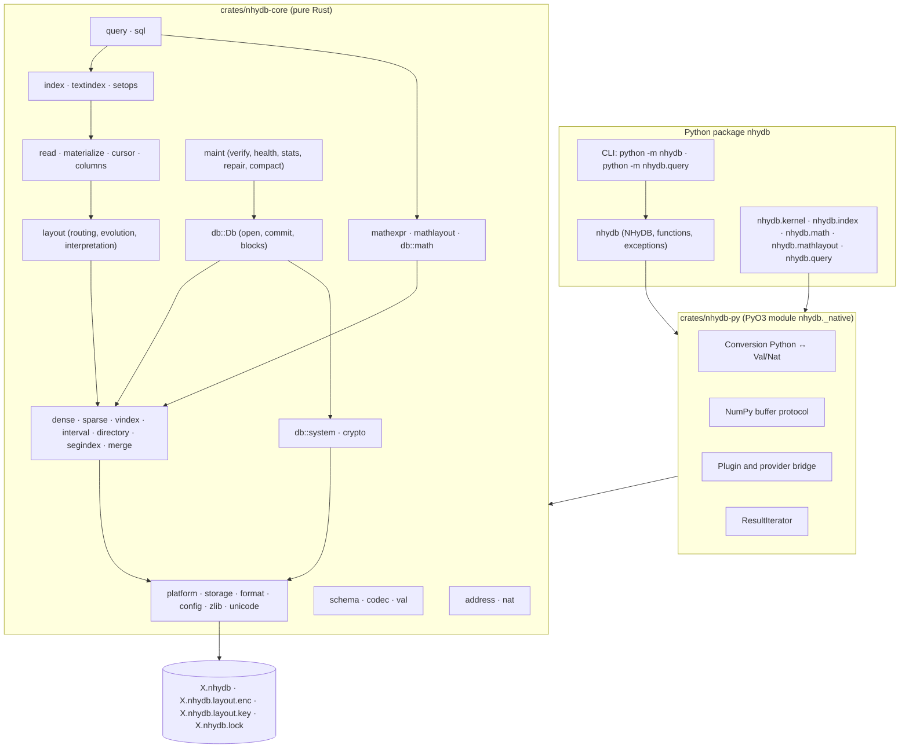
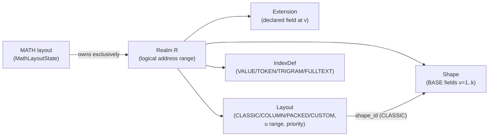
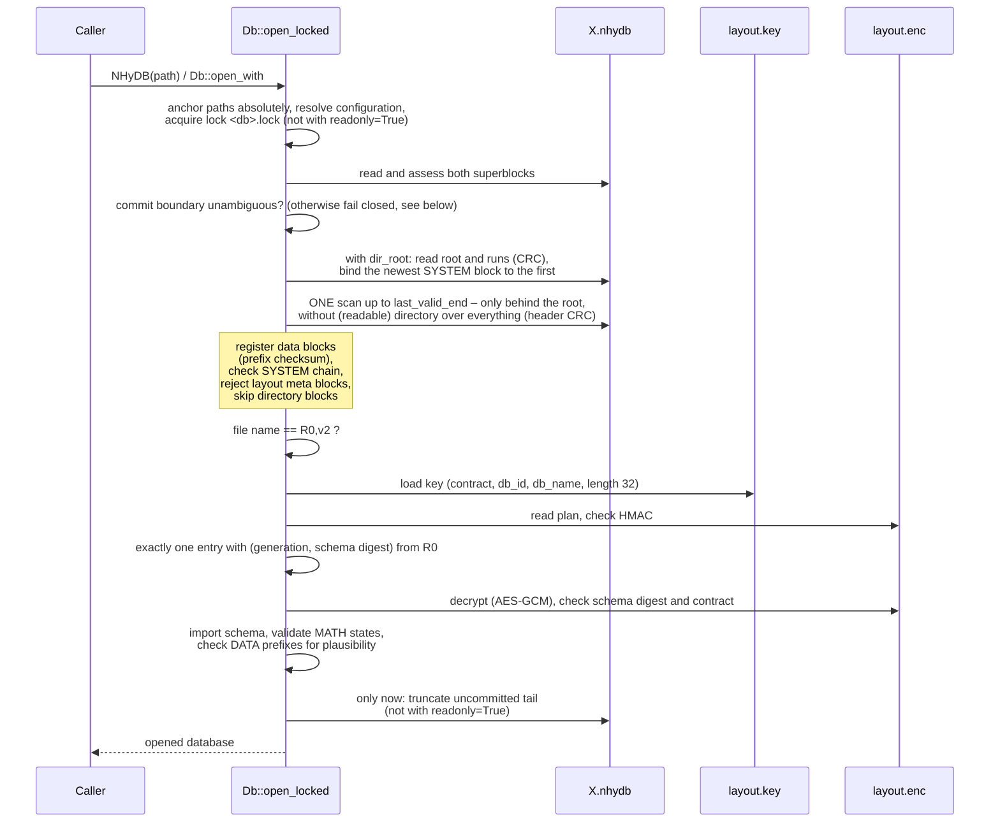
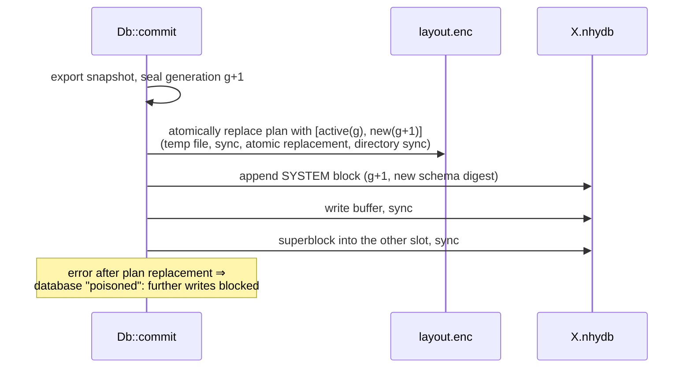
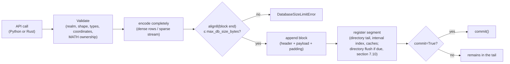
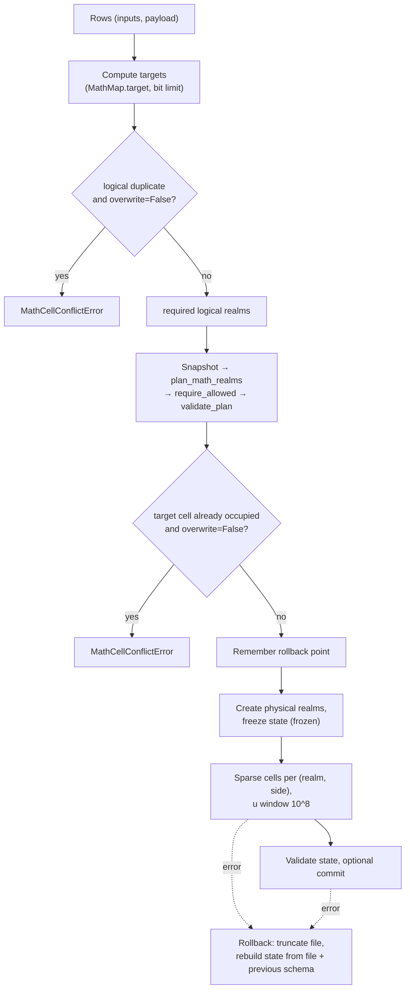
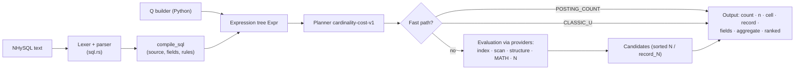

# NHyDB 0.28.2 – Technical Documentation

| Metadata | Value |
|---|---|
| Document | Technical reference documentation NHyDB 0.28.2 (native Rust engine with Python binding) |
| Language | English |
| German version | `../de/NHyDB_Technische_Dokumentation.md` |
| Document date | 2026-11-11 – engine and file format 0.28.2 (changes since 0.28.0: `CHANGELOG.md`, section `[0.28.2]`) |
| Product | NHyDB 0.28.2, Python package `nhydb` |
| Engine version (`ENGINE_VERSION`) | `0.28.2` |
| File format (`FILE_FORMAT_VERSION`) | `0.28.2` – the format version is the engine release that defined the format; signature `NHYDB` + version bytes 0, 28, 2. Files of NHyDB 0.28.0 (`NHYDB016`, format 0.16) and databases of NHyDB 0.27.1 or earlier are not read (`CorruptionError` naming the format, section 7) |
| Platforms | macOS, Linux, Windows |
| License | NHyDB / dNHyDB Experimental Software License 1.0, see file `LICENSE.md` (source-available, not an open-source license; no production use) |
| Contact | achim.meissner@nhydb.de |

---

## Table of Contents

1. [Objectives and Scope](#1-objectives-and-scope)
2. [Mathematical Foundations of Addressing](#2-mathematical-foundations-of-addressing)
3. [Implementation of the Mathematics in the Rust Core](#3-implementation-of-the-mathematics-in-the-rust-core)
4. [Architecture and Components](#4-architecture-and-components)
5. [Data Model: Realms, Shapes, Extensions, Layouts](#5-data-model-realms-shapes-extensions-layouts)
6. [Data Types and Value Encoding](#6-data-types-and-value-encoding)
7. [Storage Organization and File Format 0.28.2](#7-storage-organization-and-file-format-0282)
8. [System Address Space R0,u1 and External Layout Plan](#8-system-address-space-r0u1-and-external-layout-plan)
9. [Write and Read Paths, Commit and Persistence](#9-write-and-read-paths-commit-and-persistence)
10. [Layouts, Routing and Layout Evolution](#10-layouts-routing-and-layout-evolution)
11. [Geometric GET: Cell, Record, Auto](#11-geometric-get-cell-record-auto)
12. [Secondary Indexes and Full-Text Search](#12-secondary-indexes-and-full-text-search)
13. [MATH_MAP: Mathematical Placement](#13-math_map-mathematical-placement)
14. [Query Systems: QueryEngine and NHySQL-0.24](#14-query-systems-queryengine-and-nhysql-024)
15. [Integrity, Recovery and Safety Mechanisms](#15-integrity-recovery-and-safety-mechanisms)
16. [Python Interface (PyO3) and NumPy](#16-python-interface-pyo3-and-numpy)
17. [Configuration, Installation, Build and Operation](#17-configuration-installation-build-and-operation)
18. [Tests, Validation and Benchmarks](#18-tests-validation-and-benchmarks)
19. [Known Limitations](#19-known-limitations)
20. [Appendix: Source Code References](#20-appendix-source-code-references)

---

## 1. Objectives and Scope

### 1.1 What NHyDB Is

NHyDB is an embedded, file-based database engine whose address space is
defined not by table rows or keys but by an **arithmetic cell geometry**.
Every storable cell has the structural identity

```text
(R, u, v, lane)      R = realm, u = first coordinate, v = local second coordinate,
                     lane ∈ {NL, NR} (lane/side)
```

From this four-part coordinate a unique natural number `N` can be computed at
any time – and vice versa. `N` is a **derived external reference**, not a
stored key.

The present implementation is a **native Rust engine** with a Python binding
via PyO3.

### 1.2 Feature Set (Overview)

| Area | Content |
|---|---|
| Address mathematics | exact mapping `(R,u,v,lane) ↔ N` with arbitrarily large integers; exclusion of GZ and N0 numbers |
| Storage core | dense BASE records, sparse cells, two lanes, tombstones and null values as separate states |
| Logical interpretation | layouts CLASSIC, COLUMN, PACKED, CUSTOM; mixed-realm routing; safe layout evolution |
| Reading | `get`, `get_cell`, object APIs, geometric GET (`cell`/`record`/`auto`), DESCRIBE, occupancy queries |
| Persistence | append-only container, alternating superblocks, commit boundary, tail recovery (never at the expense of committed data), durability `fsync`/`full`, read-only mode `readonly=True` |
| Security | system address space R0,u1, encrypted external layout plan (AES-256-GCM, HMAC-SHA256), fail-closed opening, write lock, DB size limit |
| Indexes | VALUE, TOKEN, TRIGRAM, FULLTEXT (positions, BM25); persistent sorted key trees with a page cache, build with external sort |
| MATH_MAP | safe expression language, mapping of input tuples to cells, realm planner, exclusive MATH realms |
| Queries | QueryEngine (cost planner, providers, aggregation, ranking) and NHySQL-0.24 (read-only `SELECT`) |
| Maintenance | checkpoint, verify, health, stats, repair, compaction (in-place and export), restoring backups |
| Python | Python API (single operations) and NumPy batch API |

### 1.3 Scope

NHyDB is **not** a relational database system, **not** a server and
**not** a multi-process transaction system. There is exactly one writing
process per database (secured by a lock file), no network interface and no
transaction API with `BEGIN`; `rollback()` only discards the uncommitted
changes of one object (section 9.7). NHySQL is a read-only query
language; writes are performed exclusively through the API.

---

## 2. Mathematical Foundations of Addressing

This section is limited to the mathematics that is **actually implemented**
in the source code. Every formula is assigned to a Rust function; the worked
examples were recomputed with the engine (Python calls into the native module)
or are test cases from `crates/nhydb-core/src/address.rs` and
`tests/python/test_math.py`. How the formulas are implemented in the core
(data types, computation paths) is described in section 3.

### 2.1 Quantities and Value Ranges

| Symbol | Meaning | Value range (checked in code) | Rust identifier |
|---|---|---|---|
| `R` | realm number | integer `R ≥ 1`, otherwise `ValueError("realm_id must be > 0")` | `realm`, `realm_id` |
| `u` | first coordinate | `u ≥ 1`, otherwise `ValueError("u must be > 0")` | `u` |
| `v` | **local** second coordinate | `1 ≤ v ≤ T`; `v = 0` ⇒ `RealmLimitError("local v must start at 1")`, `v > T` ⇒ `RealmLimitError("Realm R: local v limit reached …")` | `v_local`, `local_v` |
| `lane` | lane | exactly `0` (NL) or `1` (NR) | `Lane = u8`, `NL = 0`, `NR = 1` |
| `T` | realm span | constant `10^100` | `realm_span()` |
| `V` | global second coordinate | `V ≥ 1` | `vg`, field `v` of the address dicts |
| `G` | group | `G = u + V ≥ 2` | `g` |
| `N` | canonical cell number | `N ≥ 3`; GZ and N0 numbers excluded | `n` |

All quantities are **unbounded** natural numbers. There is no floating-point
arithmetic and no limitation to 64 bits for mathematical coordinates (for
limits imposed by resources and configuration see section 3.6).

> **Naming pitfall `v`:** Functions receive the *local* `v`. In the result
> dicts of `dynadron_address`, `cell_address` and `n_to_dynadron_address`,
> `"v"` holds the *global* `V`, and the local one is under `"v_local"`.

### 2.2 Lane Normalization (`normalize_lane_str`, `normalize_lane_int`)

| Input | Result |
|---|---|
| `0`, `"0"`, `"NL"`, `"L"`, `"DEFAULT"` (case-insensitive, whitespace removed), `None` | `0` (NL) |
| `1`, `"1"`, `"NR"`, `"R"` | `1` (NR) |
| otherwise | `ValueError("lane must be 0/NL or 1/NR")` or `"lane must be 0 or 1"` |

In the block header the lane is stored as bit 0 of the flags:
`flags = 1` for NR, `0` for NL (`lane_flags`, `lane_from_flags = flags & 1`).

### 2.3 Realm and Global Coordinate

Forward (`global_v`):

```text
V = (R − 1)·T + v            (for R = 1 directly V = v)
```

Backward (`split_global_v`):

```text
R = ⌊(V − 1) / T⌋ + 1
v = ((V − 1) mod T) + 1
```

Realm bounds (`realm_v_bounds`, API `realm_bounds`):

```text
V_min(R) = (R − 1)·T + 1,   V_max(R) = R·T
```

**Worked examples (verified with the engine):**

| Call | Result |
|---|---|
| `split_global_v(T)` | `(R = 1, v = T)` |
| `split_global_v(T + 1)` | `(R = 2, v = 1)` |
| `global_v(2, 1)` | `T + 1` |
| `realm_v_bounds(2)` | `(T + 1, 2T)` |

`V = T` is the last cell of realm 1, `V = T + 1` the first of realm 2.
For every combination `(R, u, lane)` the local `v` starts again at 1.

### 2.4 Group and Forward Mapping to N (`n_pair`, `dynadron_n`)

```text
G = u + V

lane = NL (0):   N = G² − u
lane = NR (1):   N = G² + V
```

Properties that follow directly from the formulas and are checked in the
tests:

* Because `1 ≤ u ≤ G − 1`, `N_NL` lies in `[G² − G + 1, G² − 1]`; because
  `1 ≤ V ≤ G − 1`, `N_NR` lies in `[G² + 1, G² + G − 1]`.
* The same structural combination `(R, u, v)` yields two different cells
  (NL and NR); both can be stored independently of each other.

**Worked examples:**

| `(R, u, v, lane)` | `V` | `G` | Computation | `N` |
|---|---|---|---|---:|
| `(1, 1, 1, NL)` | 1 | 2 | `4 − 1` | 3 |
| `(1, 1, 1, NR)` | 1 | 2 | `4 + 1` | 5 |
| `(1, 2, 1, NL)` | 1 | 3 | `9 − 2` | 7 |
| `(1, 1, 2, NL)` | 2 | 3 | `9 − 1` | 8 |
| `(1, 2, 1, NR)` | 1 | 3 | `9 + 1` | 10 |
| `(1, 1, 2, NR)` | 2 | 3 | `9 + 2` | 11 |
| `(1, 5, 2, NL)` | 2 | 7 | `49 − 5` | 44 |
| `(1, 3, 5, NL)` / `NR` | 5 | 8 | `64 − 3` / `64 + 5` | 61 / 69 |
| `(1, 11, 13, NL)` / `NR` | 13 | 24 | `576 − 11` / `576 + 13` | 565 / 589 |
| `(23, 14, 744, NL)` | `22·T + 744` | `22·T + 758` | `G² − 14` | 203 decimal digits |
| `(2, 3, 5, NR)` | `T + 5` | `T + 8` | `G² + T + 5` | 201 decimal digits |

### 2.5 Excluded Numbers GZ and N0

For every group `G ≥ 2`:

```text
N0(G) = G·(G − 1)        group boundary, not a cell
GZ(G) = G²               square center, not a cell
NL cells:  N0(G)+1 … GZ(G)−1        (G − 1 numbers)
NR cells:  GZ(G)+1 … N0(G+1)−1      (G − 1 numbers),  N0(G+1) = G·(G+1)
```

Thus every interval `[G(G−1), (G+1)G)` decomposes into exactly
`N0(G)`, `G−1` NL cells, `GZ(G)`, `G−1` NR cells. Every positive integer is
either exactly one cell or exactly one of the two boundary kinds (for
`N = 1, 2`: `1 = GZ(1)`, `2 = N0(2)`; the core test checks all numbers from
1 to 199,999 for this decomposition).

Example `G = 24`: `552 = N0(24)`, NL cells `553 … 575`, `576 = GZ(24)`,
NR cells `577 … 599`, `600 = N0(25)`.

### 2.6 Backward Mapping N → (R, u, v, lane) (`n_to_address`)

Algorithm (integer operations only):

```text
Input N ≥ 1 (N = 0 ⇒ ValueError "N must be > 0")
m = isqrt(N)                 largest m with m² ≤ N
d = N − m²                   it holds that 0 ≤ d ≤ 2m

d = 0          ⇒ GZ(m):   AddressError "N… is a GZ point, not an NHyDB storage cell"
1 ≤ d < m      ⇒ NR:      G = m,     V = d,          u = m − d
d = m          ⇒ N0(m+1): AddressError "N… is an N0 point, not an NHyDB storage cell"
m < d ≤ 2m     ⇒ NL:      G = m + 1, u = G² − N,     V = G − u

(R, v) = split_global_v(V)
Check: cell_address(R, u, v, lane).N == N, otherwise AddressError
           "N… could not be resolved unambiguously"
```

Rationale for the case distinction: for NR cells, `G² < N < G² + G`, hence
`isqrt(N) = G` and `d = V ∈ [1, G−1]`. For NL cells,
`(G−1)² + (G−1) < N < G²`, hence `isqrt(N) = G − 1 = m` and
`d = N − m² ∈ [m+1, 2m]`. `d = m` corresponds to `N = m(m+1) = N0(m+1)`.

**Worked examples:**

| `N` | `m` | `d` | Case | Result |
|---:|---:|---:|---|---|
| 589 | 24 | 13 | `1 ≤ 13 < 24` ⇒ NR | `G = 24, V = 13, u = 11` ⇒ `(1, 11, 13, NR)` |
| 391 | 19 | 30 | `30 > 19` ⇒ NL | `G = 20, u = 400 − 391 = 9, V = 11` ⇒ `(1, 9, 11, NL)` |
| 553 | 23 | 24 | `24 > 23` ⇒ NL | `G = 24, u = 23, V = 1` (first NL cell of G = 24) |
| 575 | 23 | 46 | `46 = 2m` ⇒ NL | `G = 24, u = 1, V = 23` (last NL cell) |
| 576 | 24 | 0 | GZ | `AddressError` |
| 552 | 23 | 23 | `d = m` ⇒ N0 | `AddressError` |
| 600 | 24 | 24 | `d = m` ⇒ N0 | `AddressError` |
| 10 | 3 | 1 | NR | `G = 3, V = 1, u = 2` ⇒ `(1, 2, 1, NR)` |

For `N = (22·T + 758)² − 14` the inversion yields `V = 22·T + 744` and, via
`split_global_v`, exactly `(R = 23, v = 744)`.

### 2.7 Additional Indicators (`dynadron_address`)

In addition to `R, u, v_local, V, G, NL, NR`, `dynadron_address(R, u, v)`
returns:

```text
station        = V − 1
stufenbreite   = u + 2
stufe          = ⌊station / stufenbreite⌋ + 1
stufenstation  = station mod stufenbreite
```

Example `(1, 3, 5)`: `V = 5, G = 8, station = 4, stufenbreite = 5,
stufe = 1, stufenstation = 4, NL = 61, NR = 69`. For `(2, 3, 5)`:
`station = T + 4`, `stufe = ⌊(T+4)/5⌋ + 1`, `stufenstation = (T+4) mod 5`.
These values are **not** part of the cell identity and are never stored;
they are computed on demand and appear in cell outputs with the prefix
`_dyn_…`: `get_cell` and `get_cell_n` return them by default
(`dyn_address=True`, can be disabled with `dyn_address=False`), `get_math_cell`
only with `dyn_address=True`. For record reads (`get`, `range`) the mode
`dyn_address="off"|"once"|"auto"` applies (with `dyn_v` for `"once"`); its
default value is set with `set_dyn_address_output(mode, v=…)`
(preset `"off"`).

### 2.8 N References as Text (`parse_n_reference`)

Accepted are decimal numbers with an optional leading `N`/`n` and whitespace
(`"N589"`, `" n 12 "`, `"123"`); N references are output as `"N<number>"`
(`N_ref`). Invalid text ⇒ `AddressError("invalid N reference '…'")`,
`0` ⇒ `ValueError`.

### 2.9 Geometry of the Layouts (Logical Mappings over the Cell Address)

Layouts assign logical records and fields to valid cells. The following
mappings are implemented in `Db::logical_address_in` (forward) and
`Db::interpret_layout_address` (backward); they do not change the cell
identity.

| Layout | Forward: object `o`, field `f` → cell | Backward: cell `(R, u, v)` → record | Anchor |
|---|---|---|---|
| CLASSIC | `(R, u = o, v = v_f)`; without field `v = 1` | `record = u`, field = `v` | `v = 1` |
| COLUMN | `(R, u = u_f, v = o)`; without field `u = anchor_u` (default: smallest field `u`) | `record = v`, field = `u` | `u = anchor_u` |
| PACKED (`u_p`, `span`) | `anchor = (o − 1)·span + 1`, `(R, u = u_p, v = anchor + offset_f)`; `anchor > T` or `v > T` ⇒ `RealmLimitError` | `record = ⌊(v − 1)/span⌋ + 1`, `offset = (v − 1) mod span` | `offset = 0` |
| CUSTOM | plugin `logical_address` | plugin `describe` | plugin |

Constraints from `create_layout`: PACKED `1 ≤ span ≤ T` (default `10^8`),
`0 ≤ offset < span`, `u_p` within the u range of the layout; COLUMN fields with
unique `u` within the u range.

**Canonical `record_N`** (`record_n_nat`): `N` of the record's anchor cell on
the same lane, regardless of whether the anchor is occupied.

**Worked examples (verified with the engine):**

| Layout | Request | Computation | Result |
|---|---|---|---|
| CLASSIC, realm 1 | `record_n_for_address(1, 4, 7)` | anchor `(1, 4, 1, NL)`: `G = 5`, `25 − 4` | `N21` |
| CLASSIC, realm 1 | `get_n(44, mode="cell")` | `44 → (1, 5, 2, NL)`, anchor `(1, 5, 1)`: `G = 6`, `36 − 5` | `record_N = N31` |
| COLUMN, realm 2, fields `u = 3` (a), `u = 5` (b) | object 9, field `b` | `(2, 5, 9, NL)`: `V = T + 9`, `G = T + 14`, `N = G² − 5` | `N = 10^200 + 28·10^100 + 191` |
| COLUMN, same | anchor object 9 | `anchor_u = 3` ⇒ `(2, 3, 9)` | `u = 3, v = 9` |
| PACKED, realm 3, `u = 2`, `span = 8` | object 4, field with `offset = 5` | `anchor = 3·8 + 1 = 25`, `v = 30` | `(3, 2, 30)` |
| PACKED, same | interpretation of `v = 30` | `⌊29/8⌋ + 1 = 4`, `29 mod 8 = 5` | `record = 4, offset = 5, anchor = False` |

### 2.10 Routing Mathematics (Winner Rule)

For `(R, u)`, all layouts of the realm with `u_start ≤ u ≤ u_end`
(`u_end = None` = unbounded) are considered. Sort key
(`LayoutDef::sort_cmp`, larger wins):

```text
(priority,  −width,  layout_id)
width = u_end − u_start      or 10^200 for unbounded layouts
```

### 2.11 Mathematics of the MATH_MAP Layer

MATH layouts (section 13) compute from inputs `(x1, …, xk)` integer values
`u = f_u(x)`, `V = f_V(x)` and `side = f_side(x)` and decompose `V` with
the same formulas as section 2.3, but over `BigInt` with a selectable span
(`split_global_v(V, realm_span)`, `join_global_v(R, v, realm_span)`
in `mathexpr.rs`; in the database always `T = 10^100`):

```text
Preconditions:  u > 0, V > 0 (otherwise MathDomainError), side ∈ {0, 1}
(R_log, v) = (⌊(V−1)/T⌋ + 1, ((V−1) mod T) + 1)        (div_mod_floor)
join:       V = (R_log − 1)·T + v      with R_log ≥ 1, 1 ≤ v ≤ T
```

Example: `u = x`, `V = x·10^100 + 7`, `side = NR`, input `x = 3` ⇒
`V = 3·T + 7` ⇒ `R_log = 4`, `v = 7`, `side = 1`; `join_global_v(4, 7) = 3·T + 7`.

The logical realm is mapped to a physical realm via the RealmMap
(`physical = physical_start + (R_log − logical_start)` per extent);
the cell `(R_phys, u, v, side)` is what is stored and addressed. The `N`
of a MATH cell is therefore `N(R_phys, u, v, side)`.

Three levels have to be distinguished:

| Level | Meaning | Size |
|---|---|---|
| logical realm `R_log` | result of splitting `V`; part of the mathematics of the layout | unbounded (e.g. ≈ 10^5000 is possible) |
| physical realm `R_phys` | realm ID assigned by the realm planner, densely from 1, under which the cell is stored; the mapping `R_log → R_phys` is kept in the encrypted layout plan | small (number of occupied realms) |
| `N` of the stored cell | `N(R_phys, u, v, side)` | – |

The huge logical realm number is never stored as a cell coordinate. The
physical `N` of a MATH cell equals the "mathematical" `N(R_log, u, v, side)`
only if `R_log` is mapped to the same physical realm (e.g. `R_log = 1 →
R_phys = 1`). `get_math_cell` returns `_logical_realm` and `_V_global` in
addition to the physical address.

### 2.12 Derived Number Sequences in the Query Layer

* **Provider `n_sequence`** (`provider_n_sequence`): iterates over
  `N = start, start+step, …, stop` (`step ≠ 0`), inverts each number with
  `n_to_address` and **skips** GZ/N0 numbers (with `strict=True`
  an `AddressError` instead); with a realm context only cells of that
  realm are taken over.
  Example `start = 550, stop = 560` in realm 1: 552 (N0) is dropped,
  10 cells remain. In the record domain each cell is mapped to its
  `record_N`, e.g. `554 → (1, 22, 2, NL) → anchor (1, 22, 1)`:
  `G = 23`, `529 − 22 = 507`; `550 → (1, 2, 21, NR) → anchor (1, 2, 1, NR)`:
  `9 + 1 = 10`. Result: `N5, N10, N273, N307, N343, N381, N421, N463, N507, N553`.
* **Provider `formula`** (`provider_formula`): compiles `u` and `V` (or
  a local `v`, which is extended to `V = (R−1)·T + v`) as MATH expressions
  over the parameter `k = start … stop` and returns
  `N(R_log, u, v, side)` – **no** RealmMap is applied here.
* **Provider `math_layout_inputs`**: applies the MathMap and RealmMap of a
  MATH layout and returns `N(R_phys, u, v, side)`.

### 2.13 Principle versus Implementation Decision

| Statement | Kind |
|---|---|
| Cell identity `(R, u, v, lane)`; `N` is derived | mathematical principle |
| Formulas for `V`, `G`, `N`, exclusion of GZ/N0, inversion via `isqrt` | mathematical principle |
| `T = 10^100`, `NL = 0`, `NR = 1` | fixed system constants (R0,u1,v9), not configurable |
| Station indicators (`station`, `stufe` …) | computed supplementary information, not part of the identity |
| Layout geometries and winner rule | logical interpretation layer |
| MATH: inputs → `(u, V, side)` → logical → physical realm | application layer; the physical realm assignment is an implementation decision (exclusive, freely planned realms) |
| structural block encoding, no N index | implementation decision |
| `u64`/`u128` fast paths, `BigUint` fallback path | implementation decision (performance) |

> **Note on payload data:** A schema field named `N` (e.g. in the
> benchmark program `bench_native` or in the example in section 16.9) is an
> ordinary application value, not the cell address.

---

## 3. Implementation of the Mathematics in the Rust Core

### 3.1 The Number Type `Nat` (`nat.rs`)

```rust
pub enum Nat {
    S(u64),            // values 0 … u64::MAX directly
    B(Box<BigUint>),   // exclusively values > u64::MAX
}
```

* **Invariant:** `B` contains only values `> u64::MAX`. All constructors
  (`From<u128>`, `From<BigUint>`, arithmetic) normalize accordingly.
  Therefore the derived `Eq`, `Ord`, `Hash` are numerically correct
  (`S(_) < B(_)` always holds).
* Operations: `add`, `add_u64`, `checked_sub`, `sub_u64`, `mul`, `div_rem`,
  `pow10`, `parse_decimal`; each with a `u64` fast path and a
  `BigUint` fallback path.
* `T = 10^100` is computed once as `Nat::pow10(100)` and held in a
  `OnceLock` (`realm_span()`); likewise `10^200` as the width of
  unbounded layouts (`unbounded_width()`).

### 3.2 Computation Paths of the Address Functions (`address.rs`)

| Function | Flow in the code |
|---|---|
| `require_positive(name, x)` | `x = 0` ⇒ `ValueError("<name> must be > 0")` (the PyO3 layer maps negative Python numbers to 0 so that the same text results) |
| `validate_local_v(v, R)` | `v = 0` ⇒ `RealmLimitError`; only if `v` is present as `Nat::B` can `v > T` hold – then `RealmLimitError` (values ≤ `u64::MAX` are always `< T`) |
| `global_v_unchecked(R, v)` | `R = 1` ⇒ `V = v` (no multiplication), otherwise `(R−1)·T + v` via `BigUint` |
| `split_global_v(V)` | `V` as `Nat::S` ⇒ immediately `(1, V)`; otherwise `div_rem(V − 1, T)` |
| `n_pair(u, V)` | `G = u + V`; if `u`, `V` are present as `u64` and `G < 2^63`: `G²` in `u128`, `N_NL = G² − u`, `N_NR = G² + V` in `u128`; otherwise `BigUint` |
| `dynadron_address` | validation, `V`, `n_pair`, indicators via `div_rem` |
| `dynadron_n` | validation, `V`, `n_pair`, selection by `lane` |
| `isqrt(N)` | `Nat::S`: initial value `⌊√N⌋` via `f64`, then exact correction in `u128` (`while r² > N: r −= 1; while (r+1)² ≤ N: r += 1`); `Nat::B`: `BigUint::sqrt` |
| `n_to_address(N)` | algorithm 2.6, final check `cell_address(...).n == N` |

**Why the `u128` path is safe:** For `G < 2^63`, `G² < 2^126` and
`G² + V < 2^126 + 2^63 < 2^128`; an overflow is impossible. For
`R ≥ 2`, `V ≥ T + 1 > 2^64`, so `V` is a `Nat::B`, and the
`BigUint` path is used.

**Why the floating-point initial estimate becomes exact:** The estimate serves
only as an initial value; the two correction loops establish
`r² ≤ N < (r+1)²` in exact `u128` arithmetic.

### 3.3 Worked Examples through the Rust Core

**Example A – `dynadron_n(1, 11, 13, NR)`:**

```text
require_positive(R=1), require_positive(u=11), validate_local_v(13)   ok
global_v_unchecked: R = 1  ⇒  V = 13                                 (Nat::S)
n_pair: u, V as u64, G = 24 < 2^63  ⇒  u128 path
        G² = 576, NL = 576 − 11 = 565, NR = 576 + 13 = 589
Result (lane = NR): 589
```

**Example B – `n_to_address(589)`:**

```text
isqrt(589): f64 estimate 24, correction: 24² = 576 ≤ 589 < 625  ⇒  m = 24
d = 589 − 576 = 13;  1 ≤ 13 < 24  ⇒  NR, u = 24 − 13 = 11, V = 13
split_global_v(13): Nat::S  ⇒  (R = 1, v = 13)
Check: cell_address(1, 11, 13, NR).n = 589 = N   ⇒   (1, 11, 13, NR)
```

**Example C – `dynadron_n(23, 14, 744, NL)`:**

```text
global_v_unchecked: R = 23  ⇒  V = 22·T + 744          (Nat::B, BigUint path)
n_pair: V is Nat::B  ⇒  BigUint: G = 22·T + 758, N = G² − 14
N has 203 decimal digits
n_to_address(N): isqrt via BigUint::sqrt ⇒ m = 22·T + 757;
  d = N − m² = 2m + 1 − 14 = 2m − 13 > m  ⇒  NL, G = m + 1, u = G² − N = 14,
  V = G − 14 = 22·T + 744;  split_global_v(V) ⇒ (23, 744)
```

(Test case `r23_u14_v744` in `address.rs`, additionally NR back-computation.)

**Example D – boundary number `n_to_address(552)`:** `isqrt(552) = 23`,
`d = 552 − 529 = 23 = m` ⇒ `AddressError("N552 is an N0 point, not an NHyDB storage cell")`.

### 3.4 Physical Encoding of the Coordinates

Coordinates are encoded **structurally** and per block, never as complete
tuples and never as `N` per cell:

| Coordinate | Dense block (`DATA_DENSE`) | Sparse block (`SPARSE_CELLS`) |
|---|---|---|
| `R` | VarUInt in the prefix | VarUInt in the prefix |
| `lane` | bit 0 of the block flags | bit 0 of the block flags |
| `u` | `u_start` in the prefix; record `i` has `u = u_start + i` | `u_start`, `u_end` in the prefix; per group `Δu` (first group `Δu = 0`) |
| `v` | implicit through the field position in the shape | per cell `Δv` to the predecessor (start 0), strictly ascending |

The sparse cell stores `Δv` together with three flag bits as **one**
VarUInt: `key = (Δv << 3) | flags` with `flags = tomb | self-typed<<1 |
null<<2`. For `Δv < 2^60` the computation is done in `u64`, otherwise via `BigUint`.

Example: cells `v = 2` and `v = 9` of a u group, both declared, not
null: keys `(2 << 3) | 0 = 16` and `((9 − 2) << 3) | 0 = 56`.

### 3.5 VarUInt and VarInt

```text
VarUInt:  n = Σ b_i·128^i, byte i = b_i | 0x80 (except the last byte)
VarInt:   z = 2n (n ≥ 0),  z = −2n − 1 (n < 0);  then VarUInt(z)
          inverse mapping: z even ⇒ n = z/2, z odd ⇒ n = −(z+1)/2
```

Encodings verified with the engine (`enc_vu`, `enc_vi`, hexadecimal):

| Value | VarUInt | | Value | VarInt |
|---:|---|---|---:|---|
| 0 | `00` | | 0 | `00` |
| 1 | `01` | | −1 | `01` |
| 127 | `7f` | | 1 | `02` |
| 128 | `8001` | | −3 | `05` |
| 300 | `ac02` | | 3 | `06` |
| 2^64 | `80808080808080808002` | | | |

Implementation: `put_vu64` for `u64`, `put_vu_big` via
`BigUint::to_radix_le(128)`; `get_vu64` decodes up to 64 bits in a
`u128` accumulator and otherwise falls back to `get_vu` (arbitrary size).
`get_vu_u64` is used for physical fields (lengths, counters, IDs) and
rejects values > `u64::MAX` with `CorruptionError("…: value too large")`.

### 3.6 Large Numbers: BigInt Capability and Limits

Addressing, storage and reopening are designed throughout for arbitrarily
large natural numbers: `R`, `u`, `V`, `N` and values of the types
`varuint`/`varint` are taken over exactly (Python ↔ Rust in binary via
`BigInt`, without intermediate strings), stored and read again after
reopening. `get_vu` has **no fixed bit limit**; the length of a VarUInt is
bounded only by the remaining bytes of the CRC-checked block payload
(truncated values ⇒ `CorruptionError("VarUInt ends prematurely")`).
Allocations are requested with `try_reserve`; if memory runs out, a clean
`MemoryError` is raised instead of a crash. Coordinates and values with
2^16,380, 2^16,400, 10^5 and 10^6 bits are tested via the single-item API,
`put_points`, `create_realm`, dense batches and MATH pass-through, each with
commit, reopen, read and `verify(deep=True)`
(`tests/python/test_stab_bigint.py`).

| Kind | Limit | Scope |
|---|---|---|
| Mathematical (Dynadron) | `u, v, R ≥ 1`; GZ/N0 excluded; `v_local ≤ 10^100` per realm | part of the concept |
| Configuration | `realm_auto_limit` (**number** of logical realms of a MATH layout, not their size) | MATH layouts only (section 13.4) |
| | `math_max_intermediate_bits` | only arithmetic operations in formulas (section 13.2), never passed-through inputs |
| | IDs (`shape_id`, `layout_id`, `index_id`, `default_shape_id`) ≤ 2^63 − 1 | administrative IDs only (`ValueError`) |
| Technical | NumPy batch APIs: coordinate arrays `uint64` | NumPy path only; single-item and list APIs are unbounded |
| | Python display: `str(int)` with more than 4,300 decimal digits is refused | output in Python only (`print`, `json`, f-strings) |
| Physical | memory, disk (`db_max_size_bytes`), computing time | one address computation with 10^6 bits takes ≈ 0.1 s |

**Displaying very large numbers in Python:** since Python 3.11 (also in
security updates of older versions), `str(int)` refuses numbers with more
than 4,300 decimal digits (`ValueError: Exceeds the limit (4300 digits) for
integer string conversion`). This affects only the
display, not NHyDB: values come back as `int`, and address dicts also contain
`N_ref` as text. For output, set `sys.set_int_max_str_digits(0)` (0 = no
limit) or work with `int.bit_length()`.

```python
import sys
sys.set_int_max_str_digits(0)      # only for displaying huge numbers
```

### 3.7 Fixed System Constants per Database

Every newly created database writes the cell
`v9 = {"lane_NL": 0, "lane_NR": 1, "realm_span": 10**100}` into R0,u1. `check_record`
(`db/system.rs`) checks on opening that v9 – if present – corresponds exactly
to this value and that `realm_span` is numerically equal to `realm_span()`; otherwise
`CorruptionError("R0,u1,v9: fixed system constants violated …")`. If v9 is
missing, the same value applies.

### 3.8 Verification of the Mathematics

| Test | Content |
|---|---|
| `address.rs::examples_from_docs` | 589 → `(1,11,13,NR)`, NL partner 565, 391 → `(1,9,11,NL)`, rejection of 552, 576, 600, 4; edge cells 553/575 (NL) and 577/599 (NR) with `G = 24`; `(1,1,1,NL) = 3` |
| `address.rs::r23_u14_v744` | forward = `(22·T+758)² − 14`, 203 digits, back-computation NL and NR |
| `address.rs::realm_edges` | `split_global_v(T) = (1, T)`, `split_global_v(T+1) = (2, 1)`, round trips for very large `R` and `u` on both lanes, `v` bounds, zero coordinates |
| `address.rs::exhaustive_small_range` | all `N` in `[1, 200,000)`: either GZ/N0 or exactly invertible; > 199,000 valid cells |
| `address.rs::parse_refs` | text forms of N references |
| `nat.rs` (unit tests) | VarUInt/VarInt incl. `i64::MIN`, truncated inputs |
| `tests/python/test_math.py` | rejection of GZ/N0 numbers, worked example `(23, 14, 744)` |
| `crates/nhydb-core/tests/sparse_access.rs` | sparse access with `u = 2^70` and `v ≥ 10^40` against an independent model |

---

## 4. Architecture and Components

### 4.1 Layer Model



**Architecture decision:** The core `nhydb-core` has no Python dependency
and can be tested on its own with `cargo test -p nhydb-core`. Address
mathematics, encoding, routing and commit reside exclusively in the core; the
PyO3 layer only converts types, releases the GIL for purely native sections
(queries, SQL, batch writes, commit, maintenance) and bridges Python plugins
and providers, which take the GIL back for their callback. Reading calls
share an `NHyDB` object (several threads may query at the same time); a
writing call needs the object exclusively, a conflict is rejected
immediately (section 16.7, "Threads").

### 4.2 Modules of the Rust Core

Line counts: physical lines of the source files in NHyDB 0.27.0 (`wc -l`,
including comments and unit tests); they serve for orientation only.

| Module | Lines | Task |
|---|---:|---|
| `lib.rs` | 50 | crate root, public re-exports |
| `error.rs` | 155 | error type `Error` (mapping to the Python exceptions) |
| `nat.rs` | 458 | number type `Nat`, VarUInt/VarInt encoding |
| `val.rs` | 927 | dynamic value type `Val` (None/Bool/Int/Big/Float/Str/Bytes/List/Map), Python-compatible JSON |
| `address.rs` | 411 | address mathematics (section 3) |
| `codec.rs` | 479 | 15 data types, `FieldDef`, value encoding/decoding |
| `schema.rs` | 585 | `ShapeDef`, `RealmDef`, `ExtensionDef`, `LayoutDef`, `IndexDef` |
| `format.rs` | 217 | superblock, block header, block types, constants |
| `storage.rs` | 147 | append buffer, position-based reading, sync |
| `platform.rs` | 425 | OS layer: durability, directory sync, atomic replacement, locks |
| `config.rs` | 242 | `nhydb_config.toml` |
| `crypto.rs` | 161 | AES-256-GCM, HMAC-SHA256, SHA-256, Base64, UUIDv4 |
| `unicode.rs` + `unicode_tables.rs` | 180 + 17 (generated tables, very long lines) | CPython-exact character classes and `casefold` (Unicode 16.0.0) |
| `zlib.rs` | 53 | zlib compression of the postings |
| `plugin.rs` | 46 | trait `LayoutPlugin` for CUSTOM layouts |
| `setops.rs` | 96 | sorted set operations (galloping intersection) |
| `textindex.rs` | 625 | tokenizer, n-grams, FULLTEXT codecs, phrase, BM25 |
| `mathexpr.rs` | 1,942 | MATH expression language, `MathMap`, `MathMapLayoutSpec`, `dry_run` |
| `mathlayout.rs` | 546 | realm planner for MATH layouts |
| `query.rs` | 4,276 (0.28.2) | QueryEngine: expression tree, planner, evaluation, aggregation, search |
| `sql.rs` | 1,399 (0.28.2) | NHySQL: lexer, parser, compiler |
| `db/mod.rs` | 1,197 | `Db`: state, open, commit, blocks, open scan |
| `db/system.rs` | 397 | R0,u1, key/plan files, schema snapshot |
| `db/schema_ops.rs` | 427 | realms, shapes, extensions, index definitions |
| `db/layout.rs` | 1,451 | layouts, SpaceMaps, routing, evolution, logical addresses |
| `db/dense.rs` | 620 | dense BASE records |
| `db/sparse.rs` | 555 | sparse cells |
| `db/vindex.rs` | 554 | v index per u group (targeted sparse access) |
| `db/interval.rs` | 152 | interval index with prefix maximum |
| `db/read.rs` | 828 | read APIs, geometric GET |
| `db/materialize.rs` | 374 | iteration of materialized cells, `record_N` |
| `db/cursor.rs` | 330 | lazy cursor for `range`, `select`, `find`, sparse points |
| `db/columns.rs` | 489 | column-wise writing/reading (NumPy paths) |
| `db/index.rs` | 1,155 | index construction, postings, candidates |
| `db/math.rs` | 553 | MATH API in the core, rollback |
| `db/maint.rs` | 1,060 | checkpoint, verify, health, stats, repair, compaction |
| `db/blockcache.rs` | new in 0.28.0 (609) | block cache (LRU), "verified" registry, partial reads of verified blocks, cache budgets (section 9.8) |
| `db/batch.rs` | new in 0.28.0 (116) | single-cell check for `batch()`, `rollback()` |
| `db/directory.rs` | new in 0.28.2 (1,386) | persistent block directory: pages, runs, root, flush and merging (section 7.10) |
| `db/segindex.rs` | new in 0.28.2 (569) | segment registry per realm/lane from directory pages and tail |
| `db/merge.rs` | new in 0.28.2 (1,099) | memory-bounded merge of the sparse blocks (compaction, iterators), external runs |
| `db/secindex.rs` | new in 0.28.2 (1,201) | SECONDARY key trees: key encoding and order, pages, lookup, range walk, page cache (section 7.8) |
| `db/idxspill.rs` | new in 0.28.2 (385) | external sort of the index build: sorted runs in an anonymous temporary file, key-by-key merge over a heap (section 12.2) |
| `db/mempot.rs` | new in 0.28.2 (497) | process budget of all caches (`[cache] total_bytes`), byte-budget maps, eviction across handles (section 9.8) |
| `container.rs` | new in 0.28.2 (732) | result container `.nhyc`: CRC-32C-protected chunks, locked writing, atomic no-replace finish, anonymous sort runs (section 14.5) |
| `valcodec.rs` | new in 0.28.2 (298) | canonical value codec of the containers (section 14.5) |
| `results.rs` | new in 0.28.2 (487) | result files, result directory and budget, `cleanup_results`, background jobs (section 14.5) |

In 0.28.2, `db/vindex.rs` (773 lines) and `db/interval.rs` (481 lines) were
also reworked (section 9.4).

### 4.3 PyO3 Layer `nhydb-py`

| File | Task |
|---|---|
| `lib.rs` | class `NHyDB`, `LayoutDef`, `IndexDef`, module functions, registration |
| `conv.rs` | conversion Python ↔ `Val`/`Nat` (arbitrarily large `int`) |
| `exceptions.rs` | exception hierarchy |
| `numpy_io.rs` | buffer protocol for NumPy arrays, output without a copy via `ColumnBuffer` and `numpy.frombuffer` |
| `batch.rs` | `WriteBatch` for `NHyDB.batch()` |
| `iter.rs` | `ResultIterator` (lazy, block-wise) |
| `pyplugin.rs` | bridge for Python CUSTOM plugins (weak reference to the DB object) |
| `kernel.rs` | stateless kernel functions for `nhydb.kernel` |
| `textapi.rs` | functions for `nhydb.index` |
| `mathapi.rs` | classes for `nhydb.math`/`nhydb.mathlayout`, MATH methods |
| `queryapi.rs` | native `QueryEngine`, SQL, provider bridge |

### 4.4 External Dependencies

Versions according to `Cargo.lock` of NHyDB 0.28.0:

| Crate | Version | Usage |
|---|---|---|
| `num-bigint` / `num-integer` / `num-traits` | 0.4.8 / 0.1.47 / 0.2.19 | exact integer arithmetic |
| `crc32fast` | 1.5.2 | CRC32 for superblocks, block headers, payloads |
| `miniz_oxide` | 0.8.9 | zlib decompression; compression on Windows |
| `aes-gcm` | 0.11.1 | AEAD encryption of the layout plan |
| `sha2` | 0.11.1 | SHA-256 (fingerprints, key derivation for MAC and schema digest) |
| `hmac` | 0.13.0 | HMAC-SHA256 over the plan envelope and the schema snapshot |
| `base64` | 0.23.1 | encoding of key, nonce and ciphertext |
| `getrandom` | 0.4.3 | operating system random numbers (keys, nonces, UUID) |
| `toml` | 1.1.8 | configuration file |
| `libc` (Unix only) | 0.2.190 | `fsync`, `fcntl(F_BARRIERFSYNC/F_FULLFSYNC)`, `O_NOFOLLOW`, `sysconf` (physical memory), `localtime_r` |
| `windows-sys` (Windows only) | 0.61.2 | `GlobalMemoryStatusEx` (physical memory), `GetLocalTime`; file sync (`FlushFileBuffers`) and rename via the standard library |
| `pyo3` (`nhydb-py` only) | 0.29.3 | Python binding, feature `num-bigint` |
| system `libz` (Unix, via FFI) | – | zlib compression byte-identical to CPython |

No custom cryptography is implemented; JSON is produced with a custom,
Python-compatible codec in `val.rs` (no `serde`).

### 4.5 Release Profile

```toml
[profile.release]
opt-level = 3
lto = "fat"
codegen-units = 1
panic = "unwind"
```

Plus `.cargo/config.toml` with `rustflags = ["-C",
"llvm-args=-align-all-functions=6"]`: function starts aligned to 64 bytes.
Without it, the placement of unrelated code shifted the KQ-10M import by
about 6 %. The file is part of the release export. Measured in the wheel
built from the exported tree: 99.9 % of the functions aligned, 7.6 % without
the file. A `RUSTFLAGS` environment variable replaces this setting.

---

## 5. Data Model: Realms, Shapes, Extensions, Layouts

### 5.1 Overview of Terms



| Object | Rust type | Persistence | Important fields |
|---|---|---|---|
| Realm | `RealmDef` | external layout plan | `realm_id`, `name`, `description`, `default_shape_id`, `base_reserve_to` |
| Shape | `ShapeDef` | external layout plan | `shape_id`, `realm_id`, `name`, `fields: Vec<FieldDef>` |
| Field | `FieldDef` | part of shape/extension | `v`, `name`, `typ`, `enum_map`, `description` |
| Extension | `ExtensionDef` | external layout plan | `realm_id`, `v`, `typ`, `name`, `enum_map` |
| Layout | `LayoutDef` | external layout plan | `layout_id`, `realm_id`, `kind`, `u_start`, `u_end`, `priority`, `shape_id`, `params`, `spacemap`, `plugin` |
| Index | `IndexDef` | external layout plan | `index_id`, `realm_id`, `name`, `kind`, `source_v`, `options` |
| MATH state | `MathLayoutState` | external layout plan | specification, RealmMap, `payload_type`, `frozen` |

Since format 0.16 (unchanged in 0.28.2), all schema objects reside **not** in the database file
but encrypted in the external layout plan (section 8). The database file
contains only data, index, delete, checkpoint, configuration and SYSTEM
blocks.

### 5.2 Dense and Sparse

* **Dense BASE record:** a contiguous record at `(R, u, lane)` with
  the fields of a shape in field order (`v = 1 … k`). It is written
  block-wise for contiguous `u` ranges (`put_dense_batch`).
* **Sparse cell:** a single cell `(R, u, v, lane)` with a value, null or
  tombstone. Sparse cells supplement or overlay dense records
  (extensions, single values, COLUMN/PACKED/CUSTOM objects, MATH cells).

Three states are strictly separated:

| State | Meaning | Encoding |
|---|---|---|
| missing | cell was never written | no entry |
| null | cell exists with value `None` | sparse flag `4` |
| tombstone | cell was deleted | sparse flag `1` |

**The newest write wins – across both layers** (since 0.28.2).
For every cell the state written last counts, whether it was written as a
dense record or as a sparse cell. The order is the block ID; both structures
carry it, the format is unchanged:

* A dense record (block ID `d`) holds every field of its shape. A sparse
  state of one of these fields from an **older** block (`s < d`) is hidden by
  the record; a newer one (`s > d`) overlays it. Example: `put(x=10)`,
  `put_cell(x=11)`, `put(x=12)` reads `x = 12`; `put`, `delete_cell(x)`,
  `put(x=20)` reads `x = 20`.
* Sparse states at `v` outside the shape (extensions, reserved BASE
  positions, fields of other shapes) are never hidden by a dense record: a
  `put` writes only the fields of its shape.
* **`put` replaces the BASE record as a whole.** When a `put` with shape B
  replaces a record with shape A, the fields of A that B lacks are no longer
  part of the record. If such a field had been written as a sparse cell and
  was hidden by the A record, `put` writes a tombstone for it in the same
  unit, so that the overwritten value cannot show again (`put_cell(y=7)`,
  `put(A{x, y=20})`, `put(B{x})` → `y` does not exist). This check runs only
  when the lane has sparse cells and dense records of a shape with extra
  fields; otherwise the write path reads nothing.
* A `DELETE` block hides the dense record of u (higher block ID);
  `delete_record`/`delete_area` additionally write tombstones for every
  sparse value of the u group, also the ones hidden by the record – a
  `DELETE` alone would let them show again.

Every read and maintenance path applies the same rule: `get`/`get_internal`,
`get_cell`/`get_value`, `read_numpy`, the cell cursor
(`iter_materialized_cells`, SQL/QueryEngine), `iter_materialized_sparse_points`,
the winner view (`[query] overlay_view`), index build and incremental index
maintenance and compaction. Compaction drops hidden sparse states and
writes the surviving ones to the target **after** the dense record of their
u (higher block ID), also across chunk boundaries.

Up to 0.28.0 the rule was "sparse is always on top": an older
`put_cell` or `delete_cell` hid a later `put` of the same BASE field (also in
Python v0.14/v0.27). This is corrected as a bug since 0.28.2.

**Existence of a cell.** A cell lives when its newest state is a value – a
stored `None` included. A tombstone, a cell never written and a field of the
current shape that the stored record lacks do not exist
(`get_cell(...)["present"] = False`). A record exists as long as it has at
least one live cell (SQL, QueryEngine, the `read_numpy` column `_present`;
the N paths `get_n`, `get_n_cell`, `get_address` and `describe_n` report
`present`/`occupied` by the same rule as `get_cell`). `get()`, `range()` and
`select()` show the record view of v0.14 (records with a live dense
record). Dense fields are typed and cannot store `None`: a `None` in a field
of the shape raises `ValueError` for every field type (up to 0.28.0
`utf8` fields silently stored `"None"` and `bool` fields `False`); a `None`
comes only from `put_cell`.

**Deleting.** The public delete API has exactly three functions. They work
on logical cells, independent of BASE/extension, dense/sparse and field
names:

| Command | Effect |
|---|---|
| `delete_cell(realm, u, v)` | tombstone for a live cell (also a BASE field of a dense record or a null cell). Returns `True` if it lived; otherwise `False` without a write |
| `delete_area(realm, u_from, u_to, v_from, v_to)` | every live cell of the rectangle (bounds inclusive): per u one `DELETE` block plus tombstones of the sparse values when all live cells of the u lie in the area, otherwise tombstones per cell. Returns the number of live cells deleted. One unit (`write_scope`); tombstones in chunks of 8,192; cost proportional to the live cells |
| `delete_record(layout_id, object_id)` | every live cell of the object: CLASSIC – `DELETE` block and tombstones of all sparse values of the u group; COLUMN/PACKED/CUSTOM – tombstones of the live cells the layout assigns to the object. Returns the number of live cells deleted (0 = nothing, then no write) |

`delete(realm, u)` and `delete_point(realm, u, v)` are gone since
0.28.2; `delete` hid only the dense record and left single
cells and extensions in place. Internally the `DELETE` block and the sparse
tombstone remain the two physical forms.

Deleted data stays in the file as older blocks (append-only). Hidden dense
records and deleted cells are removed physically only by `compact_file()`
(section 15.5).

### 5.3 Extensions and the BASE Boundary

Extensions are declared additional fields of a realm at a `v` above
the BASE fields. They are stored as sparse cells (an optional
EXT area `0xEA` in dense records is supported on read but not
written by the engine). `define_extension`, `put_extensions`, `put_extension_list` and
`put_extension_range` operate at this level. `base_reserve_to` reserves
a `v` range for future BASE fields.

---

## 6. Data Types and Value Encoding

### 6.1 The 15 Field Types

| Type code | Name | Encoding | Value range / notes |
|---:|---|---|---|
| 1 | `u8` | 1 byte LE | 0 … 255 |
| 2 | `u16` | 2 bytes LE | 0 … 65,535 |
| 3 | `u32` | 4 bytes LE | 0 … 2³²−1 |
| 4 | `u64` | 8 bytes LE | 0 … 2⁶⁴−1 |
| 5 | `i8` | 1 byte LE | −128 … 127 |
| 6 | `i16` | 2 bytes LE | |
| 7 | `i32` | 4 bytes LE | |
| 8 | `i64` | 8 bytes LE | |
| 9 | `f32` | 4 bytes IEEE 754 LE | finite values that would become infinite as `f32` are rejected |
| 10 | `f64` | 8 bytes IEEE 754 LE | |
| 11 | `bool` | 1 byte | Python truth value |
| 12 | `varuint` | VarUInt | arbitrarily large, ≥ 0 |
| 13 | `varint` | VarInt (ZigZag + VarUInt) | arbitrarily large |
| 14 | `utf8` | `vu(length)` + UTF-8 bytes | non-strings are converted like Python `str()` |
| 15 | `bytes` | `vu(length)` + bytes | |

The type codes are available as `nhydb.TYPE_CODES`.

### 6.2 VarUInt and VarInt

* **VarUInt (`vu`):** base 128, seven data bits per byte, little-endian,
  highest bit = continuation. Arbitrarily large (for `Nat::B` via `BigUint`).
* **VarInt (`vi`):** ZigZag mapping `n ≥ 0 → 2n`, `n < 0 → −2n−1`,
  followed by VarUInt.
* Decoding errors result in `CorruptionError` with fixed texts
  (`VarUInt ends prematurely`, `length value ends beyond the payload`,
  `fixed-width value incomplete`). There is no fixed bit limit
  (section 3.6).

### 6.3 Enums

A field can carry an enum mapping `label → code` (codes as `i64`).
On write, labels are translated into codes, and back on read. With
duplicate codes, the last entry wins – as with a Python dict comprehension.
Unknown labels result in
`ValueError("<feld>: unknown enum value '<x>'")`.

### 6.4 Self-Typed Sparse Cells

Sparse cells for which no type can be derived from the shape, extension or
layout, or which are written with an explicit `type=`, store their
type code as an additional byte ("self-typed"). CUSTOM layout cells and
MATH cells are always self-typed. If no type can be derived and none is
specified, the write is rejected with `SchemaError("…: cannot derive a data type; specify type=...")`.

### 6.5 The Value Type `Val`

Cell values, layout parameters and API results are represented in the core
as `Val`: `None`, `Bool`, `Int(i64)`, `Big(BigInt)`, `Float(f64)`,
`Str`, `Bytes`, `List`, `Map` (ordered keys). `Val` implements the
**Python equality and ordering semantics** (e.g. `1 == 1.0 == True`) that
are required for aggregation, grouping and sorting in the query layer,
as well as a JSON codec that serializes byte-identically to
`json.dumps(…, sort_keys=True, separators=(",", ":"), ensure_ascii=False)`
(for fingerprints additionally an `ensure_ascii=True` mode).

---

## 7. Storage Organization and File Format 0.28.2

The engine writes file format 0.28.2 (`FILE_FORMAT_VERSION = "0.28.2"`).
**The format version is the engine release that defined the format**; the
historical numbering `NHYDB016`/`NHYDB017` ends. The file starts with the
signature `NHYDB` followed by the three version bytes 0, 28, 2 (major,
minor, patch). Compared with format 0.16 of NHyDB 0.28.0, the **persistent
block directory** (block type 14 `DIRECTORY`, section 7.10), the superblock
field `dir_root`, a **prefix checksum** in DATA_DENSE and SPARSE_CELLS
payloads (tags `D28D`/`SP28`, sections 7.6/7.7) and SECONDARY indexes as
**key trees** (tag `SI28`, block type 15 `SECONDARY_PAGE`, section 7.8) are
added; all other blocks and payloads are unchanged (golden test
`test_stab_format_golden.py`). All integers are
little-endian.

**Compatibility with NHyDB 0.28.0.** Files in format 0.16 are not
read (no backward compatibility in the development phase): opening fails
with `CorruptionError` "unsupported file format NHYDB016 (expected NHYDB
0.28.2)", the file stays unchanged. Blocks of format 0.16 (`D10D`, `SP10`,
`SI10`) count as a wrong tag. An unreleased development format (`NHYDB017`)
and older format revisions are not read either. There is no
migration path or converter: rebuild the database with 0.28.2 from the
source data or exports.

**Compatibility with NHyDB 0.27.1.** The file identifier `NHYDB016`,
superblocks, block headers and data payloads were unchanged in 0.28.0 from 0.27.1.
Since 0.28.0, however, the schema digest in the layout plan (field `sha256`)
and in R0,u1,v6 is an HMAC-SHA256 with a key derived from the layout key
(section 8.3) instead of a plain SHA-256 of the schema snapshot; in addition,
the MATH layout state contains the field `max_intermediate_bits`. Databases
created with NHyDB 0.27.1 or earlier do not open – not even with
`readonly=True`: such a file already fails at the superblock
(`CorruptionError` "unsupported file format NHYDB016 …", see above); the
files stay unchanged. The check of the layout plan for an unkeyed schema
digest remains: such a plan results in a `CorruptionError` whose text names
NHyDB 0.27.1 and the export/re-import route (`repair_file`: `action:
"abort"` with `plan_error`). There is no migration: read
out (export) the data with NHyDB 0.27.1, create a new database with 0.28.2,
import the data there and build the indexes with `build_indexes()`.

### 7.1 Files of a Database

| File | Content | Note |
|---|---|---|
| `X.nhydb` | container (superblocks, blocks) | |
| `X.nhydb.layout.enc` | encrypted layout plan (1–2 schema generations) | path selectable |
| `X.nhydb.layout.key` | 32-byte key (JSON), Unix permissions `0600` | **back up separately**; without it the DB cannot be opened |
| `X.nhydb.lock` | lock file for exclusive write access (empty, persists) | |

The paths of plan and key can be chosen via `layout_path`/`key_path` or the
configuration; R0,u1 stores only the **file names**, not paths.

### 7.2 Overall File Layout

```text
Offset 0      Superblock A (4096 bytes)
Offset 4096   Superblock B (4096 bytes)
Offset 8192   Block 1: SYSTEM (R0,u1, generation 0)
              Block 2: DB_CONFIG
              Block …: DATA_DENSE | SPARSE_CELLS | DELETE | SECONDARY | CHECKPOINT | SYSTEM | DB_CONFIG
                       | DIRECTORY (pages, run, root – section 7.10)
                       | SECONDARY_PAGE (leaf, inner page, posting chunk – section 7.8)
              ── commit boundary last_valid_end ──
              (optional: uncommitted tail, truncated on open if the
               commit boundary is unambiguous – section 8.4)
```

### 7.3 Superblock

| Offset | Type | Content |
|---:|---|---|
| 0 | 8 bytes | `NHYDB` + bytes `00 1C 02` (0.28.2; other signatures ⇒ `CorruptionError`) |
| 8 | u16 | major `0` |
| 10 | u16 | minor `28`; the patch is part of the signature |
| 12 | u32 | superblock size `4096` |
| 16 | u64 | `generation` |
| 24 | u64 | `checkpoint_offset` |
| 32 | u64 | `last_valid_end` (commit boundary) |
| 40 | u64 | `next_block_id` |
| 48 | u64 | `created_ns` |
| 56 | u64 | `updated_ns` |
| 64 | u32 | `flags` |
| 68 | u64 | `dir_root`: offset of the root of the committed block directory (0 = none) |
| 4092 | u32 | CRC32 over bytes 0 … 4091 |

On opening, the valid superblock with the highest generation wins,
provided its commit boundary lies inside the file (assessment of both slots:
section 8.4). A commit always writes the **other** slot. Only a superblock
with `dir_root` makes a directory valid.

### 7.4 Block Header

32 bytes, structure `<4sBBHQQII`:

| Field | Type | Content |
|---|---|---|
| Magic | 4 bytes | `NHBL` |
| Version | u8 | `16` (block version, unchanged in format 0.28.2) |
| Type | u8 | block type (table 7.5) |
| Flags | u16 | bit 0 = lane NR |
| Block ID | u64 | sequential |
| Payload length | u64 | |
| Payload CRC | u32 | CRC32 of the payload |
| Header CRC | u32 | CRC32 of the header with header CRC = 0 |

The payload is followed by zero padding to a multiple of 8 bytes.

### 7.5 Block Types

| Type | Name | Location | Payload |
|---:|---|---|---|
| 1 | REALM | layout plan only | – |
| 2 | SHAPE | layout plan only | – |
| 3 | INDEX_DEF | layout plan only | – |
| 4 | DATA_DENSE | DB | `D28D vu(realm) vu(shape) vu(u_start) vu(count) u32(prefix_checksum) u32[count+1] records` |
| 5 | DELETE | DB | `vu(realm) vu(u)` |
| 6 | CHECKPOINT | DB | `CP10` + JSON |
| 7 | SECONDARY | DB | root of a key tree `SI28 vu(index) vu(source_block) vu(keys) vu(height) vu(len) zlib(top page)` |
| 8 | EXTENSION_DEF | layout plan only | – |
| 9 | LAYOUT_DEF | layout plan only | – |
| 10 | SPARSE_CELLS | DB | `SP28 vu(realm) vu(u_start) vu(u_end) vu(groups) vu(cells) u32(prefix_checksum) stream` |
| 11 | MATH_LAYOUT_STATE | layout plan only | – |
| 12 | DB_CONFIG | DB | JSON `{"contract":"NHYDB_DB_CONFIG_V015","max_db_size_bytes":N}` |
| 13 | SYSTEM (R0,u1) | DB | JSON `{"contract":"NHYDB027_R0U1_V1","cells":{…}}` |
| 14 | DIRECTORY | DB | page `DP17`, run `DR17` or root `DT17` of the block directory (since 0.28.2, section 7.10) |
| 15 | SECONDARY_PAGE | DB | leaf `SL28`, inner page `SN28` or posting chunk `SC28` of a key tree (since 0.28.2, section 7.8) |

A layout meta block (types 1, 2, 3, 8, 9, 11) in the database file is an
error; opening fails with `CorruptionError` (fail closed).

**Implementation detail:** Schema operations still internally call the
append path with these block types. `Db::append_block_limit` intercepts them,
writes nothing to the file and instead sets `layout_dirty`, so that the
next commit produces a new plan generation.

### 7.6 Dense Block

```text
"D28D"
vu(realm) vu(shape_id) vu(u_start) vu(count)
u32                     prefix checksum: CRC-32C over the bytes from "D28D" up to this field
u32[count + 1]          offsets relative to the record area (last = total length)
records                 record i = bytes [off[i], off[i+1])
```

A record contains the BASE fields in shape order (fixed types LE,
`varuint`/`varint`, `utf8`/`bytes` as `vu(len)` + bytes, `bool` 1 byte).
An optional EXT area
`0xEA vu(count) (vu(Δv<<1 | has_value) [value])*` is supported on read
but not written. Because of the 32-bit offsets, the record area of a
block may comprise at most 4 GiB
(`ValueError("a DATA batch may contain at most 4 GiB of record data")`).
Since 0.28.2 a dense write (`put_dense_batch`, `put_numpy_batch`, compaction)
splits its records into consecutive DATA blocks of at most
`[write] max_block_bytes` payload (default 8 MiB, 0 = one block per call); a
single larger record gets a block of its own. All blocks of a call are one
unit (write scope); each block is encoded, appended and freed before the next
one is built. The result keeps its fields: `block_offset`/`block_id` are those
of the first block, `bytes` is the payload of all blocks.

### 7.7 Sparse Block

```text
"SP28"
vu(realm) vu(u_start) vu(u_end) vu(groups) vu(cells)
u32                     prefix checksum: CRC-32C over the bytes from "SP28" up to this field
stream:  per u group:  vu(Δu) vu(len) record        (first Δu = 0)
record:  vu(count), then per cell ascending by v:
         vu(Δv << 3 | flags)  [u8 typecode, if self-typed]  [value, except tombstone/null]
flags:   1 = tombstone, 2 = self-typed, 4 = null
```

`v` must be strictly ascending per `u` (`SchemaError`). Write operations
group cells in `u` windows (default `u_window = 10,000`, MATH:
`10^8`) into one block each. Since 0.28.2, compaction no longer splits sparse
blocks by a `u` window (fewer, larger blocks, section 15.5).

**Prefix checksum (since 0.28.2, dense and sparse block).** The prefix of a
data block (tag up to and including the counts) routes the `u` ranges to
the blocks on open; only the prefix is read for this, not the whole
payload. It is therefore followed by a checksum of its own: `u32` (LE) =
**CRC-32C** (Castagnoli, reflected polynomial `0x82F63B78`) over the prefix
bytes from the tag on (`format.rs`: `prefix_crc`, `check_prefix_crc`).
Deliberately not the CRC32 of the payload: appending a CRC32 to the bytes it
covers makes the CRC32 over both a constant – the payload CRC would then no
longer depend on the prefix. With the second polynomial both checks stay
independent: a prefix whose checksum was recomputed still fails the payload
CRC. When which check takes place is shown in section 15.1.

### 7.8 SECONDARY Block (Index)

Since 0.28.2 every index (per lane) is a **persistent sorted key tree**
(bulk-loaded B+ tree, `db/secindex.rs`) with pages of about 4 KiB
uncompressed. Every page is a block of its own. No query loads all keys
into memory.

| Part | Block type | Payload |
|---|---:|---|
| root | 7 SECONDARY | `SI28 vu(index) vu(source_block) vu(keys) vu(height) vu(len) zlib(top page)` – at height 0 the embedded page is the only leaf |
| leaf | 15 SECONDARY_PAGE | `SL28 vu(index) vu(0) vu(raw_len) zlib(body)`, body `vu(m) (vu(off) vu(block_id))^m vu(n) entry^n`; entry `vu(klen) key vu(count) u8(codec) u8(location) …` with location 0 = posting inline (`vu(len) bytes`, up to 256 bytes) or 1 = posting chunk (`vu(i) vu(rel) vu(clen)`: index into the block table of the leaf, payload offset and length of the zlib-compressed posting) |
| inner page | 15 SECONDARY_PAGE | `SN28 vu(index) vu(level) vu(raw_len) zlib(vu(n) (vu(klen) first_key vu(off) vu(block_id))^n)` |
| posting chunk | 15 SECONDARY_PAGE | `SC28 vu(index)` + concatenated zlib postings (target 1 MiB; a larger posting gets a block of its own) |

**Keys** are binary-encoded: `0x00` None, `0x01`/`0x02` False/True, `0x03`
vu(zigzag i64), `0x04` big integer (two's complement LE), `0x05` f64 (LE),
`0x06` UTF-8, `0x07` bytes, `0x0F` JSON (lists, dicts; bytes as
`{"__bytes__": hex}`). **Order** (also that of the writer): numbers (no NaN)
by value, then `str` (code point order = UTF-8 bytes), then `bytes`, then
all others (None, NaN, containers) by subclass and encoding. Equal numbers
of different types (`1`, `1.0`, `True`) are one key (as in a Python `dict`).

| Codec | Content of the posting |
|---:|---|
| 4 / 8 | `u` values as a u32 or u64 array (width from the largest indexed `u`, at least from the lane maximum) |
| 0 | VarUInt deltas (for `u ≥ 2^64`) |
| 1 | FULLTEXT positions: `FTP1 vu(n) (vu(Δu) vu(tf) vu(pos0) vu(Δpos)…)*` |
| 2 | FULLTEXT document lengths: `FTD1 vu(n) vu(total_tokens) (vu(Δu) vu(len))*`, key `"\u0000NHYDB_FULLTEXT_DOCUMENT_LENGTHS"` |

Postings are zlib-compressed (level 1; Unix: system `libz`, byte-identical to
CPython; Windows: `miniz_oxide`, a valid but not necessarily byte-identical
stream). `count` is the document frequency or document count;
`posting_count` reads it from the leaf entries without decoding postings.

**Reading.** On open only the head of the root is read. A lookup reads one
page per tree level; every page is CRC-checked (payload CRC) when loaded and
must match its parent entry (offset, block id, type, tag, index, level,
lane), otherwise `CorruptionError` – never silently wrong hits. Range
lookups walk the leaves in key order (without copying the keys). Decoded
pages are kept in an LRU cache with a byte budget (`[cache]
index_page_cache_bytes`, default 32 MiB, section 9.8). `verify(deep=True)`
walks all trees without filling the cache (binding, order, key count, every
posting decodable and with a matching count).

**Writing.** `build_indexes` writes the tree as a stream (one open page per
level; every page after its children, the root last; construction and
memory: section 12.2). Once at least 1,024 pages (type 15) were added since
the last directory root, the commit writes a new directory root (also
without new data blocks), so that the next open does not have to scan these
pages (section 7.10).

**Format 0.16 (`SI10`).** SECONDARY blocks of NHyDB 0.28.0 (tag `SI10`)
are not read: the tag
`SI10` results in `CorruptionError` (wrong tag); only `SI28` key trees are
read.

### 7.9 CHECKPOINT Block

`CP10` followed by JSON with `version` (11), `data_max_block_id`, per realm and
lane the segment count and `max_u`, as well as `secondary_source_block`. A
checkpoint is appended via `checkpoint()` and committed immediately. It does
**not** make earlier blocks superfluous; it is a snapshot for
diagnostic purposes (`health` reports a warning if none exists).
Since 0.28.2, `checkpoint()` also writes the blocks added since the last
directory run as a run when that pays off (section 7.10).

### 7.10 Block Directory (Type 14, since 0.28.2)

The directory (`db/directory.rs`, `db/segindex.rs`) replaces, for large
databases, the scan of all blocks on open and the complete in-memory segment
registry. It is **redundant**: everything it states is also contained in
the data blocks it describes. A directory describes exactly the blocks
before its root and becomes valid only through a superblock with `dir_root`.

| Part | Payload | Content |
|---|---|---|
| page | `DP17 u8(kind) vu(realm) u8(lane) vu(n) entry*` | at most 32 entries of one kind (1 = DATA_DENSE, 2 = SPARSE, 3 = DELETE) of one (realm, lane), sorted by `(u_start, block_id)`, delta-coded (`vu(Δu_start)`, `vi(Δblock_id)`, offsets as `vi(Δ(offset/8))`); DENSE additionally `vu(count) vu(shape) vi(Δoff) vu(payload_len) vu(prefix_len)`, SPARSE `vu(u_end−u_start) vi(Δoff) vu(payload_len) vu(prefix_len) vu(groups) vu(cells)`, DELETE only `vu(Δu) vi(Δblock_id)` |
| run | `DR17 vu(level) vu(parts)` | per part `u8(kind) vu(realm) u8(lane) vu(pages)`, per page `vu(offset/8) vu(n) vu(Δfirst_u) vu(max_u_end−first_u) vu(max_block_id)` |
| root | `DT17 vu(len) JSON` | list of the live runs; offsets of the newest SYSTEM, DB_CONFIG and CHECKPOINT block; newest SECONDARY blocks per (index, lane); per (realm, lane) the aggregates the scan would otherwise collect (record/group/cell sums, shapes, `max_u`, newest data block id, overlay flags) |

**Writing.** A run of level 0 describes the blocks since the previous run.
It is written once `[directory] flush_blocks` data/DELETE blocks (default
65,536) or `flush_bytes` payload bytes (default 256 MiB) were added since
the last run – in a commit or after a write call – and at `checkpoint()`
when that pays off (from 1,024 entries or 64 MiB and on average at least 8
entries per page part). Merging works in levels: 8 runs of one level become
one run of the next level (O(log n) rewrites per entry); superseded
directory blocks stay in the file as garbage until compaction. Only a
compaction target is merged completely into one run once. Directory blocks
lie before the superblock (a crash leaves the previous directory valid) and
count against the database size limit (`db_max_size_bytes`). Once at least
1,024 pages of key trees (type 15, section 7.8) were added since the last
root, the commit writes a new root (also without new data blocks), so that
the next open does not scan them.

**Failure handling.** A flush after a write call is an attempt: if it fails
(size limit, I/O error, damaged old page), it is rolled back and retried
only after a further threshold or in the commit; the write call itself
reports no error. If a directory cannot be written in a commit, it is
rolled back and the commit is carried out without a new directory. If a
merge fails because of a damaged page, the handle keeps writing level-0
runs, stops merging and reports the state
(`stats()["directory"]["degraded"]`, warning in `verify`); `repair_file`
drops the directory losslessly (`dir_root = 0`). If a flush finds a damaged
block in the tail, it is rolled back and reported
(`stats()["directory"]["last_flush_error"]`, warning in `verify`/`health`).

**Reading.** On open, root and runs are read (CRC-checked), pages only on
demand (CRC-checked, LRU cache of `[directory] cache_entries` entries).
Checks:

* A page must match its summary in the run (count, first `u`, largest `u`
  end, largest block id, sort order, entries only for blocks before it),
  also when it comes from the cache. The root must name every run and every
  page exactly once.
* A data block is checked against its entry when it is first loaded:
  payload CRC, header (type, block id, lane, length) and prefix (tag, realm,
  shape, `u` range, counters, prefix length); a CRC-valid but swapped block
  raises `CorruptionError` instead of returning the older version.
* Block ids grow with the position in the file (open, `verify`,
  `inspect_tail`); a swapped or copied block is detected by the scan.
* A damaged root or run makes the open fall back to the full scan (warning,
  not an error); a damaged page raises `CorruptionError` on use. A directory
  block with a damaged header (signature and type 14 intact, directory tag
  in the payload, payload CRC or a valid following block) is skipped as
  redundant instead of cutting the chain as for damaged data.
* `verify(deep=True)` compares the whole directory with the scanned data
  blocks (entries, aggregates and overlay flags of the root, every DELETE
  entry belonging to a DELETE block).

According to `CHANGELOG.md`, a file with one million single-cell blocks opens
with directory in ≈ 5 ms with ≈ 7 MB instead of ≈ 0.3 s with ≈ 230 MB.

### 7.11 Storage Requirements

Measured file sizes of the core benchmark (section 18.5): 1 million
KQ records BASE_ONLY ≈ 23.4 MB (≈ 23.4 bytes per record with 11 fields), SPARSE_MIX additionally
≈ 9.78 bytes per materialized extension cell. These values apply only to
the respective benchmark schema.

---

## 8. System Address Space R0,u1 and External Layout Plan

### 8.1 Purpose

The file format (since 0.16, unchanged in 0.28.2) separates **data** (in `X.nhydb`) from **schema and layout**
(encrypted in `X.nhydb.layout.enc`). The system address space R0,u1 in the
database file cryptographically binds the database to exactly one
plan generation. If the key is missing, the plan has been manipulated or the
generation does not match, opening is refused.

> **Distinction:** Realm 0 is **not** a Dynadron address space. For users,
> realm 0 is invalid (`require_positive`). R0,u1 is a reserved
> system structure with its own API (`get_system_metadata`, `get_system_cell`).

### 8.2 Cells of R0,u1

| Cell | Content | mutable |
|---:|---|---|
| v1 | database UUID (v4) | no |
| v2 | original DB file name | no |
| v3 | file name of the layout plan | no |
| v4 | file name of the key file | no |
| v5 | plan generation (+1 per SYSTEM block) | yes |
| v6 | schema digest (keyed HMAC-SHA256, hex) of the active schema snapshot | yes |
| v7 | `created_ns` | no |
| v8 | `"AES-256-GCM + HMAC-SHA256"` | no |
| v9 | `{"lane_NL":0,"lane_NR":1,"realm_span":10**100}` (only in the first SYSTEM block) | no |

v9 is only in the first SYSTEM block of the chain; subsequent generations do
not contain v9. `get_system_cell(9)` nevertheless returns v9 from the remembered chain.

### 8.3 Key File and Plan File

* **Key file:** JSON
  `{"contract":"NHYDB027_KEY_V1","db_id","db_name","key_b64"}` with 32
  random bytes; created exclusively (`create_new`), Unix permissions `0600`,
  file and directory sync. If the file is readable by group or others on
  open (`mode & 0o077`), NHyDB issues a `RuntimeWarning` (also listed in
  `db.open_warnings`). The key is zeroed in memory when it is released
  (limits: section 15.6). Windows: the
  key file inherits the ACL of its directory; NHyDB sets no ACL of its own.
  Therefore put key files into a directory accessible only to the user (for
  example below `%USERPROFILE%`) or into a protected location via
  `[paths] key_path`.
* **Plan file:** JSON `{"contract":"NHYDB027_EXTERNAL_LAYOUT_V1","db_id","entries":[1..2],"mac"}`
  with `mac = HMAC-SHA256(SHA256("NHYDB027-LAYOUT-MAC:" ‖ key), json(envelope without mac))`.
* **Entry:** `{"generation","sha256","nonce","ciphertext"}`; AES-256-GCM
  with a 12-byte random nonce, AAD `"NHYDB027:{db_id}:{generation}:{sha256}"`,
  Base64-encoded. `sha256` (historical field name) is the schema digest
  `HMAC-SHA256(SHA256("NHYDB027-SCHEMA-DIGEST:" ‖ key), plaintext)` – a
  guessed schema cannot be confirmed without the key.
* **Plaintext:** schema snapshot
  `{"contract":"NHYDB027_SCHEMA_V1","realms","shapes","extensions","layouts","indexes","math_layouts"}`
  (lists sorted by ID).
* JSON everywhere with sorted keys, separators `,`/`:` and UTF-8 without
  ASCII escaping; MAC and schema digest depend on this byte-exact serialization.

### 8.4 Opening (Fail Closed)



Any error before the tail is truncated leaves the file unchanged.
The engine checks R0 and registers data blocks in **one** scan over the
block headers. If the superblock points to a block directory (`dir_root`,
section 7.10), the engine reads its root and runs (CRC-checked), binds the
newest SYSTEM block to the first one (immutable cells equal, generation not
smaller), takes the DB_CONFIG, CHECKPOINT and SECONDARY heads from the root
and scans only the blocks behind the root. Without a directory, or if it
cannot be read (warning, not an error), the whole committed range is
scanned. The scan also checks that block ids grow with the position in the
file, and the prefix checksum of DATA_DENSE and SPARSE_CELLS blocks
(section 7.7; fail closed, `CorruptionError` "… prefix checksum mismatch");
it does not read whole payloads of data blocks. Of SECONDARY blocks it reads only the head of
the root.

**Assessment of the superblocks.** The valid superblock with the highest
generation whose commit boundary lies inside the file is chosen. Bytes behind
the boundary are only known to be uncommitted if **both** superblocks are
valid and consistent. Otherwise:

| Situation | Behavior on open |
|---|---|
| both superblocks valid and consistent | the tail is truncated after all checks (`recovered_tail_bytes`) |
| one superblock damaged or inconsistent, **no** bytes behind the boundary of the newest valid superblock | opens with a `RuntimeWarning` (also in `db.open_warnings`) |
| one superblock damaged or inconsistent, bytes behind the usable boundary (could be committed data) | `CorruptionError`, file unchanged; `readonly=True` reads the state of the usable superblock, `repair_file` resolves the situation (section 15.4) |
| newest valid superblock points behind the end of the file (file truncated) | `CorruptionError` with a hint to `repair_file`; `readonly=True` reads an older fitting superblock if there is one |
| both superblocks damaged or foreign file | `CorruptionError` ("no usable superblock" or "not an NHyDB 0.28.2 database file") |
| file shorter than 8192 bytes | `CorruptionError` ("file is shorter than the superblock area …") |
| opening with `lock=False` and an uncommitted tail | `DatabaseLockedError` (the tail could belong to another writer; nothing is truncated) |

**When does this happen?** A plain process abort (e.g. `SIGKILL`, a crash
of the application) never produces a damaged superblock: superblocks are
written with a single write call, and uncommitted blocks are simply
discarded on the next open. A torn superblock with data behind it only
arises from a power or system failure during the superblock write (or from
media errors). Then fail closed applies: `readonly=True` reads the state of
the other superblock; `repair_file(apply=True, keep_uncommitted=True)` takes
over the intact blocks behind the boundary (usually the state that was just
being committed), `allow_data_loss=True` discards them.

**File name binding.** R0,v2 stores the file name under which the database
was created. It is compared with the name actually stored in the directory
(Unix: match via the inode, Windows: canonical path); on case-insensitive
file systems the stored spelling therefore counts. A file that was renamed
or copied under another name does not open ("must keep the name"); for a
copy under a new name use `compact_file(path, output=new)`.

**Read-only mode `readonly=True`.** The file is opened with `O_RDONLY`,
without lock; nothing is truncated and nothing is committed on close. Write
APIs and `commit()` raise `NHyDBError`. An uncommitted tail stays invisible
(`recovered_tail_bytes` reports its length). The view is the committed state
at the time of opening; later commits of a writer that has the database open
at the same time are not loaded (no `refresh`). If opening meets a concurrent schema commit of a writer
(plan and R0 briefly inconsistent), it is retried. Write-protected files
(e.g. permissions `0444`) can be read this way.

### 8.5 Commit with Schema Change (Two-Generation Protocol)



Crash analysis:

| Crash point | State on next open |
|---|---|
| before plan replacement | old generation g in the old plan; R0 points to g |
| after plan replacement, before the superblock | R0 (committed) points to g; g is contained in the new plan ⇒ opens; data in the tail is discarded |
| after the superblock | R0 points to g+1; g+1 in the plan ⇒ opens |

The plan holds only **two** generations. If the superblock fell back to a
state before g (both superblocks of a newer generation defective), the
matching generation would no longer be in the plan; opening then fails
closed. A restored **older** plan is detected in the same way (no generation
matches R0 ⇒ `CorruptionError`).

If only **one** superblock is found damaged on the next open and there are
bytes behind the usable commit boundary, NHyDB no longer discards these bytes
silently but refuses to open (section 8.4).

---

## 9. Write and Read Paths, Commit and Persistence

### 9.1 Append-Only and Commit Boundary

All data is **appended**; existing blocks are never overwritten.
An update is a new block that overlays the older state
(highest block ID wins). Only the range up to the commit boundary
`last_valid_end` of the active superblock is valid.

`Storage` (`storage.rs`) holds an append buffer of up to 8 MiB. Reads
also see bytes that have not yet been written. A failed append is
completely rolled back (`rollback_to`) so that no half block ends up behind
a later commit boundary.

### 9.2 Commit without Schema Change

```text
0. if due, append directory run and root (thresholds reached, section 7.10)
1. Write append buffer, synchronize file (durability mode)
2. Write superblock (with dir_root) with generation+1 into the other slot, synchronize
```

A crash before the superblock leaves the previous directory valid; a
directory that cannot be written (e.g. size limit) is rolled back and the
commit is carried out without a new directory.

After `commit()` returns (or an operation with `commit=True`), the state is
durable according to the selected durability mode. Data written without a
commit resides in the tail and is lost in a crash.

* On macOS, the sync in step 1 in mode `fsync` is an
  `fcntl(F_BARRIERFSYNC)`: all data written before is persisted before the
  superblock (write ordering). If the file system does not support the
  barrier, `fsync(2)` is used.
* In mode `full`, the sync in step 1 on macOS is an `F_BARRIERFSYNC` as well
  (ordering), the sync in step 2 an `F_FULLFSYNC`: it flushes the drive
  cache for the data **and** the superblock before `commit()` returns. Same
  guarantee as before (two `F_FULLFSYNC`), but ≈ 3.6 instead of 6.0 ms per
  commit. Without barrier support, step 1 uses `F_FULLFSYNC`. Crash
  analysis: a failure before the superblock leaves the old superblock (old
  consistent state); if the new superblock is persisted, so is its data,
  because of the barrier.
* If a sync or the superblock write fails, the handle is "poisoned": further
  commits are rejected and the database must be reopened (a repeated sync
  could report success although data was lost). A failed write of the buffer
  itself can be retried.
* A commit without changes writes nothing once both superblocks hold the
  current state; `close()` makes sure that both slots are current. Opening
  and closing without changes writes nothing, also after a fallback to the
  full scan.

### 9.3 Write Paths at a Glance

| Operation | Result in the container | Notes |
|---|---|---|
| `put_dense_batch(realm, u_start, rows, …)` | one `DATA_DENSE` block (+ optionally one `SPARSE_CELLS` block for extensions) | extensions are validated and encoded **before** the first append |
| `put(realm, u, values, …)` | like `put_dense_batch` with one row | |
| `put_points(realm, cells, …)` | one `SPARSE_CELLS` block per `u` window | all cells are encoded before the first append |
| `put_extensions(…)`, `put_extension_list(…)`, `put_extension_range(…)` | sparse cells | `merge=False` deletes unnamed, live extensions via tombstone |
| `delete_cell(realm, u, v, …)` | sparse tombstone | writes nothing if the cell does not live; a null cell lives (section 5.2) |
| `delete_area(realm, u_from, u_to, v_from, v_to, …)` | `DELETE` blocks and sparse tombstones | every live cell of the rectangle, one unit (section 5.2) |
| `delete_record(layout_id, object_id, …)` | `DELETE` block (CLASSIC) and sparse tombstones | deletes the logical record completely (section 5.2) |
| `put_object(s_batch)` | cells according to the layout | |
| `put_math_batch(…)` | sparse cells in exclusive MATH realms | complete rollback in case of error (section 13) |
| `with db.batch(…) as b:` | one `put_points` per realm/lane when the block is left | calls checked immediately, last one wins, no read-your-writes, nothing written on an exception (section 16.4) |
| `set_max_db_size(…)` | `DB_CONFIG` block | |
| schema operations | no file bytes; `layout_dirty` | new plan generation on commit |



**Atomicity of multi-block operations (since 0.28.2):** an operation that
writes several blocks is one unit: `put_points` across several `u` windows,
`put_dense_batch` with `extensions_by_u`, `put_extensions(merge=False)`,
`put_objects_batch`, `put_objects_numpy`, `delete_record`, the write of a
`batch()`, `put_math_batch` and every SECONDARY tree of `build_indexes`. If a
later append fails (e.g. size limit, I/O), the write scope (`Db::write_scope`)
cuts the file back to its length before the operation and rebuilds the
in-memory state; a later commit cannot take over partial results. Earlier
uncommitted writes of the object are kept. If the rollback itself fails, the
object is poisoned (reopen). Trees that `build_indexes` completed before the
error stay valid.

### 9.4 Read Paths

* **Dense:** `resolve_segment(realm, u, lane)` searches all segments
  containing `u` – in the directory pages (section 7.10, loaded on demand)
  and in the interval index of the blocks since the last directory run
  (`interval.rs`) – and selects the one with the highest block ID, provided
  no newer `DELETE` block exists. The record byte window results from the
  offset table. Since 0.28.2 the interval index keeps its entries in sorted
  blocks of at most 512 entries (instead of one sorted vector); an
  out-of-order insert therefore no longer costs O(n), and building the index
  is O(n log n) for every write order.
* **Sparse:** For targeted sparse accesses per `u` (among others
  COLUMN/PACKED) the engine builds a **v index** (`vindex.rs`) once per
  `(realm, lane, u)`, with two parts:
  * **single-cell records** (one cell of `u` in a block, typical for
    individual writes): a sorted map `v → newest record`. A newer record of
    the same cell replaces the older one; overwritten versions cost neither
    memory nor lookup time (one million versions of one cell: index ≈ 0 MB
    instead of ≈ 300 MB, point read ≈ 0.3 µs instead of ≈ 3 ms according to
    `CHANGELOG.md`).
  * **multi-cell records:** their v range in the interval index and – only
    above 128 cells – jump marks every 128 cells.

  A point access takes the single-cell candidate and the multi-cell records
  whose range contains `v` from the newest to the oldest block, jumps via a
  mark close to `v` and decodes only the hit cell. Building is O(n log n)
  for every write order; up to 64 sibling u groups with the same block set
  are indexed jointly. Budget: `[cache] vindex_max_marks` (byte budget in
  units of one 48-byte jump mark, default 4,000,000 ≈ 192 MB) and
  `vindex_max_indexes` (4,096), evicted least recently used; a single index
  above the budget is kept alone. Guide values: ≈ 60 bytes per live
  single-cell record, ≈ 140 bytes per multi-cell record plus 48 bytes per
  128 cells.
* **Overlays:** `get_internal` combines the dense record and the newest
  sparse states of the same u group. If the realm/lane has no sparse
  overlays, `get_value`/`get_cell` decode only the requested BASE field (the
  preceding fields are skipped).
* **Sparse writes and v index:** a new sparse block does not update the
  cached v indexes immediately; a v index catches up with the new blocks in
  block order on the next read of its `u` (brought up to date, not
  rebuilt). Since 0.28.2 this also holds across a directory flush: the
  cached indexes are no longer dropped, and directory pages without newer
  blocks are not read. Decoded sparse records (key block ID and `u`,
  immutable) stay valid.
* **Ranges:** `range`/`select` find the next stored `u` through the interval
  index in O(log segments) and skip gaps.
* **Block cache:** budget `[cache] block_cache_bytes` (default 64 MiB),
  blocks up to max(8 MiB, budget/8), LRU eviction. Every block is read
  completely and checked by its payload CRC before its first use and is
  then marked as *verified*; verified blocks that are not (or no longer)
  cached are read by range only (offset table entry + record, or the sparse
  window between two jump marks). Large batches therefore stay fast for
  single accesses. The mark is per handle and is dropped whenever the file
  is cut back (rollback, discarded buffer) and on close; `verify` always
  checks completely. Details and all cache budgets: section 9.8.

### 9.5 Iterators

`range`, `select`, `select_us`, `find`, `iter_materialized_sparse_points`,
`iter_materialized_cells` and `iter_materialized_record_ns` return
**lazy iterators** (`ResultIterator`) in Python: results are loaded
block by block, errors occur only at the first `next()`, and the
memory requirement is independent of the result size.

* After `close()` every further `next()` raises `NHyDBError("database is closed")`, even if rows are still
  buffered.
* `find` determines the list of matching `u` from the index at the first
  `next()` (freshness is checked then, `StaleIndexError`). Afterwards the
  iterator works with this snapshot: later writes raise no `StaleIndexError`
  and are not taken into account. Create a new iterator for a current state.
* If the same database object discards data – a `rollback()` with pending
  changes, or the append buffer dropped after a concurrent writer was
  detected (`lock=False`) – the next step of every iterator raises
  `NHyDBError` ("iterator invalidated"); restart the query. Writes and
  commits between two steps remain allowed; a `rollback()` without pending
  changes and `readonly` handles are not affected.
* Since 0.28.2, `iter_materialized_sparse_points` uses the same
  memory-bounded merge as compaction (section 15.5; memory independent of
  the number of blocks). The temporary runs of an external merge are placed
  in the system temporary directory or – if that is not usable – next to
  the database.

### 9.6 Durability Modes

| Mode | macOS | Linux | Windows |
|---|---|---|---|
| `fsync` (default) | `fsync(2)` | `fsync(2)` | `FlushFileBuffers` |
| `full` | `fcntl(F_BARRIERFSYNC)` before, `fcntl(F_FULLFSYNC)` after the superblock | `fsync(2)` | `FlushFileBuffers` |

* `fsync` is the ordinary file sync of the operating system and is called on Unix via
  `libc::fsync` – deliberately **not** via
  `std::fs::File::sync_all`, which internally uses `F_FULLFSYNC` on Apple platforms
  and would thus already correspond to the `full` mode (in the core benchmark,
  section 18.5, write throughput with `full` is about 30–60 % lower,
  depending on the scenario).
* On macOS, `fsync(2)` only guarantees handover to the drive, not the
  flushing of its write cache; `full` additionally guarantees the flush.
* On Linux and Windows, `full` performs the same call as `fsync`
  (Linux: according to the kernel contract, `fsync(2)` also flushes the drive cache;
  Windows: `FlushFileBuffers`).
* If a mode is not supported or `F_FULLFSYNC` fails on macOS
  (e.g. on a file system without support), the operation fails with
  an error; there is **no silent fallback** to `fsync(2)`.
* All file syncs (database, layout plan) follow the selected mode, and on
  Unix the directory syncs as well. On Windows the directory sync
  (`sync_dir`) has no effect in either mode: directory entries are journaled
  NTFS metadata of the file they name, and syncing a newly created file
  commits the journal up to its last change. The atomic replacement
  (`atomic_replace`) uses `std::fs::rename` there (POSIX semantics: replaces
  an existing target even while a read-only handle still has it open; long
  paths are supported) and then syncs the replaced file in the selected
  mode, which makes the rename durable. If another process (virus scanner,
  indexing service) briefly holds the file, it retries up to eight times with
  a short delay (errors 5/32). On Unix `rename` followed by a directory
  sync.
* Before the superblock write, mode `fsync` on macOS uses `F_BARRIERFSYNC`
  (section 9.2). This protects the commit boundary against power loss also
  in mode `fsync`: the superblock can never reach the medium before the data
  it points to. Measured cost: about 0.3 ms per commit (0.063 → 0.365 ms);
  `full` additionally flushes the drive cache – with a single `F_FULLFSYNC`
  after the superblock (section 9.2; commit `full` with 100 records
  ≈ 6.0 → 3.6 ms).
* Spellings: besides `"fsync"`, `durability` accepts the aliases
  `"default"` and `"normal"`, besides `"full"` the alias `"fullfsync"`;
  `db.durability` always returns the canonical name.

### 9.7 Life Cycle

| Method | Effect |
|---|---|
| `NHyDB.create(path, overwrite=False, …)` | creates the triad (key, plan with generation 0, DB with SYSTEM block), sets the size limit (`DB_CONFIG`) and commits |
| `NHyDB(path, …)` / `nhydb.open` | opens fail closed (section 8.4); `readonly=True` opens without lock and without changing the file |
| `commit()` | commit protocol; return value: commit boundary |
| `rollback()` | discards all writes and schema changes of the object since its last commit: cuts the file back to the commit boundary, clears the caches, rebuilds the state with the open scan and the schema from the active layout plan entry (data, R0,u1, MATH states, size limit). Session settings (plugins, `durability`, dyn output) are kept. No effect without changes. `readonly=True` or "poisoned" ⇒ `NHyDBError`; with `lock=False` a commit of another writer is checked first (`DatabaseLockedError`, nothing is cut). Return value: commit boundary |
| `sync(hard=False)` | write buffer, optionally file sync – **no** superblock commit |
| `close(commit=True)` | optional commit, then release file handle and lock (immediately, not only when the object is released); afterwards all read, write, index and query APIs as well as open iterators raise `NHyDBError` ("database is closed"), independent of cache contents; repeated calls have no effect; if the commit fails, the database stays open (retry or `close(commit=False)`), unless the handle is "poisoned" (section 9.2) – then handle and lock are released and the error is raised; `close(commit=False)` releases handle and lock even if writing the buffer fails; with `readonly=True` nothing is ever committed |
| `with nhydb.create(...) as db:` | `__exit__` calls `close(commit=True)` – **even if an exception occurred in the block** (semantics of the v0.14 reference). If this commit fails, the database is closed with `close(commit=False)` (handle and lock released) and the commit error is raised, chained to the original exception (`__cause__`); `with` on a closed object raises `NHyDBError` |
| object release without `close` | buffer is written but not committed |

### 9.8 Caches and Memory Budgets

All caches belong to one open object (handle); together, all objects of a
process are bounded by the process budget `[cache] total_bytes` (see
"Process budget" below). They are cleared, or
dropped from the cut position on, on close, on `rollback()` and whenever
the file is cut back. No cache replaces a check: data are used only after
the CRC check of their block succeeded.

**Assumption "blocks are immutable":** the check applies per handle
and per block. A block checked once is afterwards used from the cache or by
partial reads without a new CRC check, because NHyDB never changes a block
after appending it. If another process changes the file *in place*
(manipulation, tools outside NHyDB, or `repair_file(allow_data_loss=True)`,
which cuts the file back, followed by new writes), a handle that is already
open – typically a `readonly=True` reader without lock – does not notice: it
returns cached old values or reads new bytes from a previously checked offset
without CRC. A newly opened handle checks again. After such a change, close
open handles and open them again. Compaction and `restore_backup`, in
contrast, replace the file atomically; open handles keep reading the old file
unchanged.

| Cache | Budget | Behavior |
|---|---|---|
| block cache (payloads) | `[cache] block_cache_bytes`, default 64 MiB; `0` = off | LRU; eviction in batches down to ¾ of the budget; largest item max(8 MiB, budget/8), at most the budget (64 MiB ⇒ 8 MiB, 256 MiB ⇒ 32 MiB) |
| "verified" registry | compact set of block offsets, a few bits per checked block, no fixed limit on the number of blocks | allows partial reads (`pread` of offset table entry + record, or sparse window); payload length and partial-read counter only for recently verified blocks; after 8 partial reads a cacheable block is loaded completely again (new CRC check) and cached. If a block promoted this way is evicted before it paid off (fewer hits than about one per 16 KiB of block, at least 64), this threshold rises (×4, up to 8 · 2^16); if it pays off clearly (4×), it falls (÷2). This prevents thrashing under random access over more blocks than fit into the cache. |
| block directory pages | `[directory] cache_entries`, default 262,144 entries (at least 128, ≈ 130 bytes per entry) | LRU over decoded pages; every page is checked against its summary in the run, also when it comes from the cache (section 7.10) |
| index pages (key trees, section 7.8) | `[cache] index_page_cache_bytes`, default 32 MiB (estimated bytes of the decoded pages) | LRU over decoded leaves and inner pages of all indexes; a lookup reads one page per tree level; `verify(deep=True)` does not fill the cache |
| index postings, FULLTEXT term postings, FULLTEXT document-length segments | `[cache] posting_cache_bytes`, default 256 MiB, shared (estimated bytes, large `Nat` and values included) | LRU; an entry above the budget is not cached; range lookups over more than 64 keys decode their postings without caching them |
| sparse group directories, decoded sparse records, merged u groups | `[cache] sparse_cache_bytes`, default 128 MiB, shared | LRU; key block offset, (block ID, `u`) or (realm, lane, `u`) |
| field types per address (`field_meta`) | part of the process budget; cleared above 65,536 entries | cleared as a pool of its own under pressure |
| v index (targeted sparse access per `u`) | `[cache] vindex_max_marks` (units of 48 bytes, default 4,000,000 ≈ 192 MB) and `vindex_max_indexes` (4,096) | LRU; a single index above the budget is kept alone; ≈ 60 bytes per live single-cell record, ≈ 140 bytes per multi-cell record plus 48 bytes per 128 cells; brought up to date after new blocks (also across a directory flush) instead of being rebuilt (section 9.4) |
| FULLTEXT document lengths | paged in the key tree (since 0.28.2), through page and posting cache | a ranked search reads only the segments of its hits; no per-document corpus in memory (section 12.4) |
| merge of the sparse blocks (compaction, `iter_materialized_sparse_points`) | read windows of all open block streams together 32 MiB (4 KiB to 1 MiB per stream); at most 4,096 blocks open at once | values above 256 bytes are read only when their cell wins; with more than 4,096 blocks overlapping at one `u`, external merge through runs in **one** anonymous temporary file (section 15.5) |

**Unbudgeted structures of the indexes (structural limits).** The memory of
the indexes is **not completely** bounded. Without a budget remain:

* **Build** (`build_indexes`, section 12.2): deduplication sets
  proportional to the number of records of a realm/lane when dense segments
  overlap or deletes exist; the map of sparse overlays of indexed BASE
  fields; the set of sparse cells of indexed extension fields; the posting
  list of the key being written (a key with very many documents ≈ 8 bytes
  per document; the document-length key of a FULLTEXT index holds one entry
  per document).
* **Build, check points:** the budget is checked every 256 dense records or
  64 KiB of record bytes and every 256 groups of a SPARSE block; the
  block being read is held completely. Deduplication sets exist only for
  overlapping blocks.
* **Queries:** result and union vectors proportional to the result size;
  large results can be read section by section or written to result files
  (section 14.5).
* The debug API `_ensure_secondary_directory` (Rust:
  `secondary_directory()`) returns **all** keys of an index.

When a budget is reached, the cache concerned (except block cache, v index,
index and directory pages, which evict least recently used) is cleared after its
real use was recomputed. The block cache counts 112 bytes of overhead per
cached block against its budget. `stats()["block_cache"]` returns
`budget_bytes`, `max_item_bytes`, `cached_bytes`, `cached_blocks`,
`verified_blocks` and the counters `hits`, `loads`, `partial_reads`,
`evictions` (since opening), since 0.28.2 also for the v index cache
`vindex_indexes`, `vindex_bytes`, `vindex_budget_bytes`, `vindex_builds` and
`vindex_catchups`, and for the page cache of the indexes `index_pages`,
`index_page_bytes`, `index_page_budget_bytes`, `index_page_reads` and
`index_page_evictions`. `stats()["directory"]` returns `root_offset`, `runs`,
`levels`, `persisted_entries`, `live_pages`, `tail_entries`, `tail_bytes`,
`flushes`, `merges`, `pages_written`, `bytes_written`, `loaded`,
`fallback_full_scan`, `failed_flushes`, `damaged_blocks_skipped`, `degraded`
(reason, if the directory is no longer merged because of a damaged page),
`last_flush_error` (a flush was aborted because of a damaged block in the
tail; also a warning in `verify`/`health`), `cached_pages` and
`cached_entries`.

**Process budget** (`[cache] total_bytes`, default 4 GiB, `0` = evict
everything at once):
- **Booking:** every change of a cache is booked in the process pot when its lock is released.
- **Eviction:** above the budget, all objects that are not busy right now are evicted until 7/8 is reached, only through `try_lock`, so nothing blocks. An object whose cache lock was poisoned by a panic is still evicted.
- **Order:** within an object the largest pool goes first. Pools that free nothing are skipped. The verified registry comes last, because dropping it costs CRC checks again.
- **Counter:** the byte counter of the registry is exact, and debug builds check it against the sum.
- **Brief overshoot:** by entries just inserted by busy objects and by the caches of an object while it opens.
- **Who sets it:** the first object opened while no other is open sets the budget. It stays in force as long as any object is open; deviating values give a warning.

**Effect (measurement section 18.5):** single access into a block with 1M
records after the first check: `get` 4.2 ms → 3 µs; 4,000 random accesses
across 400 blocks (≈ 100 MB) warm 21 µs → 3.6 µs (budget 32 MiB), 2.2 µs
(64 MiB), 0.26 µs (256 MiB). The first access to a block still costs the
one-time read and check of the whole block (1M KQ records ≈ 25 MB, a few
ms). Secondary indexes as key trees (measured, section 18.5): first point
lookup 0.14–0.2 ms instead of 200 ms, RSS after ≈ 15,000 mixed queries
75–90 MB instead of 722 MB.

### 9.9 Central RAM Limiter

Every process has **exactly one** limiter. It watches the memory of its own
process and slows the large operations under memory pressure. It manages no
budgets and admits nothing; caches, spill paths and `max_result_bytes` stay
as they are.

**Water level and limit.** The footprint of the whole process is measured
(including the Python application):

| Platform | Source |
|---|---|
| macOS | `phys_footprint` (`task_info`) |
| Linux | resident set (`/proc/self/statm`); the RAM side is also bounded by the cgroup v2 limit `memory.max`. `memory.current` is deliberately not used: it counts the page cache |
| Windows | `PrivateUsage` (commit) |

`limit = (100 − reserve_percent) % × RAM`; the yellow zone begins
`warn_percent` % of the RAM below it. `ram_bytes` sets a smaller RAM for the
limiter (e.g. to give NHyDB only a part of a large machine).

**Monitor thread.** It starts with the first large operation, measures every
`tick_ms` (default 20 ms) and sleeps completely without operations and in the
green zone (no wake-ups). Cost while operations run ≈ 0.1–0.25 % of one
core. A failure in the thread lifts every wait; the limiter then only
observes (`error` in the status). After `fork()` the child starts its own
thread with reset counters at its first large operation.

**Operations and checkpoints.** Large operations register once they grew by
1 MiB and check their signal at their chunk boundaries (about every MiB):
collecting queries (`sql()`, `execute()`, `search()`, `sql_numpy()`,
`ResultFile.fetchall()/to_numpy()`), the Python conversion of large results,
sorts of streaming queries, large candidate sets (NOT/OR included), FULLTEXT
postings, the TRIGRAM verification, the column projection of `sql()`
(`collect`), `build_indexes`, write calls (between
two blocks) and `compact_file`. Single operations never register. A
checkpoint costs ≈ 2.5 ns normally.
There is at most one job per thread: a step that grows in a thread which
already has a registered job (such as writing the index trees inside
`build_indexes`) does not register again but books its growth on that job
(counter `jobs_joined`).

**Decisions.**

| Zone | Effect |
|---|---|
| green | nothing; waiting operations go on |
| yellow | caches are emptied down to the yellow border (with feedback: if emptying did not lower the footprint, e.g. because of the macOS allocator, the relief ends and the caches fill up again); elastic operations (sorts, index builds) spill early (`SHRINK`); newly started operations wait |
| red | every operation but the oldest waits |
| always | never all operations wait at once: the oldest runs |

**Last resort (`cancel_over_limit`, default on).** If the level stays above
the limit for 5 ticks although all other operations wait, and the single
running one keeps growing, it is cancelled: `ResourceLimitError` with
`reason = "cancelled_by_limiter"`. A write call is rolled back completely.
The next operation then runs. A further cancel needs real growth: the
5-tick window counts again only once the level is more than 64 MiB above
the level of the last cancel (or has fallen below the limit meanwhile).
Memory that a cancelled operation gives back only gradually (Windows heap:
up to ≈ 20 s) thus causes no follow-up cancels (counter
`cancel_held_ticks`). On Linux (glibc) a cancelled operation returns the
freed memory to the system with `malloc_trim(0)` when it unregisters – in
its own thread, after its data are gone, outside every limiter lock
(counters `trims`, `trim_ms_total`); glibc would otherwise keep it in the
process. With `cancel_over_limit = false` the situation
is only counted.

**`TEST_IT`.** With a high, stable level a waiting operation may grow by
`probe_bytes` (256 MiB). If the footprint rises clearly less than reported
(the process reuses free memory it already holds, e.g. the macOS large
cache), it gets the next probe; otherwise it waits again.

**Python and the GIL.** An operation never waits while holding the GIL; the
binding sits such a wait out as soon as the GIL is released. Likewise no
operation waits while holding an internal lock of a handle: the overlay of a
stale index is computed without the overlay lock, which is taken only to
look up and store it. Deletes (`delete_area`,
`delete_record`) and writing a `batch()` take part in the limiter with
checkpoints.

**Application.**

* `nhydb.resource_status()`: zone, level, limits, source, mode (`active`,
  `dry_run`, `observe`), operations (`id`, `path`, `kind`, `state`,
  `waiting_s`, `waiting_long` …), counters per event and per path, hints.
* `nhydb.cancel_job(id)`: cancels an operation at its next checkpoint, also a
  waiting one (`reason = "cancelled_by_app"`). `True` means: the cancel is
  requested. An operation without a further checkpoint (e.g. the end of a
  merge rebuild of the index maintenance) runs to its end.
* Waiting never ends with an error by default; from `notify_wait_s` on an
  operation is marked `waiting_long`. `wait_timeout_s > 0` cancels after that
  waiting time (`reason = "wait_timeout"`).

**Operating statistics `limiter.txt` (`[limiter_log]`).** The limiter keeps
its counters in memory all the time. Every `interval_min` minutes (allowed
1 … 527,040 = one year, else `ValueError`; default
30) the monitor thread hands one complete record with a UTC time stamp to a
helper thread of its own; the limiter never waits for it (bounded buffer
`buffer_records`, a full buffer is counted). The helper appends the record
as one JSON line to `limiter.txt` and checks the size only afterwards: from
`max_bytes` on (default 60 MB, a rotation threshold, not a hard limit) the
file is archived as `limiter_<UTC time>.zip` and begun anew. Write errors
only show in `resource_status()["log"]["last_error"]`. When the last handle
of the process closes, the started interval is written too (`"final": true`).

* Location: `path` (a directory or a `*.txt` file); default the directory of
  the database whose handle defined the limiter. The limiter is per process:
  every line names `pid` and that database (`db`); processes writing into
  the same directory share the file (each line is one appending write).
* Fields of a line: `ts` (end of the interval), `from` (its start),
  `interval_s`, `final`, `pid`, `db`, `mode`, `source`, `ram_bytes`,
  `limit_bytes`, `yellow_bytes`, `level_bytes` and `zone` (state at the end),
  `jobs_now`, `log_dropped` (records dropped by the buffer, total since the
  process started), `counters` and `paths` (registered operations and
  checkpoints per path).
* `counters` are values **of the interval**: event counters as the
  difference to the previous record (each event counts in exactly one
  record), peaks (`peak_level`, `peak_over_limit`, `max_rise_per_tick` in
  bytes, `wait_ms_max` in ms) as the maximum of the interval. Times in ms
  (`green_ms`, `yellow_ms`, `red_ms`, `wait_ms_total`), otherwise counts:
  `ticks`, `zone_changes`, `signals_wait/resume/shrink/cancel`,
  `waits_deferred` (waits sat out after releasing the GIL), `long_waits`,
  `wait_timeouts`, `jobs_registered`, `jobs_finished`, `jobs_joined`,
  `trims`, `trim_ms_total` (ms), `probes`,
  `probes_reused/grew/invalid`, `cache_relief_requests`,
  `cache_relief_bytes` (bytes), `cache_relief_ineffective`,
  `over_limit_single_ticks`, `cancel_held_ticks`, `dry_*`, `sample_errors`, `thread_starts`,
  `tick_panics`.

**Limits.** The limiter protects on a best-effort basis; it promises no
bound. It sees the whole process but steers only NHyDB operations;
application memory and free memory kept by the allocator count as well.
Waiting rigid operations (collecting queries) keep their memory. Other
processes on the same machine are not protected. For services on macOS,
`MallocLargeCache=0` at start returns freed memory to the system at once.

---

## 10. Layouts, Routing and Layout Evolution

### 10.1 The Four Geometries

| Layout | Record ID | Field | Anchor (record address) | Parameters |
|---|---|---|---|---|
| CLASSIC | `u` | `v` (shape field or extension) | `v = 1` | `shape_id` (required) |
| COLUMN | `v` | `u` (one `u` per field) | `u = anchor_u` (default: smallest field u) | `fields: [{u, name, type}]` |
| PACKED | `⌊(v−1)/span⌋ + 1` | offset `(v−1) mod span` | `v = (record−1)·span + 1` | `u`, `span` (default 10^8), `fields: [{offset, name, type}]` |
| CUSTOM | by plugin | by plugin | by plugin | `plugin` (persisted ID), `params`, `spacemap` |

For CLASSIC, COLUMN and PACKED, the SpaceMap is derived from the mapping logic
and is **read-only**; a deviating SpaceMap is rejected.

### 10.2 Mixed-Realm Routing

Several layouts may share a realm. For `(realm, u)`, among all layouts whose
u range contains `u`, the winner is determined by:

1. higher `priority`,
2. in case of a tie, the **narrower** u range (`u_end − u_start`; unbounded
   counts as `10^200`),
3. in case of a tie, the higher `layout_id`.

(`LayoutDef::sort_cmp`, `Db::layout_at`, `Db::layout_candidates`.)
`route_address` and `layout_diagnostics` make the routing visible
(winner, candidates, overlaps, gaps).

### 10.3 Protection of Materialized Data

When creating, replacing (`replace=True`) or evolving a layout,
the engine computes the intervals whose routing would change
(`routing_change_intervals`) and checks whether dense records or
sparse cells already exist there (`occupied_routing_impact`). If materialized space
would change its layout owner, the change is rejected with `SchemaError`.
Empty address space may be rerouted.

| Method | Purpose |
|---|---|
| `plan_layout_evolution(layout_id, …)` | dry run: shows routing and ownership effects |
| `evolve_layout(layout_id, …, commit=False)` | applies a safe evolution (`name`, `description`, `u_start`, `u_end`, `priority`, `add_fields`, `spacemap_update` – the latter CUSTOM only) |

### 10.4 CUSTOM Layouts and Plugins

A CUSTOM layout persists only its plugin ID. The address logic is supplied by
an object registered at runtime:

```python
db.register_layout_plugin(name, obj)
```

The object can have the optional methods `logical_address`, `describe`,
`type_of`, `spacemap` and `occupied_addresses(db, layout, object_id, lane)`;
missing methods are detected via `hasattr`;
the engine then uses its built-in default behavior. In the core, the
interface is the trait `LayoutPlugin` (`plugin.rs`); the PyO3 layer
provides a bridge for Python objects.

* Without a registered plugin, accesses that require the address function
  fail with `SchemaError("CUSTOM layout requires registered plugin '…'")`;
  the logic is not simulated.
* **Limitation:** Callbacks from a plugin into the same database during
  an ongoing write operation (`put_object`, `put_objects_batch`,
  `delete_record` …) are not supported and are rejected with a PyO3 borrow error
  (`RuntimeError`). Read callbacks outside of
  write operations work.
* `occupied_addresses(db, layout, object_id, lane)` is also called during
  `delete_record`; `db` is locked there (`RuntimeError: Already mutably
  borrowed`). Plugins should therefore compute the addresses from `layout`,
  `object_id` and `lane` only and not use `db` in this method.

### 10.5 Example COLUMN and PACKED

```python
db.create_realm(2, "col")
db.create_column_layout(10, 2, "colz",
    fields=[{"u": 1, "name": "a", "type": "varuint"},
            {"u": 2, "name": "b", "type": "utf8"}])
db.put_object(10, 42, {"a": 7, "b": "x"}, commit=True)
db.get_object(10, 42)
# {'_layout': 10, '_layout_name': 'colz', '_kind': 'COLUMN', '_object': 42,
#  '_lane': 0, '_lane_name': 'NL', 'a': 7, 'b': 'x'}

db.create_realm(3, "pk")
db.create_packed_layout(11, 3, "packed", u=1, span=8,
    fields=[{"offset": 0, "name": "a", "type": "varuint"},
            {"offset": 1, "name": "b", "type": "utf8"}])
db.put_object(11, 3, {"a": 1, "b": "p"}, commit=True)
db.record_anchor(11, 3)["N"]   # anchor v = (3-1)*8+1 = 17 in realm 3
```

---

## 11. Geometric GET: Cell, Record, Auto

A number `N` initially denotes only **one** mathematical cell. How it is
read is determined by the mode:

| Mode | Behavior |
|---|---|
| `cell` | returns exactly the addressed cell (even if it is a record anchor) |
| `record` | interprets the address via the routed layout, determines the logical record and returns its **actually occupied** cells; without a resolvable record `SchemaError` |
| `auto` | anchor of a record → `record`, otherwise `cell` (`auto_policy = "anchor_record_else_cell"`) |

Further rules:

* The canonical `record_N` is computed from the **geometric anchor address**,
  even if the anchor is physically empty.
* A PACKED record also includes occupied offsets not declared as fields.
* For undefined realms, GET returns
  `{"result": "unresolved", "reason": "realm_not_defined", …}`.
* `get_n(value, mode=…)` and `get_address(realm, u, v, lane=…, mode=…)`
  use the same resolved access.
* `describe_n(N)` returns address, layout, interpretation and occupancy.
* `occupied_n(layout_id, object_id)` and `occupied_from_n(N, output="N"|"ADDRESS"|"BOTH")`
  list the occupied cells of a logical object.

Example (CLASSIC realm 1, record `u = 5`, field `v = 2`):

```python
n = nhydb.dynadron_n(1, 5, 2, 0)          # 44
db.get_n(n, mode="cell")
# {'result': 'cell', 'N': 'N44', 'realm': 1, 'u': 5, 'v': 2, 'lane': 0, 'lane_name': 'NL',
#  'layout_id': 1, 'layout_name': 'records', 'layout_kind': 'CLASSIC', 'object': 5,
#  'record_N': 'N31', 'field': 'status', 'anchor': False, 'present': True, 'value': 'idle',
#  'requested_mode': 'cell', 'effective_mode': 'cell'}
db.get_n(nhydb.dynadron_n(1, 5, 1, 0), mode="auto")["effective_mode"]   # 'record'
```

---

## 12. Secondary Indexes and Full-Text Search

### 12.1 Index Families

| Family | Options (normalized, persisted) | Keys per value | Creation |
|---|---|---|---|
| VALUE | `{}` | `(value,)` (also `None`) | `create_index(…)` |
| TOKEN | `tokenizer="simple"`, `casefold=True` | unique `\w+` tokens | `create_token_index(…)` or `create_index(…, kind="TOKEN")` |
| TRIGRAM | `ngram ∈ [2, 16]` (default 3), `casefold=False` | unique code point n-grams | `create_trigram_index(…)` |
| FULLTEXT | `tokenizer="simple"`, `casefold=True`, `positions=True` | terms with positions, document lengths | `create_fulltext_index(…)` |

* Non-VALUE indexes are permitted only on `utf8` source fields (BASE or extension).
* Text normalization: `None → ""`, otherwise Python `str(value)`, optionally
  `casefold()`. Character classes (`\w`) and `casefold` are generated from CPython 3.14.5
  (Unicode 16.0.0) and tested against CPython over all 0x110000 code points.
* N-grams and `contains` operate on code points, not on bytes.
* **Long values in VALUE indexes:** a VALUE index stores the whole
  field value as its key. Values up to about 1,000 characters are
  unremarkable. From about 2,000 characters on only two entries fit into an
  inner page; the tree becomes binary and larger than the data. Measured at
  4,200 characters: index about 1.4 × the data, lookup about 0.1 ms instead
  of 2 µs. Results stay correct. TOKEN, TRIGRAM and FULLTEXT are meant for
  long texts; VALUE indexes on long texts or blobs are not recommended.

### 12.2 Construction and Freshness

`build_indexes(index_ids=None, commit=False)` reads BASE fields via a
selective decoder and extensions directly from sparse blocks (newest block
wins, tombstones and deletes are respected) and writes one key tree (pages
and root, section 7.8) per index and lane. An index is **fresh** if its
SECONDARY block (the root) is newer than the newest data block of the lane
(`index_is_fresh`). The direct index APIs (`find_u`/`find`,
`index_candidates`) raise `StaleIndexError` for an index without a built
part (or beyond `overlay_max_bytes`); otherwise they answer through the
overlay. With `maintenance = "auto"` an index without a built part – never
built, or left without a base by deletes and a compaction of a lane – is
built at the next commit with data in the lane, independent of the rebuild
threshold and not deferred by a bulk commit (only the red limiter zone
defers it). `index_candidates(TRIGRAM, "contains", …)` with a pattern
shorter than `ngram` raises `ValueError` (the index cannot narrow it; SQL
scans then). A single TOKEN/FULLTEXT term answers `COUNT(*)` directly from
the postings only for a fresh index (`index_candidate_estimate(...)["exact"]`);
a stale one counts through the overlay.
The QueryEngine planner uses only fresh indexes and otherwise falls back to
a scan; BM25 search (`search`) requires a fresh
FULLTEXT index. `verify` reports built indexes with pending changes (an
index that was defined but never built is not listed).

**Memory during the build (external sort, since 0.28.2):** all selected
indexes are built from **one** scan. Keys and posting lists are collected in
memory (4 bytes per reference, 8 bytes from u ≥ 2^32, exact BigInt values
from u ≥ 2^64); the DATA blocks are checked but read past the block cache.
Once the estimated need of all collections exceeds `[index]
build_memory_bytes` (default 512 MiB), they are sorted in key order and
written as **runs** to an anonymous temporary file (system temporary
directory, otherwise the folder of the database; CRC per run, nothing is
left behind after an abort) and then continue empty (`db/idxspill.rs`).
When the key trees are written, the runs and the in-memory rest are merged
key by key (lists of one key from several runs by document `u`). Peak
need: the budget plus one read window per run (together a quarter of the
budget), the write buffer of the file (8 MiB) and the posting list of the
key being written. The result reports `spill_rounds` and `spill_bytes`;
`passes` is always 1. The several scans 0.28.0 needed when memory was
short and the refusal of an index above the physical memory with
`MemoryError` are gone.

Not covered by the budget (structural limits, section 9.8): deduplication
sets proportional to the number of records of a realm/lane when dense
segments overlap or deletes exist; the map of sparse overlays of indexed
BASE fields; the set of sparse cells of indexed extension fields; the
posting list of the key being written (a key with very many documents,
e.g. a frequent token, ≈ 4–8 bytes per document encoded; the
document-length key of a FULLTEXT index holds one entry per document).
A run reads only the header of a key; a key with at least 65,536
entries over several runs is merged entry by entry from the read windows
into the encoder, its parts are never decoded at the same time. The key trees written are
byte-identical. TRIGRAM and token keys are slices of the normalised text
instead of one string per position. If an allocation still
fails, this raises `MemoryError` instead of aborting the process, as far as
the operating system refuses the request (on Linux the OOM killer may act
first). The database always stays unchanged in its last committed state.

The index of a realm that contains only sparse data is written and
is considered fresh; sparse states of BASE fields (incl. tombstones and
purely sparse records) are taken into account during index construction.

**Semantics: the index returns exactly what the scan returns.** The general
evaluator (scan) is the reference; index paths may only be used where they
give identical results:

* **Only CLASSIC records** are indexed. Cells of `u` routed to a COLUMN,
  PACKED or CUSTOM layout go into no index. The planner uses an index only if
  all layouts of the realm are CLASSIC and the field appears there under the
  queried name; otherwise it scans.
* **Newest write:** index build and index maintenance take a sparse state of
  a BASE field only when it is newer than the dense record (section 5.2).
  A field written with `put_cell` that the stored record lacks is indexed as
  in the scan. Deleted cells (`delete_cell`/`delete_area`/`delete_record`)
  are in no index.
* **Equality** follows Python (`1 == 1.0 == True`); `== NaN` never matches
  (also not inside lists or dicts).
* **Ranges** (`between`, `<`, `>` …) exclude `None` and NaN; values that
  are not comparable with the bounds (e.g. text against a number) do not
  match – an empty result instead of `TypeError`, as in the scan.
* `u` above 2^32 or 2^64 are stored exactly in postings.
* A lookup reads one page of the key tree per tree level; every page and
  every posting chunk is CRC-checked when first loaded and bound to its
  parent entry; a damaged page results in `CorruptionError` (section 7.8).

> **Note on updating:** indexes built with NHyDB 0.27.1 or older could
> contain incomplete or surplus postings because of the fixed defects
> (large `u`, non-CLASSIC layouts, extensions after `delete`). Since
> databases of 0.27.1 do not open with 0.28.x (section 7), the indexes are
> rebuilt with `build_indexes()` after the re-import.

### 12.3 Candidate API in the Core

| Method | Purpose |
|---|---|
| `find_u(realm, filters, …)` / `find(…)` | VALUE filter (equality, range) → sorted `u` or records (iterator) |
| `posting_count(index_id, cond)` | hit count from the leaf entries of the key tree without decoding the postings |
| `index_candidate_estimate(index_id, op, value, value2, …)` | estimate for the planner |
| `index_candidates(index_id, op, value, value2, …)` | sorted candidate `u` (VALUE `eq/between`, TOKEN `token/tokens_all/tokens_any`, TRIGRAM `contains/icontains`, FULLTEXT `fulltext/phrase`) |
| `fulltext_term_posting`, `fulltext_corpus`, `fulltext_payloads` | access to FULLTEXT payloads |

### 12.4 BM25

```text
idf   = ln(1 + (N − df + 0.5) / (df + 0.5))
avgdl = total_tokens / N          (0 ⇒ 1.0)
score += idf · tf · (k1 + 1) / (tf + k1 · (1 − b + b · dl / avgdl))
k1 = 1.2, b = 0.75 (default)
```

Summation is performed in query-term order in `f64`; sorting is by
`(-score, u)`, i.e. by `u` in case of a tie.

---

## 13. MATH_MAP: Mathematical Placement

### 13.1 Principle

A MATH layout maps **input tuples** to cells via arithmetic
expressions:

```text
inputs (x1, …, xk)  ──MathMap──►  (u, V_global, side)
V_global  ──split──►  (logical realm, v_local)     with T = 10^100
logical realm  ──RealmMap──►  physical realm
stored cell:  (physical realm, u, v_local, lane = side)
```

| Aspect | Kind |
|---|---|
| mapping `inputs → (u, V, side)` via user-defined expressions | application model |
| decomposition `V → (R_logical, v)` with `T = 10^100` | mathematical principle (sections 2.3 and 2.11) |
| assignment of logical to physical realms via an append-only RealmMap | **implementation decision**: MATH layouts occupy only free realm IDs and own them exclusively |
| `N` of a MATH cell | is computed from the **physical** cell address |

### 13.2 Expression Language

The language mirrors the Python expression grammar (`mathexpr.rs`); `^`
is read as `**`.

| Allowed | Examples |
|---|---|
| integer and bool constants, literals `0x…`, `0o…`, `0b…`, `1_000` | `10**100` |
| parameter names (identifiers not starting with `_`, no function names) | `x`, `y` |
| operators `+ - * // % **`, unary `+ - not` | `(x - 1) // 2` |
| `and`/`or` (short-circuit), comparison chains `== != < <= > >=` | `0 < x < 10` |
| functions `abs`, `gcd`, `lcm`, `isqrt`, `min`, `max` (positional arguments only) | `gcd(x, 6)` |

Not allowed (selection): attributes, subscripts, division `/`, bitwise operators,
conditional expressions (`a if c else b` → `MathSyntaxError("syntax element IfExp is not allowed")`).
Semantics follow Python: arbitrarily large integers, floor division and modulo
with the sign of the divisor, `**` with a negative exponent ⇒
`MathDomainError`, `bool` in arithmetic forbidden.

**Resource limit:** No intermediate result
may have more than `math_max_intermediate_bits` bits (default
2^20 = 1,048,576). `*`, `**` and `lcm` are estimated via the bit lengths
**before** the computation; exceeding the limit ⇒ `MathDomainError`. The
limit applies only to results of arithmetic operations in formulas;
passed-through inputs (`u = "x"`), constants, the realm split and the realm
assignment are not limited. Constant folding at compile time also respects
the limit. There are **two settings** that do not influence each other:

| Setting | applies to |
|---|---|
| `[math] math_max_intermediate_bits` in `nhydb_config.toml` | MATH layouts of a database: the value is frozen in the layout state when a MATH layout is **created** (`MathLayoutState.max_intermediate_bits`) and then applies to writing and reading this layout, independent of later sessions and configurations; `replace_math_spec` (before the first write) takes over the current configuration value |
| `nhydb.math.set_math_max_intermediate_bits(bits)` | process-wide for **standalone** objects (`MathExpression`, `MathMap`, `dry_run`); has no effect on database operations; `bits ≥ 1`, otherwise `ValueError` |

**Nesting limits:** brackets and recursion levels (bracket, unary operators,
`not`, `**`) are limited to 200 as in CPython
(`MathSyntaxError("too many nested parentheses …")` or "expression too
deeply nested …"),
the syntax tree to depth 1000. Long chains of the same precedence
(`x + 1 + 1 + …`) are evaluated n-ary and iteratively and are not limited.
Identifiers and parameter names must be NFC/NFKC-normalized; number literals
follow the rules of CPython (e.g. `0x_ff`, no keyword directly after a
number). Input values are converted like Python `int()` (large floats
exactly, underscores, NaN/inf ⇒ `ValueError`).

```python
from nhydb.math import MathExpression
MathExpression.compile("2**3 + gcd(x, 6)", ("x",)).evaluate(x=4)   # 10
```

### 13.3 MathMap and Specification

```python
from nhydb.math import MathMap, MathMapLayoutSpec
m = MathMap.compile("grid", ("x", "y"), u="x+1", V="y", side="x % 2")
spec = MathMapLayoutSpec("grid", m, 4096)      # realm_auto_limit = 4096
```

* `side` is fixed (`"NL"`, `"NR"`, `0`, `1`, `bool`) or an expression with
  result 0/1/bool.
* `target(*inputs)` requires `u > 0`, `V > 0`.
* The **fingerprint** is SHA-256 over the canonical JSON with
  `ensure_ascii=True`. `from_dict` checks it.
* `dry_run(mapping, rows, …)` returns a diagnosis (valid/invalid rows,
  collisions, required realms, budget) without database access.

### 13.4 Realm Planner (`mathlayout.rs`)

* Required logical realms are grouped into contiguous extents;
  each extent is placed into the **first free physical run** that can hold it
  entirely (starting at realm 1; every non-MATH realm counts as
  occupied).
* Budget: `existing + new ≤ realm_auto_limit` (default 4096), otherwise
  `RealmBudgetExceeded`. `realm_auto_limit` limits the **number** of logical
  realms of a MATH layout, not their size or number – a single huge logical
  realm number (e.g. ≈ 10^5000) counts as 1.
* Origin of `realm_auto_limit`: `MathMapLayoutSpec(name, mapping,
  realm_auto_limit)` carries the value itself; `create_math_map_layout(...)`
  takes the value from `[math] realm_auto_limit` of the configuration if none
  is given; standalone objects (`MathMapLayoutSpec`, `MathRealmMap`,
  `dry_run`) use the library default 4096
  (`nhydb.math.DEFAULT_REALM_AUTO_LIMIT`) if none is given. The value is
  stored with the layout and never overridden by the configuration on open.
* Plans are validated against a snapshot (revision = `next_block_id`)
  (`StalePlanError`, `AllocationConflictError`).
* The RealmMap is append-only and bijective.

### 13.5 Core API

| Method | Description |
|---|---|
| `create_math_layout(spec, *, layout_id=None, payload_type="bytes", commit=False)` | creates a MATH layout (free ID = smallest unused) |
| `create_math_map_layout(name, parameters, *, u, V, side=None, …)` | short form with expressions |
| `replace_math_spec(layout_id, spec, …)` | only before the first write, otherwise `MappingFrozenError` |
| `put_math_batch(layout_id, rows, *, overwrite=False, commit=False)` | rows `(inputs, payload)` |
| `put_math_numpy(layout_id, inputs, payloads, …)` | NumPy variant (section 16.6) |
| `put_math(layout_id, inputs, payload, …)` | one row; returns the physical address |
| `get_math(layout_id, inputs)` | value or `None` (never allocates) |
| `get_math_cell(layout_id, inputs, *, dyn_address=False)` | cell dict with `_math_layout_id`, `_logical_realm`, `_V_global`, `_math_inputs` |
| `describe_math(layout_id)` | state, mapping, RealmMap, number of cells |

### 13.6 Flow of `put_math_batch`



### 13.7 Exclusivity

Physical realms of a MATH layout are blocked for shapes, layouts, extensions,
indexes and direct `put_points`
(`SchemaError("Realm … belongs exclusively to MATH layout …")`).
`create_realm` on such a realm ID (as on any occupied one) raises
`SchemaError("realm … already exists")`.

### 13.8 Example

```python
from nhydb.math import MathMap, MathMapLayoutSpec
m = MathMap.compile("grid", ("x", "y"), u="x+1", V="y", side="x % 2")
db.create_math_layout(MathMapLayoutSpec("grid", m, 4096), layout_id=7, payload_type="utf8")
db.put_math_batch(7, [((x, y), f"{x},{y}") for x in range(1, 5) for y in (1, 10**100 + 1)],
                  commit=True)
# {'cells': 8, 'blocks': 4, 'bytes': 508, 'new_realms': 2, 'mapped_realms': 2,
#  'realm_extents': [{'logical_start': 1, 'logical_end': 2,
#                     'physical_start': 4, 'physical_end': 5}]}
db.get_math(7, (3, 10**100 + 1))           # '3,1000…0001'
db.get_math_cell(7, (3, 10**100 + 1))      # u=4, physical realm 5, NR, _logical_realm=2
```

In this run, realms 1–3 were already occupied by ordinary layouts;
the planner therefore placed logical realms 1 and 2 on physical
realms 4 and 5.

---

## 14. Query Systems: QueryEngine and NHySQL-0.24

### 14.1 Pipeline



### 14.2 Expression Tree and Builder

Nodes: `BoolExpr(and|or|not)`, `FieldPredicate`, `StructPredicate`,
`MathPredicate`, `DirectNPredicate`, `AllPredicate`. Python operators `&`,
`|`, `~` and comparisons on references create nodes.

| Builder | Meaning |
|---|---|
| `Q.field(name)` | field reference with `eq ne lt le gt ge between contains icontains token tokens_all tokens_any fulltext phrase exists` (also via `== != < <= > >=`) |
| `Q.realm`, `Q.u`, `Q.v`, `Q.lane`, `Q.N`, `Q.record_N`, `Q.struct(name)` | structural predicates |
| `Q.n(*values, domain=…)` | direct N set |
| `Q.math(provider, **params)` | provider predicate |
| `Q.fulltext(field, …)`, `Q.phrase(field, …)` | full text |
| `Q.all()` | all candidates |

### 14.3 QueryEngine

```python
from nhydb.query import Q, QueryEngine
q = QueryEngine(db)
q.execute(expr, *, realm=None, lane=None, return_mode=None, select=None, aggregate=None,
          group_by=None, order_by=None, limit=None, offset=None, explain=None, k1=1.2, b=0.75)
q.explain(expr, *, realm=None, lane=None, return_mode=None)
q.search(expr, *, realm=None, lane=None, select=None, limit=20, offset=None, explain=None, k1=1.2, b=0.75)
q.execute_spec(spec)                         # JSON specification
q.register_math_provider(name, function, *, domain=None, description=None, estimator=None)
q.execute_numpy(expr, *, realm=None, lane=None, select, order_by=None, limit=None, offset=None)
q.compile_sql(text, parameters=None, *, lane=None)
q.execute_sql(text, parameters=None, *, lane=None)
q.execute_sql_numpy(text, parameters=None, *, lane=None)
```

**Return modes:** `record`, `cell`, `n`, `count`, `fields`, `aggregate`,
`ranked` (= `search`).

**Planner `cardinality-cost-v1`:** An index access costs `8 + rows` (plus
`rows` for TRIGRAM, `0.5·rows` for FULLTEXT), a scan costs the
universe estimate. `AND` sorts children by (rows, cost, position)
and terminates early on an empty set; `OR` sums; `NOT` = universe minus
child. Structural predicates use `DIRECT_N`, `STRUCT_DIRECT`, `STRUCT_RANGE`.
Costs are rounded like Python `round(cost, 3)`.

**Fast paths:**

* `POSTING_COUNT`: `count` over exactly one field predicate with an exact estimate.
* `CLASSIC_U`: record domain in a realm with exactly one CLASSIC layout,
  only indexed field leaves in `AND`; evaluation in u space.
* Universe from segment metadata (no marker in the output): realm with
  exactly one CLASSIC layout, `(realm, lane)` without overlays (no sparse
  cells, `DELETE` blocks or overlaps), shapes with fields. Then `COUNT(*)`
  comes from the segments (1M records 0.76 s → 1.9 ms on the first call per
  handle with the checksum check of the DATA blocks, repeated 0.03 ms;
  sections 15.1 and 18.5), `NOT`/`ALL` need no
  decoding, `ORDER BY … LIMIT` builds only the window and `GROUP BY`
  streams the rows in chunks of 4,096. Results and error messages are
  identical to the general path (tested).
* Planner: FIELD, AND-of-FIELD and ALL expressions are planned only when
  needed (`explain`); nested AND/OR reuse the plan of `execute`. Unions of
  several postings are sorted as `u64` (exact `Nat` path as soon as a
  `u > 2^64` occurs).

**Providers:** built-in `formula` (expressions over `k`), `n_sequence`
(arithmetic N sequence, GZ/N0 skipped), `math_layout_inputs`
(input tuples of a MATH layout); additionally runtime providers as
Python callables that receive the engine and may access `engine.db`
**read-only**.

**Semantics:** comparisons, equality and group keys follow Python
(`1 == 1.0 == True`; incompatible ordering comparisons yield `False` – in the
scan **and** via indexes, section 12.2); `== NaN` never matches, ranges
exclude `None` and NaN; rows with NaN as group value each form a group of
their own; groups in insertion order; `sum` exact for integers; `avg` as a
correctly rounded division; `ORDER BY` stable with fixed `None` handling,
incompatible types ⇒ `QueryPlanError`. The `CLASSIC_U` fastpath returns the
same row shapes as the general path (`record` envelopes, structural
columns); unknown columns in `select` yield `None`. `IS NULL` matches only if
the field is **missing** in the record (e.g. an extension that was never
set); an explicitly stored null value counts as present (`IS NOT NULL`).

**Limits:** expression trees (Python `Q`, JSON specification) are limited
to 256 levels (`QueryPlanError`); chains of the same `&`/`|` operator are
collected n-ary and are not limited. BM25: `k1` must be finite and > 0
(`IndexConfigError`); `@record_n` requires integral values (`3.0` yes,
`3.7` ⇒ `ValueError`); `search(limit=)` accepts arbitrarily large integers.

**Performance optimizations without semantic change:** Rows without `ORDER BY`
are produced only within the LIMIT/OFFSET window; materialization scans do not hold
a set of all records; `STRUCT_RANGE` over ranges > 4096 visits only the
stored `u` **of the range** (candidates from the dense/sparse interval
index, presence per `u` as in the direct path; 1M records, `u 1..4097`:
284 → 11 ms).

**Thread model:** `query`, `explain_query`, `sql`, `sql_numpy` and the
`QueryEngine` methods run without the GIL; runtime providers in Python take
the GIL back for their call (section 16.7).

### 14.4 NHySQL-0.24 (Read-Only SELECT)

Grammar (simplified):

```text
[EXPLAIN [QUERY PLAN]]
SELECT select_list
FROM [realm.]layout [[AS] alias]
[WHERE or_expr]
[GROUP BY ident, …]
[ORDER BY path [ASC|DESC], …]
[LIMIT literal] [OFFSET literal] [;]
```

| Element | Support |
|---|---|
| SELECT list | `*`, `q.*`, field `[AS] alias`, `relevance`, `COUNT/SUM/MIN/MAX/AVG(*\|field)` (default alias `<op>_<field\|all>`) |
| Source | **CLASSIC** layouts only; realm as `realm_N`, `realmN`, `rN`, `N` or unique name; layout as number, `layout_N`, `layoutN` or unique name. `FROM <layout>` covers only the records routed to this layout (routing winner, section 10.2), not the whole realm |
| WHERE | `NOT` > `AND` > `OR`, parentheses; `IS [NOT] NULL`, `BETWEEN … AND …`, comparisons with a literal (`= NULL` forbidden), infix `CONTAINS`, `ICONTAINS`, `TOKEN`, `FULLTEXT`, `PHRASE`; functions `TOKEN`, `TOKENS_ALL`, `TOKENS_ANY`, `CONTAINS`, `ICONTAINS`, `FULLTEXT`, `FULLTEXT_ANY`, `PHRASE`, `EXISTS` |
| Structural references | `@u`, `STRUCT.u` (`realm`, `u`, `v`, `lane`, `n`, `record_n`, `layout_id`, `layout_kind`, `layout_name`, `object`) |
| Parameters | `?` (numbered by position) and `:name`; substituted during parsing |
| Lexis | comments `--` and `/* */`, strings `'…'` with `''`, identifiers `"…"`/`` `…` ``, Unicode digits according to CPython rules |
| Not implemented | `DISTINCT`, `HAVING` (error "… is not implemented in NHySQL"), all writing statements |

Rules: field and alias resolution is case-insensitive (casefold); non-aggregated
fields must be grouped; `GROUP BY` without an aggregate is an
error; `relevance` only without an aggregate and only with `ORDER BY relevance DESC`
(→ BM25 search, default `LIMIT 20`); `COUNT(*)` alone uses the count path.
Error texts contain line, column and `near`. Brackets and `NOT` are limited
to 256 levels (`SQLSyntaxError`); `AND`/`OR` chains are n-ary and not
limited. `IS NULL` has the semantics from section 14.3 (field missing).

Result: `{query_version, language: "NHySQL-0.24", statement, source,
columns, rows, returned, matched, optimizer, …}`; `EXPLAIN` returns the plan
and, for large estimates, the same `hints` as `explain()`.

```python
db.sql("SELECT status, COUNT(*) AS n FROM records GROUP BY status ORDER BY n DESC")["rows"]
# [{'status': 'idle', 'n': 667}, {'status': 'active', 'n': 333}]
db.sql("SELECT id, relevance FROM records WHERE FULLTEXT(body, :q) "
       "ORDER BY relevance DESC LIMIT 5", {"q": "quick fox"})
db.sql_numpy("SELECT id, temp FROM records WHERE id BETWEEN ? AND ?", [3, 7])
# {'id': array([3, 4, 5, 6, 7]), 'temp': array([23., 24., 25., 26., 20.])}
```

### 14.5 Large Result Sets (since 0.28.2)

`sql()` is unchanged: it builds the whole result, with the same rows, types,
order and errors as before. Very large results have other ways out. The
planner shortcuts of 0.28.2 give the same results as the general path:
- top-k for `ORDER BY … LIMIT`;
- aggregates and order from a covering VALUE index. Aggregates take this
  shortcut only if every shape declares the field uniformly as integer or
  as utf8 and no sparse cells exist;
- field predicates in u space;
- selective decoding.

* **`db.sql_iter(text, parameters=None, *, lane=0)`**: rows like
  `sql()["rows"]`, built section by section (4096 each). The memory of
  field queries does not depend on the result size. The iterator semantics
  of `select`/`find` apply:
  - errors come at the first `next()`;
  - writes between two steps are allowed; a section shows the state when
    its rows were built;
  - a record deleted before its section is built is skipped;
  - after `rollback()` of the same object, `NHyDBError`;
  - `db.sql_numpy` uses the same stream.
* **Result files**: `db.sql_to_file(…, path=None, compress=None)` writes the
  rows to a result container `.nhyc` and returns a `nhydb.ResultFile`.
  Layout, all numbers little endian, CRC = CRC-32C:
  - **Header:** `"NHYC"`, version 1, flags 0, kind, metadata, CRC.
  - **Chunks:** `"CK"`, codec (raw/zlib), items, lengths, header CRC,
    payload, payload CRC.
  - **Footer:** `"FT"`, 0 0, counts, metadata, CRC.
  - **Trailer:** footer offset and `"NHYC"`.
  - **Items:** one map per row in the canonical value codec. Any deviation
    is `CorruptionError`.

  The `ResultFile` offers:
  - iteration, `fetchall()`, `to_numpy()`, `pin()`/`unpin()`, `delete()`,
    `close()`;
  - **without `path`** the file lies in the result directory `[results]
    temp_dir` (default `<system temp>/nhydb-results`, independent of the
    database location) and is deleted on close unless pinned;
  - **with `path`** it belongs to the caller and is never overwritten, not
    even by a concurrent writer.
* **Background**: `db.submit_sql(…)` runs the query in a thread of its own
  on a read-only snapshot (state of the last commit) and returns a
  `nhydb.ResultJob`: `done()`, `rows_written`, `cancel()`, `wait(timeout)`.
  For `timeout`, `inf` means no limit and NaN raises `ValueError`. An
  internal failure of the job ends as an error of `wait()`.
* **Ownership and cleanup**:
  - Managed files are named exactly `nhydb-<pid>-<hex>-<seq>.nhyc`; this
    pattern is reserved in the result directory.
  - Their owner holds a shared file lock without a gap: from creation
    (created hidden, locked, then named) through finishing and renaming to
    closing, also across `pin()`/`unpin()`.
  - `nhydb.cleanup_results(directory=None)` deletes only files with this
    pattern and only while it holds their exclusive lock. That is safe
    against other processes and against caller files with similar names.
  - No expiry by time.
* **External sort**: `ORDER BY`, with and without LIMIT, sorts in sorted runs for
  `sql_iter`, `sql_numpy`, `sql_to_file` and `submit_sql` once the keys
  exceed `[results] sort_memory_bytes` (default 256 MiB, at least 64 KiB).
  - **Runs:** anonymous temporary files in the result directory, with no
    name and nothing left after a crash. They count against `[results]
    budget_bytes` until the merge ends.
  - **Scope:** every `ORDER BY` of these ways, with and without
    LIMIT, in every realm and layout. The exception is NaN beyond the
    budget, see below. In the fast CLASSIC path the runs hold keys and u.
    In all other paths, e.g. with deletes, single cells, several shapes or
    other layouts, they hold the finished rows, and each record is read
    only once.
  - **Order:** always that of `sql()`. Incomparable values of a column give
    the same error as `sql()`.
  - **NaN:** within `sort_memory_bytes` the sort uses the algorithm of
    `sql()` and gives an identical order. Beyond the budget it ends with
    `QueryLimitError`, because NaN has no order that runs could be merged
    by.
    - Rationale: a fixed NaN order as in PostgreSQL ("greater than any
      number") would have changed the existing order of `sql()` or made
      `sql()` and streaming differ. An error instead of a silent difference
      is the only consistent solution without an in-memory fallback.
  - **Merge:** the final merge takes at most 128 runs of about 128 KiB
    each. More runs are first merged in stages: level 0 per 32, higher
    levels per 128. A stage temporarily needs the space of the runs it
    merges in addition, within the budget.
  - **Crash leftovers:** a process dying while it creates a run can leave
    an empty hidden file. `cleanup_results()` removes it (Unix).
  - **Failures:** see the table below. There is no in-memory
    fallback.

  | Message starts with / class | Cause | Remedy |
  |---|---|---|
  | "ORDER BY without enough memory needs sort runs in the result directory …" – `PermissionError`/`OSError` (errno, path) | result directory not writable, disk full | provide write access or space, set `[results] temp_dir` to another directory, `nhydb.cleanup_results()` |
  | the same opening – `DatabaseSizeLimitError` | `[results] budget_bytes` exhausted | raise the budget, clean up, narrow the query with LIMIT/WHERE |
  | "ORDER BY …: the sort keys exceed [results] sort_memory_bytes … NaN …" – `QueryLimitError` | NaN in a sort column beyond the budget | filter NaN out, narrow the query, raise `sort_memory_bytes` |
  | "query result too large … max_result_bytes …" – `QueryLimitError` | `sql()`/`execute()`/`search()`/`sql_numpy()` would hold more than `[query] max_result_bytes` | use `sql_iter()`/`sql_to_file()`/`submit_sql()`, LIMIT/WHERE/an aggregate, raise the bound (0 = off) |
* **Memory bound of the collecting calls:** `[query]
  max_result_bytes`, default 4 GiB, 0 = no bound.
  - **What it covers:** `sql()`, `QueryEngine.execute()`/`search()` and
    `sql_numpy()`. They return the whole result at once, so it necessarily
    lies in memory.
  - **What is measured:** the estimated bytes of the collected rows, sort
    keys and aggregation groups, continuously while collecting. When the
    bound is exceeded, `QueryLimitError` follows at once. For
    `sql_numpy()` the column values count (about 8 bytes per value plus
    strings). The Python objects of `sql()` need about 2–3 times more on
    top. The groups of a GROUP BY, also in streaming calls, are collected
    completely and are subject to this bound.
  - **Note:** this deliberately changes `sql()`, which was unbounded before.
    The streaming ways are there for large results.
  - **Also covered:** `find_u()` and the `find()` iterator (16 bytes per
    matching u) as well as `ResultFile.fetchall()` and `ResultFile.to_numpy()`,
    which load the whole result file. Iterating a `ResultFile` stays
    unbounded. `ORDER BY … LIMIT` in `sql()` keeps only the top-k window also
    outside the CLASSIC fast path while the sort keys are totally ordered
    (numbers without NaN, or strings); a small LIMIT does not fail at the
    bound.
* **Per-query bound** (optional): `[query] max_result_rows` (default 0 = no
  bound).
  - Queries whose estimated result rows (bounded by LIMIT) exceed it are
    rejected with `QueryLimitError` before they run.
  - The estimate is coarse: a filter without an index estimates the whole
    realm.
  - COUNT, aggregates and `sql_iter` are exempt.
  - `explain()` and `sql("EXPLAIN …")` show `hints` from 1 million
    estimated rows on, or above the bound.

---

## 15. Integrity, Recovery and Safety Mechanisms

### 15.1 Checksums and Structural Checks

| Check | When |
|---|---|
| superblock CRC32, magic, version | every open |
| header CRC of the blocks in the scanned range (without directory: all; with directory: the blocks behind the root) | every open (one scan) |
| block ids grow with the position in the file | open (scanned range), `verify`, `inspect_tail` |
| payload CRC of SYSTEM, DB_CONFIG, DELETE, CHECKPOINT of the scanned blocks | on open |
| prefix checksum (CRC-32C, section 7.7) of the scanned DATA_DENSE and SPARSE_CELLS blocks (`D28D`/`SP28`) | on open (fail closed, `CorruptionError` "… prefix checksum mismatch"); a block checked only by its prefix is **not** registered as verified |
| payload CRC of data blocks (DATA, SPARSE) | before the first use per handle (whole block, then partial reads), in `verify`, in compaction (on error the staging file is discarded) and in the index build |
| binding of a block loaded through a directory entry: header (type, block id, lane, length) and prefix (tag, realm, shape, `u` range, counters, prefix length) | when the block is first loaded (otherwise `CorruptionError`) |
| directory blocks: CRC; page against its summary in the run; root names every run and every page exactly once | when reading root/runs (open) or each page (also from the cache) |
| directory against data blocks (entries, aggregates, overlay flags, DELETE entries) | `verify(deep=True)` |
| payload CRC of the key tree pages and posting chunks (SECONDARY, SECONDARY_PAGE) and binding to the parent entry (offset, block id, type, tag, index, level, lane) | when the page or posting chunk is first loaded |
| key trees: binding, key order, key count, every posting decodable and with a matching count | `verify(deep=True)` (without filling the page cache) |
| DATA prefix: end of the offset table = end of payload, shape exists and belongs to the realm | on open (from the read-ahead window of the open scan; for large blocks one additional small read) |
| prefixes, offset tables, sparse streams, group count | `verify`, with `deep=True` complete decoding of all records |
| plan: HMAC, AES-GCM tag, schema digest (HMAC) of the plaintext, contracts, generation | every open |
| R0 chain: immutable cells, generation +1, v9 | every open |
| MATH states (no foreign definitions in MATH realms, no double occupancy) | open and `health` |

All length and offset computations from file contents are overflow-checked
(`checked_add`, `try_from`); counters from the file (groups, postings) are
checked for plausibility against the payload length, allocations are
requested with `try_reserve`, zlib streams are inflated with a size limit,
JSON metadata is read up to depth 256. Damaged or manipulated files result in
`CorruptionError` (or `MemoryError` on real memory shortage), never in
`IndexError`, `PanicException` or a process abort.

**Routing prefixes:** for blocks covered by the directory, the routing
information (realm, shape, `u` range, counters) comes from the CRC-checked
directory pages; when first loaded, the block itself (payload CRC, header
and prefix) must match its entry, otherwise `CorruptionError` – a CRC-valid
block swapped with another one therefore does not silently return the older
version. For data blocks in the scanned range (behind the directory root, or
all of them without directory), the **prefix checksum** (section
7.7) protects realm, shape, `u` range and counters since 0.28.2: a flipped
prefix byte raises `CorruptionError` on open without the whole payload
being read. Because the prefix
checksum is a different CRC than the payload CRC, a prefix with a
recomputed prefix checksum still fails the payload CRC on first load. A
displaced overlay can therefore no longer silently return an older BASE
value. For DATA prefixes the shape must also exist and belong to the realm
of the segment.

**Blocks in format 0.16** (`D10D`/`SP10`, without prefix checksum) are not
read: their tag results in `CorruptionError` on open (wrong tag).

**Remaining limit:** for blocks in format 0.28.2 the routing prefixes are
protected by the prefix checksum. Not detected is a
deliberately forged block whose checksums (prefix and payload) were
recomputed – this is outside what checksums protect against (section 19.1,
"Warning: forged directories").

### 15.2 Tail Recovery

Bytes behind the commit boundary are truncated on open – only after successful
verification of R0, key, plan and schema; their number is available in
`db.recovered_tail_bytes`. They are truncated only if the commit boundary is
unambiguous (both superblocks valid and consistent) and the lock is held;
otherwise opening fails without changing the file (section 8.4). Committed,
CRC-valid data is never truncated silently.

### 15.3 Maintenance Functions

| Function | Description |
|---|---|
| `verify(deep=False)` | block structure up to end of file; continues after damage and reports **every** damaged block; result `{ok, scanned_blocks, physical_records, error_count, errors, warnings, …}`; built indexes with pending changes are listed in `warnings` (not an error; a never-built index is not listed); a "degraded" block directory and a directory flush aborted because of a damaged block (`last_flush_error`) result in a warning; `deep=True` additionally compares the block directory with the data blocks (section 7.10) and walks all key trees of the indexes (section 7.8) |
| `health(deep=False)` | checks `container`, `layouts`, `spacemap`, `layout_routing`, `math_layouts`, `definitions`, `indexes`, `checkpoint`; overall status `healthy`/`warning`/`unhealthy`; a stale index results in `warning` |
| `stats()` | file, format, realms, shapes, layouts, extensions, indexes (incl. `kind`, `options`, `distinct_values`), `max_db_size_bytes`, MATH layouts, `block_cache` and `directory` (section 9.8) |
| `checkpoint()` | CHECKPOINT block + commit |
| `NHyDB.inspect_tail(path)` | checks the file without opening (header, payload CRC); additionally reports both superblocks (`superblocks`), the commit boundary (`committed_end`), `superblock_problem`, `uncommitted_bytes`, `damaged_blocks` and intact blocks behind a damaged spot (`later_valid_blocks`), since 0.28.2 also `damaged_directory_blocks` and `directory_damaged_in_use` |
| `NHyDB.repair_file(path, *, apply=False, make_backup=True, rebuild_indexes=True, allow_data_loss=False, keep_uncommitted=False, …)` | establishes an unambiguous, consistent state (section 15.4) |
| `NHyDB.restore_backup(backup, path, …)` | restores a backup of `repair_file`/`compact_file` (DB + plan) after checking it (section 15.5) |
| `NHyDB.compact_file(path, *, output=None, make_backup=True, rebuild_indexes=True, batch_records=10000, …)` | rewrites the logical state |

### 15.4 Repair

`repair_file` first takes the write lock (with `apply=True`), examines the file
(`inspect_tail`, both superblocks) and determines a **safe** end: only
CRC-valid blocks are taken over whose R0 generation is in the layout plan and
whose data blocks refer to published realms, shapes and indexes. Principles:

* **Committed data is never sacrificed silently.** If intact committed blocks
  lie behind a damaged spot and would be cut off, `repair_file` aborts with
  `CorruptionError` and changes nothing. Only with `allow_data_loss=True` are
  they discarded; they are then listed in `lost_blocks`.
* **Uncommitted blocks** behind the commit boundary are discarded by default
  (`discarded_uncommitted_blocks`); with `keep_uncommitted=True` intact
  uncommitted blocks are taken over (`kept_uncommitted_blocks`).
* If the commit boundary is ambiguous (one superblock damaged or
  inconsistent) and complete blocks follow, `repair_file` requires an
  explicit decision: `keep_uncommitted=True` (keep) or `allow_data_loss=True`
  (discard); otherwise `CorruptionError`.
* If the file is shorter than the commit boundary, the result reports
  `missing_committed_bytes`; the new boundary is the last valid block end.
* **Damaged block directory:** `repair_file` cuts nothing because of
  damaged directory blocks; it drops the directory (`dir_root = 0`,
  lossless, because everything it states is also in the data blocks); the
  database then opens with a full scan.
* Both superblocks are written with new generations (the inactive slot
  first, each with a sync), then the file is truncated.
* `apply=False` (default) changes nothing and reports the planned action
  (`action`, `cut_reason`, `plan_error`, `damaged_blocks`, `lost_blocks` …).
* With `make_backup=True` (under unique names, also for several backups
  per second), the DB file is first saved durably as
  `<db>.bak_<timestamp>` and the layout plan as
  `<db>.bak_<timestamp>.layout.enc` (`backup`, `backup_layout_plan`).

Side file paths and configuration are passed through.

### 15.5 Compaction

* **In-place** (`output=None`): new file with identical R0 identity (ID,
  generation) and the same side files; only the `.nhydb` is replaced atomically;
  with `make_backup=True` durable backup of the DB file as
  `<db>.before_compact_<timestamp>` and of the layout plan as
  `<db>.before_compact_<timestamp>.layout.enc`.
* **Export** (`output=…`): new UUID, own side files next to the target file.
* Flow: dense records with stored raw BASE values (records hidden by a
  `DELETE` block are not copied), newest sparse states without the ones the
  dense record hides (tombstones only where they hide dense values),
  each written after the dense record of its u, MATH states 1:1,
  index rebuild, checkpoint, deep verify of the target file, reopening with
  deep verify, atomic replacement.
* **Bounded memory:** BASE records are copied as raw bytes (same shape; the
  depth check of the target decodes every record again), tombstones are
  checked against the record's shape/extensions only when needed, extension
  and sparse cells are written in chunks of 50,000. Memory depends on
  `batch_records`, not on the database size (1M KQ records with overlays:
  peak RSS 1,880 → 67 MiB, 3.5 → 1.2 s; 2M: 91 MiB).
* **Sparse cells (since 0.28.2):** the sparse cells are no longer collected
  in one map of all live cells (≈ 300 bytes per cell; large sparse databases
  could not be compacted). A memory-bounded merge (`db/merge.rs`) reads
  every SPARSE block as a stream through a bounded read window (all windows
  together 32 MiB) and merges the blocks by `(u, v, block id)` next to the
  dense records of the same realm/lane (for equal cells the block written
  last wins, as in the read path). Values above 256 bytes are read only when
  their cell wins; a superseded large version is never read. If more than
  4,096 blocks overlap at one `u`, groups of blocks are merged into sorted
  runs (external merge); all runs live in **one** anonymous temporary file
  next to the target (no name on Unix, delete-on-close on Windows; one file
  descriptor; nothing is left behind after a crash or `kill -9`). Peak
  memory measured according to `CHANGELOG.md` ≈ 55–60 MB independent of the
  data (40 M cells, 3.6 GB file: 57 MB; previously ≈ 1.4 GB for 5 M cells);
  300 versions of a 1 MiB cell: 630 → 81 MB. The source is read with at most
  16 MiB of block cache; the target is merged completely into one directory
  run once. If the directory of the source is damaged, NHyDB compacts from a
  full scan.
* **Disk space:** with `make_backup=True` the free space for the backup copy
  is checked first. Peak requirement: original + target (+ backup), with an
  external merge additionally up to the amount of sparse data for the
  temporary runs.
* In-place compaction also works with MATH data; realm defaults
  (`default_shape_id`/`base_reserve_to`) and tombstones on BASE fields
  are preserved.
* The lock is held across source, staging file and replacement.
* If a compaction is killed, the staging file `<db>.compacting` stays.
  `health()` then reports it as the check `compaction_leftover` (warning,
  with path, size and `removable`). A writer holding its own lock removes it
  when opening (a running compaction would hold that lock, so none can
  run); `cleanup_compaction()` removes it explicitly, only with the own lock
  and only a regular file of exactly that name.
* If compaction fails, only the files it created itself are removed; the
  source stays unchanged.

**Restoring backups.** Backups of `repair_file` and `compact_file` consist
of `<backup>` and `<backup>.layout.enc`; the key stays unchanged.
`NHyDB.restore_backup(backup, path)` (CLI `nhydb restore`) takes the lock of
`path`, checks that the backup opens with the plan of the backup and the key
of `path` and belongs to this database, copies both files durably next to
the targets and swaps them in (first the plan, then the DB). By hand: copy
`<backup>` to the DB path and `<backup>.layout.enc` to the plan path while
the database is closed.

### 15.6 Safety Mechanisms and Their Limits

| Mechanism | Protects against | Does **not** protect against |
|---|---|---|
| AES-256-GCM + HMAC of the layout plan | unnoticed manipulation or swapping of schema/plan; reading the schema without the key | reading the **payload data** in `X.nhydb` – it is **not encrypted** |
| binding R0 ↔ plan (generation, keyed schema digest) | combining files that do not belong together; confirming a guessed schema without the key | loss of the key file (the DB can then no longer be opened) |
| file name binding (R0,v2) | accidental opening of renamed files | – |
| write lock `<db>.lock` | concurrent writing processes of the same engine; the lock file never follows a symbolic link | processes that bypass the lock (`lock=False`) or ignore it |
| size limit `DB_CONFIG` | uncontrolled file growth | – |
| MATH bit limit | resource exhaustion through expressions | – |
| CRC32 (payload, header), CRC-32C (prefix of the data blocks) | random bit errors, partial writes | deliberate manipulation of the data blocks (CRC is not a cryptographic protection) |

Key file: Unix permissions `0600` (warning on open if group or others may
read it); on Windows it inherits the ACL of its directory (section 8.3).
Secret keys never belong in the configuration file.

**Key material in memory:** the key object is overwritten with zeros when it
is released, the keys derived from it for the plan MAC and the schema digest
right after use. Not guaranteed to be erased are the internal states of the
HMAC and AES-GCM implementations used and temporary buffers while the key
file is loaded or created (file content, JSON object, Base64 text). NHyDB is
not a security product: only the layout plan is encrypted, the data file
`.nhydb` is not.

---

## 16. Python Interface (PyO3) and NumPy

### 16.1 Modules

| Module | Content |
|---|---|
| `nhydb` | `NHyDB`, `LayoutDef`, `IndexDef`, `QueryEngine`, `MathLayoutState`, exceptions, address functions, constants, `open()`, `create()` |
| `nhydb.kernel` | stateless kernel: address mathematics, codecs, postings, set kernels, superblock/block header, plan crypto |
| `nhydb.index` | index semantics (`simple_tokens`, `ngrams`, `index_keys`, `predicate_matches`, FULLTEXT codecs, `bm25_scores`, …) |
| `nhydb.math` | `MathExpression`, `MathMap`, `MathMapTarget`, `MathMapLayoutSpec`, `dry_run`, `split_global_v`, `join_global_v`, `normalize_side`, `set/get_math_max_intermediate_bits` |
| `nhydb.mathlayout` | realm planner (`plan_math_realms`, `validate_plan`, `resolve_math_target`, …) |
| `nhydb.query` | `Q`, expression classes, native `QueryEngine`, `expr_from_spec`, `parse_sql`, SQL dataclasses, CLI |

Module constants of `nhydb`: `REALM_SPAN` (`10**100`), `ENGINE_VERSION`
(`"0.28.2"`, the product version), `FILE_FORMAT_VERSION` (`"0.28.2"`, the
version of the file format = the engine release that defined it), `TYPE_CODES`. `nhydb.query` additionally provides
`QUERY_VERSION` (`"0.27"`) and `SQL_LANGUAGE_VERSION` (`"NHySQL-0.24"`)
(section 18.3).

### 16.2 Opening and Creating

```python
db = nhydb.NHyDB.create("x.nhydb", *, overwrite=False, layout_path=None, key_path=None,
                        config=None, durability=None, lock=None, lock_timeout_ms=None)
db = nhydb.NHyDB("x.nhydb", *, readonly=False, layout_path=None, key_path=None,
                 config=None, durability=None, lock=None, lock_timeout_ms=None)
```

All options are keyword arguments. `nhydb.create(...)` and
`nhydb.open(...)` are short forms of `NHyDB.create(...)` and `NHyDB(...)`, respectively.
The former parameter `strict` has been removed (it had no effect); a call
with `strict=` raises `TypeError`. `readonly=True` opens without lock and
without changing the file (section 8.4); `create` rejects `readonly=True`.

* All paths (DB, plan, key, lock, configuration) are anchored absolutely on
  open or create; a later `os.chdir` has no effect. Empty, identical or
  directory paths for DB, plan, key and lock are rejected (`ValueError` or
  `IsADirectoryError`).
* `create(overwrite=True)` first creates the new database under temporary
  names and replaces the old one only afterwards; plan or key files of
  **another** database (different `db_id`) are never deleted but lead to
  `FileExistsError`. For several equally named databases sharing one key
  directory there is the placeholder `{db_path_hash}` (section 17.2). `db_max_size_bytes` must be at least 64 KiB.
* `lock=` and `lock_timeout_ms=` override the entries of `[lock]`
  individually (a value not given comes from the configuration).

Attributes: `path`, `closed`, `durability` (readable and writable),
`layout_path`, `key_path`, `max_db_size_bytes`, `next_block_id`,
`last_valid_end`, `committed_end`, `checkpoint_offset`,
`recovered_tail_bytes`, `config_source`, `realms` (`{id: dict}`),
`index_defs` (`{id: IndexDef}`), `math_layouts`, `f` (read-only file view with
`seek`/`tell`), `readonly`, `open_warnings` (list of warnings on open, e.g.
superblock fallback or a key file that is too open; they are also issued as
`RuntimeWarning`). `path` is absolute.

### 16.3 Python API (Selection by Area)

| Area | Methods |
|---|---|
| Schema | `create_realm`, `create_shape`, `set_realm_default_shape`, `define_extension`, `define_extensions`, `resolve_v`, `extension_catalog` |
| Layouts | `create_layout`, `create_classic_layout`, `create_column_layout`, `create_packed_layout`, `create_custom_layout`, `register_layout_plugin`, `layout_at`, `layout_candidates`, `route_address`, `layout_diagnostics`, `get_layout`, `plan_layout_evolution`, `evolve_layout`, `logical_address`, `record_anchor` |
| Writing | `put_dense_batch`, `put`, `put_extensions`, `put_extension_list`, `put_extension_range`, `put_points`, `delete_cell`, `delete_area`, `delete_record`, `put_object`, `put_objects_batch`, `batch` (`WriteBatch.put_cell`/`delete_cell`/`delete_record`/`delete_area`/`flush`/`discard`) |
| Reading | `get`, `get_internal`, `get_cell`, `get_cell_n`, `get_object`, `get_record_view`, `get_n`, `get_n_cell`, `get_n_record`, `get_address`, `describe_n`, `occupied_n`, `occupied_from_n`, `range`, `select`, `select_us`, `iter_materialized_sparse_points`, `iter_materialized_cells`, `iter_materialized_record_ns`, `record_n_for_address`, `record_n_from_n` |
| Addresses | `realm_bounds`, `dyn_address`, `cell_address`, `resolve_n`, `set_dyn_address_output` |
| Indexes | `create_index`, `create_token_index`, `create_trigram_index`, `create_fulltext_index`, `build_indexes`, `find_u`, `find`, `posting_count`, `index_candidate_estimate`, `index_candidates`, `fulltext_term_posting`, `fulltext_corpus`, `fulltext_payloads` |
| MATH | `create_math_layout`, `create_math_map_layout`, `replace_math_spec`, `put_math_batch`, `put_math_numpy`, `put_math`, `get_math_cell`, `get_math`, `describe_math` |
| Queries | `query`, `explain_query`, `sql`, `sql_numpy`, `compile_sql` |
| System | `get_system_metadata`, `get_system_cell`, `set_max_db_size` |
| Maintenance | `commit`, `rollback`, `sync`, `close`, `checkpoint`, `verify`, `health`, `stats`, `compact_file`, `inspect_tail`, `repair_file`, `restore_backup` (static) |

Return values: `create_realm/shape/index` and `define_extension` return
dicts (same fields as `to_dict()`), `db.realms` returns `{id: dict}`;
`QueryEngine.math_providers` returns a dict
`{name: {name, domain, description, builtin}}`; runtime providers receive
`params` as a copy (dict/list instead of tuple).

### 16.4 Single-Item API (One Record or One Cell per Call)

| Method | Description |
|---|---|
| `put_record(layout_id, object_id, values, *, lane=None, commit=False)` | write a record via a layout |
| `put_cell(realm_id, u, v, value, *, type=None, lane=None, commit=False)` | single cell `(R,u,v[,lane])` |
| `get_record(layout_id, object_id, *, lane=None)` | dict or `None` |
| `get_value(realm_id, u, v, *, lane=None)` | value or `None`; `v` also as a column name (field, extension, COLUMN field name, `"v<n>"`) as with `get_cell` |
| `delete_cell(realm_id, u, v, *, lane=None, commit=False)` | tombstone; `True` if the cell lived (also with a stored `None`), otherwise `False` (then nothing is written) |
| `delete_area(realm_id, u_from, u_to, v_from, v_to, *, lane=None, commit=False)` | delete every live cell of the rectangle (bounds inclusive), one unit; returns the number of live cells deleted |
| `delete_record(layout_id, object_id, *, lane=None, commit=False)` | delete a record completely (every live cell of the object, BASE and extensions, dense and sparse); returns the number of live cells deleted (0 = nothing) |

`commit=True` executes the same commit sequence as `db.commit()` (also if
there was nothing to delete). `put` writes the BASE record of its shape as a
whole, `put_cell` one cell; the newest write of a cell counts (section 5.2).

**Collecting writes and deletes (`batch`).** `with db.batch(commit=False,
u_window=10_000) as b:` returns a `WriteBatch`; `b.put_cell(...)`,
`b.delete_cell(...)`, `b.delete_record(...)` and `b.delete_area(...)` take
the same arguments as the database methods (without `commit`) and are
**checked immediately**. The final state is the one of the single calls in
the same order: single cell calls between two record/area deletes are
collected per cell (the last `put_cell` wins, `put_cell` → `delete_cell`
deletes, also a null cell); `delete_record`/`delete_area` act on the state
after the calls before them (what was written before is deleted, what is
written after stays; repetitions count nothing twice). When the block is
left without an exception, everything is written as one unit (single cells
with one `put_points` per realm and lane; consecutive record deletes share
one tombstone buffer), `commit=True` commits afterwards. Inside the
block there is **no read-your-writes**; if the block ends with an
exception, nothing is written. If writing fails (size limit, I/O error,
realm removed by `rollback()` inside the block), the whole batch is taken
back – across all realm/lane groups and `u` windows: the file is cut back
to its length before the batch and the state of the handle is rebuilt
(one rescan of the file, like an open); earlier uncommitted writes of the
handle stay. `flush()` writes early (`{"cells",
"tombstones", "deleted", "blocks", "bytes"}`; `deleted` = live cells deleted
by all delete operations, like the sum of the returns of the single calls),
`discard()` drops, `len(b)` counts the calls since the last `flush()`. A
failed `flush()` (write or commit error, handle in use by another thread)
**consumes the batch**: nothing of it is written, every further call
raises `RuntimeError`, leaving the block writes and commits nothing. A
successful `flush()` inside the block stays written even if the block then
ends with an exception. A batch holds every order in RAM until `flush()`
(about 105 bytes per cell order, about 86 bytes per record order). For
millions of orders call `b.flush()` in between; delete large contiguous
ranges directly with `db.delete_area(...)`, which works in packets of 8,192
cells and needs a fraction of the memory. Effect: 20,000 single cells ≈ 1.8× faster, file ≈ 5× smaller.

**Coordinates, realm, lane, IDs:** `int`, objects with `__index__` (e.g.
NumPy integers) and decimal strings are taken over exactly; floats,
`Decimal` and `Fraction` only with an integral value (`3.0`). `2.7` raises
`TypeError` (no silent truncation as with `int()` in the reference).
Administrative IDs (`shape_id`, `layout_id`, `index_id`) are limited to
0 … 2^63 − 1 (`ValueError`, a negative ID with "must be >= 0"; for parameters with a 64-bit type the conversion may
already report `OverflowError`). Nested values (lists/dicts) are limited to
256 levels (`ValueError`, also for cyclic structures).

**Type checks on writing:** integers that do not fit a finite `f32`/`f64`
⇒ `ValueError`; `bytes` for a `utf8` field ⇒ `TypeError`; unknown keys in
dict rows ⇒ `SchemaError`; keys from the output of `get` (metadata starting
with `_`, extension names and `v<n>`) are ignored by `put`, so
`put(realm, u, db.get(realm, u))` works; `bytes(n)` from an integer at most 1 GiB.

**Schema IDs:** `create_realm`, `create_shape`, `create_index` (and layout
creation) with an ID that is already occupied raise `SchemaError` instead of
replacing the definition; the default shape of a realm is changed with
`set_realm_default_shape`.

### 16.5 NumPy Batch API

Arrays are taken over via the buffer protocol (controlled copy,
arbitrary endianness and strides; no `numpy` crate). Encoding, validation
and write loops run in Rust without the GIL. `read_numpy` and `sql_numpy`
hand their result vectors to NumPy without a copy (writable arrays over
the buffer `ColumnBuffer`, which lives as long as the array); `read_numpy`
decodes numeric BASE values of records without sparse overlay and without
extensions straight into the typed column (1M × 11 fields: 3.9 → 6.5 M
records/s, peak RSS 309 → 240 MiB).

| Method | Description |
|---|---|
| `put_numpy_batch(realm_id, u_start, columns, *, shape_id=None, lane=None, commit=False)` | CLASSIC/BASE batch from `u_start` |
| `put_objects_numpy(layout_id, object_ids, columns, *, lane=None, commit=False, u_window=10000)` | any layout |
| `put_cells_numpy(realm_id, u, v, values, *, type=None, lane=None, commit=False, u_window=10000)` | sparse cells |
| `read_numpy(realm_id, u_start, count, fields=None, *, lane=None, object_fallback=False, masks=False)` | columns as arrays + `_present` (+ `_cells` with `masks=True`) |

Columns are one-dimensional arrays, buffer objects (`memoryview`,
`array.array`) or Python sequences. `ndim != 1` ⇒ `ValueError`; `str`,
`bytes`, `bytearray`, `dict` as a column ⇒ `TypeError`; all columns must
have the same length (`ValueError`, also with an empty first column).
Supported dtypes: bool, int8 … int64, uint8 … uint64, float32, float64,
object, str/bytes; float16, longdouble, complex, datetime/timedelta and
structured dtypes ⇒ `TypeError`. Scalars (Python `int`, NumPy scalar, 0-d
array) for `u`/`v`/`object_ids` are broadcast to all rows.

| Field type | Accepted columns | Rejected (`TypeError`) |
|---|---|---|
| `u8 … i64`, `varuint`, `varint` | integer arrays of any width (range is checked), lists, BigInt objects | bool, float arrays |
| `f32`, `f64` | float and integer arrays; NaN/±Inf are valid values (as in the single-item API); finite values outside `f32` ⇒ `ValueError` | bool arrays |
| `bool` | bool and integer arrays | float arrays |
| `utf8`, `bytes` | object, str, bytes arrays or lists | integer, float, bool arrays |
| enums | object arrays or lists (labels), integer arrays (codes) | bool, float arrays |

`read_numpy` returns exactly `count` rows; the dtype depends only on the field
type: `varuint` `uint64`, integer types `int64`, `float32/64`, `bool`,
otherwise object arrays. If a stored value does not fit (e.g. a `varuint`
above 2^64 − 1), `ValueError` is raised; with `object_fallback=True` this column
becomes an object array. `_present` follows the existence rule (at least
one live cell; pure sparse records are present and read their single cells,
a record whose cells are all deleted is not). Missing values: 0/`False`, NaN
or `None`. `masks=True` adds `"_cells"` (field name → bool array: the cell
lives, a stored `None` included) and tells real `0`/`False` from missing
cells. A `count` whose result does not fit into physical memory raises
`MemoryError` (no process abort); a negative `count` ⇒ `ValueError`. **Large coordinates:** scalars such as
`u_start`/`realm_id` may be arbitrarily large; arrays for `u`/`v`/`object_id`
are limited to `uint64` – for larger values use object arrays or lists of
Python `int`.

### 16.6 NumPy for MATH and Queries

* `put_math_numpy(layout_id, inputs, payloads, *, overwrite=False, commit=False)`:
  `inputs` as a 2D array (rows × parameters), 1D array or list of
  columns; same semantics and byte-identical file as `put_math_batch`.
* `db.sql_numpy`, `QueryEngine.execute_numpy`, `QueryEngine.execute_sql_numpy`
  return `{column: ndarray}`. Type rule per column: only `bool` ⇒ `bool`; only
  integers in the int64 range ⇒ `int64`; integers/floats without
  loss of precision ⇒ `float64`; otherwise (None, text, large numbers) ⇒ `object`
  – without silent NaN substitution.

### 16.7 Exception Hierarchy

```text
Exception
├── NHyDBError
│   ├── CorruptionError
│   ├── SchemaError
│   ├── StaleIndexError
│   ├── RealmLimitError
│   ├── AddressError
│   ├── DatabaseLockedError
│   ├── DatabaseSizeLimitError
│   ├── MathLayoutError
│   │   ├── MathLayoutNotFound
│   │   ├── MappingFrozenError
│   │   └── MathCellConflictError
│   ├── MathError
│   │   ├── MathSyntaxError
│   │   └── MathDomainError
│   ├── LayoutError              (errors of the MATH realm planner)
│   │   ├── LayoutStateError
│   │   ├── RealmBudgetExceeded
│   │   ├── StalePlanError
│   │   └── AllocationConflictError
│   └── QueryError
│       ├── QueryPlanError
│       ├── QueryDomainError
│       └── SQLSyntaxError
└── ValueError
    └── IndexConfigError
```

Since 0.28.0, `MathError`, `LayoutError` and `QueryError` are
subclasses of `NHyDBError`; `except nhydb.NHyDBError` therefore catches all
library-specific errors except `IndexConfigError` (a `ValueError`).
The hierarchy is defined in `crates/nhydb-py/src/exceptions.rs`.

In addition, the engine uses builtins:

| Exception | Cause |
|---|---|
| `ValueError`, `TypeError`, `KeyError` | invalid arguments, values and names (e.g. non-integral coordinates ⇒ `TypeError`, IDs > 2^63 − 1 ⇒ `ValueError`, values nested too deeply ⇒ `ValueError`) |
| `OverflowError` | a Python integer does not fit a parameter with a fixed 64-bit type (e.g. `layout_id=2**64`) |
| `UnicodeEncodeError` | text with lone surrogates (cannot be encoded as UTF-8) |
| `MemoryError` | real memory shortage or a result larger than physical memory (e.g. `read_numpy(count=…)`) |
| `OSError` and subclasses (`FileNotFoundError`, `FileExistsError`, `PermissionError`, `IsADirectoryError` …) | file system errors, with `errno` and – where known – `filename` |
| `RuntimeError` | a write call on an object that another thread is using (or vice versa), a plugin callback into the database that is currently writing (PyO3: "Already borrowed"), use of a finished `WriteBatch` |
| `RuntimeWarning` (warning) | notes on open (`db.open_warnings`) |

Damaged files result in `CorruptionError`. An `IndexError` or a
`PanicException` caused by file or user input is a defect of the engine.

**Threads.** Without the GIL run: `query`, `explain_query`, `sql`,
`sql_numpy`, the `QueryEngine` methods, `stats`, `health`, `verify`,
`read_numpy`, the batch writers (`put_dense_batch`, `put_points`,
`put_numpy_batch`, `put_cells_numpy`, `put_objects_batch`,
`put_objects_numpy`, `put_math_batch`, `put_math_numpy`,
`WriteBatch.flush`), `build_indexes`, `commit`, `checkpoint`, `sync`,
`rollback`, `close`, open/create and `compact_file`, `repair_file`,
`restore_backup` and `inspect_tail` (`checkpoint`, `sync` and
`inspect_tail` since 0.28.2). Single writes with `commit=True` keep the GIL for the commit
too: measured, the commit of a `put_cell(commit=True)` otherwise grew
from 0.9 to 7.7 ms while another Python thread computes (GIL hand-back). Python
runtime providers and layout plugins take the GIL back for their callback.
`get`, `find_u` and other calls in the µs range keep the GIL **on
purpose**: handing it over per call cost 3–8 % single-threaded and halved
(`get`) or cut to a fifth (`find_u`) the throughput of four threads.

An object is shared by reading calls and held exclusively by writing calls.
Several threads may run read-only queries on the **same** object at the
same time (tested with `sql`, `query`, `stats`, `health`). A write call,
`commit` or `rollback` while another thread uses the object (or vice versa)
is rejected immediately with `RuntimeError` ("Already borrowed" / "Already
mutably borrowed") – it does not wait and does not change any data (tested:
after such conflicts all successful writes are visible and
`verify(deep=True)` is clean). For parallel work use one object per thread
(reading threads with `readonly=True`, because the write lock allows only
one writing object per file; four threads with own objects: SQL scan over
1M records ≈ 2.9× faster than one, point query ≈ 1.65×) or serialize
writes and reads with a `threading.Lock`. This also applies to iterators
and `QueryEngine` objects that use a database. Several reader processes
with `readonly=True` scale almost linearly (`get_value`, 1/2/4/6
processes: 3.3/5.8/10.5/13.0 M calls/s in total).

### 16.8 CLI

The package installs the command `nhydb` (equivalent: `python -m nhydb`);
`nhydb --help` or `nhydb <command> --help` show the options.

| Command | Purpose |
|---|---|
| `to-n`, `from-n` | address conversion without a database |
| `layout`/`get-layout`, `layout-check`, `layout-plan`, `evolve-layout`, `route`, `logical-address` | layouts |
| `describe`, `occupied`, `get`/`get-n`, `address`, `cell`, `cell-n`, `find` | reading |
| `stats`/`info`, `health`, `verify`, `rebuild-indexes`, `repair`, `restore`, `compact` | operation |

`get` accepts `N123`, `R1,u2,v3[,NL|NR]` or `u2,v3[,NL|NR]` with `--realm`.

`python -m nhydb.query DB` offers `--eq`, `--between`, `--token`,
`--contains`, `--icontains`, `--fulltext`, `--phrase`, `--u`, `--v`,
`--spec(-file)`, `--sql(-file)`, `--params`, `--return`, `--select`,
`--aggregate`, `--group-by`, `--order-by`, `--limit`, `--offset`,
`--explain`, `--json`.

```bash
nhydb from-n N589
nhydb get daten.nhydb u5,v2 --realm 1 --mode cell
python -m nhydb.query daten.nhydb --sql "SELECT COUNT(*) FROM records"
```

The CLI has no options for deviating `layout_path`/`key_path`; it
uses the default side files or the configuration.

* Read commands open the database with `readonly=True` (the file is never
  changed); `verify` also works on damaged files (fallback to
  `inspect_tail`).
* Exit codes: `0` success, `1` a check found problems (`verify`, `health`
  with `unhealthy`, `repair` dry run with findings), `2` usage error or
  refused operation, `3` error. Errors appear as a message on stderr,
  without traceback.
* `repair` is a dry run without `--apply`; `--allow-data-loss` and
  `--keep-uncommitted` correspond to the switches of `repair_file`.
  `restore BACKUP DB` restores a backup.
* In JSON output, `bytes` appear as `{"$bytes_b64": "…"}`.
* By default Python cannot print numbers with more than 4,300 decimal digits
  as text (section 3.6); set the environment variable
  `PYTHONINTMAXSTRDIGITS=0` for that.

### 16.9 Complete Example

The following example was executed with NHyDB 0.28.0; the
comments show the actual outputs.

```python
import numpy as np
import nhydb
from nhydb.query import Q, QueryEngine

nhydb.n_to_dynadron_address(589)
# {'N': 589, 'N_ref': 'N589', 'realm': 1, 'u': 11, 'v_local': 13, 'v': 13, 'G': 24,
#  'lane': 1, 'lane_name': 'NR', 'NL': 565, 'NR': 589}

with nhydb.create("daten.nhydb") as db:      # creates .nhydb, .layout.enc, .layout.key, .lock
    db.create_realm(1, "main")
    db.create_shape(1, 1, "row", [{"v": 1, "name": "id", "type": "varuint"},
                                  {"v": 2, "name": "status", "type": "utf8"},
                                  {"v": 3, "name": "temp", "type": "f64"}])
    db.create_classic_layout(1, 1, "records", shape_id=1)
    db.put_dense_batch(1, 1, [[u, "idle" if u % 3 else "active", 20.0 + u % 7]
                              for u in range(1, 1001)], shape_id=1)
    db.define_extension(1, 100, "utf8", name="note")
    db.put_extensions(1, 5, {"note": "hallo"})
    db.commit()

    db.get(1, 5)
    # {'_realm': 1, '_u': 5, '_lane': 0, '_lane_name': 'NL', '_shape': 1,
    #  'id': 5, 'status': 'idle', 'temp': 25.0, 'note': 'hallo'}

    db.put_cell(1, 5, 2, "rechts", type="utf8", lane="NR", commit=True)
    db.get_value(1, 5, 2), db.get_value(1, 5, 2, lane="NR")     # ('idle', 'rechts')

    db.create_index(1, 1, "idx_status", "status")
    db.build_indexes(commit=True)
    QueryEngine(db).execute(Q.field("status") == "active", realm=1,
                            return_mode="count")["count"]       # 333
    QueryEngine(db).execute((Q.field("status") == "idle") & Q.field("temp").between(21, 22),
                            realm=1, return_mode="fields", select=["id", "temp"],
                            limit=3)["rows"]
    # [{'record_N': 'N3', 'id': 1, 'temp': 21.0}, {'record_N': 'N7', 'id': 2, 'temp': 22.0},
    #  {'record_N': 'N73', 'id': 8, 'temp': 21.0}]

    db.create_realm(10, "np")
    db.create_shape(2, 10, "kq", [{"v": 1, "name": "N", "type": "varuint"},
                                  {"v": 2, "name": "tp", "type": "varint"}])
    db.create_classic_layout(12, 10, "kq", shape_id=2)
    u = np.arange(1, 100_001, dtype=np.uint64)
    db.put_numpy_batch(10, 1, {"N": u, "tp": u.astype(np.int64) * 2}, commit=True)
    db.read_numpy(10, 1, 5, ["N", "tp"])
    # {'N': array([1, 2, 3, 4, 5], dtype=uint64), 'tp': array([ 2,  4,  6,  8, 10]),
    #  '_present': array([ True,  True,  True,  True,  True])}

    db.verify(deep=True)["ok"]                                   # True

nhydb.NHyDB.compact_file("daten.nhydb")["ok"]                    # True
```

---

## 17. Configuration, Installation, Build and Operation

### 17.1 Prerequisites

| Component | Requirement | Note |
|---|---|---|
| Python | `requires-python = ">=3.12"` (`pyproject.toml`) | for the Python package `nhydb` |
| NumPy | `numpy>=1.22` | optional (`nhydb[numpy]`), for the NumPy batch API |
| Rust (edition 2024, resolver 3) | current stable toolchain (tested with Rust 1.99); at least Rust 1.89 | only for building from source; the write lock uses `std::fs::File::try_lock` (stable since Rust 1.89). On Windows additionally the *Microsoft C++ Build Tools*, on macOS the Xcode Command Line Tools |
| maturin | `maturin>=1.15,<2.0` | build backend, only for building from source |
| pytest | extra `nhydb[test]` = `pytest>=7`, `numpy>=1.22`, `cryptography` | only for the tests |

### 17.2 Configuration File `nhydb_config.toml`

A commented example file is located at
`config/nhydb_config.example.toml`.

Search order (the first source found applies):

1. API parameter `config=` (path),
2. environment variable `NHYDB_CONFIG`,
3. `nhydb_config.toml` in the directory of the database,
4. built-in default values.

**Windows paths:** in TOML a backslash inside double quotes starts an escape
sequence – `"C:\data"` is rejected, `"C:\new"` silently becomes a line break.
Write Windows paths in single quotes (`temp_dir = 'C:\data\nhydb'`) or with
forward slashes (`temp_dir = "C:/data/nhydb"`).

```toml
[database]
db_max_size_bytes = 53687091200   # 50 GiB; initial value for NEW databases (min. 65536)
durability = "fsync"              # "fsync" | "full"

[math]
realm_auto_limit = 4096           # initial value for NEW MATH layouts
math_max_intermediate_bits = 1048576   # frozen per MATH layout at creation

[lock]
enabled = true                    # lock file <db>.lock
timeout_ms = 0                    # 0 = fail immediately, otherwise wait time in ms

[paths]
# layout_path = "{db}.layout.enc"           # {db} = file name of the database
# key_path    = "/secure/location/{db}.{db_path_hash}.layout.key"

[cache]
total_bytes = 4294967296          # process budget of all caches (4 GiB; 0 = evict at once)
block_cache_bytes = 67108864      # block cache (64 MiB)
posting_cache_bytes = 268435456   # decoded postings and document lengths (256 MiB)
sparse_cache_bytes = 134217728    # decoded sparse data (128 MiB)
vindex_max_marks = 4000000        # budget of the cached v indexes (x 48 bytes ≈ 192 MB)
vindex_max_indexes = 4096         # number of cached v indexes
index_page_cache_bytes = 33554432 # decoded pages of the index key trees (32 MiB)

[index]
build_memory_bytes = 536870912    # memory budget of build_indexes() (512 MiB), spilled beyond

[write]
max_block_bytes = 8388608         # largest DATA block of a dense write (8 MiB; 0 = one block per call, else at least 64 KiB)

[directory]
flush_blocks = 65536              # data/DELETE blocks since the last directory run
flush_bytes = 268435456           # payload bytes since the last directory run (256 MiB)
cache_entries = 262144            # decoded directory entries held in memory

[query]
max_result_rows = 0               # optional bound of the estimated result rows (0 = none)
max_result_bytes = 4294967296     # memory bound of sql()/execute()/search()/sql_numpy() (4 GiB, 0 = none)
overlay_view = true               # fast paths also on overwritten/deleted/sparse data (winner view; false = general path)
overlay_view_max_bytes = 268435456  # memory bound of one winner view (256 MiB); larger = general path

[results]
# temp_dir = "/fast/ssd/nhydb-results"      # default <system temp>/nhydb-results
budget_bytes = 0                  # bytes of managed result files per process (0 = no budget)
compress = false                  # zlib-compressed chunks by default
sort_memory_bytes = 268435456     # sort keys in memory before runs (256 MiB, at least 64 KiB)

[limiter]
enabled = true                    # false = only measure and count, never steer
reserve_percent = 10              # share of the RAM kept free
warn_percent = 5                  # width of the yellow zone in % of the RAM
tick_ms = 20                      # tick of the monitor thread
notify_wait_s = 300               # "waiting_long" from this waiting time on
wait_timeout_s = 0                # 0 = waiting never cancels
cancel_over_limit = true          # last resort: cancel the single still growing operation above the limit
probe_bytes = 268435456           # TEST_IT probe (256 MiB, 0 = off)
ram_bytes = 0                     # assumed RAM (0 = physical RAM; at least 64 MiB)
dry_run = false                   # diagnosis: only count decisions

[limiter_log]
enabled = true                    # operating statistics limiter.txt
# path = "/var/log/nhydb"         # directory or *.txt file; default: directory of the database
interval_min = 30                 # one record per interval
max_bytes = 60000000              # rotation threshold (60 MB): then ZIP archive and a new file
buffer_records = 16               # records held in memory until written
```

Rules:

* Explicit API parameters (`layout_path`, `key_path`, `durability`, `lock`,
  `lock_timeout_ms`) take precedence over the file.
* Values persisted in the database (size limit in the `DB_CONFIG` block,
  `realm_auto_limit` per MATH layout) are **never** overwritten on open.
* Unknown keys are errors; `realm_span`, `nl`, `nr` are forbidden
  keys (fixed system settings).
* Relative path templates refer to the directory of the database.
  Placeholders: `{db}` = file name of the database, `{db_path_hash}` = the
  first 16 hex digits of the SHA-256 of the absolute DB path (unique per
  location; for several equally named databases sharing one key directory).
* `durability` also accepts the aliases `default`/`normal` (= `fsync`) and
  `fullfsync` (= `full`).
* `[lock] enabled`/`timeout_ms` and the API parameters `lock`/
  `lock_timeout_ms` are combined field by field.
* `db_max_size_bytes` must be at least 65,536 (64 KiB).
* `math_max_intermediate_bits` is frozen per MATH layout at creation
  (section 13.2); later changes of the file affect only new MATH layouts.
* **Section `[cache]`:** `block_cache_bytes` sets the budget of the block
  cache (0 = no cache, verified blocks are only read by range). Since
  0.28.2, `vindex_max_marks` bounds the cached sparse v indexes (one per
  read u group) in bytes, counted in units of one 48-byte jump mark
  (default 4,000,000 ≈ 192 MB); `vindex_max_indexes` bounds their number
  (4,096). Eviction is least recently used; an index larger than the whole
  budget is kept alone (sections 9.4 and 9.8). `index_page_cache_bytes`
  (since 0.28.2) bounds the decoded pages of the SECONDARY key trees
  (default 32 MiB, LRU, sections 7.8 and 9.8); the memory of the indexes no
  longer grows with their number of keys when reading.
* **Process budget and pools** (since 0.28.2, section 9.8): `total_bytes`
  is the budget of all caches of all objects of a process;
  `posting_cache_bytes` and `sparse_cache_bytes` bound the decoded index
  payloads and sparse data per object.
* **Sections `[query]` and `[results]`** (since 0.28.2, section 14.5):
  per-query bound, result directory, budget, compression and sort memory of
  the external sort.
* **Section `[index]`** (since 0.28.2, section 12.2): `build_memory_bytes`
  is the estimated memory of `build_indexes()` for the collected keys and
  posting lists (default 512 MiB); beyond it they are written as sorted runs
  to an anonymous temporary file and merged when the key trees are written.
* **Section `[write]`** (since 0.28.2, section 7.6): `max_block_bytes` bounds
  the payload of a DATA block a dense write creates (default 8 MiB = the
  smallest largest cacheable item of the block cache). Larger calls are split
  into consecutive blocks, atomic like one block. 0 = one block per call (the
  behaviour of 0.28.0), otherwise at least 64 KiB. Also applies when
  `compact_file` rewrites a file, which splits older large blocks this way.
* **Section `[directory]`** (since 0.28.2, section 7.10): a directory run is
  written once `flush_blocks` data/DELETE blocks or `flush_bytes` payload
  bytes were added since the previous one (after a write call or in a
  commit); `cache_entries` bounds the decoded directory entries held in
  memory (LRU, ≈ 130 bytes per entry, at least 128). `stats()["directory"]`
  shows the state.

### 17.3 Installation and Build from Source

**Installing from PyPI** (prebuilt wheels for CPython 3.12–3.15 on Linux
x86_64/aarch64, macOS x86_64/arm64 and Windows x64):

```bash
pip install nhydb
pip install numpy                             # optional, for the NumPy API
```

**Build from source** (Rust toolchain required, see `BUILDING.md`):

```bash
python3 -m venv .venv
source .venv/bin/activate            # Windows: .venv\Scripts\activate
pip install maturin
maturin build --release --out dist   # wheel in dist/
pip install dist/nhydb-0.28.2-*.whl
# alternatively, build and install in one step:
pip install .
```

A wheel is specific to the operating system, CPU architecture and
Python version with which it was built.

Tests from the source tree:

```bash
cargo test --workspace --release     # Rust core
pip install ".[test]"                # or: pip install numpy pytest
python -m pytest tests/python        # Python package (against the installed package)
```

The Python tests import the **installed** package, not the sources
under `python/`. Detailed notes on toolchain, platforms and wheels
are contained in `BUILDING.md`. The GitHub Actions workflows under
`.github/workflows/` run the tests (`ci.yml`) and build wheels for
Linux, macOS and Windows (`release.yml`, triggered by a version tag;
see `RELEASING.md`).

### 17.4 Platforms

Operating-system-specific code resides exclusively in `platform.rs`
(Unix: `libc`, Windows: `windows-sys`). The file format (little-endian,
UTF-8 JSON) and the layout plan are platform-neutral. CI builds and tests on
Linux, macOS and Windows (`.github/workflows/ci.yml`); details on durability,
lock and key files per platform are in `docs/PLATFORM.md`.

### 17.5 Operational Notes

* **Backup:** Always back up all three files (`.nhydb`, `.layout.enc`,
  `.layout.key`); keep the key file separate and access-protected.
* **Renaming:** A renamed DB file does not open (R0,v2). For a
  copy under a new name use `compact_file(path, output=new)`.
* **Multiple processes and threads:** exactly one writing object per
  database (the lock is taken exclusively on every writing open);
  `lock_timeout_ms` waits. Further readers open with `readonly=True`
  (without lock, state at the time of opening; reopen for a newer state,
  ≈ 1 ms for 1M records). Do not write and read on one object at the same
  time; parallel threads with own objects (section 16.7).
* **Caches:** adapt `[cache] block_cache_bytes` to the working set
  (section 9.8); `stats()["block_cache"]` shows hits, loads, partial reads
  and evictions as well as the occupancy of the v index cache
  (`vindex_bytes`, `vindex_budget_bytes`). Many individually written sparse
  cells of one `u` (unconsolidated anchors) cost ≈ 60 bytes per live
  single-cell record in the v index; compaction or batch writes
  (`db.batch()`, `put_points`) bundle them. `[cache] index_page_cache_bytes`
  bounds the pages of the indexes (`index_page_bytes`,
  `index_page_evictions`), `[index] build_memory_bytes` the index build
  (result `spill_rounds`, `spill_bytes`; section 12.2).
* **Block directory:** `stats()["directory"]` shows runs, levels, tail size
  and failure counters; `degraded` set ⇒ `repair_file` drops the directory
  losslessly (sections 7.10 and 15.4).
* **Key file on Windows:** inherits the ACL of its directory; put it into a
  directory accessible only to the user (section 8.3).
* **Durability:** `fsync` is the default (on macOS with a write barrier before
  the superblock, section 9.6); for protection against loss of the drive cache
  on macOS choose `durability="full"` (commit ≈ 3.6 ms; in the core
  benchmark before the optimization about 30–60 % lower write throughput,
  sections 9.6 and 18.5).
* **Many single cells:** use `db.batch()` (section 16.4) instead of many
  single `put_cell` calls; discard unwanted uncommitted changes with
  `rollback()`.
* **Maintenance:** run `verify()`/`health()` regularly; before `repair_file(apply=True)`
  and compaction, back up copies (backups of DB and plan are active by
  default; restore with `NHyDB.restore_backup`). Compaction needs bounded
  memory (batch `batch_records`, memory-bounded sparse merge), but disk
  space for the new file, the backup (checked beforehand) and possibly
  temporary runs (section 15.5).
* **Updating from 0.28.0:** files in format 0.16 (`NHYDB016`) are
  not read by 0.28.2 (no backward compatibility in the development phase):
  `CorruptionError` naming the format, the file stays unchanged. There is
  no migration path; rebuild the database with 0.28.2 from the source data
  or exports and create the indexes with `build_indexes()` (section 7).
* **Updating from 0.27.1:** databases of NHyDB 0.27.1 or earlier do not
  open with 0.28.x; export the data with 0.27.1, import it with 0.28.2 into a
  newly created database and build the indexes with `build_indexes()`
  (sections 7 and 12.2).

---

## 18. Tests, Validation and Benchmarks

### 18.1 Test Strategy

1. **Unit and integration tests in the core** (`cargo test --workspace --release`):
   unit tests in `crates/nhydb-core/src/**` as well as the integration tests
   `crates/nhydb-core/tests/selftest.rs`,
   `crates/nhydb-core/tests/sparse_access.rs` and (since 0.28.2)
   `crates/nhydb-core/tests/memory_bounds.rs`.
2. **Python tests** (`python -m pytest tests/python`) via the installed
   package `nhydb`.
3. **Exhaustive tests** (all Unicode code points, address ranges).
4. **System and maintenance tests** (locks, manipulation, configuration,
   durability, repair, compaction).
5. **Functional tests per area** (indexes, QueryEngine, NHySQL, MATH_MAP)
   with expected results computed independently from the test data.

### 18.2 Test Inventory

Rust (`cargo test --workspace --release`): 50 unit tests in
`crates/nhydb-core/src/**`, 5 tests in `selftest.rs`, 2 tests in
`sparse_access.rs`; the PyO3 crate `nhydb-py` contains no tests of its own.

| File | Focus |
|---|---|
| `crates/nhydb-core/src/**` (unit) | address mathematics, Nat/VarUInt, format, codec, crypto (NIST GCM, RFC 4231, SHA KATs), R0 chain, platform (lock, sync, atomic replacement), file handle release on `close`, rollback after a write error (fault injection that exists only in test builds), configuration, set operations, text index, MATH, SQL lexer |
| `crates/nhydb-core/tests/selftest.rs` | end-to-end in the core |
| `crates/nhydb-core/tests/sparse_access.rs` | sparse point/range access against an independent model and full merge (12 seeds, `u = 2^70`, `v ≥ 10^40`) |
| `tests/python/test_math.py` (6) | address mathematics: rejection of GZ/N0, worked example `(23, 14, 744)` |
| `tests/python/test_math_map.py` (5) | MATH expressions, mapping targets of a MathMap, writing/reading/reopening a MATH layout, bit limit, rollback of `put_math_batch` at the size limit |
| `tests/python/test_index.py` (4) | construction of VALUE, TOKEN, TRIGRAM and FULLTEXT indexes, equality and range lookup, token/substring/full-text candidates, detection and rebuild of stale indexes |
| `tests/python/test_iterators.py` (3) | lazy iterators (`range`/`find`, writing between iteration steps) |
| `tests/python/test_kernel.py` (8) | kernel functions, Unicode 16.0.0 reference values (all Python versions), Unicode tables against the running Python over all code points (only where it also uses Unicode 16.0.0, i.e. CPython 3.14), AES-256-GCM against `cryptography`, plan MAC, JSON |
| `tests/python/test_kiss_api.py` (6) | single-item API, context manager, durability option, loss of uncommitted data |
| `tests/python/test_numpy_api.py` (7) | NumPy ≙ list API byte-identical, dtypes, endianness, strides, errors without partial append |
| `tests/python/test_numpy_columns.py` (5) | `put_math_numpy`, query results as NumPy columns |
| `tests/python/test_query.py` (6) | QueryEngine: counting via a fresh VALUE index, aggregation and grouping, ordering and limit, BM25 search, sparse overlays across all access paths, large `STRUCT_RANGE` |
| `tests/python/test_sql.py` (8) | NHySQL: filters, grouping, ordering, positional and named parameters, full-text relevance, NumPy output, syntax errors and unsupported statements, query CLI |
| `tests/python/test_system.py` (6) | R0,u1, external layout plan, fail closed, renamed DB, lock between processes, configuration, durability `full`, repair |
| `tests/python/test_maintenance.py` (9) | repair, superblock fallback, compaction, file handle release on `close`, rolled-back appends, manipulated headers, plugin re-entrancy, CLI |

A run on 2026-10-18 (macOS, Python 3.14, with `numpy` and
`cryptography`) yielded **73 passed Python test cases** (counted including
parametrizations) with no skipped tests, plus 57 passed Rust tests.
The engine's Unicode tables are fixed to Unicode 16.0.0 (CPython 3.14),
independent of the running Python. On CPython 3.12, 3.13 and 3.15 (Unicode 15.0, 15.1 and 17.0)
the two exhaustive comparisons against the running `unicodedata` are
therefore skipped (71 passed, 2 skipped); the fixed Unicode 16.0.0 reference
values are checked on every version.
On Windows, `test_failed_append_is_rolled_back` is skipped because it needs
the POSIX file size limit (`RLIMIT_FSIZE`); the same property (no partial
block after a write error) is checked on all platforms by the Rust test
`db::file_handle_tests::failed_append_is_rolled_back`.
`test_kernel.py` skips the AES-GCM comparison if the package `cryptography`
is missing; `test_sql.py` skips the NumPy output test without `numpy`.

The figures above describe the release state 0.27.1. With the stabilization
in 0.28.0 (`CHANGELOG.md`) the regression tests
`tests/python/test_stab_*.py` were added: persistence, opening, repair and
restore (`test_stab_persistence.py`), schema digest and rejection of 0.27.1
databases (`test_stab_schema_digest.py`), CLI (`test_stab_cli.py`), large
numbers (`test_stab_bigint.py`), codec and input conversion
(`test_stab_codec.py`), ID limits (`test_stab_ids.py`), MATH limits
(`test_stab_math.py`), index versus scan as a matrix of scenarios,
predicates and return modes (`test_stab_index_vs_scan.py`), query API and
closed database (`test_stab_query_api.py`), recursion limits in a subprocess
(`test_stab_recursion_limits.py`) and the Python and NumPy API including
threads (`test_stab_api.py`); in addition further Rust unit tests (among
others fault injection for fsync and compaction).

The performance revision of 0.28.0 adds result-equality and invariant tests: read
path and block cache with budgets from 0 to 256 MiB including corruption
(`test_perf_lesen.py`), query fast paths against the general path
(`test_perf_query_paths.py`), compaction, `put_math`, GIL release, NumPy
output, `batch()` and `rollback()` (`test_perf_schreiben.py`) and cache
coherence after `rollback`, `batch` and compaction
(`test_perf_integration.py`); Rust tests among others in
`db/blockcache.rs`.

0.28.2 adds: the block directory through the Python API with tiny
thresholds, damaged directory blocks and memory-bounded compaction
(`test_stab_directory.py`), a golden test of the block payloads
(`test_stab_format_golden.py`), the regression pool of
0.28.2 (`test_regress_0282.py`); in Rust, twin comparisons with and without
directory (`db/directory_tests.rs`), complexity tests based on counted reads
(`db/complexity_tests.rs`) and memory bounds with a counting allocator
(`crates/nhydb-core/tests/memory_bounds.rs`), unit tests of the key trees
(`db/secindex.rs`: key encoding and order of writer and reader, deep trees
against a brute-force search).

### 18.3 Version Identifiers

| Identifier | Value | Meaning |
|---|---|---|
| Product version | `0.28.2` | identical in the Cargo workspace (`nhydb-core`, `nhydb-py`), the Python package `nhydb` (version via maturin from Cargo) and `nhydb.ENGINE_VERSION` |
| File format | `FILE_FORMAT_VERSION = "0.28.2"`, signature `NHYDB` + bytes `00 1C 02`, superblock major 0 / minor 28, block version 16 | the format version is the engine release that defined the format; it changes only when the on-disk format changes. Only this format is read; format 0.16 (`NHYDB016`) of NHyDB 0.28.0 and 0.27.1 as well as an unreleased development format (`NHYDB017`) result in `CorruptionError` naming the format (section 7) |
| `QUERY_VERSION` | `"0.27"` | identifier of the query layer; appears as `query_version` in query results; not a product version |
| `SQL_LANGUAGE_VERSION` | `"NHySQL-0.24"` | identifier of the NHySQL language scope; appears as `language` in SQL results; not a product version |
| Contract identifiers | `NHYDB027_R0U1_V1`, `NHYDB027_KEY_V1`, `NHYDB027_EXTERNAL_LAYOUT_V1`, `NHYDB027_SCHEMA_V1`, `NHYDB_DB_CONFIG_V015`, MAC domain `NHYDB027-LAYOUT-MAC:`, schema digest domain `NHYDB027-SCHEMA-DIGEST:` | fixed identifiers of the JSON structures and of the key derivation in the file format (sections 7.5 and 8.3); the digits they contain are part of the identifier, not a product version |

### 18.4 License

See file `LICENSE.md`. NHyDB is licensed under the "NHyDB / dNHyDB
Experimental Software License", version 1.0. The source code is available
for inspection, but this is not an open-source license: free use is limited
to non-production purposes (unlimited for private individuals,
time-limited for teaching, research and businesses),
and any production use requires a separate written license. The license
text alone is authoritative. Inquiries to achim.meissner@nhydb.de.

### 18.5 Benchmarks

**Measurement conditions:** measured on 2026-10-17 on a MacBook Air
(15-inch, Apple M2, 8 cores) under macOS 26.6.2 with Rust 1.99.0,
release profile (section 4.5), database files on the internal SSD,
a single run each. The figures describe only the named
scenarios on this system; they are **not** performance guarantees. Other
hardware, file systems and data volumes lead to different values, and
repetitions vary noticeably.

#### Core Benchmark (Pure Rust)

```bash
cargo run --release -p nhydb-core --example bench_native -- 1000000 <dir> fsync   # or full
```

1 million synthetic records with 11 integer fields ("KQ records",
indicators derived from `N`; definition in
`crates/nhydb-core/examples/bench_native.rs`), realm 500, batch 10,000,
commit every 10 batches, followed by `verify`. Scenarios: BASE_ONLY (dense
records only), RESERVE_ONLY (CLASSIC layout with `base_reserve_to = 1000`),
DEFINITIONS_EMPTY (additionally five declared, unoccupied extensions),
SPARSE_MIX (additionally 710,000 sparse extension cells).

| Scenario (1 million records) | File size | `fsync` | `full` |
|---|---:|---:|---:|
| BASE_ONLY | 23,375,280 B | 14.2 million records/s | 6.9 million records/s |
| RESERVE_ONLY | 23,375,304 B | 18.8 million records/s | 7.7 million records/s |
| DEFINITIONS_EMPTY | 23,375,328 B | 18.8 million records/s | 7.8 million records/s |
| SPARSE_MIX | 30,318,768 B | 5.7 million records/s | 4.1 million records/s |

Output of the run with `fsync`:

```text
Scenario                     bytes   write s         rec/s    verify s
BASE_ONLY                 23375280     0.070      14188866       0.003
RESERVE_ONLY              23375304     0.053      18808587       0.003
DEFINITIONS_EMPTY         23375328     0.053      18805683       0.003
SPARSE_MIX                30318768     0.175       5722328       0.011
```

#### MATH in the Core

```bash
cargo run --release -p nhydb-core --example bench_math -- 200000 <dir>
```

200,000 rows with two inputs, 8 logical realms, payload type `varint`,
`put_math_batch` with commit (durability `fsync`), `get_math` for every
tenth row.

| Operation | Throughput |
|---|---:|
| `MathMap.target` (target computation) | 1.77 million/s |
| `put_math_batch` | 852,000 rows/s |
| `get_math` | 645,000 queries/s |

#### Performance Revision (0.28.0)

The scripts `benchmarks/bench_028_lesen.py`, `bench_028_query.py` and
`bench_028_schreiben.py` (description, `--scale` and load run for larger
machines: `benchmarks/README.md`) compare two builds alternately. Measured
on 2026-10-20 on the same MacBook Air (M2, 16 GB), release builds, serially
without other load, median of five alternating runs (read path: three runs
of five repetitions each) against the state before the revision. All
results were identical in both states.

| Case (scale 1) | before | after |
|---|---:|---:|
| `get` in a block with 1M records (after the first check) | 4,035 µs | 3.0 µs |
| `get_value` 4,000 random records across ≈ 100 MB, warm, 64 MiB cache | 20.5 µs | 2.1 µs |
| open, 1M records in 20,000 blocks | 24.5 ms | 4.8 ms |
| `get_value` (dense, no overlay) | 1.36 M/s | 4.10 M/s |
| alternating `put_cell`/`get_value` | 8,210 pairs/s | 304,800 pairs/s |
| `range` over 80,000 single segments | 3,786 ms | 172 ms |
| `Q.u.between(1, 4097)` over 1M records | 271 ms | 10.2 ms |
| SQL `COUNT(*)` (1M), first call / repeated | 764 / 750 ms | 1.9 / 0.03 ms |
| SQL `ORDER BY id DESC LIMIT 5` / `GROUP BY` (1M) | 2,479 / 2,048 ms | 578 / 541 ms |
| compaction 1M records + overlays (time / peak RSS) | 3.38 s / 1,880 MiB | 1.13 s / 67 MiB |
| compaction with 100,000 tombstones (time / peak RSS) | 6.50 s / 1,970 MiB | 3.72 s / 145 MiB |
| `put_math`, 2,000 realms | 882/s | 62,060/s |
| commit `fsync` / `full` (macOS, 100 records) | 0.19 / 4.99 ms | 0.19 / 3.95 ms |
| `read_numpy` 1M × 11 fields | 3.99 M rec/s | 6.61 M rec/s |
| single `put_cell`, commit every 1,000 (after: also with `batch()`) | 397,000/s | 402,000/s (`batch()`: 578,000/s) |
| SQL scan, 4 threads with own `readonly` handles (speedup) | 0.99× | 3.35× |

On its first call per handle, `COUNT(*)` checks the checksums of all
DATA blocks involved; repetitions use the result of that check.

#### Secondary Indexes as Key Trees (0.28.2)

Measured on an Apple M1 Max, release build, 1 million rows with four
indexes (fields `k`, `s`, `flag` and a TOKEN index `token`), page cache
4 MiB unless noted otherwise; compared with the previous index format
0.16 (index directory per SECONDARY block). Measured values,
no guarantees.

| Case | before | after |
|---|---:|---:|
| first point lookup after opening | 200 ms | 0.14–0.2 ms |
| point lookup warm (page in the cache) | 0.54 µs | 0.41 µs |
| point lookup cold (page not in the cache) | – | ≈ 11 µs |
| RSS after ≈ 15,000 mixed queries | 722 MB | 75–90 MB |
| index bytes on disk | 92 MB | ≈ 16.8 MB |
| `build_indexes` | 8.0 s | 2.1–2.6 s |
| open | 0.28 ms | 0.26 ms |

Exact heap with a counting allocator (build budget 8 MiB, page cache
2 MiB): build peak 10.3 MB at 200,000 keys and 12.6 MB at 800,000; first
lookup 0.02 MB; live heap after 40,000 lookups 5.3 MB for both sizes. The
unbudgeted structures listed in section 9.8 (among them the posting list of
a very frequent key and the FULLTEXT corpus) come on top depending on the
data.

## 19. Known Limitations

### 19.1 Limitations

| Topic | Status |
|---|---|
| Payload encryption | only the layout plan is encrypted; data in `X.nhydb` is stored in plaintext |
| Key file | without the matching `*.layout.key` the database cannot be opened (fail closed); a lost key cannot be recovered |
| Key material in memory | key object and derived keys are zeroed; internal states of the HMAC/AES-GCM implementations and temporary buffers while loading the key file are not guaranteed to be erased (section 15.6); NHyDB is not a security product |
| Concurrency | one writing object per database (exclusive lock `<db>.lock`, also within a process); further readers with `readonly=True` (without lock, state at the time of opening, no reload); no multi-process transactions |
| Threads | reading calls may share an object; a write call next to another call on the same object ⇒ immediate `RuntimeError`, no data change; `get`/`find_u` keep the GIL (section 16.7) |
| Transactions | atomicity via the commit boundary; `rollback()` discards all changes of the object since its last commit; no nested transactions/savepoints; multi-block operations are atomic per call since 0.28.2 (write scope, section 9.3) |
| `batch()` | no read-your-writes inside the block; collects `put_cell`, `delete_cell`, `delete_record`, `delete_area` |
| Deleting | `delete_area` costs time proportional to the live cells in the area (no O(1) range delete; about 15 s for 40 million cells); one `DELETE` block per completely deleted u; only `compact_file()` removes data physically (section 5.2) |
| Context manager | `__exit__` commits even after an exception in the `with` block (semantics of the reference); a commit error is chained to the original exception, handle and lock are released |
| Plugins | callbacks into the same DB during a write operation not supported (`RuntimeError`), also not in `occupied_addresses` during `delete_record`; CUSTOM logic must be registered at runtime |
| Unconsolidated sparse anchors | reading a sparse `u` whose cells were written in many separate blocks builds an in-memory v index of that `u`: ≈ 60 bytes per live single-cell record, ≈ 140 bytes per multi-cell record; compaction or batch writes bundle the cells; the cached indexes are bounded by `[cache] vindex_max_marks`, yet a single index above the budget is still kept alone (section 9.4) |
| Block directory | superseded directory blocks stay in the file until compaction; directory blocks count against the size limit; after a failed merge (damaged page) "degraded" – only level-0 runs until `repair_file` drops the directory (section 7.10) |
| Large blocks | a cacheable block is read and checked completely once per object on the first access; since 0.28.2 a DATA block above the largest cacheable item (default 8 MiB) is checked in chunks of 1 MiB and then read by range only (memory ≤ 1 MiB instead of the block size). New dense writes create no blocks above `[write] max_block_bytes` (8 MiB); scans, index builds and sparse blocks still read a block as a whole |
| `readonly` readers | see the state at the time of opening; no `refresh()`, reopen for a newer state |
| Index build | collects keys and postings in memory up to `[index] build_memory_bytes` (512 MiB) and spills sorted runs to an anonymous temporary file beyond it (disk need up to the size of the collections). The budget is checked every 256 records or 64 KiB and every 256 sparse groups; the block being read is held completely. Not covered by the budget: deduplication sets (only for overlapping blocks), sparse overlays of indexed BASE fields, sparse cells of indexed extension fields and the encoded posting list of the key being written (≈ 4–8 bytes per document; FULLTEXT document lengths: one entry per document); the parts of large keys from runs are merged entry by entry (section 12.2) |
| Memory of the indexes when reading | key tree pages, posting caches and FULLTEXT document lengths (paged) are budgeted (section 9.8), but not everything: result and union vectors grow with the result size (`sql()`; section by section through `sql_iter`/result files, section 14.5); the debug API `_ensure_secondary_directory` returns all keys |
| Prefix check | blocks covered by the directory are bound to their entry (header and prefix) when first loaded; data blocks in the scanned range are protected by the prefix checksum since 0.28.2 (checked on open). A block with deliberately recomputed checksums is not detected (see next row) |
| **Warning: forged directories** | The checksums (CRC32, prefix checksum CRC-32C) detect accidental damage, not deliberate changes. Whoever edits the file with own tools and recomputes the checksums can falsify data unnoticed – in data blocks as well as in the block directory. In particular, a block is checked against its directory entry **once** while reading, not per entry: an additional forged entry pointing to an already checked block is not matched again and can return the data of another realm or range. Normal operation (including crashes, bit errors or misdirected writes) never produces such a state; `verify(deep=True)` compares the whole directory with the data blocks and detects it. **For programmers:** never modify database files with own tools; check files of unknown origin with `verify(deep=True)` before use; protect against unauthorised changes with file-system permissions or disk encryption – NHyDB is not a security product, only the layout plan is encrypted. |
| Open handles | a handle checks every block once and then uses it without a new CRC check; an in-place change of the file by another process (including `repair_file(allow_data_loss=True)` followed by writes) is not noticed by a handle that is already open – open it again (section 9.8) |
| Negative coordinates | single reads (`get`, `get_value`, `get_cell`) return `None` for a negative `realm`/`u`/`v`, as v0.14 does; writes and N computation reject it, the NumPy paths raise `ValueError` |
| Open option `strict` | removed (it had no effect); use `readonly=True` instead; opening is always fail closed |
| Format versions | only format 0.28.2 is read (no backward compatibility in the development phase); files of format 0.16 (`NHYDB016`, NHyDB 0.28.0), an unreleased development format (`NHYDB017`) and older format revisions ⇒ `CorruptionError` naming the format, the file stays unchanged; no converter – rebuild from the source data or exports |
| Databases of 0.27.1 | file identifier `NHYDB016`: opening ⇒ `CorruptionError` "unsupported file format NHYDB016 …" already at the superblock (also with `readonly=True`); the check of the layout plan for an unkeyed schema digest (naming 0.27.1) remains; no migration – export with 0.27.1, re-import with 0.28.2 (section 7) |
| ID ranges | `shape_id`, `layout_id` (also MATH), `index_id`, `default_shape_id` ≤ 2^63−1 (`ValueError`); `block_id` ≤ 2^64−1; enum codes `i64`; mathematical coordinates and `varuint`/`varint` values unbounded (section 3.6) |
| NumPy coordinates | `u`/`v`/`object_id` arrays limited to `uint64` |
| Dense batch | record area ≤ 4 GiB per block |
| Plan generations | only two generations in the plan; superblock fallback across more than one schema generation ⇒ fail closed |
| Repair | sacrifices committed data only with `allow_data_loss=True`; uncommitted blocks are discarded by default and taken over with `keep_uncommitted=True` (section 15.4) |
| Durability `full` | macOS: `F_BARRIERFSYNC` before and `F_FULLFSYNC` after the superblock, an error if the file system lacks `F_FULLFSYNC` support (no silent fallback); Linux: `fsync(2)`; Windows: `FlushFileBuffers` (section 9.6) |
| Platforms | developed primarily on macOS (Apple Silicon); CI builds and tests on Linux, macOS and Windows |
| Indexes | only CLASSIC records are indexed; indexes are maintained automatically after commits by default (`[index] maintenance = "auto"`, section 12.2); with `maintenance = "manual"` they are rebuilt only by `build_indexes()`. An index on a field that is missing from the current BASE shape reads only SPARSE cells; dense values from older shapes are not in the index |
| RAM limiter on Windows | with a limiter budget that cannot be reached, a cache relief can keep the cache budget capped for several seconds up to about two minutes (measured 4–131 s) until the relief is judged ineffective; the policy is intentional (section 9.9) |
| NHySQL | read-only, CLASSIC sources only; `DISTINCT`, `HAVING` not implemented |
| Full-text search | `search` requires a fresh FULLTEXT index (no scan fallback) |
| Large sorts and results | the streaming ways sort every `ORDER BY` bounded (memory up to `sort_memory_bytes`, runs on disk beyond it within `budget_bytes`); NaN beyond the budget ⇒ `QueryLimitError`. `sql()`/`execute()`/`search()`/`sql_numpy()` are bounded by `[query] max_result_bytes` (4 GiB). The general path keeps the list of candidate N (≈ 45 bytes per row) in memory (section 14.5) |
| Selective decoding | field queries do not check the content of unselected fields of a record (e.g. UTF-8); bit errors are caught by the block CRC, invalid values in a CRC-valid block are reported by `verify(deep=True)` |
| Result files and locks | shared/exclusive file locks (`flock`); on file systems without locks there is no protection against `cleanup_results` of other processes. On Windows file locks are mandatory; the owner lock there covers a single byte at offset 2^63−1, outside the file contents, so the writer is not blocked by its own shared lock. Hidden leftovers of crashed processes are not cleaned up on Windows. |
| Deliberate tampering | unkeyed checksums: a block with recomputed checksums and a shifted u range gives, without a block directory, silently an older version or "absent"; `verify()` detects it (see the warning above) |

### 19.2 Error Texts

Errors from internally used libraries appear with the matching
NHyDB error class and their own text, e.g.
`CorruptionError("layout plan: decryption/authentication failed (invalid AES-GCM tag)")` for a
layout plan that cannot be decrypted, or
`MathSyntaxError("invalid syntax (<unknown>, line 1)")` for syntax errors in
MATH expressions. All error texts of the engine are in English. Error texts
are not part of the stable interface and may change (spelling, additions
such as paths or hints); programs should evaluate error classes and – for
`OSError` – `errno`, not the text.

---

## 20. Appendix: Source Code References

| Topic | File |
|---|---|
| Address mathematics | `crates/nhydb-core/src/address.rs`, `nat.rs` |
| Data types | `crates/nhydb-core/src/codec.rs`, `val.rs` |
| Container format | `crates/nhydb-core/src/format.rs`, `storage.rs`, `db/mod.rs` |
| Block directory | `crates/nhydb-core/src/db/directory.rs`, `db/segindex.rs` |
| Caches | `crates/nhydb-core/src/db/blockcache.rs`, `db/vindex.rs` |
| R0,u1 and layout plan | `crates/nhydb-core/src/db/system.rs`, `crypto.rs` |
| Dense/sparse | `crates/nhydb-core/src/db/dense.rs`, `db/sparse.rs`, `db/vindex.rs`, `db/interval.rs` |
| Layouts | `crates/nhydb-core/src/db/layout.rs`, `schema.rs`, `plugin.rs` |
| Reading | `crates/nhydb-core/src/db/read.rs`, `db/materialize.rs`, `db/cursor.rs`, `db/columns.rs` |
| Indexes | `crates/nhydb-core/src/db/index.rs`, `db/secindex.rs` (key trees), `db/idxspill.rs` (external sort), `textindex.rs`, `setops.rs`, `unicode.rs` |
| MATH | `crates/nhydb-core/src/mathexpr.rs`, `mathlayout.rs`, `db/math.rs` |
| Queries | `crates/nhydb-core/src/query.rs`, `sql.rs` |
| Maintenance | `crates/nhydb-core/src/db/maint.rs`, `db/merge.rs` (memory-bounded sparse merge) |
| Platform, configuration | `crates/nhydb-core/src/platform.rs`, `config.rs` |
| Python | `crates/nhydb-py/src/*.rs`, `python/nhydb/*.py` |
| Tests | `crates/nhydb-core/tests/*.rs`, `tests/python/test_*.py` |
| Example configuration | `config/nhydb_config.example.toml` |
| Build | `BUILDING.md`, `pyproject.toml`, `Cargo.toml` |
