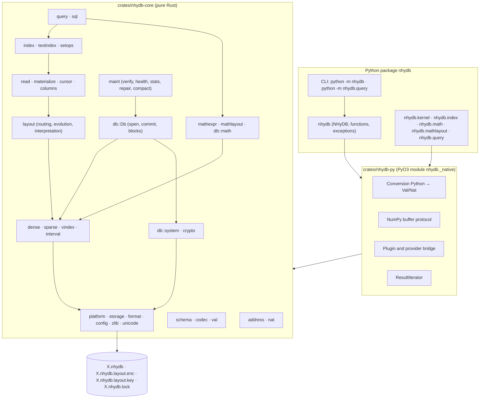
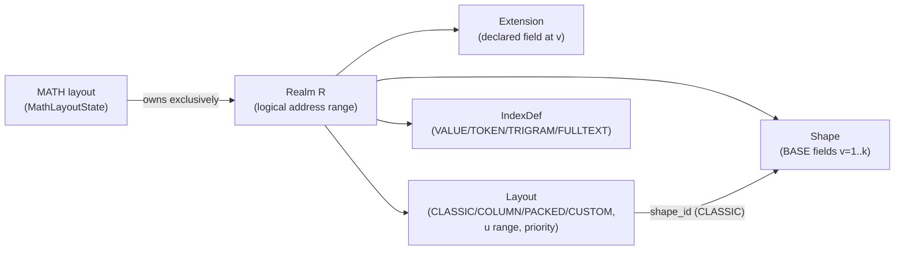
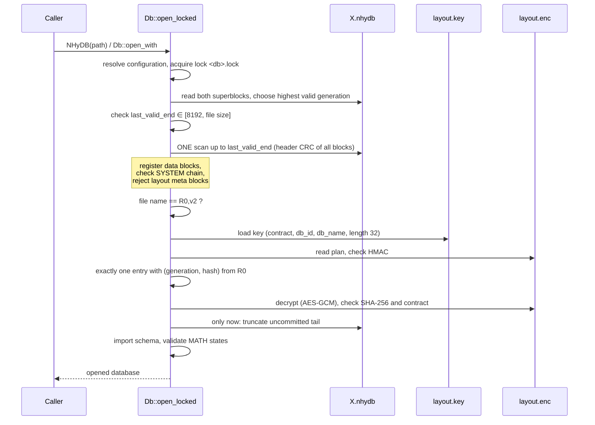
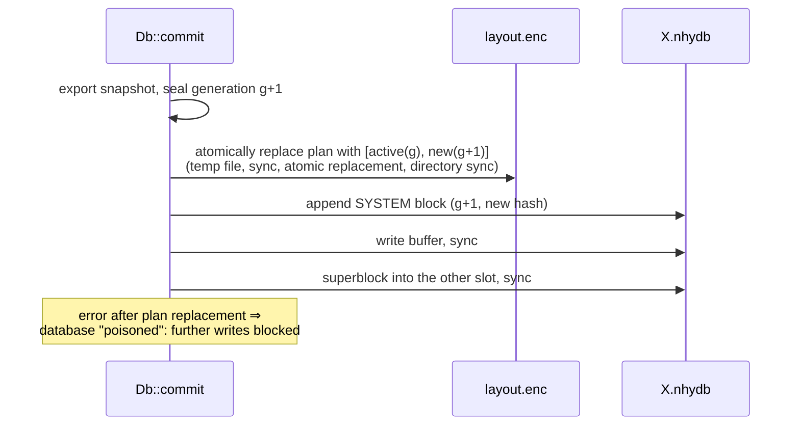
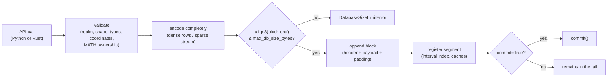
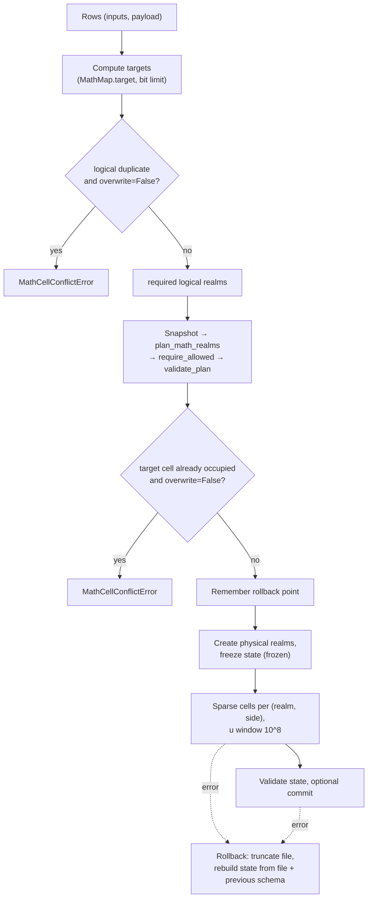
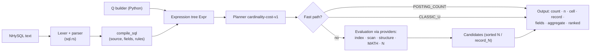

# NHyDB 0.27.0 – Technical Documentation

| Metadata | Value |
|---|---|
| Document | Technical reference documentation NHyDB 0.27.0 (native Rust engine with Python binding) |
| Language | English |
| German version | `../de/NHyDB_Technische_Dokumentation.md` |
| Document date | 2026-10-17 |
| Product | NHyDB 0.27.0, Python package `nhydb` |
| Engine version (`ENGINE_VERSION`) | `0.27.0` |
| File identifier | `NHYDB016` (format revision 16, `FILE_FORMAT_VERSION = "0.16"`) – internal identifier of the file format; it changes only when the on-disk format changes and is independent of the product version |
| Platforms | macOS, Linux, Windows |
| License | see file `LICENSE` (custom license; the license terms have not yet been published) |
| Contact | achim.meissner@nhydb.de |

---

## Table of Contents

1. [Objectives and Scope](#1-objectives-and-scope)
2. [Mathematical Foundations of Addressing](#2-mathematical-foundations-of-addressing)
3. [Implementation of the Mathematics in the Rust Core](#3-implementation-of-the-mathematics-in-the-rust-core)
4. [Architecture and Components](#4-architecture-and-components)
5. [Data Model: Realms, Shapes, Extensions, Layouts](#5-data-model-realms-shapes-extensions-layouts)
6. [Data Types and Value Encoding](#6-data-types-and-value-encoding)
7. [Storage Organization and File Format 0.16](#7-storage-organization-and-file-format-016)
8. [System Address Space R0,u1 and External Layout Plan](#8-system-address-space-r0u1-and-external-layout-plan)
9. [Write and Read Paths, Commit and Persistence](#9-write-and-read-paths-commit-and-persistence)
10. [Layouts, Routing and Layout Evolution](#10-layouts-routing-and-layout-evolution)
11. [Geometric GET: Cell, Record, Auto](#11-geometric-get-cell-record-auto)
12. [Secondary Indexes and Full-Text Search](#12-secondary-indexes-and-full-text-search)
13. [MATH_MAP: Mathematical Placement](#13-math_map-mathematical-placement)
14. [Query Systems: QueryEngine and NHySQL-0.24](#14-query-systems-queryengine-and-nhysql-024)
15. [Integrity, Recovery and Safety Mechanisms](#15-integrity-recovery-and-safety-mechanisms)
16. [Python Interface (PyO3) and NumPy](#16-python-interface-pyo3-and-numpy)
17. [Configuration, Installation, Build and Operation](#17-configuration-installation-build-and-operation)
18. [Tests, Validation and Benchmarks](#18-tests-validation-and-benchmarks)
19. [Known Limitations](#19-known-limitations)
20. [Appendix: Source Code References](#20-appendix-source-code-references)

---

## 1. Objectives and Scope

### 1.1 What NHyDB Is

NHyDB is an embedded, file-based database engine whose address space is
defined not by table rows or keys but by an **arithmetic cell geometry**.
Every storable cell has the structural identity

```text
(R, u, v, lane)      R = realm, u = first coordinate, v = local second coordinate,
                     lane ∈ {NL, NR} (lane/side)
```

From this four-part coordinate a unique natural number `N` can be computed at
any time – and vice versa. `N` is a **derived external reference**, not a
stored key.

The present implementation is a **native Rust engine** with a Python binding
via PyO3.

### 1.2 Feature Set (Overview)

| Area | Content |
|---|---|
| Address mathematics | exact mapping `(R,u,v,lane) ↔ N` with arbitrarily large integers; exclusion of GZ and N0 numbers |
| Storage core | dense BASE records, sparse cells, two lanes, tombstones and null values as separate states |
| Logical interpretation | layouts CLASSIC, COLUMN, PACKED, CUSTOM; mixed-realm routing; safe layout evolution |
| Reading | `get`, `get_cell`, object APIs, geometric GET (`cell`/`record`/`auto`), DESCRIBE, occupancy queries |
| Persistence | append-only container, alternating superblocks, commit boundary, tail recovery, durability `fsync`/`full` |
| Security | system address space R0,u1, encrypted external layout plan (AES-256-GCM, HMAC-SHA256), fail-closed opening, write lock, DB size limit |
| Indexes | VALUE, TOKEN, TRIGRAM, FULLTEXT (positions, BM25) |
| MATH_MAP | safe expression language, mapping of input tuples to cells, realm planner, exclusive MATH realms |
| Queries | QueryEngine (cost planner, providers, aggregation, ranking) and NHySQL-0.24 (read-only `SELECT`) |
| Maintenance | checkpoint, verify, health, stats, repair, compaction (in-place and export) |
| Python | Python API (single operations) and NumPy batch API |

### 1.3 Scope

NHyDB is **not** a relational database system, **not** a server and
**not** a multi-process transaction system. There is exactly one writing
process per database (secured by a lock file), no network interface and no
explicit transaction API with `BEGIN`/`ROLLBACK`. NHySQL is a read-only query
language; writes are performed exclusively through the API.

---

## 2. Mathematical Foundations of Addressing

This section is limited to the mathematics that is **actually implemented**
in the source code. Every formula is assigned to a Rust function; the worked
examples were recomputed with the engine (Python calls into the native module)
or are test cases from `crates/nhydb-core/src/address.rs` and
`tests/python/test_math.py`. How the formulas are implemented in the core
(data types, computation paths) is described in section 3.

### 2.1 Quantities and Value Ranges

| Symbol | Meaning | Value range (checked in code) | Rust identifier |
|---|---|---|---|
| `R` | realm number | integer `R ≥ 1`, otherwise `ValueError("realm_id must be > 0")` | `realm`, `realm_id` |
| `u` | first coordinate | `u ≥ 1`, otherwise `ValueError("u must be > 0")` | `u` |
| `v` | **local** second coordinate | `1 ≤ v ≤ T`; `v = 0` ⇒ `RealmLimitError("local v must start at 1")`, `v > T` ⇒ `RealmLimitError("Realm R: local v limit reached …")` | `v_local`, `local_v` |
| `lane` | lane | exactly `0` (NL) or `1` (NR) | `Lane = u8`, `NL = 0`, `NR = 1` |
| `T` | realm span | constant `10^100` | `realm_span()` |
| `V` | global second coordinate | `V ≥ 1` | `vg`, field `v` of the address dicts |
| `G` | group | `G = u + V ≥ 2` | `g` |
| `N` | canonical cell number | `N ≥ 3`; GZ and N0 numbers excluded | `n` |

All quantities are **unbounded** natural numbers. There is no floating-point
arithmetic and no limitation to 64 bits for mathematical coordinates (for the
physical decoding limit see section 3.6).

> **Naming pitfall `v`:** Functions receive the *local* `v`. In the result
> dicts of `dynadron_address`, `cell_address` and `n_to_dynadron_address`,
> `"v"` holds the *global* `V`, and the local one is under `"v_local"`.

### 2.2 Lane Normalization (`normalize_lane_str`, `normalize_lane_int`)

| Input | Result |
|---|---|
| `0`, `"0"`, `"NL"`, `"L"`, `"DEFAULT"` (case-insensitive, whitespace removed), `None` | `0` (NL) |
| `1`, `"1"`, `"NR"`, `"R"` | `1` (NR) |
| otherwise | `ValueError("lane must be 0/NL or 1/NR")` or `"lane must be 0 or 1"` |

In the block header the lane is stored as bit 0 of the flags:
`flags = 1` for NR, `0` for NL (`lane_flags`, `lane_from_flags = flags & 1`).

### 2.3 Realm and Global Coordinate

Forward (`global_v`):

```text
V = (R − 1)·T + v            (for R = 1 directly V = v)
```

Backward (`split_global_v`):

```text
R = ⌊(V − 1) / T⌋ + 1
v = ((V − 1) mod T) + 1
```

Realm bounds (`realm_v_bounds`, API `realm_bounds`):

```text
V_min(R) = (R − 1)·T + 1,   V_max(R) = R·T
```

**Worked examples (verified with the engine):**

| Call | Result |
|---|---|
| `split_global_v(T)` | `(R = 1, v = T)` |
| `split_global_v(T + 1)` | `(R = 2, v = 1)` |
| `global_v(2, 1)` | `T + 1` |
| `realm_v_bounds(2)` | `(T + 1, 2T)` |

`V = T` is the last cell of realm 1, `V = T + 1` the first of realm 2.
For every combination `(R, u, lane)` the local `v` starts again at 1.

### 2.4 Group and Forward Mapping to N (`n_pair`, `dynadron_n`)

```text
G = u + V

lane = NL (0):   N = G² − u
lane = NR (1):   N = G² + V
```

Properties that follow directly from the formulas and are checked in the
tests:

* Because `1 ≤ u ≤ G − 1`, `N_NL` lies in `[G² − G + 1, G² − 1]`; because
  `1 ≤ V ≤ G − 1`, `N_NR` lies in `[G² + 1, G² + G − 1]`.
* The same structural combination `(R, u, v)` yields two different cells
  (NL and NR); both can be stored independently of each other.

**Worked examples:**

| `(R, u, v, lane)` | `V` | `G` | Computation | `N` |
|---|---|---|---|---:|
| `(1, 1, 1, NL)` | 1 | 2 | `4 − 1` | 3 |
| `(1, 1, 1, NR)` | 1 | 2 | `4 + 1` | 5 |
| `(1, 2, 1, NL)` | 1 | 3 | `9 − 2` | 7 |
| `(1, 1, 2, NL)` | 2 | 3 | `9 − 1` | 8 |
| `(1, 2, 1, NR)` | 1 | 3 | `9 + 1` | 10 |
| `(1, 1, 2, NR)` | 2 | 3 | `9 + 2` | 11 |
| `(1, 5, 2, NL)` | 2 | 7 | `49 − 5` | 44 |
| `(1, 3, 5, NL)` / `NR` | 5 | 8 | `64 − 3` / `64 + 5` | 61 / 69 |
| `(1, 11, 13, NL)` / `NR` | 13 | 24 | `576 − 11` / `576 + 13` | 565 / 589 |
| `(23, 14, 744, NL)` | `22·T + 744` | `22·T + 758` | `G² − 14` | 203 decimal digits |
| `(2, 3, 5, NR)` | `T + 5` | `T + 8` | `G² + T + 5` | 201 decimal digits |

### 2.5 Excluded Numbers GZ and N0

For every group `G ≥ 2`:

```text
N0(G) = G·(G − 1)        group boundary, not a cell
GZ(G) = G²               square center, not a cell
NL cells:  N0(G)+1 … GZ(G)−1        (G − 1 numbers)
NR cells:  GZ(G)+1 … N0(G+1)−1      (G − 1 numbers),  N0(G+1) = G·(G+1)
```

Thus every interval `[G(G−1), (G+1)G)` decomposes into exactly
`N0(G)`, `G−1` NL cells, `GZ(G)`, `G−1` NR cells. Every positive integer is
either exactly one cell or exactly one of the two boundary kinds (for
`N = 1, 2`: `1 = GZ(1)`, `2 = N0(2)`; the core test checks all numbers from
1 to 199,999 for this decomposition).

Example `G = 24`: `552 = N0(24)`, NL cells `553 … 575`, `576 = GZ(24)`,
NR cells `577 … 599`, `600 = N0(25)`.

### 2.6 Backward Mapping N → (R, u, v, lane) (`n_to_address`)

Algorithm (integer operations only):

```text
Input N ≥ 1 (N = 0 ⇒ ValueError "N must be > 0")
m = isqrt(N)                 largest m with m² ≤ N
d = N − m²                   it holds that 0 ≤ d ≤ 2m

d = 0          ⇒ GZ(m):   AddressError "N… is a GZ point, not an NHyDB storage cell"
1 ≤ d < m      ⇒ NR:      G = m,     V = d,          u = m − d
d = m          ⇒ N0(m+1): AddressError "N… is an N0 point, not an NHyDB storage cell"
m < d ≤ 2m     ⇒ NL:      G = m + 1, u = G² − N,     V = G − u

(R, v) = split_global_v(V)
Check: cell_address(R, u, v, lane).N == N, otherwise AddressError
           "N… could not be resolved unambiguously"
```

Rationale for the case distinction: for NR cells, `G² < N < G² + G`, hence
`isqrt(N) = G` and `d = V ∈ [1, G−1]`. For NL cells,
`(G−1)² + (G−1) < N < G²`, hence `isqrt(N) = G − 1 = m` and
`d = N − m² ∈ [m+1, 2m]`. `d = m` corresponds to `N = m(m+1) = N0(m+1)`.

**Worked examples:**

| `N` | `m` | `d` | Case | Result |
|---:|---:|---:|---|---|
| 589 | 24 | 13 | `1 ≤ 13 < 24` ⇒ NR | `G = 24, V = 13, u = 11` ⇒ `(1, 11, 13, NR)` |
| 391 | 19 | 30 | `30 > 19` ⇒ NL | `G = 20, u = 400 − 391 = 9, V = 11` ⇒ `(1, 9, 11, NL)` |
| 553 | 23 | 24 | `24 > 23` ⇒ NL | `G = 24, u = 23, V = 1` (first NL cell of G = 24) |
| 575 | 23 | 46 | `46 = 2m` ⇒ NL | `G = 24, u = 1, V = 23` (last NL cell) |
| 576 | 24 | 0 | GZ | `AddressError` |
| 552 | 23 | 23 | `d = m` ⇒ N0 | `AddressError` |
| 600 | 24 | 24 | `d = m` ⇒ N0 | `AddressError` |
| 10 | 3 | 1 | NR | `G = 3, V = 1, u = 2` ⇒ `(1, 2, 1, NR)` |

For `N = (22·T + 758)² − 14` the inversion yields `V = 22·T + 744` and, via
`split_global_v`, exactly `(R = 23, v = 744)`.

### 2.7 Additional Indicators (`dynadron_address`)

In addition to `R, u, v_local, V, G, NL, NR`, `dynadron_address(R, u, v)`
returns:

```text
station        = V − 1
stufenbreite   = u + 2
stufe          = ⌊station / stufenbreite⌋ + 1
stufenstation  = station mod stufenbreite
```

Example `(1, 3, 5)`: `V = 5, G = 8, station = 4, stufenbreite = 5,
stufe = 1, stufenstation = 4, NL = 61, NR = 69`. For `(2, 3, 5)`:
`station = T + 4`, `stufe = ⌊(T+4)/5⌋ + 1`, `stufenstation = (T+4) mod 5`.
These values are **not** part of the cell identity and are never stored;
they are computed on demand and appear in cell outputs with the prefix
`_dyn_…`: `get_cell` and `get_cell_n` return them by default
(`dyn_address=True`, can be disabled with `dyn_address=False`), `get_math_cell`
only with `dyn_address=True`. For record reads (`get`, `range`) the mode
`dyn_address="off"|"once"|"auto"` applies (with `dyn_v` for `"once"`); its
default value is set with `set_dyn_address_output(mode, v=…)`
(preset `"off"`).

### 2.8 N References as Text (`parse_n_reference`)

Accepted are decimal numbers with an optional leading `N`/`n` and whitespace
(`"N589"`, `" n 12 "`, `"123"`); N references are output as `"N<number>"`
(`N_ref`). Invalid text ⇒ `AddressError("invalid N reference '…'")`,
`0` ⇒ `ValueError`.

### 2.9 Geometry of the Layouts (Logical Mappings over the Cell Address)

Layouts assign logical records and fields to valid cells. The following
mappings are implemented in `Db::logical_address_in` (forward) and
`Db::interpret_layout_address` (backward); they do not change the cell
identity.

| Layout | Forward: object `o`, field `f` → cell | Backward: cell `(R, u, v)` → record | Anchor |
|---|---|---|---|
| CLASSIC | `(R, u = o, v = v_f)`; without field `v = 1` | `record = u`, field = `v` | `v = 1` |
| COLUMN | `(R, u = u_f, v = o)`; without field `u = anchor_u` (default: smallest field `u`) | `record = v`, field = `u` | `u = anchor_u` |
| PACKED (`u_p`, `span`) | `anchor = (o − 1)·span + 1`, `(R, u = u_p, v = anchor + offset_f)`; `anchor > T` or `v > T` ⇒ `RealmLimitError` | `record = ⌊(v − 1)/span⌋ + 1`, `offset = (v − 1) mod span` | `offset = 0` |
| CUSTOM | plugin `logical_address` | plugin `describe` | plugin |

Constraints from `create_layout`: PACKED `1 ≤ span ≤ T` (default `10^8`),
`0 ≤ offset < span`, `u_p` within the u range of the layout; COLUMN fields with
unique `u` within the u range.

**Canonical `record_N`** (`record_n_nat`): `N` of the record's anchor cell on
the same lane, regardless of whether the anchor is occupied.

**Worked examples (verified with the engine):**

| Layout | Request | Computation | Result |
|---|---|---|---|
| CLASSIC, realm 1 | `record_n_for_address(1, 4, 7)` | anchor `(1, 4, 1, NL)`: `G = 5`, `25 − 4` | `N21` |
| CLASSIC, realm 1 | `get_n(44, mode="cell")` | `44 → (1, 5, 2, NL)`, anchor `(1, 5, 1)`: `G = 6`, `36 − 5` | `record_N = N31` |
| COLUMN, realm 2, fields `u = 3` (a), `u = 5` (b) | object 9, field `b` | `(2, 5, 9, NL)`: `V = T + 9`, `G = T + 14`, `N = G² − 5` | `N = 10^200 + 28·10^100 + 191` |
| COLUMN, same | anchor object 9 | `anchor_u = 3` ⇒ `(2, 3, 9)` | `u = 3, v = 9` |
| PACKED, realm 3, `u = 2`, `span = 8` | object 4, field with `offset = 5` | `anchor = 3·8 + 1 = 25`, `v = 30` | `(3, 2, 30)` |
| PACKED, same | interpretation of `v = 30` | `⌊29/8⌋ + 1 = 4`, `29 mod 8 = 5` | `record = 4, offset = 5, anchor = False` |

### 2.10 Routing Mathematics (Winner Rule)

For `(R, u)`, all layouts of the realm with `u_start ≤ u ≤ u_end`
(`u_end = None` = unbounded) are considered. Sort key
(`LayoutDef::sort_cmp`, larger wins):

```text
(priority,  −width,  layout_id)
width = u_end − u_start      or 10^200 for unbounded layouts
```

### 2.11 Mathematics of the MATH_MAP Layer

MATH layouts (section 13) compute from inputs `(x1, …, xk)` integer values
`u = f_u(x)`, `V = f_V(x)` and `side = f_side(x)` and decompose `V` with
the same formulas as section 2.3, but over `BigInt` with a selectable span
(`split_global_v(V, realm_span)`, `join_global_v(R, v, realm_span)`
in `mathexpr.rs`; in the database always `T = 10^100`):

```text
Preconditions:  u > 0, V > 0 (otherwise MathDomainError), side ∈ {0, 1}
(R_log, v) = (⌊(V−1)/T⌋ + 1, ((V−1) mod T) + 1)        (div_mod_floor)
join:       V = (R_log − 1)·T + v      with R_log ≥ 1, 1 ≤ v ≤ T
```

Example: `u = x`, `V = x·10^100 + 7`, `side = NR`, input `x = 3` ⇒
`V = 3·T + 7` ⇒ `R_log = 4`, `v = 7`, `side = 1`; `join_global_v(4, 7) = 3·T + 7`.

The logical realm is mapped to a physical realm via the RealmMap
(`physical = physical_start + (R_log − logical_start)` per extent);
the cell `(R_phys, u, v, side)` is what is stored and addressed. The `N`
of a MATH cell is therefore `N(R_phys, u, v, side)`.

### 2.12 Derived Number Sequences in the Query Layer

* **Provider `n_sequence`** (`provider_n_sequence`): iterates over
  `N = start, start+step, …, stop` (`step ≠ 0`), inverts each number with
  `n_to_address` and **skips** GZ/N0 numbers (with `strict=True`
  an `AddressError` instead); with a realm context only cells of that
  realm are taken over.
  Example `start = 550, stop = 560` in realm 1: 552 (N0) is dropped,
  10 cells remain. In the record domain each cell is mapped to its
  `record_N`, e.g. `554 → (1, 22, 2, NL) → anchor (1, 22, 1)`:
  `G = 23`, `529 − 22 = 507`; `550 → (1, 2, 21, NR) → anchor (1, 2, 1, NR)`:
  `9 + 1 = 10`. Result: `N5, N10, N273, N307, N343, N381, N421, N463, N507, N553`.
* **Provider `formula`** (`provider_formula`): compiles `u` and `V` (or
  a local `v`, which is extended to `V = (R−1)·T + v`) as MATH expressions
  over the parameter `k = start … stop` and returns
  `N(R_log, u, v, side)` – **no** RealmMap is applied here.
* **Provider `math_layout_inputs`**: applies the MathMap and RealmMap of a
  MATH layout and returns `N(R_phys, u, v, side)`.

### 2.13 Principle versus Implementation Decision

| Statement | Kind |
|---|---|
| Cell identity `(R, u, v, lane)`; `N` is derived | mathematical principle |
| Formulas for `V`, `G`, `N`, exclusion of GZ/N0, inversion via `isqrt` | mathematical principle |
| `T = 10^100`, `NL = 0`, `NR = 1` | fixed system constants (R0,u1,v9), not configurable |
| Station indicators (`station`, `stufe` …) | computed supplementary information, not part of the identity |
| Layout geometries and winner rule | logical interpretation layer |
| MATH: inputs → `(u, V, side)` → logical → physical realm | application layer; the physical realm assignment is an implementation decision (exclusive, freely planned realms) |
| structural block encoding, no N index | implementation decision |
| `u64`/`u128` fast paths, `BigUint` fallback path | implementation decision (performance) |

> **Note on payload data:** A schema field named `N` (e.g. in the
> benchmark program `bench_native` or in the example in section 16.9) is an
> ordinary application value, not the cell address.

---

## 3. Implementation of the Mathematics in the Rust Core

### 3.1 The Number Type `Nat` (`nat.rs`)

```rust
pub enum Nat {
    S(u64),            // values 0 … u64::MAX directly
    B(Box<BigUint>),   // exclusively values > u64::MAX
}
```

* **Invariant:** `B` contains only values `> u64::MAX`. All constructors
  (`From<u128>`, `From<BigUint>`, arithmetic) normalize accordingly.
  Therefore the derived `Eq`, `Ord`, `Hash` are numerically correct
  (`S(_) < B(_)` always holds).
* Operations: `add`, `add_u64`, `checked_sub`, `sub_u64`, `mul`, `div_rem`,
  `pow10`, `parse_decimal`; each with a `u64` fast path and a
  `BigUint` fallback path.
* `T = 10^100` is computed once as `Nat::pow10(100)` and held in a
  `OnceLock` (`realm_span()`); likewise `10^200` as the width of
  unbounded layouts (`unbounded_width()`).

### 3.2 Computation Paths of the Address Functions (`address.rs`)

| Function | Flow in the code |
|---|---|
| `require_positive(name, x)` | `x = 0` ⇒ `ValueError("<name> must be > 0")` (the PyO3 layer maps negative Python numbers to 0 so that the same text results) |
| `validate_local_v(v, R)` | `v = 0` ⇒ `RealmLimitError`; only if `v` is present as `Nat::B` can `v > T` hold – then `RealmLimitError` (values ≤ `u64::MAX` are always `< T`) |
| `global_v_unchecked(R, v)` | `R = 1` ⇒ `V = v` (no multiplication), otherwise `(R−1)·T + v` via `BigUint` |
| `split_global_v(V)` | `V` as `Nat::S` ⇒ immediately `(1, V)`; otherwise `div_rem(V − 1, T)` |
| `n_pair(u, V)` | `G = u + V`; if `u`, `V` are present as `u64` and `G < 2^63`: `G²` in `u128`, `N_NL = G² − u`, `N_NR = G² + V` in `u128`; otherwise `BigUint` |
| `dynadron_address` | validation, `V`, `n_pair`, indicators via `div_rem` |
| `dynadron_n` | validation, `V`, `n_pair`, selection by `lane` |
| `isqrt(N)` | `Nat::S`: initial value `⌊√N⌋` via `f64`, then exact correction in `u128` (`while r² > N: r −= 1; while (r+1)² ≤ N: r += 1`); `Nat::B`: `BigUint::sqrt` |
| `n_to_address(N)` | algorithm 2.6, final check `cell_address(...).n == N` |

**Why the `u128` path is safe:** For `G < 2^63`, `G² < 2^126` and
`G² + V < 2^126 + 2^63 < 2^128`; an overflow is impossible. For
`R ≥ 2`, `V ≥ T + 1 > 2^64`, so `V` is a `Nat::B`, and the
`BigUint` path is used.

**Why the floating-point initial estimate becomes exact:** The estimate serves
only as an initial value; the two correction loops establish
`r² ≤ N < (r+1)²` in exact `u128` arithmetic.

### 3.3 Worked Examples through the Rust Core

**Example A – `dynadron_n(1, 11, 13, NR)`:**

```text
require_positive(R=1), require_positive(u=11), validate_local_v(13)   ok
global_v_unchecked: R = 1  ⇒  V = 13                                 (Nat::S)
n_pair: u, V as u64, G = 24 < 2^63  ⇒  u128 path
        G² = 576, NL = 576 − 11 = 565, NR = 576 + 13 = 589
Result (lane = NR): 589
```

**Example B – `n_to_address(589)`:**

```text
isqrt(589): f64 estimate 24, correction: 24² = 576 ≤ 589 < 625  ⇒  m = 24
d = 589 − 576 = 13;  1 ≤ 13 < 24  ⇒  NR, u = 24 − 13 = 11, V = 13
split_global_v(13): Nat::S  ⇒  (R = 1, v = 13)
Check: cell_address(1, 11, 13, NR).n = 589 = N   ⇒   (1, 11, 13, NR)
```

**Example C – `dynadron_n(23, 14, 744, NL)`:**

```text
global_v_unchecked: R = 23  ⇒  V = 22·T + 744          (Nat::B, BigUint path)
n_pair: V is Nat::B  ⇒  BigUint: G = 22·T + 758, N = G² − 14
N has 203 decimal digits
n_to_address(N): isqrt via BigUint::sqrt ⇒ m = 22·T + 757;
  d = N − m² = 2m + 1 − 14 = 2m − 13 > m  ⇒  NL, G = m + 1, u = G² − N = 14,
  V = G − 14 = 22·T + 744;  split_global_v(V) ⇒ (23, 744)
```

(Test case `r23_u14_v744` in `address.rs`, additionally NR back-computation.)

**Example D – boundary number `n_to_address(552)`:** `isqrt(552) = 23`,
`d = 552 − 529 = 23 = m` ⇒ `AddressError("N552 is an N0 point, not an NHyDB storage cell")`.

### 3.4 Physical Encoding of the Coordinates

Coordinates are encoded **structurally** and per block, never as complete
tuples and never as `N` per cell:

| Coordinate | Dense block (`DATA_DENSE`) | Sparse block (`SPARSE_CELLS`) |
|---|---|---|
| `R` | VarUInt in the prefix | VarUInt in the prefix |
| `lane` | bit 0 of the block flags | bit 0 of the block flags |
| `u` | `u_start` in the prefix; record `i` has `u = u_start + i` | `u_start`, `u_end` in the prefix; per group `Δu` (first group `Δu = 0`) |
| `v` | implicit through the field position in the shape | per cell `Δv` to the predecessor (start 0), strictly ascending |

The sparse cell stores `Δv` together with three flag bits as **one**
VarUInt: `key = (Δv << 3) | flags` with `flags = tomb | self-typed<<1 |
null<<2`. For `Δv < 2^60` the computation is done in `u64`, otherwise via `BigUint`.

Example: cells `v = 2` and `v = 9` of a u group, both declared, not
null: keys `(2 << 3) | 0 = 16` and `((9 − 2) << 3) | 0 = 56`.

### 3.5 VarUInt and VarInt

```text
VarUInt:  n = Σ b_i·128^i, byte i = b_i | 0x80 (except the last byte)
VarInt:   z = 2n (n ≥ 0),  z = −2n − 1 (n < 0);  then VarUInt(z)
          inverse mapping: z even ⇒ n = z/2, z odd ⇒ n = −(z+1)/2
```

Encodings verified with the engine (`enc_vu`, `enc_vi`, hexadecimal):

| Value | VarUInt | | Value | VarInt |
|---:|---|---|---:|---|
| 0 | `00` | | 0 | `00` |
| 1 | `01` | | −1 | `01` |
| 127 | `7f` | | 1 | `02` |
| 128 | `8001` | | −3 | `05` |
| 300 | `ac02` | | 3 | `06` |
| 2^64 | `80808080808080808002` | | | |

Implementation: `put_vu64` for `u64`, `put_vu_big` via
`BigUint::to_radix_le(128)`; `get_vu64` decodes up to 64 bits in a
`u128` accumulator and otherwise falls back to `get_vu` (arbitrary size).
`get_vu_u64` is used for physical fields (lengths, counters, IDs) and
rejects values > `u64::MAX` with `CorruptionError("…: value too large")`.

### 3.6 Physical Limit of Large Coordinates

`get_vu` aborts as soon as the shift width exceeds 16,384 bits
(`CorruptionError("VarUInt implausibly large")`). A single VarUInt stored in a
file can therefore be at most 2,341 bytes (≈ 16,387 bits) long. This is a
**protective limit of the decoder** against manipulated files, not a
restriction of the address mathematics itself; coordinates of the
order of magnitude `T = 10^100` (333 bits)
lie far below it (the 203-digit `N` of example C has about 672 bits).

### 3.7 Fixed System Constants per Database

Every newly created database writes the cell
`v9 = {"lane_NL": 0, "lane_NR": 1, "realm_span": 10**100}` into R0,u1. `check_record`
(`db/system.rs`) checks on opening that v9 – if present – corresponds exactly
to this value and that `realm_span` is numerically equal to `realm_span()`; otherwise
`CorruptionError("R0,u1,v9: fixed system constants violated …")`. If v9 is
missing, the same value applies.

### 3.8 Verification of the Mathematics

| Test | Content |
|---|---|
| `address.rs::examples_from_docs` | 589 → `(1,11,13,NR)`, NL partner 565, 391 → `(1,9,11,NL)`, rejection of 552, 576, 600, 4; edge cells 553/575 (NL) and 577/599 (NR) with `G = 24`; `(1,1,1,NL) = 3` |
| `address.rs::r23_u14_v744` | forward = `(22·T+758)² − 14`, 203 digits, back-computation NL and NR |
| `address.rs::realm_edges` | `split_global_v(T) = (1, T)`, `split_global_v(T+1) = (2, 1)`, round trips for very large `R` and `u` on both lanes, `v` bounds, zero coordinates |
| `address.rs::exhaustive_small_range` | all `N` in `[1, 200,000)`: either GZ/N0 or exactly invertible; > 199,000 valid cells |
| `address.rs::parse_refs` | text forms of N references |
| `nat.rs` (unit tests) | VarUInt/VarInt incl. `i64::MIN`, truncated inputs |
| `tests/python/test_math.py` | rejection of GZ/N0 numbers, worked example `(23, 14, 744)` |
| `crates/nhydb-core/tests/sparse_access.rs` | sparse access with `u = 2^70` and `v ≥ 10^40` against an independent model |

---

## 4. Architecture and Components

### 4.1 Layer Model



**Architecture decision:** The core `nhydb-core` has no Python dependency
and can be tested on its own with `cargo test -p nhydb-core`. Address
mathematics, encoding, routing and commit reside exclusively in the core; the
PyO3 layer only converts types, releases the GIL for purely native sections
and bridges Python plugins.

### 4.2 Modules of the Rust Core

Line counts: physical lines of the source files in NHyDB 0.27.0 (`wc -l`,
including comments and unit tests); they serve for orientation only.

| Module | Lines | Task |
|---|---:|---|
| `lib.rs` | 50 | crate root, public re-exports |
| `error.rs` | 155 | error type `Error` (mapping to the Python exceptions) |
| `nat.rs` | 458 | number type `Nat`, VarUInt/VarInt encoding |
| `val.rs` | 927 | dynamic value type `Val` (None/Bool/Int/Big/Float/Str/Bytes/List/Map), Python-compatible JSON |
| `address.rs` | 411 | address mathematics (section 3) |
| `codec.rs` | 479 | 15 data types, `FieldDef`, value encoding/decoding |
| `schema.rs` | 585 | `ShapeDef`, `RealmDef`, `ExtensionDef`, `LayoutDef`, `IndexDef` |
| `format.rs` | 217 | superblock, block header, block types, constants |
| `storage.rs` | 147 | append buffer, position-based reading, sync |
| `platform.rs` | 425 | OS layer: durability, directory sync, atomic replacement, locks |
| `config.rs` | 242 | `nhydb_config.toml` |
| `crypto.rs` | 161 | AES-256-GCM, HMAC-SHA256, SHA-256, Base64, UUIDv4 |
| `unicode.rs` + `unicode_tables.rs` | 180 + 17 (generated tables, very long lines) | CPython-exact character classes and `casefold` (Unicode 16.0.0) |
| `zlib.rs` | 53 | zlib compression of the postings |
| `plugin.rs` | 46 | trait `LayoutPlugin` for CUSTOM layouts |
| `setops.rs` | 96 | sorted set operations (galloping intersection) |
| `textindex.rs` | 625 | tokenizer, n-grams, FULLTEXT codecs, phrase, BM25 |
| `mathexpr.rs` | 1,942 | MATH expression language, `MathMap`, `MathMapLayoutSpec`, `dry_run` |
| `mathlayout.rs` | 546 | realm planner for MATH layouts |
| `query.rs` | 2,397 | QueryEngine: expression tree, planner, evaluation, aggregation, search |
| `sql.rs` | 1,252 | NHySQL: lexer, parser, compiler |
| `db/mod.rs` | 1,197 | `Db`: state, open, commit, blocks, open scan |
| `db/system.rs` | 397 | R0,u1, key/plan files, schema snapshot |
| `db/schema_ops.rs` | 427 | realms, shapes, extensions, index definitions |
| `db/layout.rs` | 1,451 | layouts, SpaceMaps, routing, evolution, logical addresses |
| `db/dense.rs` | 620 | dense BASE records |
| `db/sparse.rs` | 555 | sparse cells |
| `db/vindex.rs` | 554 | v index per u group (targeted sparse access) |
| `db/interval.rs` | 152 | interval index with prefix maximum |
| `db/read.rs` | 828 | read APIs, geometric GET |
| `db/materialize.rs` | 374 | iteration of materialized cells, `record_N` |
| `db/cursor.rs` | 330 | lazy cursor for `range`, `select`, `find`, sparse points |
| `db/columns.rs` | 489 | column-wise writing/reading (NumPy paths) |
| `db/index.rs` | 1,155 | index construction, directories, candidates |
| `db/math.rs` | 553 | MATH API in the core, rollback |
| `db/maint.rs` | 1,060 | checkpoint, verify, health, stats, repair, compaction |

### 4.3 PyO3 Layer `nhydb-py`

| File | Task |
|---|---|
| `lib.rs` | class `NHyDB`, `LayoutDef`, `IndexDef`, module functions, registration |
| `conv.rs` | conversion Python ↔ `Val`/`Nat` (arbitrarily large `int`) |
| `exceptions.rs` | exception hierarchy |
| `numpy_io.rs` | buffer protocol for NumPy arrays, output via `numpy.frombuffer` |
| `iter.rs` | `ResultIterator` (lazy, block-wise) |
| `pyplugin.rs` | bridge for Python CUSTOM plugins (weak reference to the DB object) |
| `kernel.rs` | stateless kernel functions for `nhydb.kernel` |
| `textapi.rs` | functions for `nhydb.index` |
| `mathapi.rs` | classes for `nhydb.math`/`nhydb.mathlayout`, MATH methods |
| `queryapi.rs` | native `QueryEngine`, SQL, provider bridge |

### 4.4 External Dependencies

Versions according to `Cargo.lock` of NHyDB 0.27.0:

| Crate | Version | Usage |
|---|---|---|
| `num-bigint` / `num-integer` / `num-traits` | 0.4.8 / 0.1.47 / 0.2.19 | exact integer arithmetic |
| `crc32fast` | 1.5.2 | CRC32 for superblocks, block headers, payloads |
| `miniz_oxide` | 0.8.9 | zlib decompression; compression on Windows |
| `aes-gcm` | 0.11.1 | AEAD encryption of the layout plan |
| `sha2` | 0.11.1 | SHA-256 (snapshot hash, fingerprints, MAC key derivation) |
| `hmac` | 0.13.0 | HMAC-SHA256 over the plan envelope |
| `base64` | 0.23.1 | encoding of key, nonce and ciphertext |
| `getrandom` | 0.4.3 | operating system random numbers (keys, nonces, UUID) |
| `toml` | 1.1.8 | configuration file |
| `libc` (Unix only) | 0.2.190 | `fsync`, `fcntl(F_FULLFSYNC)` |
| `windows-sys` (Windows only) | 0.61.2 | `FlushFileBuffers`, `MoveFileExW` |
| `pyo3` (`nhydb-py` only) | 0.29.3 | Python binding, feature `num-bigint` |
| system `libz` (Unix, via FFI) | – | zlib compression byte-identical to CPython |

No custom cryptography is implemented; JSON is produced with a custom,
Python-compatible codec in `val.rs` (no `serde`).

### 4.5 Release Profile

```toml
[profile.release]
opt-level = 3
lto = "fat"
codegen-units = 1
panic = "unwind"
```

---

## 5. Data Model: Realms, Shapes, Extensions, Layouts

### 5.1 Overview of Terms



| Object | Rust type | Persistence | Important fields |
|---|---|---|---|
| Realm | `RealmDef` | external layout plan | `realm_id`, `name`, `description`, `default_shape_id`, `base_reserve_to` |
| Shape | `ShapeDef` | external layout plan | `shape_id`, `realm_id`, `name`, `fields: Vec<FieldDef>` |
| Field | `FieldDef` | part of shape/extension | `v`, `name`, `typ`, `enum_map`, `description` |
| Extension | `ExtensionDef` | external layout plan | `realm_id`, `v`, `typ`, `name`, `enum_map` |
| Layout | `LayoutDef` | external layout plan | `layout_id`, `realm_id`, `kind`, `u_start`, `u_end`, `priority`, `shape_id`, `params`, `spacemap`, `plugin` |
| Index | `IndexDef` | external layout plan | `index_id`, `realm_id`, `name`, `kind`, `source_v`, `options` |
| MATH state | `MathLayoutState` | external layout plan | specification, RealmMap, `payload_type`, `frozen` |

In format 0.16, all schema objects reside **not** in the database file
but encrypted in the external layout plan (section 8). The database file
contains only data, index, delete, checkpoint, configuration and SYSTEM
blocks.

### 5.2 Dense and Sparse

* **Dense BASE record:** a contiguous record at `(R, u, lane)` with
  the fields of a shape in field order (`v = 1 … k`). It is written
  block-wise for contiguous `u` ranges (`put_dense_batch`).
* **Sparse cell:** a single cell `(R, u, v, lane)` with a value, null or
  tombstone. Sparse cells supplement or overlay dense records
  (extensions, single values, COLUMN/PACKED/CUSTOM objects, MATH cells).

Three states are strictly separated:

| State | Meaning | Encoding |
|---|---|---|
| missing | cell was never written | no entry |
| null | cell exists with value `None` | sparse flag `4` |
| tombstone | cell was deleted | sparse flag `1` |

The **newest** state in each case (highest block ID) wins.

### 5.3 Extensions and the BASE Boundary

Extensions are declared additional fields of a realm at a `v` above
the BASE fields. They are stored as sparse cells (an optional
EXT area `0xEA` in dense records is supported on read but not
written by the engine). `define_extension`, `put_extensions`, `put_extension_list` and
`put_extension_range` operate at this level. `base_reserve_to` reserves
a `v` range for future BASE fields.

---

## 6. Data Types and Value Encoding

### 6.1 The 15 Field Types

| Type code | Name | Encoding | Value range / notes |
|---:|---|---|---|
| 1 | `u8` | 1 byte LE | 0 … 255 |
| 2 | `u16` | 2 bytes LE | 0 … 65,535 |
| 3 | `u32` | 4 bytes LE | 0 … 2³²−1 |
| 4 | `u64` | 8 bytes LE | 0 … 2⁶⁴−1 |
| 5 | `i8` | 1 byte LE | −128 … 127 |
| 6 | `i16` | 2 bytes LE | |
| 7 | `i32` | 4 bytes LE | |
| 8 | `i64` | 8 bytes LE | |
| 9 | `f32` | 4 bytes IEEE 754 LE | finite values that would become infinite as `f32` are rejected |
| 10 | `f64` | 8 bytes IEEE 754 LE | |
| 11 | `bool` | 1 byte | Python truth value |
| 12 | `varuint` | VarUInt | arbitrarily large, ≥ 0 |
| 13 | `varint` | VarInt (ZigZag + VarUInt) | arbitrarily large |
| 14 | `utf8` | `vu(length)` + UTF-8 bytes | non-strings are converted like Python `str()` |
| 15 | `bytes` | `vu(length)` + bytes | |

The type codes are available as `nhydb.TYPE_CODES`.

### 6.2 VarUInt and VarInt

* **VarUInt (`vu`):** base 128, seven data bits per byte, little-endian,
  highest bit = continuation. Arbitrarily large (for `Nat::B` via `BigUint`).
* **VarInt (`vi`):** ZigZag mapping `n ≥ 0 → 2n`, `n < 0 → −2n−1`,
  followed by VarUInt.
* Decoding errors result in `CorruptionError` with fixed texts
  (`VarUInt ends prematurely`, `VarUInt implausibly large`,
  `length value ends beyond the payload`, `fixed-width value incomplete`).

### 6.3 Enums

A field can carry an enum mapping `label → code` (codes as `i64`).
On write, labels are translated into codes, and back on read. With
duplicate codes, the last entry wins – as with a Python dict comprehension.
Unknown labels result in
`ValueError("<feld>: unknown enum value '<x>'")`.

### 6.4 Self-Typed Sparse Cells

Sparse cells for which no type can be derived from the shape, extension or
layout, or which are written with an explicit `type=`, store their
type code as an additional byte ("self-typed"). CUSTOM layout cells and
MATH cells are always self-typed. If no type can be derived and none is
specified, the write is rejected with `SchemaError("…: cannot derive a data type; specify type=...")`.

### 6.5 The Value Type `Val`

Cell values, layout parameters and API results are represented in the core
as `Val`: `None`, `Bool`, `Int(i64)`, `Big(BigInt)`, `Float(f64)`,
`Str`, `Bytes`, `List`, `Map` (ordered keys). `Val` implements the
**Python equality and ordering semantics** (e.g. `1 == 1.0 == True`) that
are required for aggregation, grouping and sorting in the query layer,
as well as a JSON codec that serializes byte-identically to
`json.dumps(…, sort_keys=True, separators=(",", ":"), ensure_ascii=False)`
(for fingerprints additionally an `ensure_ascii=True` mode).

---

## 7. Storage Organization and File Format 0.16

The engine writes and reads the file format with the identifier `NHYDB016`
(format revision 16, `FILE_FORMAT_VERSION = "0.16"`). Older format revisions
are not read; there is no converter. All integers are little-endian.

### 7.1 Files of a Database

| File | Content | Note |
|---|---|---|
| `X.nhydb` | container (superblocks, blocks) | |
| `X.nhydb.layout.enc` | encrypted layout plan (1–2 schema generations) | path selectable |
| `X.nhydb.layout.key` | 32-byte key (JSON), Unix permissions `0600` | **back up separately**; without it the DB cannot be opened |
| `X.nhydb.lock` | lock file for exclusive write access (empty, persists) | |

The paths of plan and key can be chosen via `layout_path`/`key_path` or the
configuration; R0,u1 stores only the **file names**, not paths.

### 7.2 Overall File Layout

```text
Offset 0      Superblock A (4096 bytes)
Offset 4096   Superblock B (4096 bytes)
Offset 8192   Block 1: SYSTEM (R0,u1, generation 0)
              Block 2: DB_CONFIG
              Block …: DATA_DENSE | SPARSE_CELLS | DELETE | SECONDARY | CHECKPOINT | SYSTEM | DB_CONFIG
              ── commit boundary last_valid_end ──
              (optional: uncommitted tail, truncated on open)
```

### 7.3 Superblock

| Offset | Type | Content |
|---:|---|---|
| 0 | 8 bytes | `NHYDB016` |
| 8 | u16 | major `0` |
| 10 | u16 | minor `16` |
| 12 | u32 | superblock size `4096` |
| 16 | u64 | `generation` |
| 24 | u64 | `checkpoint_offset` |
| 32 | u64 | `last_valid_end` (commit boundary) |
| 40 | u64 | `next_block_id` |
| 48 | u64 | `created_ns` |
| 56 | u64 | `updated_ns` |
| 64 | u32 | `flags` |
| 4092 | u32 | CRC32 over bytes 0 … 4091 |

On opening, the valid superblock with the highest generation wins. A
commit always writes the **other** slot.

### 7.4 Block Header

32 bytes, structure `<4sBBHQQII`:

| Field | Type | Content |
|---|---|---|
| Magic | 4 bytes | `NHBL` |
| Version | u8 | `16` |
| Type | u8 | block type (table 7.5) |
| Flags | u16 | bit 0 = lane NR |
| Block ID | u64 | sequential |
| Payload length | u64 | |
| Payload CRC | u32 | CRC32 of the payload |
| Header CRC | u32 | CRC32 of the header with header CRC = 0 |

The payload is followed by zero padding to a multiple of 8 bytes.

### 7.5 Block Types

| Type | Name | Location | Payload |
|---:|---|---|---|
| 1 | REALM | layout plan only | – |
| 2 | SHAPE | layout plan only | – |
| 3 | INDEX_DEF | layout plan only | – |
| 4 | DATA_DENSE | DB | `D10D vu(realm) vu(shape) vu(u_start) vu(count) u32[count+1] records` |
| 5 | DELETE | DB | `vu(realm) vu(u)` |
| 6 | CHECKPOINT | DB | `CP10` + JSON |
| 7 | SECONDARY | DB | `SI10 vu(index) vu(source_block) vu(entries) vu(dirlen) dir postings` |
| 8 | EXTENSION_DEF | layout plan only | – |
| 9 | LAYOUT_DEF | layout plan only | – |
| 10 | SPARSE_CELLS | DB | `SP10 vu(realm) vu(u_start) vu(u_end) vu(groups) vu(cells) stream` |
| 11 | MATH_LAYOUT_STATE | layout plan only | – |
| 12 | DB_CONFIG | DB | JSON `{"contract":"NHYDB_DB_CONFIG_V015","max_db_size_bytes":N}` |
| 13 | SYSTEM (R0,u1) | DB | JSON `{"contract":"NHYDB027_R0U1_V1","cells":{…}}` |

A layout meta block (types 1, 2, 3, 8, 9, 11) in the database file is an
error; opening fails with `CorruptionError` (fail closed).

**Implementation detail:** Schema operations still internally call the
append path with these block types. `Db::append_block_limit` intercepts them,
writes nothing to the file and instead sets `layout_dirty`, so that the
next commit produces a new plan generation.

### 7.6 Dense Block

```text
"D10D"
vu(realm) vu(shape_id) vu(u_start) vu(count)
u32[count + 1]          offsets relative to the record area (last = total length)
records                 record i = bytes [off[i], off[i+1])
```

A record contains the BASE fields in shape order (fixed types LE,
`varuint`/`varint`, `utf8`/`bytes` as `vu(len)` + bytes, `bool` 1 byte).
An optional EXT area
`0xEA vu(count) (vu(Δv<<1 | has_value) [value])*` is supported on read
but not written. Because of the 32-bit offsets, the record area of a
batch may comprise at most 4 GiB
(`ValueError("a DATA batch may contain at most 4 GiB of record data")`).

### 7.7 Sparse Block

```text
"SP10"
vu(realm) vu(u_start) vu(u_end) vu(groups) vu(cells)
stream:  per u group:  vu(Δu) vu(len) record        (first Δu = 0)
record:  vu(count), then per cell ascending by v:
         vu(Δv << 3 | flags)  [u8 typecode, if self-typed]  [value, except tombstone/null]
flags:   1 = tombstone, 2 = self-typed, 4 = null
```

`v` must be strictly ascending per `u` (`SchemaError`). Write operations
group cells in `u` windows (default `u_window = 10,000`, MATH:
`10^8`) into one block each.

### 7.8 SECONDARY Block (Index)

Directory entries: `vu(len) JSON key` (bytes as
`{"__bytes__": hex}`), `vu(rel_offset) vu(comp_len) vu(count) u8(codec)`.
Keys are in Python sort order (for mixed types by `repr`).

| Codec | Content |
|---:|---|
| 4 / 8 | `u` values as a u32 or u64 array |
| 0 | VarUInt deltas (for `u ≥ 2^64`) |
| 1 | FULLTEXT positions: `FTP1 vu(n) (vu(Δu) vu(tf) vu(pos0) vu(Δpos)…)*` |
| 2 | FULLTEXT document lengths: `FTD1 vu(n) vu(total_tokens) (vu(Δu) vu(len))*`, key `"\u0000NHYDB_FULLTEXT_DOCUMENT_LENGTHS"` |

Postings are zlib-compressed (level 1; Unix: system `libz`, byte-identical to
CPython; Windows: `miniz_oxide`, a valid but not necessarily byte-identical
stream). `count` is the document frequency or document count. Directories
are not decoded on open but on first access.

### 7.9 CHECKPOINT Block

`CP10` followed by JSON with `version` (11), `data_max_block_id`, per realm and
lane the segment count and `max_u`, as well as `secondary_source_block`. A
checkpoint is appended via `checkpoint()` and committed immediately. It does
**not** make earlier blocks superfluous; it is a snapshot for
diagnostic purposes (`health` reports a warning if none exists).

### 7.10 Storage Requirements

Measured file sizes of the core benchmark (section 18.5): 1 million
KQ records BASE_ONLY ≈ 23.4 MB (≈ 23.4 bytes per record with 11 fields), SPARSE_MIX additionally
≈ 9.78 bytes per materialized extension cell. These values apply only to
the respective benchmark schema.

---

## 8. System Address Space R0,u1 and External Layout Plan

### 8.1 Purpose

Format 0.16 separates **data** (in `X.nhydb`) from **schema and layout**
(encrypted in `X.nhydb.layout.enc`). The system address space R0,u1 in the
database file cryptographically binds the database to exactly one
plan generation. If the key is missing, the plan has been manipulated or the
generation does not match, opening is refused.

> **Distinction:** Realm 0 is **not** a Dynadron address space. For users,
> realm 0 is invalid (`require_positive`). R0,u1 is a reserved
> system structure with its own API (`get_system_metadata`, `get_system_cell`).

### 8.2 Cells of R0,u1

| Cell | Content | mutable |
|---:|---|---|
| v1 | database UUID (v4) | no |
| v2 | original DB file name | no |
| v3 | file name of the layout plan | no |
| v4 | file name of the key file | no |
| v5 | plan generation (+1 per SYSTEM block) | yes |
| v6 | SHA-256 (hex) of the active schema snapshot | yes |
| v7 | `created_ns` | no |
| v8 | `"AES-256-GCM + HMAC-SHA256"` | no |
| v9 | `{"lane_NL":0,"lane_NR":1,"realm_span":10**100}` (only in the first SYSTEM block) | no |

v9 is only in the first SYSTEM block of the chain; subsequent generations do
not contain v9. `get_system_cell(9)` nevertheless returns v9 from the remembered chain.

### 8.3 Key File and Plan File

* **Key file:** JSON
  `{"contract":"NHYDB027_KEY_V1","db_id","db_name","key_b64"}` with 32
  random bytes; created exclusively (`create_new`), Unix permissions `0600`,
  file and directory sync.
* **Plan file:** JSON `{"contract":"NHYDB027_EXTERNAL_LAYOUT_V1","db_id","entries":[1..2],"mac"}`
  with `mac = HMAC-SHA256(SHA256("NHYDB027-LAYOUT-MAC:" ‖ key), json(envelope without mac))`.
* **Entry:** `{"generation","sha256","nonce","ciphertext"}`; AES-256-GCM
  with a 12-byte random nonce, AAD `"NHYDB027:{db_id}:{generation}:{sha256}"`,
  Base64-encoded.
* **Plaintext:** schema snapshot
  `{"contract":"NHYDB027_SCHEMA_V1","realms","shapes","extensions","layouts","indexes","math_layouts"}`
  (lists sorted by ID).
* JSON everywhere with sorted keys, separators `,`/`:` and UTF-8 without
  ASCII escaping; MAC and hash depend on this byte-exact serialization.

### 8.4 Opening (Fail Closed)



Any error before the tail is truncated leaves the file unchanged.
The engine checks R0 and registers data blocks in **one** scan over the
block headers.

### 8.5 Commit with Schema Change (Two-Generation Protocol)



Crash analysis:

| Crash point | State on next open |
|---|---|
| before plan replacement | old generation g in the old plan; R0 points to g |
| after plan replacement, before the superblock | R0 (committed) points to g; g is contained in the new plan ⇒ opens; data in the tail is discarded |
| after the superblock | R0 points to g+1; g+1 in the plan ⇒ opens |

The plan holds only **two** generations. If the superblock fell back to a
state before g (both superblocks of a newer generation defective), the
matching generation would no longer be in the plan; opening then fails
closed.

---

## 9. Write and Read Paths, Commit and Persistence

### 9.1 Append-Only and Commit Boundary

All data is **appended**; existing blocks are never overwritten.
An update is a new block that overlays the older state
(highest block ID wins). Only the range up to the commit boundary
`last_valid_end` of the active superblock is valid.

`Storage` (`storage.rs`) holds an append buffer of up to 8 MiB. Reads
also see bytes that have not yet been written. A failed append is
completely rolled back (`rollback_to`) so that no half block ends up behind
a later commit boundary.

### 9.2 Commit without Schema Change

```text
1. Write append buffer, synchronize file (durability mode)
2. Write superblock with generation+1 into the other slot, synchronize
```

After `commit()` returns (or an operation with `commit=True`), the state is
durable according to the selected durability mode. Data written without a
commit resides in the tail and is lost in a crash.

### 9.3 Write Paths at a Glance

| Operation | Result in the container | Notes |
|---|---|---|
| `put_dense_batch(realm, u_start, rows, …)` | one `DATA_DENSE` block (+ optionally one `SPARSE_CELLS` block for extensions) | extensions are validated and encoded **before** the first append |
| `put(realm, u, values, …)` | like `put_dense_batch` with one row | |
| `put_points(realm, cells, …)` | one `SPARSE_CELLS` block per `u` window | all cells are encoded before the first append |
| `put_extensions(…)`, `put_extension_list(…)`, `put_extension_range(…)` | sparse cells | `merge=False` deletes unnamed, live extensions via tombstone |
| `delete_point(realm, u, v, …)` | sparse tombstone | |
| `delete(realm, u, …)` | `DELETE` block | hides the dense record at `u` |
| `put_object(s_batch)` | cells according to the layout | |
| `put_math_batch(…)` | sparse cells in exclusive MATH realms | complete rollback in case of error (section 13) |
| `set_max_db_size(…)` | `DB_CONFIG` block | |
| schema operations | no file bytes; `layout_dirty` | new plan generation on commit |



**Limit of atomicity:** An operation that writes several blocks (e.g.
`put_points` across several `u` windows) is not atomic as a whole. If
a later append fails (e.g. size limit), earlier blocks of the
same operation remain uncommitted in the tail until a commit makes them
durable or the database is closed without a commit. A complete
rollback is implemented only for `put_math_batch`.

### 9.4 Read Paths

* **Dense:** `resolve_segment(realm, u, lane)` searches the interval index
  (`interval.rs`) for all segments containing `u` and selects the one with the
  highest block ID, provided no newer `DELETE` block exists. The
  record byte window results from the offset table.
* **Sparse:** For COLUMN/PACKED accesses the engine builds a **v index**
  (`vindex.rs`) once per `(realm, lane, u)`: the v range of each sparse record in the
  interval index and skip marks every 128 cells. A point access checks only
  matching records from the newest to the oldest block and decodes only the
  hit cell. Budget: 4,194,304 skip marks, 4,096 v indexes, up to 64
  jointly indexed sibling u groups of a block.
* **Overlays:** `get_internal` combines the dense record and the newest
  sparse states of the same u group.
* **Block cache:** CRC-checked payloads up to 8 MiB per block, total budget
  64 MiB (when exceeded, the cache is cleared).

### 9.5 Iterators

`range`, `select`, `select_us`, `find`, `iter_materialized_sparse_points`,
`iter_materialized_cells` and `iter_materialized_record_ns` return
**lazy iterators** (`ResultIterator`) in Python: results are loaded
block by block, errors occur only at the first `next()`, and the
memory requirement is independent of the result size.

### 9.6 Durability Modes

| Mode | macOS | Linux | Windows |
|---|---|---|---|
| `fsync` (default) | `fsync(2)` | `fsync(2)` | `FlushFileBuffers` |
| `full` | `fcntl(F_FULLFSYNC)` | `fsync(2)` | `FlushFileBuffers` |

* `fsync` is the ordinary file sync of the operating system and is called on Unix via
  `libc::fsync` – deliberately **not** via
  `std::fs::File::sync_all`, which internally uses `F_FULLFSYNC` on Apple platforms
  and would thus already correspond to the `full` mode (in the core benchmark,
  section 18.5, write throughput with `full` is about 30–60 % lower,
  depending on the scenario).
* On macOS, `fsync(2)` only guarantees handover to the drive, not the
  flushing of its write cache; `full` additionally guarantees the flush.
* On Linux and Windows, `full` performs the same call as `fsync`
  (Linux: according to the kernel contract, `fsync(2)` also flushes the drive cache;
  Windows: `FlushFileBuffers`).
* If a mode is not supported or `F_FULLFSYNC` fails on macOS
  (e.g. on a file system without support), the operation fails with
  an error; there is **no silent fallback** to `fsync(2)`.
* All file syncs (database, layout plan) follow the selected mode, and on
  Unix the directory syncs as well. On Windows the directory sync
  (`sync_dir`) has no effect in either mode (directory metadata is protected by the
  NTFS journal); the atomic replacement (`atomic_replace`) uses
  `MoveFileExW` with `MOVEFILE_REPLACE_EXISTING | MOVEFILE_WRITE_THROUGH` there,
  and on Unix `rename` followed by a directory sync.

### 9.7 Life Cycle

| Method | Effect |
|---|---|
| `NHyDB.create(path, overwrite=False, …)` | creates the triad (key, plan with generation 0, DB with SYSTEM block), sets the size limit (`DB_CONFIG`) and commits |
| `NHyDB(path, …)` / `nhydb.open` | opens fail closed (section 8.4) |
| `commit()` | commit protocol; return value: commit boundary |
| `sync(hard=False)` | write buffer, optionally file sync – **no** superblock commit |
| `close(commit=True)` | optional commit, release lock |
| `with nhydb.create(...) as db:` | `__exit__` calls `close(commit=True)` – **even if an exception occurred in the block** |
| object release without `close` | buffer is written but not committed |

---

## 10. Layouts, Routing and Layout Evolution

### 10.1 The Four Geometries

| Layout | Record ID | Field | Anchor (record address) | Parameters |
|---|---|---|---|---|
| CLASSIC | `u` | `v` (shape field or extension) | `v = 1` | `shape_id` (required) |
| COLUMN | `v` | `u` (one `u` per field) | `u = anchor_u` (default: smallest field u) | `fields: [{u, name, type}]` |
| PACKED | `⌊(v−1)/span⌋ + 1` | offset `(v−1) mod span` | `v = (record−1)·span + 1` | `u`, `span` (default 10^8), `fields: [{offset, name, type}]` |
| CUSTOM | by plugin | by plugin | by plugin | `plugin` (persisted ID), `params`, `spacemap` |

For CLASSIC, COLUMN and PACKED, the SpaceMap is derived from the mapping logic
and is **read-only**; a deviating SpaceMap is rejected.

### 10.2 Mixed-Realm Routing

Several layouts may share a realm. For `(realm, u)`, among all layouts whose
u range contains `u`, the winner is determined by:

1. higher `priority`,
2. in case of a tie, the **narrower** u range (`u_end − u_start`; unbounded
   counts as `10^200`),
3. in case of a tie, the higher `layout_id`.

(`LayoutDef::sort_cmp`, `Db::layout_at`, `Db::layout_candidates`.)
`route_address` and `layout_diagnostics` make the routing visible
(winner, candidates, overlaps, gaps).

### 10.3 Protection of Materialized Data

When creating, replacing (`replace=True`) or evolving a layout,
the engine computes the intervals whose routing would change
(`routing_change_intervals`) and checks whether dense records or
sparse cells already exist there (`occupied_routing_impact`). If materialized space
would change its layout owner, the change is rejected with `SchemaError`.
Empty address space may be rerouted.

| Method | Purpose |
|---|---|
| `plan_layout_evolution(layout_id, …)` | dry run: shows routing and ownership effects |
| `evolve_layout(layout_id, …, commit=False)` | applies a safe evolution (`name`, `description`, `u_start`, `u_end`, `priority`, `add_fields`, `spacemap_update` – the latter CUSTOM only) |

### 10.4 CUSTOM Layouts and Plugins

A CUSTOM layout persists only its plugin ID. The address logic is supplied by
an object registered at runtime:

```python
db.register_layout_plugin(name, obj)
```

The object can have the optional methods `logical_address`, `describe`,
`type_of`, `spacemap` and `occupied_addresses(db, layout, object_id, lane)`;
missing methods are detected via `hasattr`;
the engine then uses its built-in default behavior. In the core, the
interface is the trait `LayoutPlugin` (`plugin.rs`); the PyO3 layer
provides a bridge for Python objects.

* Without a registered plugin, accesses that require the address function
  fail with `SchemaError("CUSTOM layout requires registered plugin '…'")`;
  the logic is not simulated.
* **Limitation:** Callbacks from a plugin into the same database during
  an ongoing write operation (`put_object`, `put_objects_batch`,
  `delete_record` …) are not supported and are rejected with a PyO3 borrow error
  (`RuntimeError`). Read callbacks outside of
  write operations work.

### 10.5 Example COLUMN and PACKED

```python
db.create_realm(2, "col")
db.create_column_layout(10, 2, "colz",
    fields=[{"u": 1, "name": "a", "type": "varuint"},
            {"u": 2, "name": "b", "type": "utf8"}])
db.put_object(10, 42, {"a": 7, "b": "x"}, commit=True)
db.get_object(10, 42)
# {'_layout': 10, '_layout_name': 'colz', '_kind': 'COLUMN', '_object': 42,
#  '_lane': 0, '_lane_name': 'NL', 'a': 7, 'b': 'x'}

db.create_realm(3, "pk")
db.create_packed_layout(11, 3, "packed", u=1, span=8,
    fields=[{"offset": 0, "name": "a", "type": "varuint"},
            {"offset": 1, "name": "b", "type": "utf8"}])
db.put_object(11, 3, {"a": 1, "b": "p"}, commit=True)
db.record_anchor(11, 3)["N"]   # anchor v = (3-1)*8+1 = 17 in realm 3
```

---

## 11. Geometric GET: Cell, Record, Auto

A number `N` initially denotes only **one** mathematical cell. How it is
read is determined by the mode:

| Mode | Behavior |
|---|---|
| `cell` | returns exactly the addressed cell (even if it is a record anchor) |
| `record` | interprets the address via the routed layout, determines the logical record and returns its **actually occupied** cells; without a resolvable record `SchemaError` |
| `auto` | anchor of a record → `record`, otherwise `cell` (`auto_policy = "anchor_record_else_cell"`) |

Further rules:

* The canonical `record_N` is computed from the **geometric anchor address**,
  even if the anchor is physically empty.
* A PACKED record also includes occupied offsets not declared as fields.
* For undefined realms, GET returns
  `{"result": "unresolved", "reason": "realm_not_defined", …}`.
* `get_n(value, mode=…)` and `get_address(realm, u, v, lane=…, mode=…)`
  use the same resolved access.
* `describe_n(N)` returns address, layout, interpretation and occupancy.
* `occupied_n(layout_id, object_id)` and `occupied_from_n(N, output="N"|"ADDRESS"|"BOTH")`
  list the occupied cells of a logical object.

Example (CLASSIC realm 1, record `u = 5`, field `v = 2`):

```python
n = nhydb.dynadron_n(1, 5, 2, 0)          # 44
db.get_n(n, mode="cell")
# {'result': 'cell', 'N': 'N44', 'realm': 1, 'u': 5, 'v': 2, 'lane': 0, 'lane_name': 'NL',
#  'layout_id': 1, 'layout_name': 'records', 'layout_kind': 'CLASSIC', 'object': 5,
#  'record_N': 'N31', 'field': 'status', 'anchor': False, 'present': True, 'value': 'idle',
#  'requested_mode': 'cell', 'effective_mode': 'cell'}
db.get_n(nhydb.dynadron_n(1, 5, 1, 0), mode="auto")["effective_mode"]   # 'record'
```

---

## 12. Secondary Indexes and Full-Text Search

### 12.1 Index Families

| Family | Options (normalized, persisted) | Keys per value | Creation |
|---|---|---|---|
| VALUE | `{}` | `(value,)` (also `None`) | `create_index(…)` |
| TOKEN | `tokenizer="simple"`, `casefold=True` | unique `\w+` tokens | `create_token_index(…)` or `create_index(…, kind="TOKEN")` |
| TRIGRAM | `ngram ∈ [2, 16]` (default 3), `casefold=False` | unique code point n-grams | `create_trigram_index(…)` |
| FULLTEXT | `tokenizer="simple"`, `casefold=True`, `positions=True` | terms with positions, document lengths | `create_fulltext_index(…)` |

* Non-VALUE indexes are permitted only on `utf8` source fields (BASE or extension).
* Text normalization: `None → ""`, otherwise Python `str(value)`, optionally
  `casefold()`. Character classes (`\w`) and `casefold` are generated from CPython 3.14.5
  (Unicode 16.0.0) and tested against CPython over all 0x110000 code points.
* N-grams and `contains` operate on code points, not on bytes.

### 12.2 Construction and Freshness

`build_indexes(index_ids=None, commit=False)` reads BASE fields via a
selective decoder and extensions directly from sparse blocks (newest block
wins, tombstones and deletes are respected) and writes one SECONDARY block per index and
lane. An index is **fresh** if its
SECONDARY block is newer than the newest data block of the lane
(`index_is_fresh`). The direct index APIs (`find_u`/`find`,
`index_candidates`) raise `StaleIndexError` for a stale index.
The QueryEngine planner uses only fresh indexes and otherwise falls back to
a scan; BM25 search (`search`) requires a fresh
FULLTEXT index. `verify` reports stale indexes.

The index of a realm that contains only sparse data is written and
is considered fresh; sparse states of BASE fields (incl. tombstones and
purely sparse records) are taken into account during index construction.

### 12.3 Candidate API in the Core

| Method | Purpose |
|---|---|
| `find_u(realm, filters, …)` / `find(…)` | VALUE filter (equality, range) → sorted `u` or records (iterator) |
| `posting_count(index_id, cond)` | hit count from the directory without decoding |
| `index_candidate_estimate(index_id, op, value, value2, …)` | estimate for the planner |
| `index_candidates(index_id, op, value, value2, …)` | sorted candidate `u` (VALUE `eq/between`, TOKEN `token/tokens_all/tokens_any`, TRIGRAM `contains/icontains`, FULLTEXT `fulltext/phrase`) |
| `fulltext_term_posting`, `fulltext_corpus`, `fulltext_payloads` | access to FULLTEXT payloads |

### 12.4 BM25

```text
idf   = ln(1 + (N − df + 0.5) / (df + 0.5))
avgdl = total_tokens / N          (0 ⇒ 1.0)
score += idf · tf · (k1 + 1) / (tf + k1 · (1 − b + b · dl / avgdl))
k1 = 1.2, b = 0.75 (default)
```

Summation is performed in query-term order in `f64`; sorting is by
`(-score, u)`, i.e. by `u` in case of a tie.

---

## 13. MATH_MAP: Mathematical Placement

### 13.1 Principle

A MATH layout maps **input tuples** to cells via arithmetic
expressions:

```text
inputs (x1, …, xk)  ──MathMap──►  (u, V_global, side)
V_global  ──split──►  (logical realm, v_local)     with T = 10^100
logical realm  ──RealmMap──►  physical realm
stored cell:  (physical realm, u, v_local, lane = side)
```

| Aspect | Kind |
|---|---|
| mapping `inputs → (u, V, side)` via user-defined expressions | application model |
| decomposition `V → (R_logical, v)` with `T = 10^100` | mathematical principle (sections 2.3 and 2.11) |
| assignment of logical to physical realms via an append-only RealmMap | **implementation decision**: MATH layouts occupy only free realm IDs and own them exclusively |
| `N` of a MATH cell | is computed from the **physical** cell address |

### 13.2 Expression Language

The language mirrors the Python expression grammar (`mathexpr.rs`); `^`
is read as `**`.

| Allowed | Examples |
|---|---|
| integer and bool constants, literals `0x…`, `0o…`, `0b…`, `1_000` | `10**100` |
| parameter names (identifiers not starting with `_`, no function names) | `x`, `y` |
| operators `+ - * // % **`, unary `+ - not` | `(x - 1) // 2` |
| `and`/`or` (short-circuit), comparison chains `== != < <= > >=` | `0 < x < 10` |
| functions `abs`, `gcd`, `lcm`, `isqrt`, `min`, `max` (positional arguments only) | `gcd(x, 6)` |

Not allowed (selection): attributes, subscripts, division `/`, bitwise operators,
conditional expressions (`a if c else b` → `MathSyntaxError("syntax element IfExp is not allowed")`).
Semantics follow Python: arbitrarily large integers, floor division and modulo
with the sign of the divisor, `**` with a negative exponent ⇒
`MathDomainError`, `bool` in arithmetic forbidden.

**Resource limit:** No intermediate result
may have more than `math_max_intermediate_bits` bits (default
2^20 = 1,048,576). `*`, `**` and `lcm` are estimated via the bit lengths
**before** the computation; exceeding the limit ⇒ `MathDomainError`.

```python
from nhydb.math import MathExpression
MathExpression.compile("2**3 + gcd(x, 6)", ("x",)).evaluate(x=4)   # 10
```

### 13.3 MathMap and Specification

```python
from nhydb.math import MathMap, MathMapLayoutSpec
m = MathMap.compile("grid", ("x", "y"), u="x+1", V="y", side="x % 2")
spec = MathMapLayoutSpec("grid", m, 4096)      # realm_auto_limit = 4096
```

* `side` is fixed (`"NL"`, `"NR"`, `0`, `1`, `bool`) or an expression with
  result 0/1/bool.
* `target(*inputs)` requires `u > 0`, `V > 0`.
* The **fingerprint** is SHA-256 over the canonical JSON with
  `ensure_ascii=True`. `from_dict` checks it.
* `dry_run(mapping, rows, …)` returns a diagnosis (valid/invalid rows,
  collisions, required realms, budget) without database access.

### 13.4 Realm Planner (`mathlayout.rs`)

* Required logical realms are grouped into contiguous extents;
  each extent is placed into the **first free physical run** that can hold it
  entirely (starting at realm 1; every non-MATH realm counts as
  occupied).
* Budget: `existing + new ≤ realm_auto_limit` (default 4096), otherwise
  `RealmBudgetExceeded`.
* Plans are validated against a snapshot (revision = `next_block_id`)
  (`StalePlanError`, `AllocationConflictError`).
* The RealmMap is append-only and bijective.

### 13.5 Core API

| Method | Description |
|---|---|
| `create_math_layout(spec, *, layout_id=None, payload_type="bytes", commit=False)` | creates a MATH layout (free ID = smallest unused) |
| `create_math_map_layout(name, parameters, *, u, V, side=None, …)` | short form with expressions |
| `replace_math_spec(layout_id, spec, …)` | only before the first write, otherwise `MappingFrozenError` |
| `put_math_batch(layout_id, rows, *, overwrite=False, commit=False)` | rows `(inputs, payload)` |
| `put_math_numpy(layout_id, inputs, payloads, …)` | NumPy variant (section 16.6) |
| `put_math(layout_id, inputs, payload, …)` | one row; returns the physical address |
| `get_math(layout_id, inputs)` | value or `None` (never allocates) |
| `get_math_cell(layout_id, inputs, *, dyn_address=False)` | cell dict with `_math_layout_id`, `_logical_realm`, `_V_global`, `_math_inputs` |
| `describe_math(layout_id)` | state, mapping, RealmMap, number of cells |

### 13.6 Flow of `put_math_batch`



### 13.7 Exclusivity

Physical realms of a MATH layout are blocked for shapes, layouts, extensions,
indexes and direct `put_points`
(`SchemaError("Realm … belongs exclusively to MATH layout …")`).
`create_realm` on such a realm ID is not
blocked and changes only the name/description.

### 13.8 Example

```python
from nhydb.math import MathMap, MathMapLayoutSpec
m = MathMap.compile("grid", ("x", "y"), u="x+1", V="y", side="x % 2")
db.create_math_layout(MathMapLayoutSpec("grid", m, 4096), layout_id=7, payload_type="utf8")
db.put_math_batch(7, [((x, y), f"{x},{y}") for x in range(1, 5) for y in (1, 10**100 + 1)],
                  commit=True)
# {'cells': 8, 'blocks': 4, 'bytes': 508, 'new_realms': 2, 'mapped_realms': 2,
#  'realm_extents': [{'logical_start': 1, 'logical_end': 2,
#                     'physical_start': 4, 'physical_end': 5}]}
db.get_math(7, (3, 10**100 + 1))           # '3,1000…0001'
db.get_math_cell(7, (3, 10**100 + 1))      # u=4, physical realm 5, NR, _logical_realm=2
```

In this run, realms 1–3 were already occupied by ordinary layouts;
the planner therefore placed logical realms 1 and 2 on physical
realms 4 and 5.

---

## 14. Query Systems: QueryEngine and NHySQL-0.24

### 14.1 Pipeline



### 14.2 Expression Tree and Builder

Nodes: `BoolExpr(and|or|not)`, `FieldPredicate`, `StructPredicate`,
`MathPredicate`, `DirectNPredicate`, `AllPredicate`. Python operators `&`,
`|`, `~` and comparisons on references create nodes.

| Builder | Meaning |
|---|---|
| `Q.field(name)` | field reference with `eq ne lt le gt ge between contains icontains token tokens_all tokens_any fulltext phrase exists` (also via `== != < <= > >=`) |
| `Q.realm`, `Q.u`, `Q.v`, `Q.lane`, `Q.N`, `Q.record_N`, `Q.struct(name)` | structural predicates |
| `Q.n(*values, domain=…)` | direct N set |
| `Q.math(provider, **params)` | provider predicate |
| `Q.fulltext(field, …)`, `Q.phrase(field, …)` | full text |
| `Q.all()` | all candidates |

### 14.3 QueryEngine

```python
from nhydb.query import Q, QueryEngine
q = QueryEngine(db)
q.execute(expr, *, realm=None, lane=None, return_mode=None, select=None, aggregate=None,
          group_by=None, order_by=None, limit=None, offset=None, explain=None, k1=1.2, b=0.75)
q.explain(expr, *, realm=None, lane=None, return_mode=None)
q.search(expr, *, realm=None, lane=None, select=None, limit=20, offset=None, explain=None, k1=1.2, b=0.75)
q.execute_spec(spec)                         # JSON specification
q.register_math_provider(name, function, *, domain=None, description=None, estimator=None)
q.execute_numpy(expr, *, realm=None, lane=None, select, order_by=None, limit=None, offset=None)
q.compile_sql(text, parameters=None, *, lane=None)
q.execute_sql(text, parameters=None, *, lane=None)
q.execute_sql_numpy(text, parameters=None, *, lane=None)
```

**Return modes:** `record`, `cell`, `n`, `count`, `fields`, `aggregate`,
`ranked` (= `search`).

**Planner `cardinality-cost-v1`:** An index access costs `8 + rows` (plus
`rows` for TRIGRAM, `0.5·rows` for FULLTEXT), a scan costs the
universe estimate. `AND` sorts children by (rows, cost, position)
and terminates early on an empty set; `OR` sums; `NOT` = universe minus
child. Structural predicates use `DIRECT_N`, `STRUCT_DIRECT`, `STRUCT_RANGE`.
Costs are rounded like Python `round(cost, 3)`.

**Fast paths:**

* `POSTING_COUNT`: `count` over exactly one field predicate with an exact estimate.
* `CLASSIC_U`: record domain in a realm with exactly one CLASSIC layout,
  only indexed field leaves in `AND`; evaluation in u space.

**Providers:** built-in `formula` (expressions over `k`), `n_sequence`
(arithmetic N sequence, GZ/N0 skipped), `math_layout_inputs`
(input tuples of a MATH layout); additionally runtime providers as
Python callables that receive the engine and may access `engine.db`
**read-only**.

**Semantics:** comparisons, equality and group keys follow Python
(`1 == 1.0 == True`; incompatible ordering comparisons yield `False`);
groups in insertion order; `sum` exact for integers; `avg` as a correctly
rounded division; `ORDER BY` stable with fixed `None` handling,
incompatible types ⇒ `QueryPlanError`.

**Performance optimizations without semantic change:** Rows without `ORDER BY`
are produced only within the LIMIT/OFFSET window; materialization scans do not hold
a set of all records; `STRUCT_RANGE` over ranges > 4096 visits only
materialized `u`.

### 14.4 NHySQL-0.24 (Read-Only SELECT)

Grammar (simplified):

```text
[EXPLAIN [QUERY PLAN]]
SELECT select_list
FROM [realm.]layout [[AS] alias]
[WHERE or_expr]
[GROUP BY ident, …]
[ORDER BY path [ASC|DESC], …]
[LIMIT literal] [OFFSET literal] [;]
```

| Element | Support |
|---|---|
| SELECT list | `*`, `q.*`, field `[AS] alias`, `relevance`, `COUNT/SUM/MIN/MAX/AVG(*\|field)` (default alias `<op>_<field\|all>`) |
| Source | **CLASSIC** layouts only; realm as `realm_N`, `realmN`, `rN`, `N` or unique name; layout as number, `layout_N`, `layoutN` or unique name |
| WHERE | `NOT` > `AND` > `OR`, parentheses; `IS [NOT] NULL`, `BETWEEN … AND …`, comparisons with a literal (`= NULL` forbidden), infix `CONTAINS`, `ICONTAINS`, `TOKEN`, `FULLTEXT`, `PHRASE`; functions `TOKEN`, `TOKENS_ALL`, `TOKENS_ANY`, `CONTAINS`, `ICONTAINS`, `FULLTEXT`, `FULLTEXT_ANY`, `PHRASE`, `EXISTS` |
| Structural references | `@u`, `STRUCT.u` (`realm`, `u`, `v`, `lane`, `n`, `record_n`, `layout_id`, `layout_kind`, `layout_name`, `object`) |
| Parameters | `?` (numbered by position) and `:name`; substituted during parsing |
| Lexis | comments `--` and `/* */`, strings `'…'` with `''`, identifiers `"…"`/`` `…` ``, Unicode digits according to CPython rules |
| Not implemented | `DISTINCT`, `HAVING` (error "… is not implemented in NHySQL"), all writing statements |

Rules: field and alias resolution is case-insensitive (casefold); non-aggregated
fields must be grouped; `GROUP BY` without an aggregate is an
error; `relevance` only without an aggregate and only with `ORDER BY relevance DESC`
(→ BM25 search, default `LIMIT 20`); `COUNT(*)` alone uses the count path.
Error texts contain line, column and `near`.

Result: `{query_version, language: "NHySQL-0.24", statement, source,
columns, rows, returned, matched, optimizer, …}`; `EXPLAIN` returns only the
plan.

```python
db.sql("SELECT status, COUNT(*) AS n FROM records GROUP BY status ORDER BY n DESC")["rows"]
# [{'status': 'idle', 'n': 667}, {'status': 'active', 'n': 333}]
db.sql("SELECT id, relevance FROM records WHERE FULLTEXT(body, :q) "
       "ORDER BY relevance DESC LIMIT 5", {"q": "quick fox"})
db.sql_numpy("SELECT id, temp FROM records WHERE id BETWEEN ? AND ?", [3, 7])
# {'id': array([3, 4, 5, 6, 7]), 'temp': array([23., 24., 25., 26., 20.])}
```

---

## 15. Integrity, Recovery and Safety Mechanisms

### 15.1 Checksums and Structural Checks

| Check | When |
|---|---|
| superblock CRC32, magic, version | every open |
| header CRC of all blocks in the committed range | every open (one scan) |
| payload CRC of SYSTEM, DB_CONFIG, DELETE, CHECKPOINT | on open |
| payload CRC of data and index blocks | on first load into the block cache and in `verify` |
| prefixes, offset tables, sparse streams, group count | `verify`, with `deep=True` complete decoding of all records |
| plan: HMAC, AES-GCM tag, SHA-256 of the plaintext, contracts, generation | every open |
| R0 chain: immutable cells, generation +1, v9 | every open |
| MATH states (no foreign definitions in MATH realms, no double occupancy) | open and `health` |

All length and offset computations from file contents are overflow-checked;
manipulated headers result in `CorruptionError` instead of a crash.

### 15.2 Tail Recovery

Bytes behind the commit boundary are truncated on open – only after successful
verification of R0, key and plan; their number is available in
`db.recovered_tail_bytes`.

### 15.3 Maintenance Functions

| Function | Description |
|---|---|
| `verify(deep=False)` | block structure up to end of file; result `{ok, scanned_blocks, physical_records, error_count, errors, …}`; reports stale indexes |
| `health(deep=False)` | checks `container`, `layouts`, `spacemap`, `layout_routing`, `math_layouts`, `definitions`, `indexes`, `checkpoint`; overall status `healthy`/`warning`/`unhealthy` |
| `stats()` | file, format, realms, shapes, layouts, extensions, indexes (incl. `kind`, `options`, `distinct_values`), `max_db_size_bytes`, MATH layouts |
| `checkpoint()` | CHECKPOINT block + commit |
| `NHyDB.inspect_tail(path)` | checks the physical file tail without opening (header, payload CRC) |
| `NHyDB.repair_file(path, *, apply=False, make_backup=True, rebuild_indexes=True, …)` | truncates a defective tail and resets both superblocks |
| `NHyDB.compact_file(path, *, output=None, make_backup=True, rebuild_indexes=True, batch_records=10000, …)` | rewrites the logical state |

### 15.4 Repair

`repair_file` determines the last CRC-valid block end via `inspect_tail`
and derives a **safe** end from it: only blocks are taken over
whose R0 generation is in the layout plan and whose data blocks refer to
published realms, shapes and indexes. If the safe end lies
before the previous commit boundary, `repair` aborts with `CorruptionError`
(no automatic repair of committed inconsistencies). Side file paths and
configuration are passed through. With `make_backup=True`, a copy
`<db>.bak_<timestamp>` is created beforehand.

> **Note:** Because the new commit boundary is set to the safe end,
> intact, previously **uncommitted** blocks can become durable through `repair`.
> `apply=False` (default) only reports.

### 15.5 Compaction

* **In-place** (`output=None`): new file with identical R0 identity (ID,
  generation) and the same side files; only the `.nhydb` is replaced atomically;
  backup `<db>.before_compact_<timestamp>` of the DB file with
  `make_backup=True`.
* **Export** (`output=…`): new UUID, own side files next to the target file.
* Flow: dense records with stored raw BASE values, sparse states
  (tombstones only where they hide dense values), MATH states 1:1,
  index rebuild, checkpoint, deep verify of the target file, reopening with
  deep verify, atomic replacement.
* In-place compaction also works with MATH data; realm defaults
  (`default_shape_id`/`base_reserve_to`) and tombstones on BASE fields
  are preserved.
* The lock is held across source, staging file and replacement.

### 15.6 Safety Mechanisms and Their Limits

| Mechanism | Protects against | Does **not** protect against |
|---|---|---|
| AES-256-GCM + HMAC of the layout plan | unnoticed manipulation or swapping of schema/plan; reading the schema without the key | reading the **payload data** in `X.nhydb` – it is **not encrypted** |
| binding R0 ↔ plan (generation, SHA-256) | combining files that do not belong together | loss of the key file (the DB can then no longer be opened) |
| file name binding (R0,v2) | accidental opening of renamed files | – |
| write lock `<db>.lock` | concurrent writing processes of the same engine | processes that bypass the lock (`lock=False`) or ignore it |
| size limit `DB_CONFIG` | uncontrolled file growth | – |
| MATH bit limit | resource exhaustion through expressions | – |
| CRC32 | random bit errors, partial writes | deliberate manipulation of the data blocks (CRC is not a cryptographic protection) |

Key file: Unix permissions `0600`; on Windows the default ACL of the
user profile applies. Secret keys never belong in the configuration file.

---

## 16. Python Interface (PyO3) and NumPy

### 16.1 Modules

| Module | Content |
|---|---|
| `nhydb` | `NHyDB`, `LayoutDef`, `IndexDef`, `QueryEngine`, `MathLayoutState`, exceptions, address functions, constants, `open()`, `create()` |
| `nhydb.kernel` | stateless kernel: address mathematics, codecs, postings, set kernels, superblock/block header, plan crypto |
| `nhydb.index` | index semantics (`simple_tokens`, `ngrams`, `index_keys`, `predicate_matches`, FULLTEXT codecs, `bm25_scores`, …) |
| `nhydb.math` | `MathExpression`, `MathMap`, `MathMapTarget`, `MathMapLayoutSpec`, `dry_run`, `split_global_v`, `join_global_v`, `normalize_side`, `set/get_math_max_intermediate_bits` |
| `nhydb.mathlayout` | realm planner (`plan_math_realms`, `validate_plan`, `resolve_math_target`, …) |
| `nhydb.query` | `Q`, expression classes, native `QueryEngine`, `expr_from_spec`, `parse_sql`, SQL dataclasses, CLI |

Module constants of `nhydb`: `REALM_SPAN` (`10**100`), `ENGINE_VERSION`
(`"0.27.0"`, the product version), `FILE_FORMAT_VERSION` (`"0.16"`, internal
identifier of the file format), `TYPE_CODES`. `nhydb.query` additionally provides
`QUERY_VERSION` (`"0.27"`) and `SQL_LANGUAGE_VERSION` (`"NHySQL-0.24"`)
(section 18.3).

### 16.2 Opening and Creating

```python
db = nhydb.NHyDB.create("x.nhydb", *, overwrite=False, layout_path=None, key_path=None,
                        config=None, durability=None, lock=None, lock_timeout_ms=None)
db = nhydb.NHyDB("x.nhydb", *, strict=True, layout_path=None, key_path=None,
                 config=None, durability=None, lock=None, lock_timeout_ms=None)
```

All options are keyword arguments. `nhydb.create(...)` and
`nhydb.open(...)` are short forms of `NHyDB.create(...)` and `NHyDB(...)`, respectively.

Attributes: `path`, `closed`, `durability` (readable and writable),
`layout_path`, `key_path`, `max_db_size_bytes`, `next_block_id`,
`last_valid_end`, `committed_end`, `checkpoint_offset`,
`recovered_tail_bytes`, `config_source`, `realms` (`{id: dict}`),
`index_defs` (`{id: IndexDef}`), `math_layouts`, `f` (read-only file view with
`seek`/`tell`).

### 16.3 Python API (Selection by Area)

| Area | Methods |
|---|---|
| Schema | `create_realm`, `create_shape`, `set_realm_default_shape`, `define_extension`, `define_extensions`, `resolve_v`, `extension_catalog` |
| Layouts | `create_layout`, `create_classic_layout`, `create_column_layout`, `create_packed_layout`, `create_custom_layout`, `register_layout_plugin`, `layout_at`, `layout_candidates`, `route_address`, `layout_diagnostics`, `get_layout`, `plan_layout_evolution`, `evolve_layout`, `logical_address`, `record_anchor` |
| Writing | `put_dense_batch`, `put`, `put_extensions`, `put_extension_list`, `put_extension_range`, `put_points`, `delete_point`, `delete`, `put_object`, `put_objects_batch` |
| Reading | `get`, `get_internal`, `get_cell`, `get_cell_n`, `get_object`, `get_record_view`, `get_n`, `get_n_cell`, `get_n_record`, `get_address`, `describe_n`, `occupied_n`, `occupied_from_n`, `range`, `select`, `select_us`, `iter_materialized_sparse_points`, `iter_materialized_cells`, `iter_materialized_record_ns`, `record_n_for_address`, `record_n_from_n` |
| Addresses | `realm_bounds`, `dyn_address`, `cell_address`, `resolve_n`, `set_dyn_address_output` |
| Indexes | `create_index`, `create_token_index`, `create_trigram_index`, `create_fulltext_index`, `build_indexes`, `find_u`, `find`, `posting_count`, `index_candidate_estimate`, `index_candidates`, `fulltext_term_posting`, `fulltext_corpus`, `fulltext_payloads` |
| MATH | `create_math_layout`, `create_math_map_layout`, `replace_math_spec`, `put_math_batch`, `put_math_numpy`, `put_math`, `get_math_cell`, `get_math`, `describe_math` |
| Queries | `query`, `explain_query`, `sql`, `sql_numpy`, `compile_sql` |
| System | `get_system_metadata`, `get_system_cell`, `set_max_db_size` |
| Maintenance | `commit`, `sync`, `close`, `checkpoint`, `verify`, `health`, `stats`, `compact_file`, `inspect_tail`, `repair_file` (static) |

Return values: `create_realm/shape/index` and `define_extension` return
dicts (same fields as `to_dict()`), `db.realms` returns `{id: dict}`;
`QueryEngine.math_providers` returns a dict
`{name: {name, domain, description, builtin}}`; runtime providers receive
`params` as a copy (dict/list instead of tuple).

### 16.4 Single-Item API (One Record or One Cell per Call)

| Method | Description |
|---|---|
| `put_record(layout_id, object_id, values, *, lane=None, commit=False)` | write a record via a layout |
| `put_cell(realm_id, u, v, value, *, type=None, lane=None, commit=False)` | single cell `(R,u,v[,lane])` |
| `get_record(layout_id, object_id, *, lane=None)` | dict or `None` |
| `get_value(realm_id, u, v, *, lane=None)` | value or `None` |
| `delete_cell(realm_id, u, v, *, lane=None, commit=False)` | tombstone |
| `delete_record(layout_id, object_id, *, lane=None, commit=False)` | logically delete a record |

`commit=True` executes the same commit sequence as `db.commit()`.

### 16.5 NumPy Batch API

Arrays are taken over via the buffer protocol (controlled copy,
arbitrary endianness and strides; no `numpy` crate). Encoding, validation
and write loops run in Rust without the GIL.

| Method | Description |
|---|---|
| `put_numpy_batch(realm_id, u_start, columns, *, shape_id=None, lane=None, commit=False)` | CLASSIC/BASE batch from `u_start` |
| `put_objects_numpy(layout_id, object_ids, columns, *, lane=None, commit=False, u_window=10000)` | any layout |
| `put_cells_numpy(realm_id, u, v, values, *, type=None, lane=None, commit=False, u_window=10000)` | sparse cells |
| `read_numpy(realm_id, u_start, count, fields=None, *, lane=None)` | columns as arrays + `_present` |

| Field type | Accepted columns |
|---|---|
| `u8 … i64`, `varuint`, `varint` | integer arrays of any width (range is checked), lists, BigInt objects |
| `f32`, `f64` | float and integer arrays |
| `bool` | bool and integer arrays |
| `utf8`, `bytes`, enums | object arrays or lists (`str`, `bytes`, enum labels) |

`read_numpy` returns `uint64` for `varuint`, `int64` for integer types,
`float32/64`, `bool`, otherwise object arrays; missing records have
`_present=False` (values 0 / NaN / None). **Large coordinates:** scalars such as
`u_start`/`realm_id` may be arbitrarily large; arrays for `u`/`v`/`object_id`
are limited to `uint64` – for larger values use object arrays or lists of
Python `int`.

### 16.6 NumPy for MATH and Queries

* `put_math_numpy(layout_id, inputs, payloads, *, overwrite=False, commit=False)`:
  `inputs` as a 2D array (rows × parameters), 1D array or list of
  columns; same semantics and byte-identical file as `put_math_batch`.
* `db.sql_numpy`, `QueryEngine.execute_numpy`, `QueryEngine.execute_sql_numpy`
  return `{column: ndarray}`. Type rule per column: only `bool` ⇒ `bool`; only
  integers in the int64 range ⇒ `int64`; integers/floats without
  loss of precision ⇒ `float64`; otherwise (None, text, large numbers) ⇒ `object`
  – without silent NaN substitution.

### 16.7 Exception Hierarchy

```text
Exception
├── NHyDBError
│   ├── CorruptionError
│   ├── SchemaError
│   ├── StaleIndexError
│   ├── RealmLimitError
│   ├── AddressError
│   ├── DatabaseLockedError
│   ├── DatabaseSizeLimitError
│   └── MathLayoutError
│       ├── MathLayoutNotFound
│       ├── MappingFrozenError
│       └── MathCellConflictError
├── MathError
│   ├── MathSyntaxError
│   └── MathDomainError
├── LayoutError                  (errors of the MATH realm planner)
│   ├── LayoutStateError
│   ├── RealmBudgetExceeded
│   ├── StalePlanError
│   └── AllocationConflictError
├── QueryError
│   ├── QueryPlanError
│   ├── QueryDomainError
│   └── SQLSyntaxError
└── ValueError
    └── IndexConfigError
```

In addition, the engine uses the builtins `ValueError`, `KeyError`,
`TypeError`, `FileNotFoundError` and `FileExistsError`. `MathError`,
`LayoutError` and `QueryError` are **not** subclasses of `NHyDBError`.
The hierarchy is defined in `crates/nhydb-py/src/exceptions.rs`.

### 16.8 CLI

The package installs the command `nhydb` (equivalent: `python -m nhydb`);
`nhydb --help` or `nhydb <command> --help` show the options.

| Command | Purpose |
|---|---|
| `to-n`, `from-n` | address conversion without a database |
| `layout`/`get-layout`, `layout-check`, `layout-plan`, `evolve-layout`, `route`, `logical-address` | layouts |
| `describe`, `occupied`, `get`/`get-n`, `address`, `cell`, `cell-n`, `find` | reading |
| `stats`/`info`, `health`, `verify`, `rebuild-indexes`, `repair`, `compact` | operation |

`get` accepts `N123`, `R1,u2,v3[,NL|NR]` or `u2,v3[,NL|NR]` with `--realm`.

`python -m nhydb.query DB` offers `--eq`, `--between`, `--token`,
`--contains`, `--icontains`, `--fulltext`, `--phrase`, `--u`, `--v`,
`--spec(-file)`, `--sql(-file)`, `--params`, `--return`, `--select`,
`--aggregate`, `--group-by`, `--order-by`, `--limit`, `--offset`,
`--explain`, `--json`.

```bash
nhydb from-n N589
nhydb get daten.nhydb u5,v2 --realm 1 --mode cell
python -m nhydb.query daten.nhydb --sql "SELECT COUNT(*) FROM records"
```

The CLI has no options for deviating `layout_path`/`key_path`; it
uses the default side files or the configuration.

### 16.9 Complete Example

The following example was executed with NHyDB 0.27.0; the
comments show the actual outputs.

```python
import numpy as np
import nhydb
from nhydb.query import Q, QueryEngine

nhydb.n_to_dynadron_address(589)
# {'N': 589, 'N_ref': 'N589', 'realm': 1, 'u': 11, 'v_local': 13, 'v': 13, 'G': 24,
#  'lane': 1, 'lane_name': 'NR', 'NL': 565, 'NR': 589}

with nhydb.create("daten.nhydb") as db:      # creates .nhydb, .layout.enc, .layout.key, .lock
    db.create_realm(1, "main")
    db.create_shape(1, 1, "row", [{"v": 1, "name": "id", "type": "varuint"},
                                  {"v": 2, "name": "status", "type": "utf8"},
                                  {"v": 3, "name": "temp", "type": "f64"}])
    db.create_classic_layout(1, 1, "records", shape_id=1)
    db.put_dense_batch(1, 1, [[u, "idle" if u % 3 else "active", 20.0 + u % 7]
                              for u in range(1, 1001)], shape_id=1)
    db.define_extension(1, 100, "utf8", name="note")
    db.put_extensions(1, 5, {"note": "hallo"})
    db.commit()

    db.get(1, 5)
    # {'_realm': 1, '_u': 5, '_lane': 0, '_lane_name': 'NL', '_shape': 1,
    #  'id': 5, 'status': 'idle', 'temp': 25.0, 'note': 'hallo'}

    db.put_cell(1, 5, 2, "rechts", type="utf8", lane="NR", commit=True)
    db.get_value(1, 5, 2), db.get_value(1, 5, 2, lane="NR")     # ('idle', 'rechts')

    db.create_index(1, 1, "idx_status", "status")
    db.build_indexes(commit=True)
    QueryEngine(db).execute(Q.field("status") == "active", realm=1,
                            return_mode="count")["count"]       # 333
    QueryEngine(db).execute((Q.field("status") == "idle") & Q.field("temp").between(21, 22),
                            realm=1, return_mode="fields", select=["id", "temp"],
                            limit=3)["rows"]
    # [{'record_N': 'N3', 'id': 1, 'temp': 21.0}, {'record_N': 'N7', 'id': 2, 'temp': 22.0},
    #  {'record_N': 'N73', 'id': 8, 'temp': 21.0}]

    db.create_realm(10, "np")
    db.create_shape(2, 10, "kq", [{"v": 1, "name": "N", "type": "varuint"},
                                  {"v": 2, "name": "tp", "type": "varint"}])
    db.create_classic_layout(12, 10, "kq", shape_id=2)
    u = np.arange(1, 100_001, dtype=np.uint64)
    db.put_numpy_batch(10, 1, {"N": u, "tp": u.astype(np.int64) * 2}, commit=True)
    db.read_numpy(10, 1, 5, ["N", "tp"])
    # {'N': array([1, 2, 3, 4, 5], dtype=uint64), 'tp': array([ 2,  4,  6,  8, 10]),
    #  '_present': array([ True,  True,  True,  True,  True])}

    db.verify(deep=True)["ok"]                                   # True

nhydb.NHyDB.compact_file("daten.nhydb")["ok"]                    # True
```

---

## 17. Configuration, Installation, Build and Operation

### 17.1 Prerequisites

| Component | Requirement | Note |
|---|---|---|
| Python | `requires-python = ">=3.9"` (`pyproject.toml`) | for the Python package `nhydb` |
| NumPy | `numpy>=1.22` | optional (`nhydb[numpy]`), for the NumPy batch API |
| Rust (edition 2024, resolver 3) | current stable toolchain (tested with Rust 1.99); at least Rust 1.89 | only for building from source; the write lock uses `std::fs::File::try_lock` (stable since Rust 1.89). On Windows additionally the *Microsoft C++ Build Tools*, on macOS the Xcode Command Line Tools |
| maturin | `maturin>=1.15,<2.0` | build backend, only for building from source |
| pytest | extra `nhydb[test]` = `pytest>=7`, `numpy>=1.22`, `cryptography` | only for the tests |

### 17.2 Configuration File `nhydb_config.toml`

A commented example file is located at
`config/nhydb_config.example.toml`.

Search order (the first source found applies):

1. API parameter `config=` (path),
2. environment variable `NHYDB_CONFIG`,
3. `nhydb_config.toml` in the directory of the database,
4. built-in default values.

```toml
[database]
db_max_size_bytes = 53687091200   # 50 GiB; initial value for NEW databases
durability = "fsync"              # "fsync" | "full"

[math]
realm_auto_limit = 4096           # initial value for NEW MATH layouts
math_max_intermediate_bits = 1048576

[lock]
enabled = true                    # lock file <db>.lock
timeout_ms = 0                    # 0 = fail immediately, otherwise wait time in ms

[paths]
# layout_path = "{db}.layout.enc"           # {db} = file name of the database
# key_path    = "/secure/location/{db}.layout.key"

[cache]
block_cache_bytes = 67108864
vindex_max_marks = 4000000
vindex_max_indexes = 4096
```

Rules:

* Explicit API parameters (`layout_path`, `key_path`, `durability`, `lock`,
  `lock_timeout_ms`) take precedence over the file.
* Values persisted in the database (size limit in the `DB_CONFIG` block,
  `realm_auto_limit` per MATH layout) are **never** overwritten on open.
* Unknown keys are errors; `realm_span`, `nl`, `nr` are forbidden
  keys (fixed system settings).
* Relative path templates refer to the directory of the database.
* **Note on the `[cache]` section:** The keys are parsed and
  validated, but in NHyDB 0.27.0 the engine uses fixed
  compiled-in values (block cache 64 MiB, v index 4,194,304 skip marks
  and 4,096 indexes). See section 19.1.

### 17.3 Installation and Build from Source

**Installing a wheel:**

```bash
pip install nhydb-0.27.0-<platform>.whl
pip install numpy                             # optional, for the NumPy API
```

**Build from source** (Rust toolchain required, see `BUILDING.md`):

```bash
python3 -m venv .venv
source .venv/bin/activate            # Windows: .venv\Scripts\activate
pip install maturin
maturin build --release --out dist   # wheel in dist/
pip install dist/nhydb-0.27.0-*.whl
# alternatively, build and install in one step:
pip install .
```

A wheel is specific to the operating system, CPU architecture and
Python version with which it was built.

Tests from the source tree:

```bash
cargo test --workspace --release     # Rust core
pip install ".[test]"                # or: pip install numpy pytest
python -m pytest tests/python        # Python package (against the installed package)
```

The Python tests import the **installed** package, not the sources
under `python/`. Detailed notes on toolchain, platforms and wheels
are contained in `BUILDING.md`. The GitHub Actions workflows under
`.github/workflows/` run the tests (`ci.yml`) and build wheels for
Linux, macOS and Windows (`release.yml`, triggered by a version tag;
see `RELEASING.md`).

### 17.4 Platforms

Operating-system-specific code resides exclusively in `platform.rs`
(Unix: `libc`, Windows: `windows-sys`). The file format (little-endian,
UTF-8 JSON) and the layout plan are platform-neutral.

### 17.5 Operational Notes

* **Backup:** Always back up all three files (`.nhydb`, `.layout.enc`,
  `.layout.key`); keep the key file separate and access-protected.
* **Renaming:** A renamed DB file does not open (R0,v2). For a
  copy under a new name use `compact_file(path, output=new)`.
* **Multiple processes:** exactly one opening process per database (the
  lock is taken exclusively on every open); `lock_timeout_ms` waits.
* **Durability:** `fsync` is the default; for protection against loss of the drive cache
  on macOS choose `durability="full"` (in the core benchmark about 30–60 %
  lower write throughput, section 18.5).
* **Maintenance:** run `verify()`/`health()` regularly; before `repair_file(apply=True)`
  and compaction, back up copies (backups are active by default).

---

## 18. Tests, Validation and Benchmarks

### 18.1 Test Strategy

1. **Unit and integration tests in the core** (`cargo test --workspace --release`):
   unit tests in `crates/nhydb-core/src/**` as well as the integration tests
   `crates/nhydb-core/tests/selftest.rs` and
   `crates/nhydb-core/tests/sparse_access.rs`.
2. **Python tests** (`python -m pytest tests/python`) via the installed
   package `nhydb`.
3. **Exhaustive tests** (all Unicode code points, address ranges).
4. **System and maintenance tests** (locks, manipulation, configuration,
   durability, repair, compaction).
5. **Functional tests per area** (indexes, QueryEngine, NHySQL, MATH_MAP)
   with expected results computed independently from the test data.

### 18.2 Test Inventory

Rust (`cargo test --workspace --release`): 44 unit tests in
`crates/nhydb-core/src/**`, 5 tests in `selftest.rs`, 2 tests in
`sparse_access.rs`; the PyO3 crate `nhydb-py` contains no tests of its own.

| File | Focus |
|---|---|
| `crates/nhydb-core/src/**` (unit) | address mathematics, Nat/VarUInt, format, codec, crypto (NIST GCM, RFC 4231, SHA KATs), R0 chain, platform (lock, sync, atomic replacement), configuration, set operations, text index, MATH, SQL lexer |
| `crates/nhydb-core/tests/selftest.rs` | end-to-end in the core |
| `crates/nhydb-core/tests/sparse_access.rs` | sparse point/range access against an independent model and full merge (12 seeds, `u = 2^70`, `v ≥ 10^40`) |
| `tests/python/test_math.py` (6) | address mathematics: rejection of GZ/N0, worked example `(23, 14, 744)` |
| `tests/python/test_math_map.py` (5) | MATH expressions, mapping targets of a MathMap, writing/reading/reopening a MATH layout, bit limit, rollback of `put_math_batch` at the size limit |
| `tests/python/test_index.py` (4) | construction of VALUE, TOKEN, TRIGRAM and FULLTEXT indexes, equality and range lookup, token/substring/full-text candidates, detection and rebuild of stale indexes |
| `tests/python/test_iterators.py` (3) | lazy iterators (`range`/`find`, writing between iteration steps) |
| `tests/python/test_kernel.py` (7) | kernel functions, Unicode tables against the running Python (all code points), AES-256-GCM against `cryptography`, plan MAC, JSON |
| `tests/python/test_kiss_api.py` (6) | single-item API, context manager, durability option, loss of uncommitted data |
| `tests/python/test_numpy_api.py` (7) | NumPy ≙ list API byte-identical, dtypes, endianness, strides, errors without partial append |
| `tests/python/test_numpy_columns.py` (5) | `put_math_numpy`, query results as NumPy columns |
| `tests/python/test_query.py` (6) | QueryEngine: counting via a fresh VALUE index, aggregation and grouping, ordering and limit, BM25 search, sparse overlays across all access paths, large `STRUCT_RANGE` |
| `tests/python/test_sql.py` (8) | NHySQL: filters, grouping, ordering, positional and named parameters, full-text relevance, NumPy output, syntax errors and unsupported statements, query CLI |
| `tests/python/test_system.py` (6) | R0,u1, external layout plan, fail closed, renamed DB, lock between processes, configuration, durability `full`, repair |
| `tests/python/test_maintenance.py` (8) | repair, superblock fallback, compaction, rolled-back appends, manipulated headers, plugin re-entrancy, CLI |

A run on 2026-10-17 (macOS, Python 3.14, with `numpy` and
`cryptography`) yielded **71 passed Python test cases** (counted including
parametrizations) with no skipped tests, plus 51 passed Rust tests.
`test_kernel.py` skips the AES-GCM comparison if the package `cryptography`
is missing; `test_sql.py` skips the NumPy output test without `numpy`.

### 18.3 Version Identifiers

| Identifier | Value | Meaning |
|---|---|---|
| Product version | `0.27.0` | identical in the Cargo workspace (`nhydb-core`, `nhydb-py`), the Python package `nhydb` (version via maturin from Cargo) and `nhydb.ENGINE_VERSION` |
| File identifier | `NHYDB016` (`FILE_FORMAT_VERSION = "0.16"`, block version 16) | internal identifier of the file format; changes only when the on-disk format changes, independent of the product version |
| `QUERY_VERSION` | `"0.27"` | identifier of the query layer; appears as `query_version` in query results; not a product version |
| `SQL_LANGUAGE_VERSION` | `"NHySQL-0.24"` | identifier of the NHySQL language scope; appears as `language` in SQL results; not a product version |
| Contract identifiers | `NHYDB027_R0U1_V1`, `NHYDB027_KEY_V1`, `NHYDB027_EXTERNAL_LAYOUT_V1`, `NHYDB027_SCHEMA_V1`, `NHYDB_DB_CONFIG_V015`, MAC domain `NHYDB027-LAYOUT-MAC:` | fixed identifiers of the JSON structures and of the key derivation in the file format (sections 7.5 and 8.3); the digits they contain are part of the identifier, not a product version |

### 18.4 License

See file `LICENSE`. NHyDB is subject to a custom license whose
terms have not yet been published; inquiries to
achim.meissner@nhydb.de.

### 18.5 Benchmarks

**Measurement conditions:** measured on 2026-10-17 on a MacBook Air
(15-inch, Apple M2, 8 cores) under macOS 26.6.2 with Rust 1.99.0,
release profile (section 4.5), database files on the internal SSD,
a single run each. The figures describe only the named
scenarios on this system; they are **not** performance guarantees. Other
hardware, file systems and data volumes lead to different values, and
repetitions vary noticeably.

#### Core Benchmark (Pure Rust)

```bash
cargo run --release -p nhydb-core --example bench_native -- 1000000 <dir> fsync   # or full
```

1 million synthetic records with 11 integer fields ("KQ records",
indicators derived from `N`; definition in
`crates/nhydb-core/examples/bench_native.rs`), realm 500, batch 10,000,
commit every 10 batches, followed by `verify`. Scenarios: BASE_ONLY (dense
records only), RESERVE_ONLY (CLASSIC layout with `base_reserve_to = 1000`),
DEFINITIONS_EMPTY (additionally five declared, unoccupied extensions),
SPARSE_MIX (additionally 710,000 sparse extension cells).

| Scenario (1 million records) | File size | `fsync` | `full` |
|---|---:|---:|---:|
| BASE_ONLY | 23,375,280 B | 14.2 million records/s | 6.9 million records/s |
| RESERVE_ONLY | 23,375,304 B | 18.8 million records/s | 7.7 million records/s |
| DEFINITIONS_EMPTY | 23,375,328 B | 18.8 million records/s | 7.8 million records/s |
| SPARSE_MIX | 30,318,768 B | 5.7 million records/s | 4.1 million records/s |

Output of the run with `fsync`:

```text
Scenario                     bytes   write s         rec/s    verify s
BASE_ONLY                 23375280     0.070      14188866       0.003
RESERVE_ONLY              23375304     0.053      18808587       0.003
DEFINITIONS_EMPTY         23375328     0.053      18805683       0.003
SPARSE_MIX                30318768     0.175       5722328       0.011
```

#### MATH in the Core

```bash
cargo run --release -p nhydb-core --example bench_math -- 200000 <dir>
```

200,000 rows with two inputs, 8 logical realms, payload type `varint`,
`put_math_batch` with commit (durability `fsync`), `get_math` for every
tenth row.

| Operation | Throughput |
|---|---:|
| `MathMap.target` (target computation) | 1.77 million/s |
| `put_math_batch` | 852,000 rows/s |
| `get_math` | 645,000 queries/s |

## 19. Known Limitations

### 19.1 Limitations

| Topic | Status |
|---|---|
| Payload encryption | only the layout plan is encrypted; data in `X.nhydb` is stored in plaintext |
| Key file | without the matching `*.layout.key` the database cannot be opened (fail closed); a lost key cannot be recovered |
| Concurrency | one opening process per database (exclusive lock `<db>.lock`, and within a process only one open object per file); no shared read mode, no multi-process transactions |
| Transactions | no explicit transaction API; atomicity via the commit boundary; multi-block operations not atomic as a whole (exception: `put_math_batch` with rollback) |
| Context manager | `__exit__` commits even after an exception in the `with` block |
| Plugins | callbacks into the same DB during a write operation not supported (`RuntimeError`); CUSTOM logic must be registered at runtime |
| `[cache]` configuration | keys are parsed and validated but not yet used by the engine (fixed: 64 MiB block cache, 4,194,304 skip marks, 4,096 v indexes); the value `vindex_max_marks = 4000000` in the configuration example deviates from the compiled-in value |
| Parameter `strict` | is stored but does not affect the open path in NHyDB 0.27.0; opening is always fail closed |
| Older format revisions | files with a file identifier other than `NHYDB016` cannot be read; no converter |
| ID ranges | `shape_id`, `layout_id`, `index_id`, `block_id` ≤ 2^64−1; enum codes `i64`; mathematical coordinates unbounded |
| NumPy coordinates | `u`/`v`/`object_id` arrays limited to `uint64` |
| Dense batch | record area ≤ 4 GiB per block |
| Plan generations | only two generations in the plan; superblock fallback across more than one schema generation ⇒ fail closed |
| Repair | can make intact, uncommitted blocks durable |
| Durability `full` | macOS: `F_FULLFSYNC`, an error if the file system lacks support (no silent fallback); Linux: `fsync(2)`; Windows: `FlushFileBuffers` (section 9.6) |
| Platforms | developed and tested primarily on macOS (Apple Silicon); wheels for Linux and Windows are built and tested via CI |
| NHySQL | read-only, CLASSIC sources only; `DISTINCT`, `HAVING` not implemented |
| Full-text search | `search` requires a fresh FULLTEXT index (no scan fallback) |

### 19.2 Error Texts

Errors from internally used libraries appear with the matching
NHyDB error class and their own text, e.g.
`CorruptionError("layout plan: decryption/authentication failed (invalid AES-GCM tag)")` for a
layout plan that cannot be decrypted, or
`MathSyntaxError("invalid syntax (<unknown>, line 1)")` for syntax errors in
MATH expressions. All error texts of the engine are in English.

---

## 20. Appendix: Source Code References

| Topic | File |
|---|---|
| Address mathematics | `crates/nhydb-core/src/address.rs`, `nat.rs` |
| Data types | `crates/nhydb-core/src/codec.rs`, `val.rs` |
| Container format | `crates/nhydb-core/src/format.rs`, `storage.rs`, `db/mod.rs` |
| R0,u1 and layout plan | `crates/nhydb-core/src/db/system.rs`, `crypto.rs` |
| Dense/sparse | `crates/nhydb-core/src/db/dense.rs`, `db/sparse.rs`, `db/vindex.rs`, `db/interval.rs` |
| Layouts | `crates/nhydb-core/src/db/layout.rs`, `schema.rs`, `plugin.rs` |
| Reading | `crates/nhydb-core/src/db/read.rs`, `db/materialize.rs`, `db/cursor.rs`, `db/columns.rs` |
| Indexes | `crates/nhydb-core/src/db/index.rs`, `textindex.rs`, `setops.rs`, `unicode.rs` |
| MATH | `crates/nhydb-core/src/mathexpr.rs`, `mathlayout.rs`, `db/math.rs` |
| Queries | `crates/nhydb-core/src/query.rs`, `sql.rs` |
| Maintenance | `crates/nhydb-core/src/db/maint.rs` |
| Platform, configuration | `crates/nhydb-core/src/platform.rs`, `config.rs` |
| Python | `crates/nhydb-py/src/*.rs`, `python/nhydb/*.py` |
| Tests | `crates/nhydb-core/tests/*.rs`, `tests/python/test_*.py` |
| Example configuration | `config/nhydb_config.example.toml` |
| Build | `BUILDING.md`, `pyproject.toml`, `Cargo.toml` |
